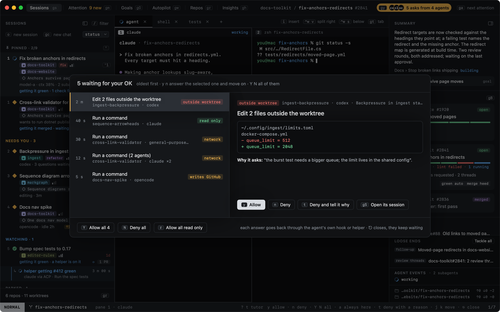
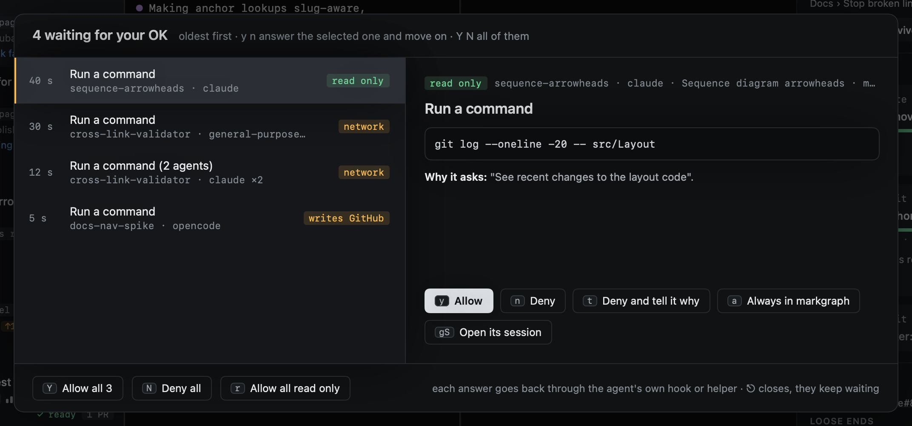
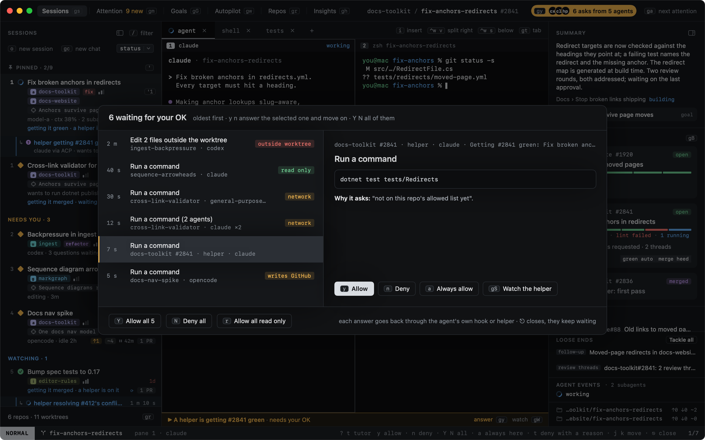
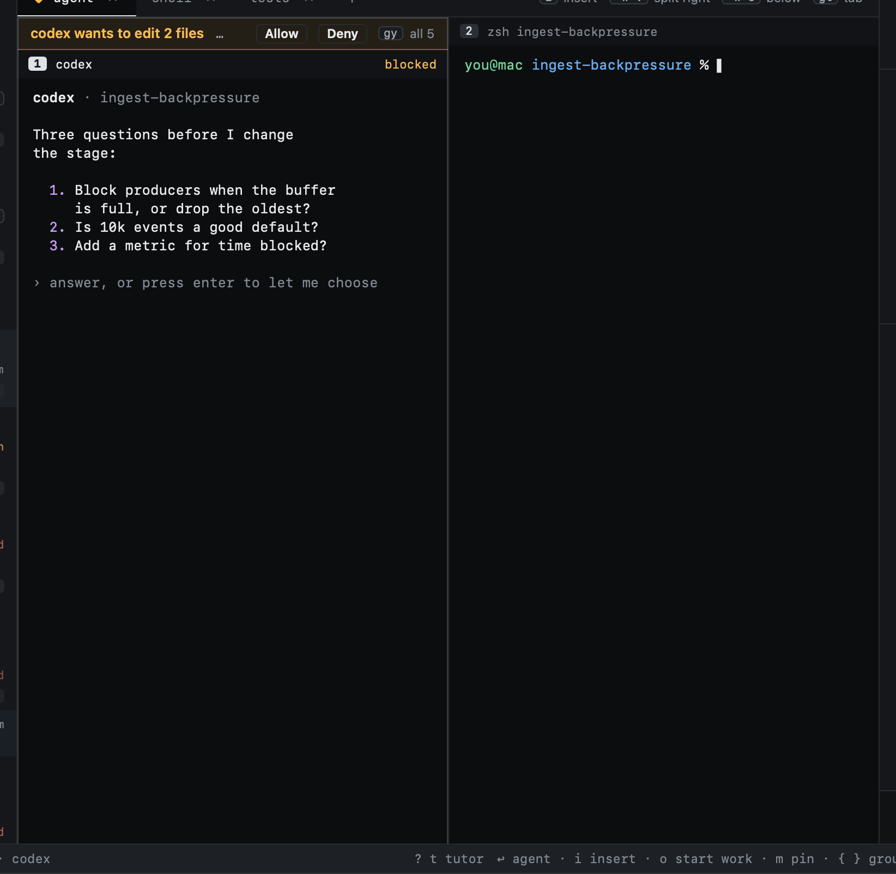

# Approvals

When agents wait on a permission (run a command, edit a file, fetch a page, push a branch), heed gathers the requests
from every session into one place. The title bar shows them as an amber pill, with the agents' initials and how many
are waiting; `gy` opens them.


The list is oldest first, with the first one selected. `y` allows it and `n` denies it; either way the next one is
selected, so pressing `y` again answers the next. `Y` and `N` answer all of them at once.



| Key | What it does |
|---|---|
| `y` | Allow the selected request, then select the next |
| `n` | Deny it, then select the next |
| `Y` | Allow every request heed can answer |
| `N` | Deny every request heed can answer |
| `r` | Allow every read-only request inside its worktree |
| `a` | Allow, and save the agent's own allow rule in this repo (Claude Code, below) |
| `t` | Deny with a reason you type; the agent is told it |
| `gS` | Go to the request's session |
| `j` `k` | Move between requests |
| `⎋` | Close; they keep waiting |

[Helpers](helpers.md) ask here too: what a helper heed started over ACP waits on is a row like any other, its agent
`helper · claude` and its place the PR it works on.

Questions are not approvals. An agent asking you something (Claude's questions and its plan to approve, Codex asking
you to choose) stays **asking** in its session and in Attention › Waiting on you, and never shows here.



## What a request shows

On the right: what the agent would run or change (the command, the files with the patch, the page), where and which
agent, the session, and the agent's permission mode when it says (Claude's `default`, `acceptEdits`, `plan`, `auto`;
Codex's `default`, `acceptEdits`, ...). **Why it asks** is the agent's own reason when it gives one (Codex's approval
reason, a Bash call's description), and says so when the same request was asked before and you said no.

Requests that are exactly the same (the same command from two sessions, say) are one row, "(2 agents)", and one answer
goes to all of them.

Each row has tags, read from the tool and its command. They are kept honest and simple: a tag is only shown when the
words show it.

| Tag | When |
|---|---|
| outside worktree | a file, a `cd`, or an absolute or `~` path that is in none of the session's worktrees |
| writes GitHub | `git push`; `gh pr`, `gh issue`, `gh release`, `gh repo` and others but their `view`, `list`, `diff`, `checks`, `status`; `gh api` with a method other than GET or with fields; GitHub MCP tools that create, update, merge, comment or close |
| network | `curl`, `wget`, `ssh` and the like, `git push`/`pull`/`fetch`/`clone`, any `gh`, package installs, web fetch and search |
| read only | every part of the command (split at `&&`, `\|\|`, `;`, `\|`) is a known reader (`ls`, `cat`, `rg`, `git log`/`status`/`diff`/`show`, `find` without `-delete` or `-exec`, `sed` without `-i`, ...), with no redirect into a file and no `$(...)`; and the Read, Glob and Grep tools |

`r` allows read-only requests only when they are inside their worktree: a read of `~/.ssh` is left for you.

## A helper's asks

A helper asks over ACP (`session/request_permission`), offering its own answers: allow once, allow always, reject.
heed shows the request as the agent describes its tool call (the command, the files with their diffs, the page),
tagged the same way against the helper's worktree, and answers with the option the agent offered: `y` its allow once,
`n` its reject, `a` its allow always (offered only when the agent offers one, under the agent's own name for it).
`Y`, `N` and `r` take helpers' asks with the rest. `t` is not offered: ACP carries no reason with a deny. `gS` opens
the helper in its split.



The helper's split asks the same request: answered in either place, it is answered once, and leaves both. When the
helper's turn is cancelled (you pause, steer or stop it), ends, or its agent goes away, its ask leaves the list.

## On the waiting agent's pane

The waiting agent's pane gets a slim amber strip on top: what it asks, Allow and Deny for this one, and the key for all
of them. Attention › Waiting on you keeps listing the session, and the notification's **Allow** answers the same
request.



## How the answer reaches the agent

heed only answers what you answer: nothing is ever allowed on its own, and every answer goes back to the hook of the
session that asked, on that hook's own connection.

| Agent | How heed answers |
|---|---|
| claude | Its `PermissionRequest` hook waits for your answer and returns it as the hook's decision (allow, or deny with a reason) |
| codex | The same: its `PermissionRequest` hook waits and returns `allow` or `deny` with a reason |
| helpers | Over ACP: the option its agent offered for your answer goes back on the helper's own connection |
| opencode, cursor, pi, gemini | Shown as a request when the session is blocked, but answered in its pane: `y` presses Return there only where heed reads the prompt on screen as one where Return means yes, else its session opens. `n` opens the session; `t` and `a` are not offered |

A hook waits for you at most `[approvals] wait_seconds` (120 by default, at most 240). Then, or when heed is not
running, the agent asks in its own pane as it would without heed; the request stays listed (now answered in the pane)
while the session is blocked. A request also leaves the list as soon as the agent moves on without heed: you answered
it in the pane, its turn ended, or its hook went away. `wait_seconds = 0` keeps every agent asking in its pane.

```toml
[approvals]
wait_seconds = 120
```

### When heed is slow or restarts

A hook never holds its agent up for longer than it says, and never loses an answer you gave:

- heed says it has a request as soon as it is in the list. A hook that hears nothing within 2 seconds (heed is not
  running, or too busy to take it) lets the agent ask in its pane at once.
- Once heed has it, the hook waits for your answer, at most `wait_seconds`, and never past its own limit (290
  seconds, under the agent's 300 second hook timeout), however the reply comes in.
- If the connection drops while it waits (heed restarting, a hiccup), the hook connects again and sends the same
  request for up to 5 seconds. heed keeps each request by its id: the request is not listed twice, an answer you
  already gave goes back at once, and no request is answered twice. A hook that does not come back within that time
  has stopped waiting, and its request leaves the list.
- Many agents asking at once are each answered on their own: a request nobody has answered holds up no other.

When a request goes back to the agent's pane for one of these reasons, heed says why on the pane's strip and on the
request in the list ("heed did not take the request in time", "the hook waited as long as it may", "nobody answered in
heed within wait_seconds"), and the [call log](../reference/call-log.md) records it as a decision from
`approvals.fallback`.

### Always in this repo

`a` allows the request and saves the allow rule Claude Code offered with it (its `permission_suggestions`) to the
project's `.claude/settings.local.json`, where Claude writes it itself: the next identical call is not asked again in
that repo. It is offered only for Claude requests that came with such a rule. Codex takes no rules from a hook (it
refuses one), so `a` is not offered there; neither is it for agents answered in their pane.

## Many agents, and auto modes

Agents in a mode that allows on their own (Claude's `acceptEdits`, `auto` or `bypassPermissions`, Codex with a looser
approval policy) only send what that mode still asks about, so the list holds what is left for you. Its mode is shown
on each request. heed applies no rules of its own: it does not allow anything you did not answer.
