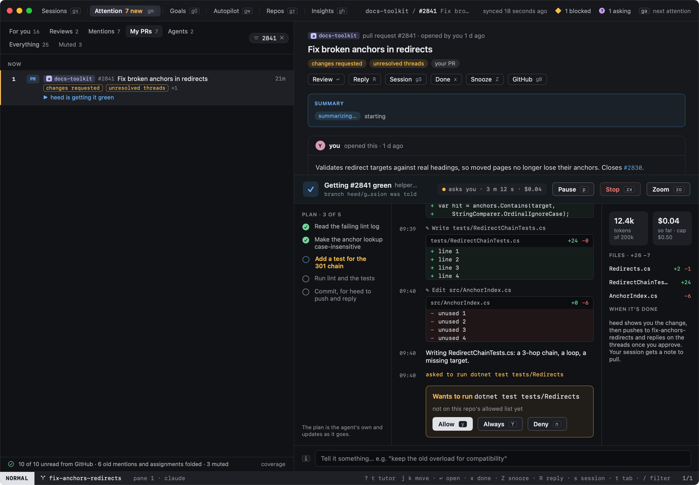
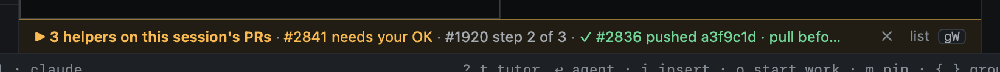
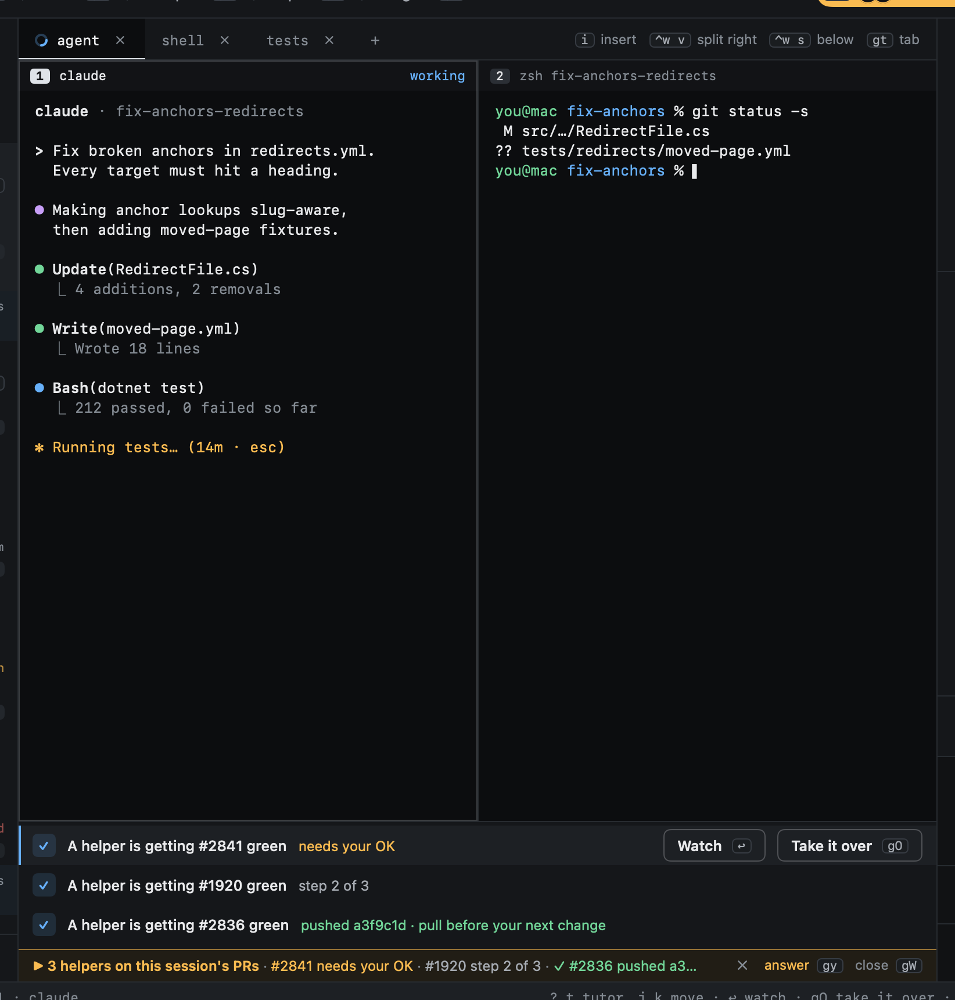
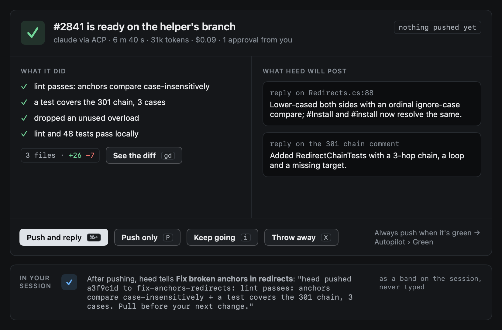

# Helpers

A **helper** is an agent heed starts on your behalf for one PR: to get it green, to resolve its conflict with the
base, or to review someone else's PR for you. It works beside your sessions, never in them: in a worktree of its own,
with nothing typed into your terminal and no tab of its own. heed draws it as it works (its plan, its story with the
diffs it makes, what it asks), you steer it with a line of text, and when it is done heed shows you what it did and
what it will post. Nothing is pushed or posted until you say so, or until the repo's **Always** says so.

Your sessions stay real terminals; helpers are what heed runs itself.

## How heed talks to them

Helpers speak the [Agent Client Protocol](https://agentclientprotocol.com) (ACP), version 1: JSON-RPC over the agent's
standard input and output. heed is the client. It starts the agent in the helper's worktree, opens a session there
(`session/new`), prompts it (`session/prompt`) and draws the `session/update` notifications that stream back: the
agent's messages, its tool calls and their diffs, its plan, and its token use and cost when it reports them. When the
agent asks before running something (`session/request_permission`), heed shows the question in the helper with the
answers the agent offers.

heed offers the agent neither its file system nor terminals: the agent reads, edits and runs commands in its own
worktree itself, and asks heed's permission the way it is set up to. Claude's adapter starts its session in Claude
Code's auto mode unless `permissions.defaultMode` in your Claude settings names another, so a claude helper asks only
what auto mode leaves to you. Files are named relative to the helper's worktree (`src/a.cs`), though the agent reports
them in full.

## Which agent

`[helpers] agent` picks it; unset, your default agent when heed knows an ACP way to it, else claude.

| Agent | What runs | Install |
|---|---|---|
| claude | `claude-agent-acp`, the ACP project's adapter for Claude Code | `npm install -g @agentclientprotocol/claude-agent-acp` |
| codex | `codex-acp`, the ACP project's adapter for Codex | `npm install -g @agentclientprotocol/codex-acp` |
| opencode | `opencode acp` | opencode itself |
| gemini | `gemini --acp` | Gemini CLI itself |

heed never installs an adapter. When the one it needs is not on your login shell's `PATH`, the proposal and Autopilot
say so, with the command to install it. `[helpers] command` replaces the command line, for a path of your own or
`npx -y @agentclientprotocol/claude-agent-acp`. The adapter signs in as the agent does: run the agent once in a
terminal first if it has never been signed in.

```toml
[helpers]
agent = "claude"
# command = "npx -y @agentclientprotocol/claude-agent-acp"
spend_cap = 0.5      # dollars a helper may spend; 0: no cap
```

## What a helper does

- **Where:** a worktree of its own (`<worktree_root>/heed/<repo>/get-it-green-<branch>`) on a branch of its own
  (`heed/get-it-green/<branch>`, `heed/get-it-merged/…` for a conflict, `heed/review/…` for a review), made from the
  PR's branch. Never your worktree. The repo's approved [setup](../worktrees/setup.md) runs in it first.
- **What it is told:** the PR's feedback, as get it green sends it (each failing check with the failed step's log, each
  review comment), or for a review the PR's description and how to read its change; that it works only in its
  worktree, commits but does not push, posts nothing, and ends with a few `heed-` lines saying what it did and the
  replies it drafted. `green_instructions` and `review_instructions` are added as for other runs.
- **How long:** until its turn ends, you stop it, it reaches `[helpers] spend_cap` (from the cost the agent reports;
  an agent that reports none is held to `run_timeout` only), or it runs past `[pilot] run_timeout`.

Get it green runs as helpers by default (`[pilot] run_in = "helper"`). See [Runs](../github/watch.md#runs) for the
other two ways, a background tab or the session's own agent, which stay for agents without an ACP adapter.

## Where you see it

- **Attention:** once you approve heed's next step for a PR, the helper opens in a split under the reader. Its row
  says `▶ heed is on it`, right on its reasons line.
- **Autopilot › Now:** a live tile per helper above the PRs: what it does now, its plan as pips, the files it touched,
  its last tool calls, and what it asks. `h` `l` move between tiles, `↩` opens one in a split.
- **Sessions:** a session tracking the PR gets one line at the foot of its panes, just above the status bar (below).
  A row under the session in the sidebar says the same.



The split: the agent's plan on the left (when it sends one; otherwise it says so), its story in the middle with the
small diffs its edits made and any permission it waits on, and on the right its tokens and cost against the cap, the
files it changed and what happens once it is done. The steer box is at the foot.

| Key | |
|---|---|
| `i` | Tell it something. Typing goes into the box; `↩` sends, `⎋` closes. A turn under way is cancelled and your words start the next |
| `p` | Pause it (its turn is cancelled and it waits), or let it carry on |
| `zx` | Stop it. Its close-out keeps what it did |
| `zo` | Zoom: the split takes the whole column |
| `y`, `Y`, `n` | Allow what it asks once, allow it from now on (when the agent offers that), deny it |
| `⎋` | Close the split; the helper keeps working |

### The session's helper line

However many helpers work on a session's PRs, the session gets one line for them at the foot of its panes. With
one, the line is that helper: *▶ A helper is getting #2841 green · step 3 of 5*. With more, it counts them and says
where each stands, what needs you first, then what works, then what waits:

```
▶ 3 helpers on this session's PRs · #2841 needs your OK · #1920 step 2 of 3 · ✓ #2836 pushed a3f9c1d · pull b…
```



The line is quiet by default and turns amber only when one needs you: it asks permission, or it is done and waits
for your close-out. It lights up briefly when a helper moves to its next step or finishes. A finished helper stays on
the line (*✓ #2841 pushed a3f9c1d · pull before your next change*) until you have seen it: you looked at the session
after it finished (it goes once you leave the session), or you took it off with the ✕ on the line.

| Key | |
|---|---|
| `gW` | With one helper, watch it: the helper in a split under the panes (again hides it). With more, the list of them over the line |
| `gO` | Take it over: the helper the line leads with, or the list's row under the cursor |

In the list, one row per helper: `j` `k` move, `↩` (**Watch**) opens the row's helper in the split, `gO` (**Take it
over**) takes it over, `x` takes a finished one off the line, and `⎋` or `gW` closes the list. A click on a row
watches it.



## Close-out

When its turn ends, the split shows what it did, from its last message and git: the lines it wrote, the files and lines
it changed, and the replies heed will post on the review threads it addressed (for a review, the comments and its
verdict).



| Key | |
|---|---|
| `⌘↩` | **Push and reply:** what it left uncommitted is committed, its branch pushed to the PR's (`git push origin HEAD:<branch>`), then each reply posted on its thread. A review is posted as one review |
| `P` | **Push only**, without the replies |
| `i` | **Keep going:** tell it what else to do, and it takes another turn |
| `X` | **Throw away**, twice: its worktree and branch go, nothing is pushed or posted |
| `gd` | The whole diff |

Once it pushed, your session is told in words: *heed pushed a3f9c1d to fix-anchors-redirects: lint fix + a
301-chain test. Pull before your next change.* The note is always on the session's helper line, and it reaches the
agent through its own [channel](messages.md) when it has one (Claude's inbox, codex's queue). It is never typed: an
agent without a channel gets the line only, and the helper's row in the list (`gW`) says which it was. Either way the
session's events record it. With get it green on **Auto** for the repo (Autopilot's **Always**), heed pushes and
replies as soon as a helper is done and has changed something.

**Take it over** (`gO` on the session) stops the helper and leaves its worktree and branch where they are, and the
session's helper line says where its branch is (`#2841 taken over · heed/get-it-green/… is yours`), and the
session's agent is told how to merge it in.

## What helpers never do

- type into your session, or touch your worktree;
- push, reply or post a review before you approve (or the repo's Always);
- run past their spend cap or `run_timeout`;
- show progress the agent did not report: an adapter that sends no plan, no usage or no diffs shows none.
