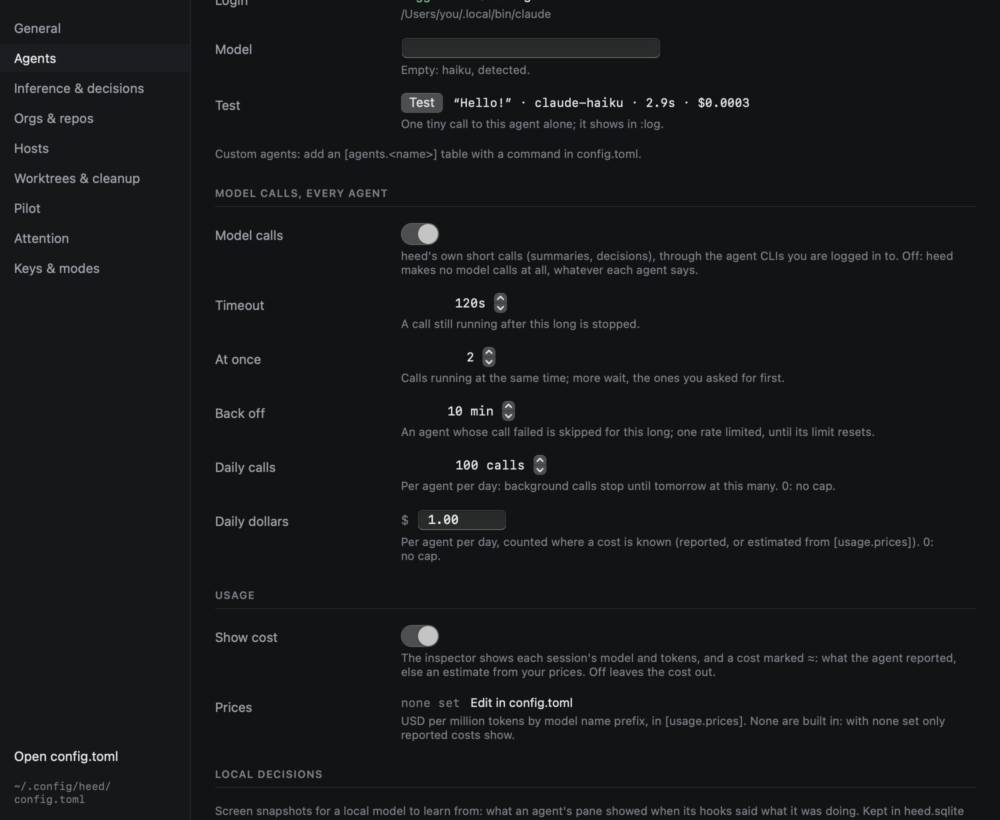

# Heed's own model calls

Some of what Heed does needs a model for a moment: a summary, or a typed answer to a question about a session. Heed
makes those calls itself, headless, through the agent CLIs you already use and are logged in to. There is no API key
to set up and nothing to configure: every built-in agent that is installed and logged in takes part, each with a cheap
model, and they take turns.

| Agent | Login check (free) | Cheap model | Structured answers |
|---|---|---|---|
| claude | `claude auth status` | `haiku` | `--json-schema` |
| codex | `codex login status` | the "fast and affordable" one in `codex debug models` | `--output-schema` |
| gemini | none: a failed call says it | `flash-lite` | read from the reply |
| opencode | `opencode providers list` | the cheapest by `opencode models --verbose`, from a provider with credentials | read from the reply |
| pi | `pi --list-models` | a small one by name (haiku, flash-lite, mini, …) | read from the reply |
| cursor | `cursor-agent status` | a small one by name from `cursor-agent models` | read from the reply |

Custom agents take no part: Heed knows how to call each built-in headless, not an arbitrary command.

## What they are for

- **Summaries**: where a piece of work stands, written from its git history, its pull request, Heed's timeline and the
  agent's last message, and a handoff brief for an agent taking work over. Heed's prompts for them are built in; add
  your own with `summary_instructions` in `[pilot]`, per org or per repo, like the
  [other instructions](../github/watch.md#extra-instructions).
- **Decisions**: typed questions about a session or a PR (pick one of some options, place it on a scale, or how
  likely something is true), answered with probabilities and a confidence. Each one writes a `decide` row in `:log`
  with what it was about, so what you do next can be compared with it. The confidence is the model's own and
  uncalibrated: Heed never takes an action that cannot be undone on it.

Nothing in Heed uses them yet besides the Test button in Settings; the features that will are on their way.

## How a call runs

- In an empty temporary directory, removed afterwards, with the agent's tools off and its session not saved
  (claude: `--tools "" --no-session-persistence --setting-sources ""`, and a short `--system-prompt` of Heed's own;
  codex: `--ephemeral -s read-only`; pi: `--no-session --no-tools`).
- By the agent's executable as Heed found it, the first word of its `command`, without your shell: an alias or a shell
  function of that name does not apply here (in panes it does). When detection does not find it, set
  `[tools] path` or the agent's `command` to where it is.
- With a timeout (`timeout_seconds`), a few at a time (`concurrency`), the calls you asked for before background ones.
- Once: an identical call (the same instructions, input and schema) is answered from a cache while Heed runs.

## Which agent takes a call

The usable agents take turns. An agent is skipped while:

- it is turned off (`[agents.<name>] llm = false`),
- it is rate limited in one of your sessions, until its limit resets when that is known,
- one of its calls failed in the last `backoff_minutes`, or said it hit a limit (until the reset it named),
- it reached its daily cap (`daily_calls`, `daily_dollars`): background calls then wait until tomorrow, while the ones
  you ask for still run,
- it is not installed or not logged in.

Every call writes an `llm` row in the call log (`:log`): which agent took it, the model, the
tokens and cost when known, the prompt and the answer, and why the agents before it were skipped. A call that could not
run at all writes a row saying why, so background work that waits on the cap shows there.

## Settings

Settings › Agents shows, per agent, whether it takes part, whether it is installed and logged in, the model it uses
(empty: the cheap one detected), and a **Test** button: one tiny call to that agent alone, with its answer, how long
it took and what it cost. The test shows in `:log` like any other call.



The same in config.toml:

```toml
[llm]
enabled = true          # false: Heed makes no model calls at all
timeout_seconds = 120
concurrency = 2
backoff_minutes = 10
daily_calls = 100       # per agent per day; 0: no cap
daily_dollars = 1.0     # per agent per day, where a cost is known; 0: no cap

[agents.codex]
llm = false             # leave this agent out
[agents.claude]
llm_model = "sonnet"    # instead of the detected cheap model
```

A cost is known when the agent reports one (claude, opencode, pi) or `[usage.prices]` has a price for the model.
