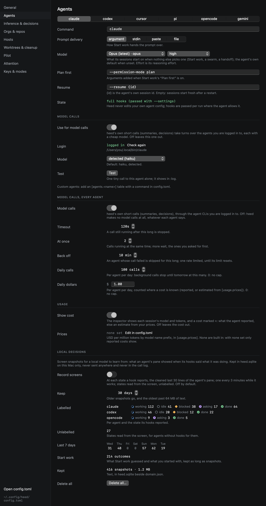
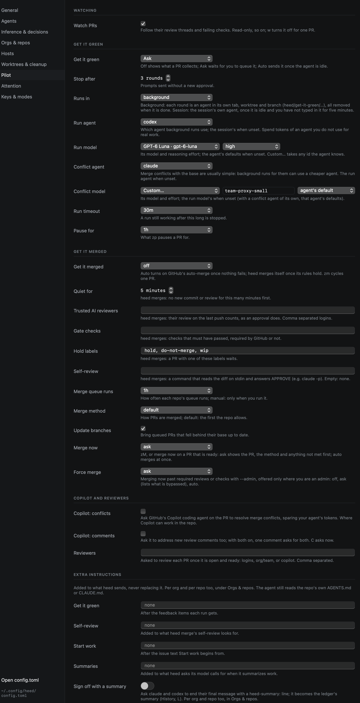

# Models and effort

Wherever Heed lets you choose what an agent runs on, it offers a list rather than a text field: Start work, the swarm
form (the lead and each kind of worker), a handoff (`:agent.switch`), Settings › Agents (each agent's own model and
effort, and the model for Heed's [model calls](model-calls.md)), Settings › Inference & decisions, Settings › Pilot
(the get it green run and the merge-conflict run) and Settings › Orgs & repos (the same, per org and repo).

Each list starts with **the agent's default** (nothing is passed, so the agent uses its own, or the model and effort
set for it below), then the models Heed knows for that agent, newest first, by name and id, then **Custom…**, which
takes any other id the agent accepts. A custom id cannot be empty or contain spaces. Beside the model, an effort list
appears for agents that take a reasoning effort at launch, with that model's levels; it is hidden for the others.



## What each agent takes

| Agent | Model | Effort | Levels |
|---|---|---|---|
| claude | `--model` (aliases `fable`, `opus`, `sonnet`, `haiku`, or a full id) | `--effort` | low, medium, high, xhigh, max (Opus and Sonnet 4.6 without xhigh, Haiku 4.5 none) |
| codex | `--model` | `-c model_reasoning_effort=<level>` | per model: low, medium, high, xhigh, max, ultra |
| pi | `--model` (`provider/id`) | `--thinking` | off, minimal, low, medium, high, xhigh, max |
| opencode | `--model` (`provider/model`) | none: `--variant` is for `opencode run`, not the TUI Heed starts | |
| cursor | `--model` | none: effort is part of the model's id (`…-high`) | |
| gemini | `--model` (`auto`, `pro`, `flash`, `flash-lite`, or a full id) | none | |

The models and levels were taken from each CLI's `--help` and the vendors' model documentation, checked on
2026-10-29; the source of each list is in the picker's tooltip. Where a CLI lists its own models (codex
`debug models`, opencode `models`, pi `--list-models`, cursor-agent `models`), Heed reads that list when it checks the
agents for [model calls](model-calls.md) (at launch, when config.toml changes, and on **Check again**), for agents
that are installed and not logged out, and puts what it finds first (at most 30), with the models it knew of after
them. codex's list carries each model's own effort levels and default.

## An agent's own model and effort

Settings › Agents › **Model** sets what an agent's sessions start on when nothing more specific picks one: a session
from Start work left on the default, a handoff without a model, a swarm task whose owner names none, a get it green
run without `[pilot] model`. In config.toml:

```toml
[agents.claude]
model = "opus"       # empty or absent: the agent's own default
effort = "high"      # its reasoning effort
```

A custom agent takes a model and an effort when it says how: `model_flag` and `effort_flag` (a flag the level
follows, or arguments with `{level}` in them). See [Custom agents](custom-agents.md).


