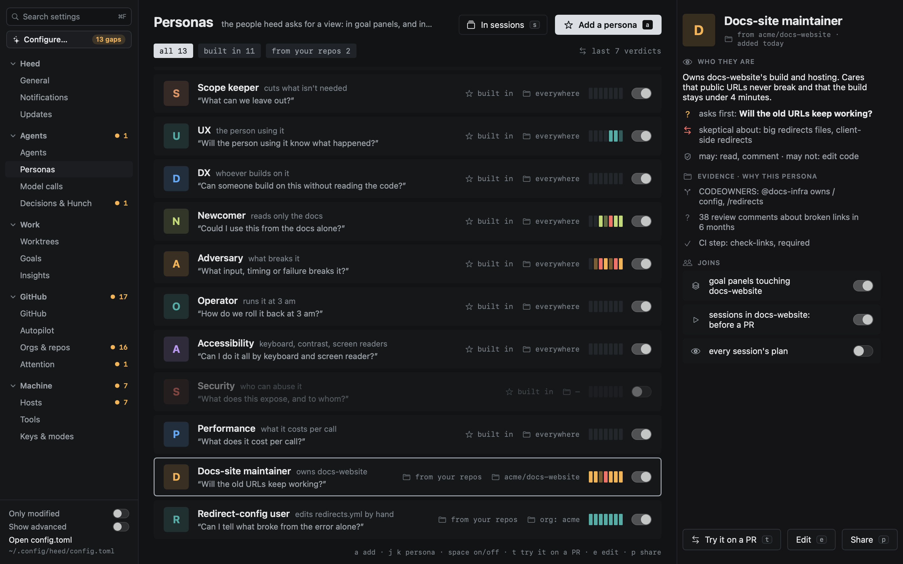
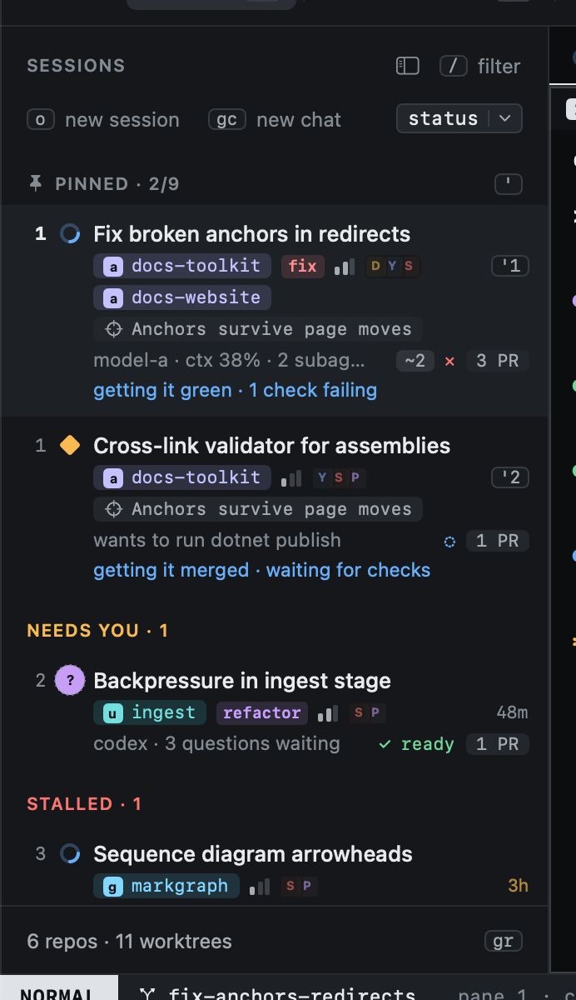
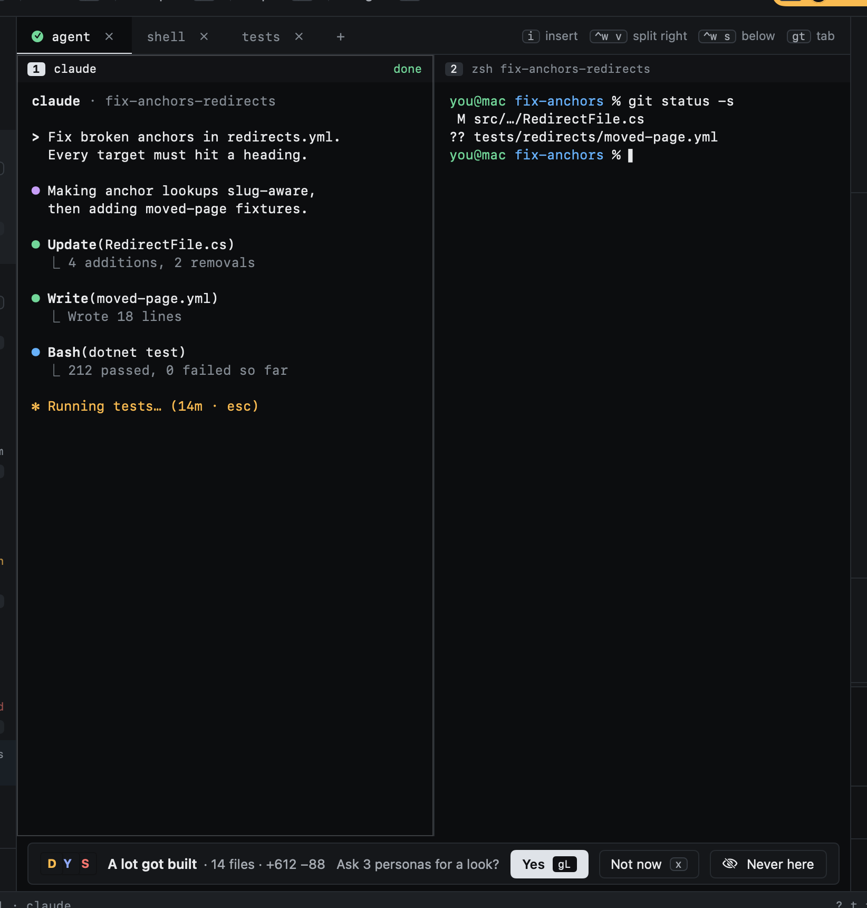
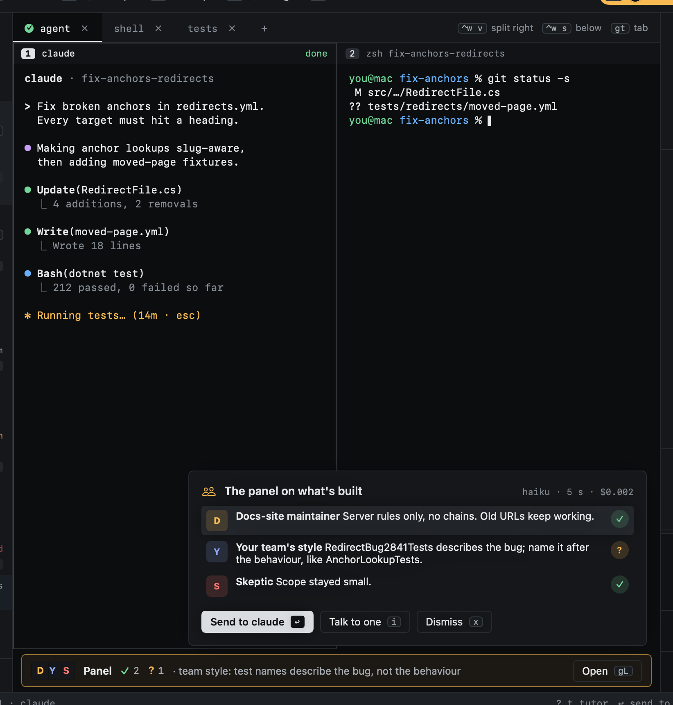
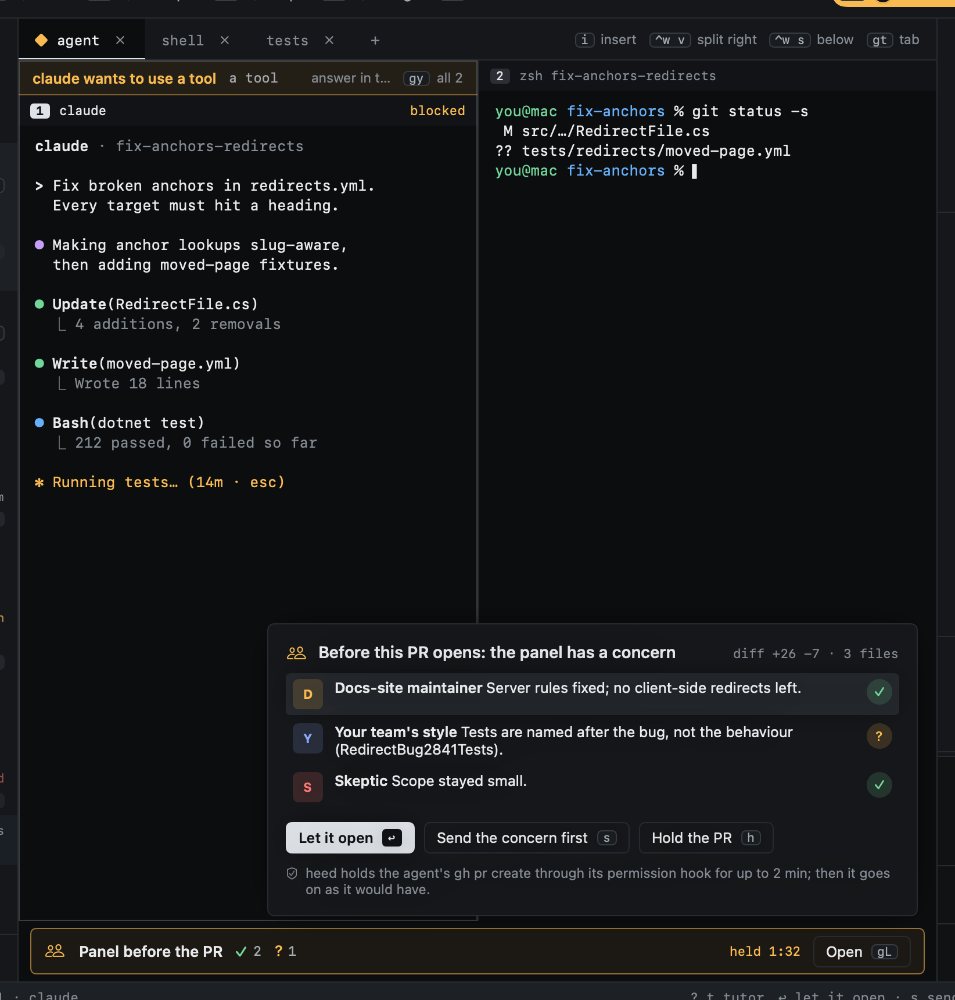
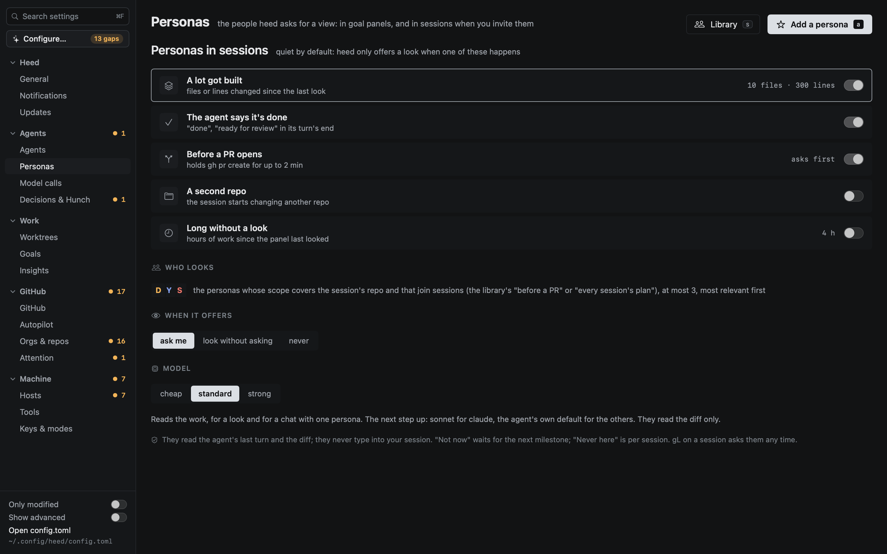
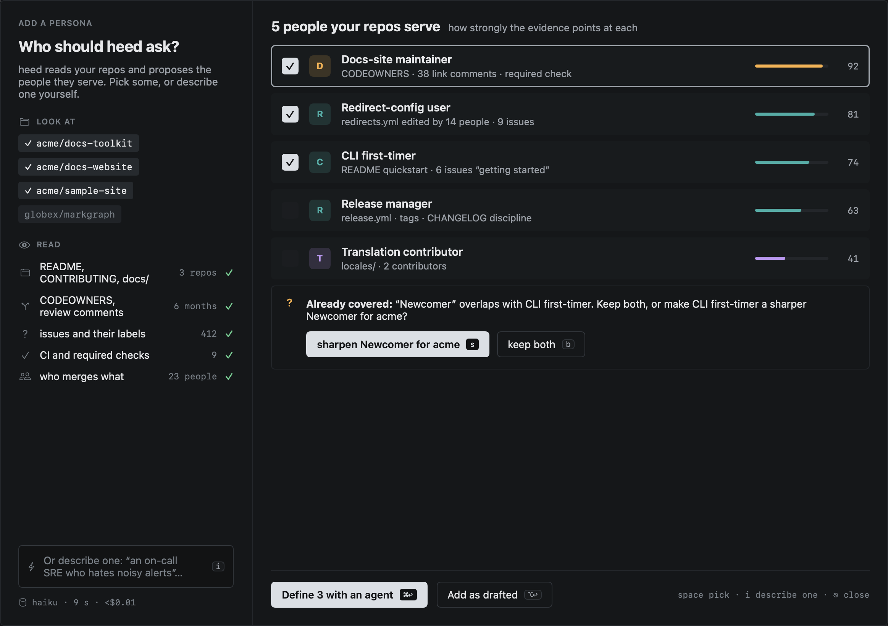
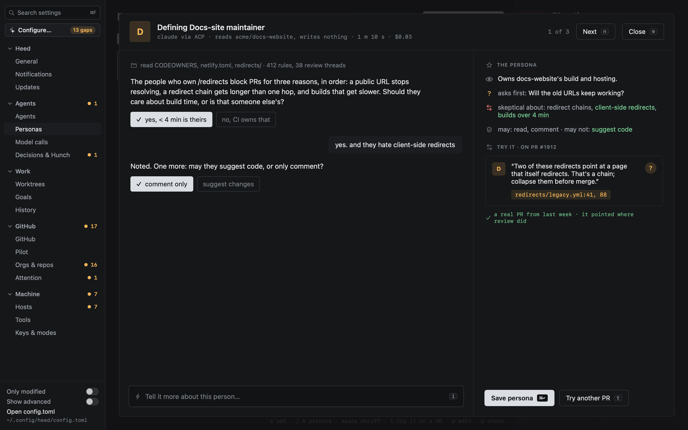

# Personas

A **persona** is a kind of person heed asks for a view: the Skeptic who argues not to do it, the newcomer who only
reads the docs, the maintainer who owns your docs site. **Settings › Personas** is the one library of them. Goal
panels ([the new-goal wizard](../goals/index.md)'s step 2) seat their personas from it, Goals'
[persona pane](../goals/personas.md) copies from it, and the personas that join sessions look at a session's work at its
milestones ([In sessions](#in-sessions)). `:personas.open` (or
`:settings.open personas`) opens it.



## The list

Every row is one persona:

| Part | What it says |
|---|---|
| Tile | Its letter, in its tint: the same tint wherever heed draws it |
| Name and who | The persona, and who it is in a few words |
| The quote | The question it asks first |
| Source | A star for built in, a folder for from your repos, a bolt for learned, a person for yours |
| Scope | Where it applies: everywhere, `org: acme`, or one repo (`acme/docs-website`) |
| Bars | Its last seven verdicts on goal panels, newest right: its tint for happy, dimmed for a concern, red for not; empty slots until a panel has read a plan with it |
| Switch | On or off. Off, it stays in the library and nothing asks it |

The built-ins are heed's panel personas: Skeptic, Purist, Scope keeper, UX, DX, Newcomer, Adversary, Operator,
Accessibility, Security and Performance. They are always in the library. Turn one off, or edit it, and heed writes
its file in the library saying so; your version is the one panels seat. The chips over the list filter by source.

**Your team's style** shows only when the library has one: a persona whose source is `learned`, or one named "team
style". heed does not learn one on its own yet, so it is there only when you add it.

## The persona under the cursor

The right side says who they are, what they ask first, what they are skeptical about and what they may and may not do;
the **evidence**, why this persona (for one from your repos: the CODEOWNERS line, the review comments, the required
check that pointed at it); and what it **joins** on its own:

| Join | What it does |
|---|---|
| goal panels touching its scope | It sits on the panel of every goal whose repos are in its scope, with the built-ins the plan invites |
| sessions in its scope: before a PR | It may look at sessions in its scope ([In sessions](#in-sessions)), first in line before a PR opens |
| every session's plan | It may look at sessions in its scope, at every milestone |

| Key | Does |
|---|---|
| `j` `k` | The persona below or above |
| `␣` | Turn it on or off |
| `t` | **Try it on a PR**: a cheap model call reads a recent merged PR in its scope (its diff, through `gh pr diff`) as this persona and shows its verdict, its quote and the lines it points at; when review commented on the same files, it says so, else it shows what review actually said. `t` again tries the next PR |
| `e` | Edit its file in place; `e` again, `⎋` or `⌘S` saves |
| `p` | Share: its file on the pasteboard, to send to a teammate for their library |
| `a` | Add a persona |
| `s` | In sessions: when personas look at sessions (`s` or `⎋` back to the library) |

The keys work while Personas shows in the Settings window; they are bound in `[keys.personas]`.

## In sessions

Personas look at a session's work only when something happened that is worth a look, and never type into the session.
While the agent works, the only sign of them is a faint stack of tiles on the session's sidebar row: up to three
personas whose scope covers its repos and that join sessions (**before a PR** or **every session's plan**), the most
relevant first (a repo's before an org's before everywhere, then learned and from your repos before yours and heed's).
Out of the box the Skeptic and the Purist join sessions (before a PR and every session's plan), so a fresh library has
someone to offer; heed's other built-ins join goal panels only. It is a default, not a file: their **Joins** switches
show it, and turning one off writes the built-in's file saying so. An offer only asks: nothing is called until you
say yes.



At a **milestone**, a line at the foot of the session's panes offers a look: the tiles, what happened, and "Ask 3
personas for a look?".



| Milestone | When | Default |
|---|---|---|
| A lot got built | Files or lines changed since the last look pass `built_files` (10) or `built_lines` (300), from the sizes heed measures for open sessions | On |
| The agent says it's done | Its turn ends on "done", "ready for review", "I think this part is done" (and does not ask you something) | On |
| Before a PR opens | The agent's `gh pr create` (or GitHub's MCP tool), seen through its [permission hook](approvals.md) | On |
| A second repo | The session starts changing a repo it had not | Off |
| Long without a look | `long_hours` (4) of work since the panel last looked | Off |

Each milestone is offered once. **Yes** (`gL`) asks them; **Not now** (`x` while the line shows) lets the offer go,
and milestones count again from there, so the next one offers again; **Never here** (`N`) ends offers in this session
(you can still ask). The line stacks with the [helpers' line](../sessions/sidebar.md) and the growing-into-a-goal line,
most urgent first: a held PR or a verdict with a concern goes above a working helper; an offer waits under it.

**The look** is one cheap model call for every persona at once, as a goal panel's is: they read the session's task,
the agent's last message and its diff against its base (bounded: every file keeps its header and a share of the
room), and each gives a verdict (happy ✓, a concern ?, against ⇄), one line, and a fix when not happy. The line
becomes the verdict: the counts and the top concern in a few words. `gL` opens it:



| Key | Does |
|---|---|
| `j` `k` | The persona below or above |
| `↩` | **Send to the agent**: the concerns and their fixes, through the agent's [inbox](messages.md) (typed only when it has none, under the usual rules) |
| `i` | **Talk to one**: a small chat with the persona under the cursor (`i` types, `⎋` closes) |
| `x` | Dismiss the verdict |
| `⎋` | Close |

**Before a PR opens**, heed holds the agent's `gh pr create` in its permission hook for up to `hold_seconds` (120)
while the panel looks. Everyone happy, it goes on at once to the [approvals](approvals.md), as it would have. A
concern, and the line turns amber with how long it is held; `gL` shows what they said:



| Key | Does |
|---|---|
| `↩` | **Let it open**: the hook allows this one `gh pr create` |
| `s` | **Send the concern first**: the hook says no, with the concerns as the reason, and the agent addresses them before it tries again |
| `h` | **Hold the PR**: the hook says no, and the agent is told to wait for you |

Nobody choosing within the hold, it goes on to the approvals as it would have: heed never opens or blocks a PR on
its own. The hold only applies when the agent asks permission for the command: a `gh pr create` your agent is
allowed to run without asking never reaches the hook.

**Asking by hand**: `gL` on a session with nothing offered asks now. Right-click a session (or the Session menu) for
**Ask the panel…**: the relevant personas, or only one of those in scope. With nobody joining sessions in its scope (the
Skeptic and the Purist switched off), asking still gets the Skeptic (and your team's style when heed has one).

**Settings › Personas › In sessions** (`s` on the library) has the milestones' switches and thresholds, who looks,
and when it offers: **ask me** (the line), **look without asking**, or **never**. `j` `k` move over the milestones,
`␣` turns one on or off.



```toml
[personas]
built = true
built_files = 10
built_lines = 300
says_done = true
before_pr = true
hold_seconds = 120     # at most 180
second_repo = false
long = false
long_hours = 4
offers = "ask"         # "ask", "look" or "never"
```

## Where a persona applies

A persona's scope walls it in. One from `acme`'s repos is never offered to work in another org: a goal panel seats it
only when the goal's repos are in its scope, Goals' `:persona.use` only offers library personas on and in scope for
the goal, and a goal's derivation copies a library file only when it is. A persona with no scope applies everywhere.
heed proposes a persona only within the repos it read, so one drawn from an org's repos is scoped to that org or one
of its repos, never everywhere.

## Add a persona

`a` opens **Add a persona**. heed picks up to three repos of the org you work in most (the session under the cursor's
org, if any) and starts reading; click a repo to read it too or leave it out (one org at a time).



For each repo heed reads, with `gh` and the checkout: README, CONTRIBUTING and `docs/`; CODEOWNERS and the last
hundred review comments; issues and their labels; the required checks and CI workflows; and who merged the last forty
PRs, in which folders. The left side counts each. All of it goes into a compact digest (at most 12,000 characters,
each section cut to a few lines) that one cheap model call reads, through heed's [model calls](model-calls.md). It
proposes the people the repos serve, each with its evidence and a strength from 0 to 100: how strongly the evidence
points at them. A proposal without evidence is dropped; at most six show, strongest first, and the ones at 70 or more
start picked.

When a proposal says the same as a persona you have (the model names it, or most of the words in who it is and what it
asks first are the same), heed asks: **sharpen** that one (`s`: the proposal becomes, say, "Newcomer for acme", which
takes the Newcomer's seat on acme's panels) or **keep both** (`b`).

| Key | Does |
|---|---|
| `␣` | Pick or unpick the proposal under the cursor |
| `i` | Describe one in your words ("an on-call SRE who hates noisy alerts"); heed drafts it and picks it |
| `r` | Read again |
| `⌘↩` | Define the picked with an agent |
| `⌥↩` | Add the picked as drafted |
| `⎋` | Close |

## Define with an agent

`⌘↩` opens one session per picked persona, over [ACP](helpers.md) with your helpers' agent, in the persona's repo. It
reads and writes nothing: reading and searching go ahead, anything else is refused, as when defining a goal's part.
It asks what it cannot tell from the repo, one question at a time with two or three answers (`1` `2` `3`, or `i` to
type one), and builds the persona on the right as you go: what it added or changed since the proposal is marked.



`t` tries the persona as it stands on a recent merged PR, as on the list. `n` goes to the next picked persona, `⌘↩`
saves this one into the library and goes on, `⎋` closes without saving.

## The file

A library persona is a plain file, `~/Library/Application Support/Heed/personas/<name>.md`, in the same format as a
goal's [persona files](../goals/personas.md#the-personas-file), with a few more lines, each written only when it is not
the default (so an older file reads and saves as it was):

```text
name: Docs-site maintainer
skeptical about: big redirects files, client-side redirects
asks first: Will the old URLs keep working?
may: read, comment
may not: edit code
who: owns docs-website
about: Owns docs-website's build and hosting. Cares that public URLs never break.
scope: repo acme/docs-website
joins: goal panels, before a PR
source: repos
added: 2026-11-11
evidence:
- CODEOWNERS: @docs-infra owns /config, /redirects
- CI step: check-links, required
```

`on: no` turns it off; `sharpens: newcomer` makes it a built-in's sharper version within its scope.
