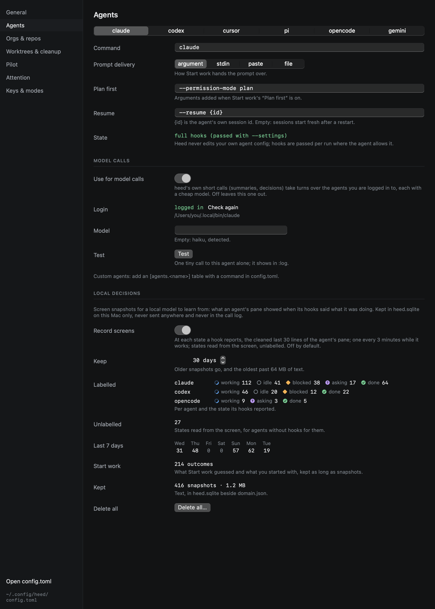

# Screen snapshots

Heed can keep a short record of what an agent's pane showed whenever its hooks said what it was doing. These snapshots
are examples for a local model, still to come, that will learn to tell from the screen alone when an agent is waiting
on you. That matters most for agents with no hook for it (gemini, a plain shell). The hooks provide the labels, so you
label nothing yourself.

Recording is **off by default**. Turn it on in **Settings › Agents › Local decisions**, or in `config.toml`:

```toml
[local]
record_screens = true
keep_days = 30
```



## What is kept

Each snapshot is one row with:

| Field | What it holds |
|---|---|
| Text | The last 30 lines of the agent's pane as plain text. Colors and other escape codes, box borders, spinners and progress glyphs are taken out, and runs of blank lines become one |
| Agent | `claude`, `codex`, … |
| State | The state the snapshot is labelled with: working, asking, blocked, idle, done, and so on |
| Previous state | The state before the change; empty for a sample taken while working |
| Source | `reported`: the agent's hooks reported the change (a label). `sampled`: taken while the hooks said working. `guessed`: the state was [read from the screen](screen-reading.md), not reported, so it is kept unlabelled |
| Time, session | When, and which session (to keep one session's snapshots together) |
| Remote | Whether the session runs on a [host](../hosts/index.md) |

Snapshots are taken:

- **At each state change an agent's hooks report**, a second after the hook fires so the screen shows what was
  reported. The snapshot is skipped if the state has changed again by then.
- **While the hooks say working**, at most one every three minutes. These show what working looks like, next to the
  waiting states.
- **At states read from the screen**, unlabelled, at most one a minute per session.

Nothing else is kept: no input you typed (beyond what the screen shows), no files, and no environment.

## Where, and for how long

Snapshots are kept in a table of `~/Library/Application Support/Heed/heed.sqlite` on this Mac. They are never sent
anywhere, never go into a model call, and are never written to the [call log](../reference/call-log.md). Snapshots
older than `keep_days` (30 by default) are deleted, and so are the oldest ones once the text kept passes 64 MB.
Turning recording off stops new snapshots. What is already kept stays until it ages out, or until you delete it.

Settings shows what is kept: labelled snapshots per agent and state, the unlabelled count, the last seven days and the
size. **Delete all** removes every snapshot after you confirm.

A screen can show anything that was in the terminal, including secrets an agent printed. They stay on this Mac with
the rest of Heed's data, but keep that in mind before you copy `heed.sqlite` anywhere.

## Start work outcomes

Each time work starts from [Start work](../start-work/index.md), Heed also keeps a row with what it guessed and what
you started with: the prompt, the guessed repo, branch name and prefix, whether the on-device model's
[smart guesses](../start-work/repos.md#smart-guesses) were part of it, and the repos, name, prefix, agent and
plan-first you chose. A local model can learn better guesses from them later. Nothing learns from them yet.

They are kept in the same `heed.sqlite`, on this Mac only, and deleted after `keep_days` like snapshots. They are kept
whether or not `record_screens` is on, since your prompts are already part of your sessions and history. Settings ›
Agents › Local decisions shows how many are kept. **Delete all** removes snapshots only.
