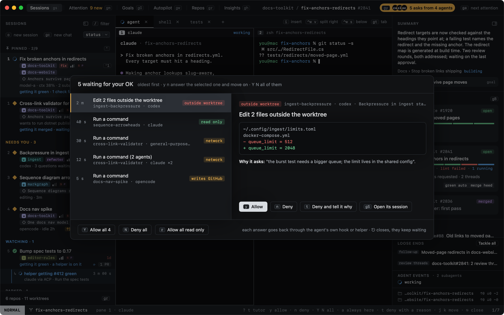
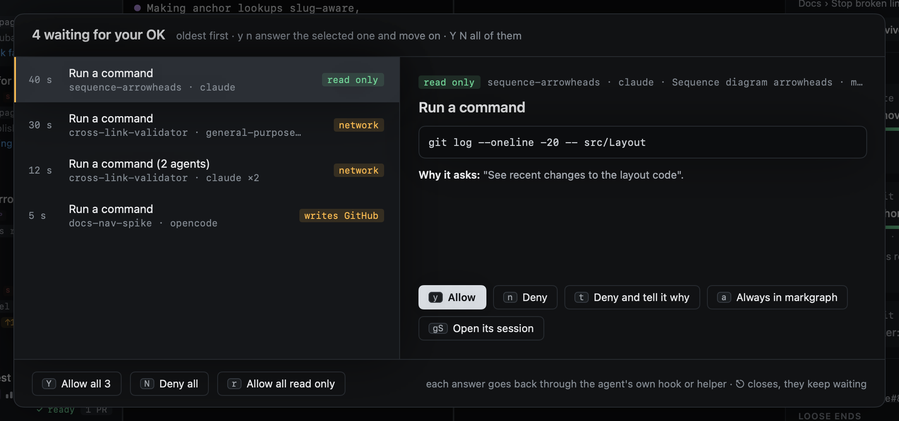
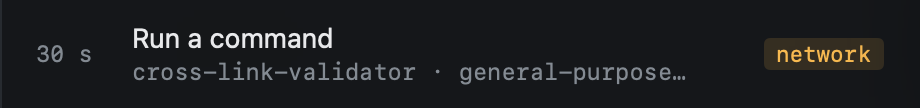
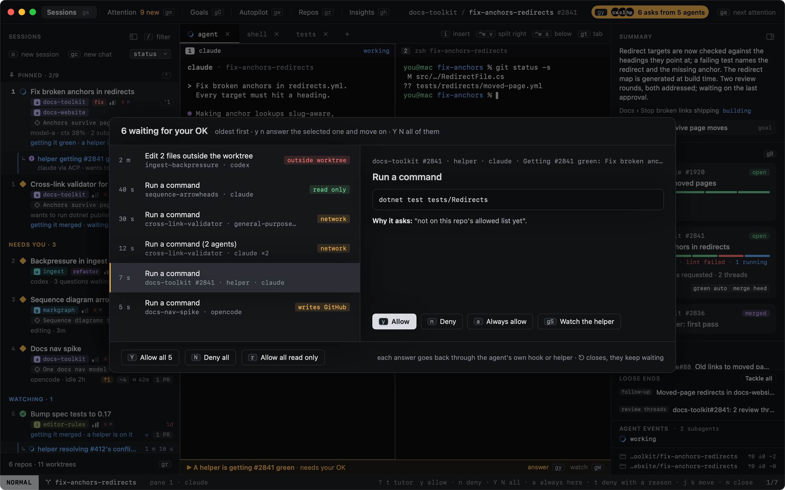
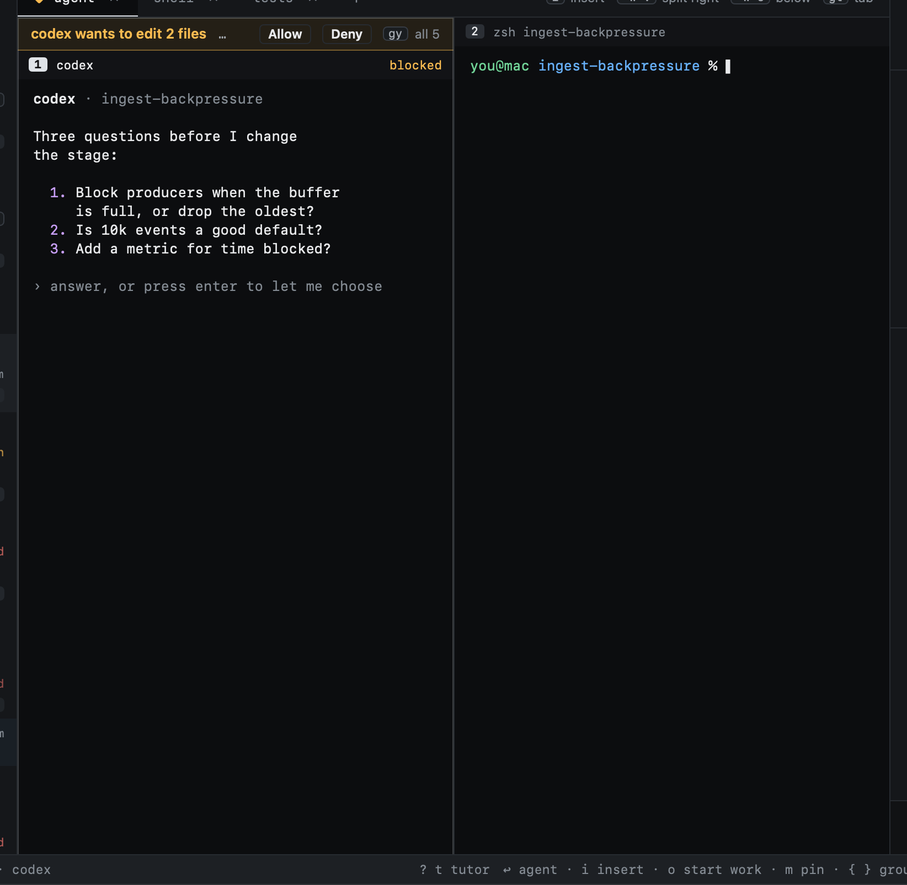

# Approvals

Agents wait on permissions to run a command, edit a file, fetch a page or push a branch. heed gathers the requests
from every session into one place. The title bar shows them as an amber pill, with the agents' initials and how many
are waiting; `gy` opens them.


The list is oldest first, with the oldest request selected. `y` allows the request and `n` denies it. Either way heed
selects the next request, so pressing `y` again answers that request. `Y` and `N` answer all requests at once.



| Key | What it does |
|---|---|
| `y` | Allow the selected request, then select the next |
| `n` | Deny the selected request, then select the next |
| `Y` | Allow every request heed can answer |
| `N` | Deny every request heed can answer |
| `r` | Allow every read-only request inside its worktree |
| `a` | Allow, and save the agent's own allow rule in this repo (Claude Code, below) |
| `t` | Deny with a reason you type; the agent is told it |
| `gS` | Go to the request's session |
| `j` `k` | Move between requests |
| `⎋` | Close; they keep waiting |

[Helpers](helpers.md) ask here too. A request from a helper that heed started over ACP is a row like any other. Its
agent reads `helper · claude` and its place is the PR the helper works on.

Questions are not approvals. When an agent asks you something (Claude's questions and its plan to approve, Codex asking
you to choose), its session stays **asking** and appears in Attention › Waiting on you. The question never shows here.



## What a request shows

On the right, the request shows what the agent would run or change (the command, the files with the patch, the page). It also shows where the request runs, which agent asks, the session, and the agent's permission mode when the agent
reports one (Claude's `default`, `acceptEdits`, `plan`, `auto`; Codex's `default`, `acceptEdits`, ...). **Why it asks** is the agent's own reason when it gives one (Codex's approval
reason, a Bash call's description). It also says so when you denied the same request before.

Identical requests (the same command from two sessions, say) are one row, "(2 agents)", and your one answer
goes to every agent in the row.



Each row has tags, which heed reads from the tool and its command. heed keeps the tags honest and simple: it shows a tag
only when the words show it.

| Tag | When |
|---|---|
| publishes | a release, publish or deploy: `npm`/`pnpm`/`yarn`/`bun publish`, `cargo publish`, `dotnet nuget push`, `gem push`, `twine upload`, `poetry`/`uv publish`, `swift package-registry publish`, `gh release create`/`upload`/`edit`, `gh workflow run`, `git push --tags` or a tag ref, `docker`/`podman push`, `fly deploy`, `vercel deploy` or `--prod`, `netlify deploy`, `kubectl apply`/`rollout`, `helm upgrade`/`install`, `terraform apply`, `brew bump-*`, and a task named `release`, `publish` or `deploy` (`mise run release`, `npm run publish`, `make deploy`) |
| outside worktree | a file, a `cd`, an absolute or `~` path, or a relative one that climbs out (`../x`), that is in none of the session's worktrees |
| writes GitHub | `git push`; `gh pr`, `gh issue`, `gh release`, `gh repo` and others but their `view`, `list`, `diff`, `checks`, `status`; `gh api` with a method other than GET or with fields; GitHub MCP tools that create, update, merge, comment or close |
| network | `curl`, `wget`, `ssh` and the like, `git push`/`pull`/`fetch`/`clone`, any `gh`, package installs, web fetch and search |
| read only | every part of the command (split at `&&`, `\|\|`, `;`, `\|`) is a known reader (`ls`, `cat`, `rg`, `git log`/`status`/`diff`/`show`, `find` without `-delete` or `-exec`, `sed` without `-i`, ...), with no redirect into a file and no `$(...)`; and the Read, Glob and Grep tools |

heed gives read only only when it understands every word. These are never read only: a command that another command runs
(`env`, `xargs`, `sudo`, `time`, `timeout`, `nice`, `nohup`, `watch`), a script in quotes (`sh -c '...'`, `bash -c`,
`eval`), `less` and `more`, a variable set in front (`PAGER=... git log`; a locale or `TZ` is fine), and a program run by
its path outside the system's folders. The options of a reader that write or run something are never read only either: `awk` with
`system(`, a pipe, `>` or `getline`; `rg --pre`; `fd -x`; `find -exec`, `-delete` or `-fprint`; `sort -o`;
`git diff --output` or `--ext-diff`, and `git -c`; `sed -i`, `sed -f`, or a `w` or `e` command. The tags of a
command that another command runs still count: `sudo npm publish` publishes.

`r` allows read-only requests only when they stay inside their worktree. heed leaves a read of `~/.ssh` for you.

## A helper's asks

A helper asks over ACP (`session/request_permission`) and offers its own answers: allow once, allow always, reject.
heed shows the request as the agent describes its tool call (the command, the files with their diffs, the page).
heed tags the request the same way against the helper's worktree. heed answers with the option the agent offered: `y` sends its allow once,
`n` its reject, and `a` its allow always (offered only when the agent offers one, under the agent's own name for it).
`Y`, `N` and `r` take helpers' asks along with the rest. `t` is not offered: ACP carries no reason with a deny. `gS` opens
the helper in its split.



The helper's split shows the same request. You answer it once, in either place, and it leaves both. The ask leaves the list when the
helper's turn ends, when you cancel the turn (you pause, steer or stop the helper), or when the helper's agent goes away.

## On the waiting agent's pane

The waiting agent's pane gets a slim amber strip on top. The strip shows what the agent asks, Allow and Deny for this request, and the key for all
requests. Attention › Waiting on you keeps listing the session, and the notification's **Allow** answers the same
request.



## How the answer reaches the agent

heed only sends the answers you give, and allows nothing on its own. Every answer goes back to the hook of the
session that asked, on that hook's own connection.

| Agent | How heed answers |
|---|---|
| claude | Its `PermissionRequest` hook waits for your answer and returns it as the hook's decision (allow, or deny with a reason) |
| codex | The same: its `PermissionRequest` hook waits and returns `allow` or `deny` with a reason |
| helpers | Over ACP: the option its agent offered for your answer goes back on the helper's own connection |
| opencode, cursor, pi, gemini | Shown as a request when the session is blocked, but answered in its pane: `y` presses Return there only where heed reads the prompt on screen as one where Return means yes, else its session opens. `n` opens the session; `t` and `a` are not offered |

A hook waits for you at most `[approvals] wait_seconds` (120 by default, at most 240). After that wait, or when heed is not
running, the agent asks in its own pane as it would without heed. The request stays listed (now answered in the pane)
while the session is blocked. A request also leaves the list as soon as the agent moves on without heed. That happens when you answer
in the pane, when the agent's turn ends, or when its hook goes away. `wait_seconds = 0` keeps every agent asking in its pane.

```toml
[approvals]
wait_seconds = 120
```

### When heed is slow or restarts

A hook never holds its agent up for longer than it says, and never loses an answer you gave:

- heed says it has a request as soon as it is in the list. A hook that hears nothing within 2 seconds lets the agent ask in its pane at once. That
  happens when heed is not running or is too busy to take the request.
- Once heed has the request, the hook waits for your answer, at most `wait_seconds`, and never past its own limit (290
  seconds, under the agent's 300 second hook timeout), however the reply comes in.
- If the connection drops while the hook waits (heed restarting, a hiccup), the hook connects again and sends the same
  request for up to 5 seconds. heed keeps each request by its id. The request is not listed twice, an answer you
  already gave goes back at once, and no request is answered twice. A hook that does not come back within 5 seconds
  has stopped waiting, and its request leaves the list.
- heed answers many agents asking at once on their own. A request nobody has answered holds up no other request.

When a request goes back to the agent's pane for one of these reasons, heed says why on the pane's strip and on the
request in the list ("heed did not take the request in time", "the hook waited as long as it may", "nobody answered in
heed within wait_seconds"), and the [call log](../reference/call-log.md) records it as a decision from
`approvals.fallback`.

### Always in this repo

`a` allows the request and saves the allow rule that Claude Code offered with it (its `permission_suggestions`) to the
project's `.claude/settings.local.json`, where Claude writes it itself. The next identical call is not asked again in
that repo. heed offers `a` only for Claude requests that came with such a rule. Codex takes no rules from a hook (it
refuses one), so heed does not offer `a` there, nor for agents answered in their pane.

A request tagged **publishes** never offers `a`, from a hook or a helper: each release, publish or deploy is asked,
and `y` allows that one.

## Many agents, and auto modes

Agents in a mode that allows on their own (Claude's `acceptEdits`, `auto` or `bypassPermissions`, Codex with a looser
approval policy) only send what that mode still asks about, so the list holds what is left for you. heed shows the agent's mode
on each request. heed applies no rules of its own and allows nothing you did not answer.
