# Get it green and merged

heed watches the PRs your sessions track. It follows their checks and reviews and sends what holds a PR back to its
agent (**green**). Once a PR is green, heed merges it (**merge**). [Autopilot](index.md)'s **Now** (`gw` then `N`) shows
the PRs as heed works on them. This page explains how each part works and how you set it.

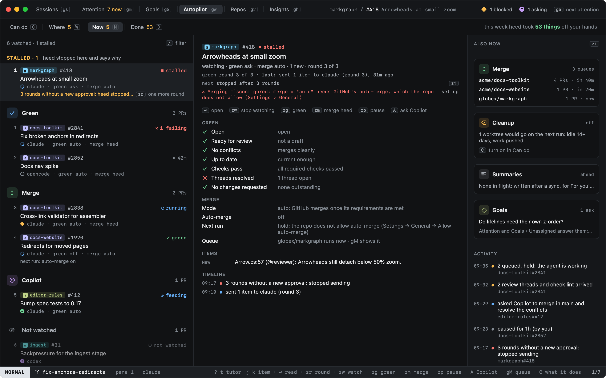

- **Left**, the PRs by card, stalled first: *Stalled* (out of rounds: see below, or feedback with no session to send it
  to), *Green* (being fixed, with the rounds used), *Merge* (merging on, and what the next run does), *Copilot* (asked)
  and *Not watched*. Autopilot's Done lists merged and closed PRs. `{` `}` jump between cards.
- **Middle**, the PR under the cursor: one line on where the PR stands, its **green** checklist, its open items, and its
  **timeline**, which lists everything heed noticed and did for the PR.
- **Right**, the **merge queues** with when each runs next, what cleanup, summaries and goals are doing, and the
  **activity** across all PRs, newest first (`zi` hides the pane).

## Green

A PR is **green** when GitHub has nothing left to object to in the code. The middle pane lists each rule with what heed
found, and `z?` (`:pilot.why`) lists the rules for the PR you are on (see [What heed will do](#what-heed-will-do)):

| Rule | Holds when |
|---|---|
| Open | not merged or closed |
| Ready for review | not a draft |
| No conflicts | the PR merges cleanly into its base |
| Up to date | not behind the base, when the repo requires branches to be current |
| Checks pass | every required check passed (every check, when the repo requires none) |
| Threads resolved | no review thread is open |
| No changes requested | no reviewer is waiting on changes |

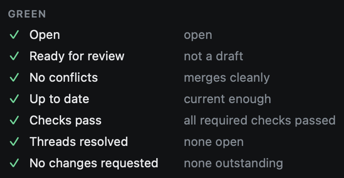

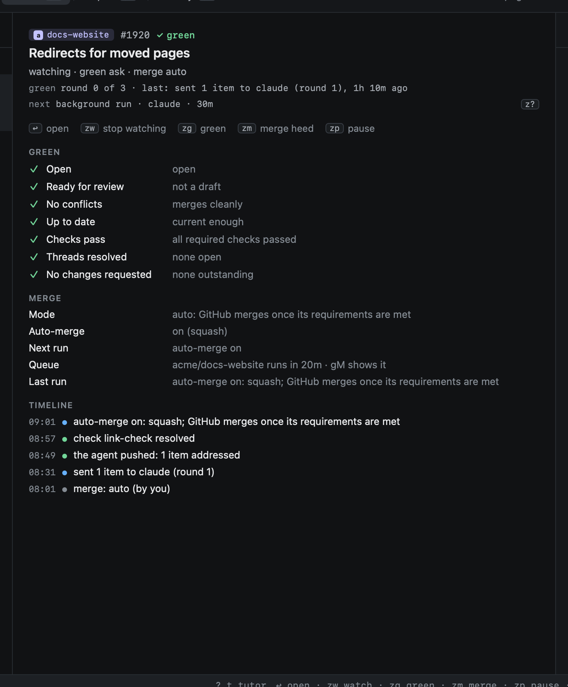

heed sends what holds a PR back to its agent as an item, the same way it sends review comments. The items are a failing check and a conflict
("rebase on main, resolve the conflicts, run the tests and push"). For a failed GitHub Actions check, heed saves the
failed step's log and the prompt points the agent at the file. The agent then reads the error rather than just "lint failed".

### Copilot does the work

heed can send merge conflicts and review comments to GitHub's Copilot coding agent instead of your session's agent. The
work then spends Copilot's budget rather than your agent's tokens. Two options, off by default, also set per org and per repo:

- `copilot_conflicts`: a PR that conflicts with its base.
- `copilot_comments`: new review comments from people who can write to the repo (see
  [Who wrote it](../github/review-feedback.md#who-wrote-it)); `C` asks about the others too.

With get it green on (`ask` or `auto`), heed asks on the PR, once per conflict and per comment. When both have
something, one comment asks for both:

> @copilot Please merge in main and resolve the conflicts, then address these review comments:
>
> 1. `RedirectFile.cs:88` (@reviewer): Anchor lookup is case sensitive.
>
> Make sure the build and tests still pass.

Copilot works in its own environment and pushes to the PR's branch. What heed asked Copilot shows as sent, so your agent does
not get the same items as well. Pull in your session's worktree before its agent pushes again. `A` in Now (`C` in the PR
overlay) asks Copilot about the PR you are on, both kinds, whatever the options say.

heed asks only where Copilot can work. heed checks that the repo lists Copilot among those an issue can be assigned to.
That is the case when the Copilot coding agent is on for the repo (any paid Copilot plan; on Business and Enterprise an
admin enables it). Elsewhere the work goes to your agent as before. Failing checks stay with your agent. A branch
that is merely behind belongs to the [merge queue](#get-it-merged).

### Reviewers

`reviewers` names who heed asks to review a PR once it is open and not a draft: logins, teams (`org/team`), and
`copilot` for Copilot code review. heed asks each reviewer once per PR, never the PR's author. `zv` (`:pilot.reviewers`) asks now.

## Three levels

Each PR has three levels, and each level needs the one before it:

| Level | Off | On |
|---|---|---|
| **Watch** | only the PR's summary from the regular sync | heed follows it: fetches its review threads and checks as they change, and shows its state everywhere |
| **Green** | items are shown, nothing is sent | `ask`: you queue items to send; `auto`: they go to the agent once it is idle (see [review feedback](../github/review-feedback.md)) |
| **Merge** | nothing is merged | `auto`: heed turns on GitHub's auto-merge, and GitHub merges once its requirements are met; `heed`: heed merges once [its rules](#heed-merges) hold (see [below](#get-it-merged)) |

Watching only reads from GitHub, so watching is on by default.

## Get it merged

`zm` cycles merging for a PR: off, `auto`, `heed` (and turns watching on with it). Each repo with such PRs has a **merge queue**. A run of the
queue goes through the queue's PRs, oldest first:

| The PR | A run |
|---|---|
| is green | turns GitHub's auto-merge on, with the repo's merge method |
| waits on something GitHub itself requires (a required check, a required review) | turns auto-merge on: GitHub merges once that arrives |
| waits on something GitHub does not hold it for | waits: auto-merge there would merge at once, with checks still running |
| fell behind its base | brings the PR up to date (`update_branches`) |
| fails a green rule | holds the PR, and turns auto-merge off if it was on: GitHub might merge what the rule catches |
| is paused | holds the PR |
| is a swarm's PR whose task waits for one not merged yet | holds the PR, and turns auto-merge off if it was on |

A swarm's PRs go through in the swarm's merge order instead, in the places they hold among the other PRs
([Landing](../goals/swarms/landing.md)).

GitHub does the merging, so the repo has to allow auto-merge (Settings ▸ General ▸ Allow auto-merge). The queue says so
when the repo does not. heed merges only PRs your sessions track.

A queue runs every hour (`merge_schedule`), when merging is turned on, when one of its PRs turns green, and after one of
its PRs merges, so heed brings the other PRs up to date. `R` in Now runs the PR's queue now, and `:merge.run all` runs
every queue. `gM` shows the PR's queue in the middle: its PRs with what the next run does to each, and every run with
what the run did. `gM` again, or moving the cursor, goes back to the PR.

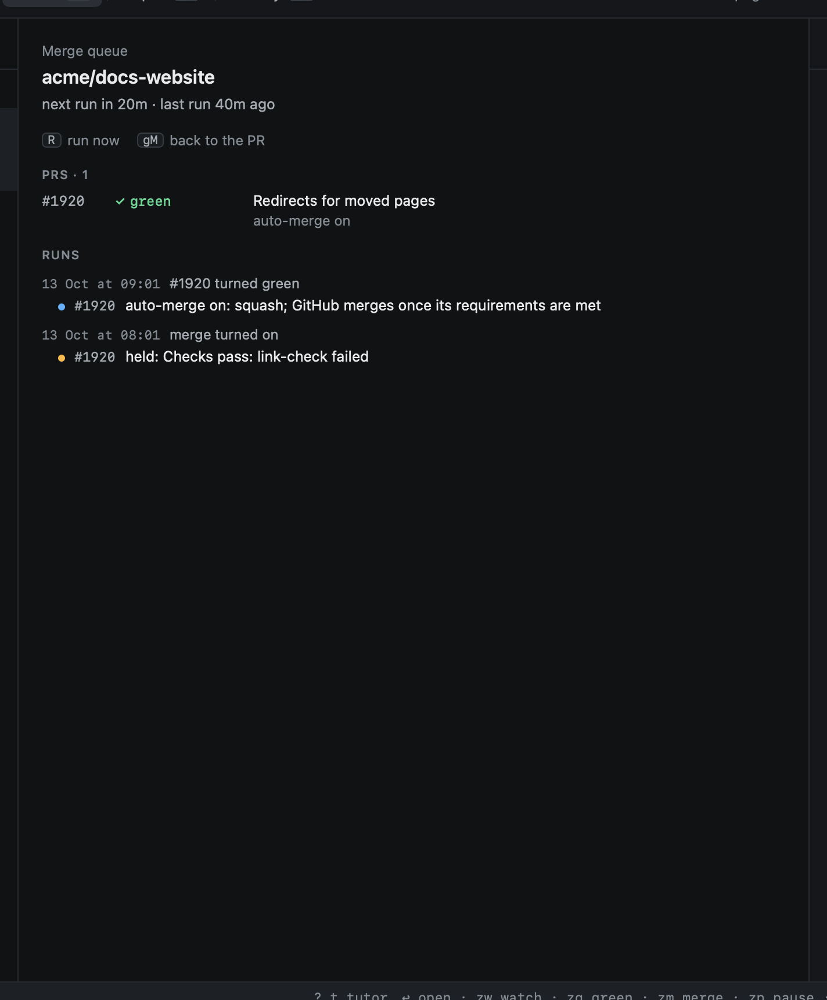

### heed merges

With `merge = "heed"`, heed does not hand the PR to GitHub's auto-merge (it turns auto-merge off if it is on). heed merges the PR itself,
once every rule holds. A run checks the rules again on the PR as it is then, and merges only that head commit
(`--match-head-commit`). A push in between holds the PR for the next run.

| Rule | Holds when |
|---|---|
| Green | every [green rule](#green) holds |
| Reviewed after push | a human approved the head commit, or a trusted AI reviewer reviewed it (below) |
| Quiet | no new commit or review for `quiet_minutes` (5) |
| Gate checks | every check named in `gate_checks` passed on the head commit, required by GitHub or not |
| No hold label | none of `hold_labels` (`hold`, `do-not-merge`, `wip`) is on the PR |
| Self-review | with `self_review` set: the command approved the diff of the head commit |

A **trusted AI reviewer** (`trusted_reviewers`, e.g. `copilot-pull-request-reviewer`) counts as a review of the head
commit in three cases. The reviewer approved the commit, or left a comment review none of whose threads is still open. Otherwise the reviewer left no review
at all, but its review check, named in `gate_checks`, passed on that commit.

The **self-review** is a command you choose, such as `claude -p`. heed passes the command a prompt with the PR's
description and diff (`gh pr diff`, nothing is checked out) on stdin, in an empty folder of its own. For `claude` heed
turns the agent's tools off (`--tools '' --strict-mcp-config`), and for `pi` too (`--no-tools`); a command that names
`--tools` itself, and any other command, runs as written. The first line of the answer, with markdown such as `**` or
`#` trimmed, must be exactly `APPROVE` to merge. `REQUEST_CHANGES: <why>` holds the PR with that reason, and any other
line holds the PR as a refusal that quotes the line. The self-review runs last, once every other rule holds, and once
per head commit.

After merging, heed comments on the PR with each rule and what heed found. When GitHub refuses the merge (branch
protection), heed holds the PR with GitHub's reason. `admin_merge = true` under `[repos."org/name"]`, and only there, retries
with `--admin`.

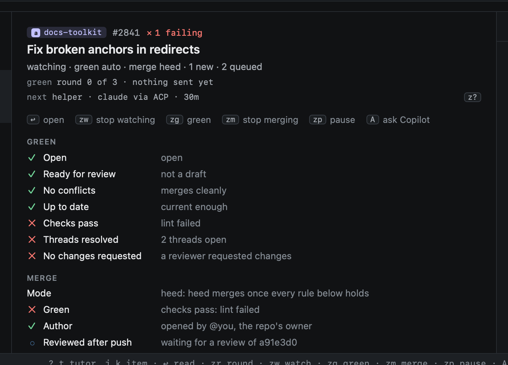

### Ready to merge, and merge now

With merging off, heed still checks whether a PR it has fetched could be merged. The PR must be open, not a draft, with no conflicts, up to
date when the repo requires it, its required checks passed, approved (or no review required), nothing else blocking it
on GitHub, no open threads, none of `hold_labels`, quiet for `quiet_minutes`, and GitHub's auto-merge not already on.
When every condition holds, the PR's card, its sidebar row and the PRs view say **Ready to merge**, and the PR shows in
[Attention](../github/attention.md) as *ready to merge*. You have two actions from there, by key or by click:

- **merge now** (`zM`, `:pilot.merge.now`): `gh pr merge` with the PR's method, on the head commit heed checked.
  `merge_now = "ask"` (the default) first shows the PR, the method and anything not met, and `"auto"` merges at once. Merge now
  works on any open PR GitHub would take. heed names its own waits (quiet, open threads, auto-merge on) and skips them.
- **set up merging**: Settings › Orgs & repos on the PR's repo, where `merge` and the rules above are set.

Sometimes the unmet condition is something GitHub enforces (a required review, a required check, being up to date). If you are an
admin of the repo, merge now then offers a **force merge** with `--admin` instead. `force_merge = "ask"` (the default) lists
exactly what heed bypasses first, `"auto"` does not ask, and `"off"` never offers a force merge. heed never bypasses a draft, conflicts or a hold label.
`admin_merge` is separate: it applies only to heed's own merges with `merge = "heed"`.

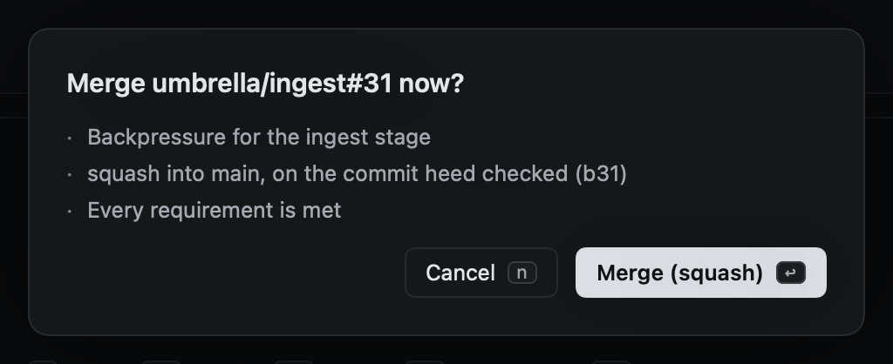

### Merging misconfigured

heed works out ahead of time whether a repo's merge settings can work, from what heed already fetches about the repo.
The misconfigurations are `merge = "auto"` where the repo does not allow auto-merge, a `merge_method` the repo does not allow, merge commits where
the base branch requires linear history, and `admin_merge` where you are not an admin. A PR in such a repo says
**Merging misconfigured** with the reason, instead of heed holding the PR at the next run.

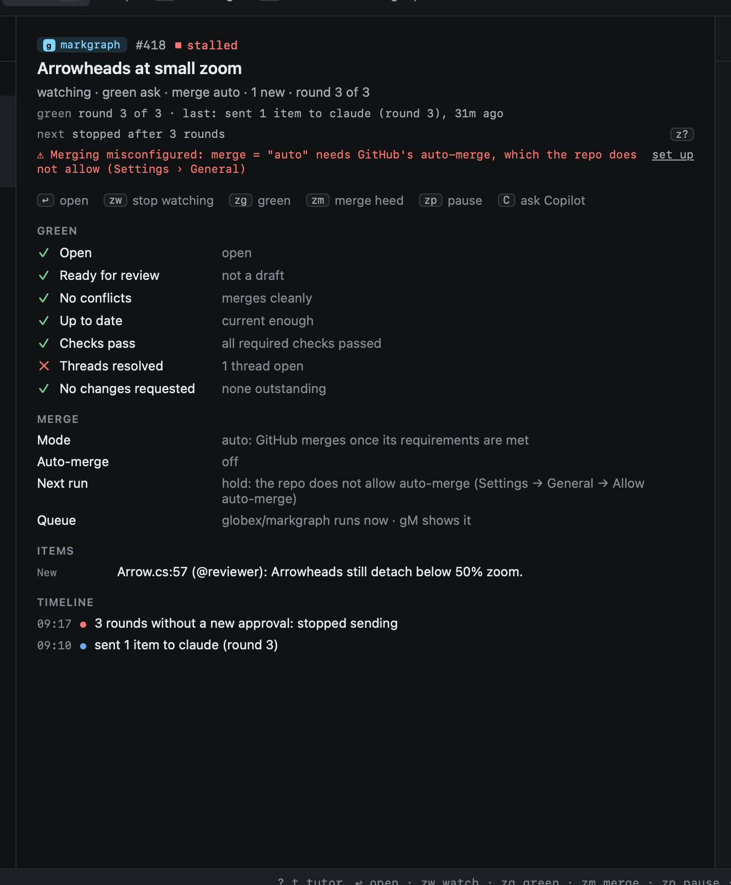

## What heed will do

Settings come from three levels and a choice made on the PR, so the next round is not always plain.
Every PR card, in the inspector and in Now's middle pane, says the next round in one line under the pilot's:

- `next  helper · claude via ACP · 30m`: a [helper](helpers.md) (the default), with the agent the helper runs
  over ACP and how long the helper may work.
- `next  background run · codex · 30m · 1 instruction`: a [run](#in-a-background-tab-instead) of its own, with the agent and model heed
  starts, how long the run may work, and how many lines of `green_instructions` the run gets.
- `next  conflict run · …`: the PR conflicts with its base, so the round takes `merge_agent` and `merge_model`.
- `next  typed into the session's claude`: `run_in = "session"`.
- `next  Copilot is asked to resolve the conflicts`: `copilot_conflicts`.
- `next  no rounds (green off) · GitHub's auto-merge, once its requirements are met`: get it green is off and merging
  is on, so heed sends no round but still merges the PR.
- `next  nothing: get it green is off`, `paused until 14:00`, `stopped after 3 rounds`: these say why heed sends no round.

Above that line, `green  round 1 of 3 · last: sent 2 items to claude (round 1), 31m ago` says how far get it green is and what
heed sent last. The pilot's line itself names both modes, `watching · green ask · merge off`.

Hover the line to see each setting behind it and where its value comes from: `default`, `org <name>`, `repo`, or
`this PR` for a choice made with `zw`, `zg` or `zm`.

`z?` (`:pilot.why`), or a click on its key cap, opens the whole picture for the PR you are on. In Now and the PRs view that is the PR under the cursor,
in the PR overlay it is the overlay's PR, and in Sessions it is the session's first PR. The picture has one row each for **Watching**, **Get it green**, **A
round**, **Conflicts** and **Get it merged**: Each row shows the value, what the value means for this PR now, and on the right where it comes
from, amber when it is not the default. Below the rows, **what holds it back** lists the green rules and, with
`merge = "heed"`, heed's merge rules, failures first (✕), then what is still pending (·), then what passes (✓).
`j` `k` scroll the picture, and ⎋ closes it.

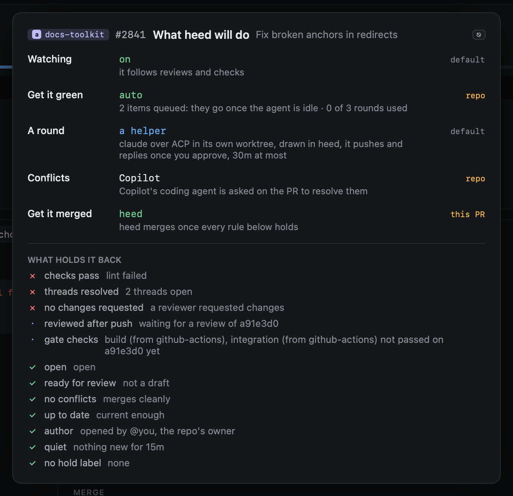

## Keys

| Key | |
|---|---|
| `↩` | Read the PR ([PR overlay](../github/review-feedback.md)) |
| `zw` | Watch or stop watching |
| `zg` | Cycle green: off, ask, auto |
| `zm` | Cycle merging: off, auto, heed |
| `zM` | Merge now (force merge with `--admin` where you are an admin and GitHub's requirements are unmet) |
| `A` | Ask Copilot to resolve the PR's merge conflicts and address its review comments (`C` in the PR overlay) |
| `zr` | Another round for a stalled PR |
| `zp` | Pause or resume |
| `z?` | What heed will do for the PR, and what holds it back |
| `zv` | Ask the PR's reviewers now |
| `gb` | Go to the session's running run |
| `zx` | Stop the session's running run |
| `v` | Select several, then `zp` pauses or resumes them all |
| `r` | Sync now |
| `R` | Run the PR's merge queue now |
| `gM` | Show the PR's merge queue |

The pilot keys are the same everywhere. In Now, the PRs view and the PR overlay they act on that PR, and in
Sessions they act on every PR the session tracks. A choice made with the keys sticks to that PR. PRs you
never set follow the settings.

## Runs

Get it green never types into your session's agent. By default each round goes to a [helper](helpers.md). A round starts when heed sends on its own with
`green = "auto"`, when you press `zg` with items queued, or when you press `D` on the PR in Attention. The helper is an
agent heed starts over ACP in a worktree of its own. heed draws the helper in Attention under the reader, in Autopilot › Now
as a live tile, and under the session's panes with `gW`. The helper pushes and replies only once you approve its close-out.
Each PR has one helper at a time, and heed sends what queues meanwhile once you close out the helper. heed tells the session tracking the PR on a
line at the foot of its panes and never types into the session.

### In a background tab instead

`run_in = "background"` (per org and repo too, or **Runs in** on the Autopilot page) keeps the way rounds ran before
helpers, for an agent that heed has no ACP adapter for. Each round is a **run** in the background:

- **Where:** a worktree of its own (`<worktree_root>/heed/<repo>/get-it-green-<branch>`) on a branch of its own,
  `heed/get-it-green/<branch>`, tracking the PR's. Conflicts with the base get `heed/get-it-merged/…`.
- **Which agent:** the agent that `[pilot] agent` names, on `[pilot] model` and `effort` (all per org and repo too), or the
  session's agent when unset. You can spend the tokens of an agent you don't use for real work. Settings picks the
  model and effort from the agent's [list](../agents/models.md), or a custom id.
- **Conflicts:** a get it merged run (conflicts with the base) takes `merge_agent`, `merge_model` and `merge_effort`
  when set. Merging is usually simple work, so a cheaper agent or model often does it. Unset, the run uses the run agent,
  model and effort.
- **What it's told:** to fix what is listed, commit, and push to the PR with `git push origin
  HEAD:<branch>`.
- **The tab:** heed appends the tab next to the session's own and names it **get it green** (or **get it merged**). The tab never takes your
  focus. Its glyph in the tab strip is the run's state, and `gb` (`:pilot.run`) goes to the tab. `zx` (`:pilot.run.stop`)
  stops the run, as closing its tab does.

While the run works, it shows in three places: a row under its session in the sidebar (the goal and PR, how long, its agent
and the last line of its screen), a box on the PR's card in the inspector (also with the round and the key to its tab),
and the PR's line in Now (`a codex run is on it (4m)`). Clicking the row or the box goes to its tab.

When the run's agent finishes its turn (or exits, or runs past `run_timeout`), the run ends at once:

1. heed keeps the run's last screen;
2. heed records what the run did: pushed N commits, no changes, timed out, or stopped (you closed its tab, or `zx`);
3. heed removes the run's tab, worktree and `heed/…` branch;
4. heed brings your session's worktree up to what the run pushed, when the worktree has no changes of its own.

The next failing check or review starts a fresh run. Each PR has one run at a time, and rounds still count
toward `max_rounds`. A run that asks something, or is blocked on a permission, puts its session in Needs you.

The inspector lists the session's runs, newest first. Click a run to read what it did and its last screen. Clicking a running
run takes you to its tab.

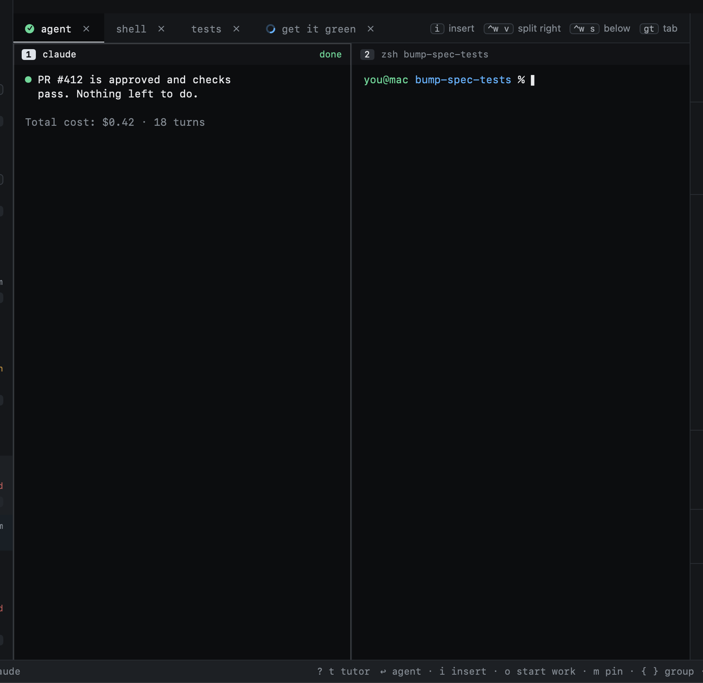

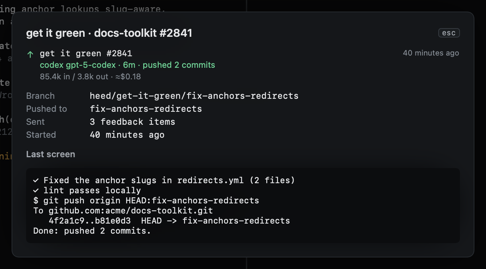

### In the session instead

`run_in = "session"` (per org and repo too, or **Runs in** on the Autopilot page) sends each round to the session's own
agent instead, as one prompt typed into its pane. heed waits until that agent is idle or done, and never sends while the agent works,
is blocked or asks. heed also waits until you have not typed in the pane for five minutes (20 seconds after `zg`). A Claude session gets
the prompt through its [inbox](../agents/messages.md) instead, which holds the prompt until the agent can read it. The five minutes
still apply. heed makes no worktree, branch or
tab. Use this mode where a fresh worktree gets in the way, such as an agent that asks to trust every new folder.

heed sends nothing for a PR once the PR is merged or closed, in either mode.

### Leftovers

If heed quits mid-run, or a removal fails, a `heed/…` branch and its worktree can be left behind. Every cleanup
(and launch) removes them when it's safe: no uncommitted changes, and nothing that isn't on the PR's
branch. Otherwise heed keeps them and says why. From a terminal, `heed cleanup runs` does the same in the repo you are
in, and also skips anything git touched in the last hour. Since every run branch starts with `heed/`, a script can
find them too:

```sh
git for-each-ref --format='%(refname:short)' 'refs/heads/heed/'
```

## Stalled

Get it green sends up to `max_rounds` prompts (3) without a new approval. Then get it green stops, and the PR is **stalled**.
A stalled PR shows first in Now and in its own group in the sidebar, in red, with how many rounds it used.

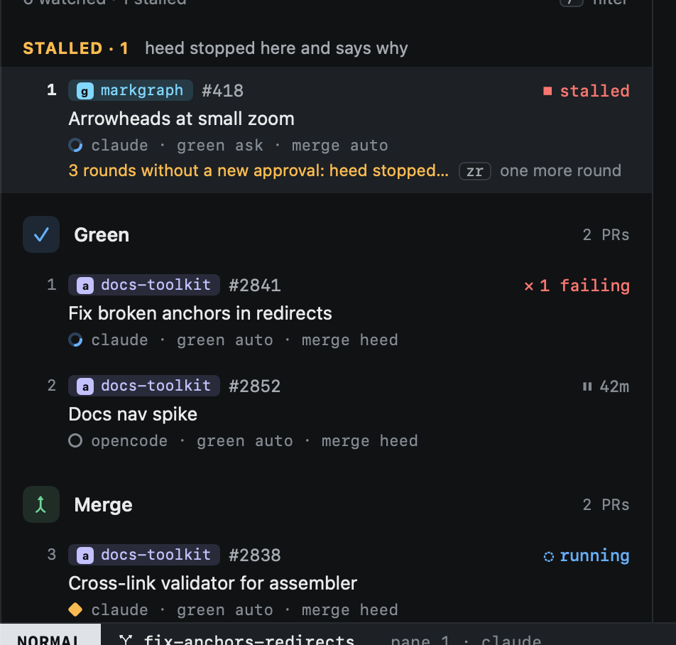

A new approval starts the count again. `zr` gives the PR one more round now. heed sends what is open (on `auto`), and
stops again if that round brings no approval either. A stalled PR does not count toward what needs you in the Dock and the
menu bar, because the PR waits on a reviewer.

## Pausing

A paused PR stays watched and heed keeps its state up to date. heed sends nothing for the PR, the PR does not count as
needing you, and its merge queue leaves it alone. `zp` pauses for an hour (`[pilot] pause`). `:pilot.pause 4h`, `:pilot.pause forever` and
`:pilot.pause off` choose another length. The countdown shows on the row, and the pause ends by itself.

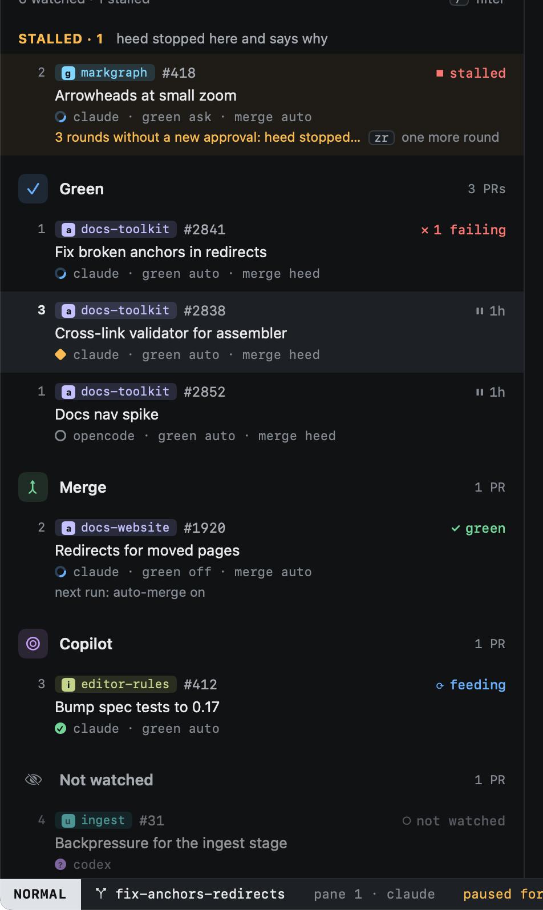

## Elsewhere

heed shows the same state wherever a PR appears: next to a session's PR count in the sidebar, on the inspector's PR card, in
the PRs view's **Watch** column, and by the PR number in Repos.

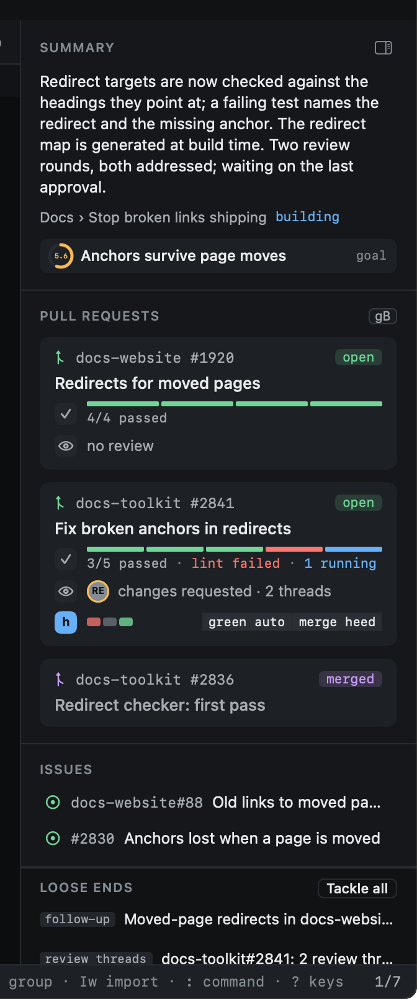

## Settings

The settings live in `[pilot]` (the pilot is what does the watching and the merging). `[pilot]` sets the
defaults, and an org or a repo overrides any of them. Settings ▸ Autopilot edits the defaults. Settings ▸ Orgs & repos
edits the overrides, on its Get it green, Get it merged and Reviews tabs.

```toml
[pilot]
watch = true         # read-only, so on
green = "ask"        # off, ask or auto
max_rounds = 3       # prompts without a new approval before it stops
agent = ""           # runs' agent (codex, claude, ...); empty: the session's
model = ""           # their model (haiku, gpt-6-luna, ...); empty: the agent's default
effort = ""          # their reasoning effort (low, high, ...); empty: the agent's default
run_in = "helper"    # helper (an ACP agent in its own worktree), background (a tab of its own) or session
merge_agent = ""     # background runs for merge conflicts; empty: agent
merge_model = ""     # their model; empty: model (with a merge_agent of its own, that agent's default)
merge_effort = ""    # their effort; empty: effort (with a merge_agent of its own, that agent's default)
run_timeout = "30m"  # a run still working after this long is stopped
pause = "1h"         # what zp pauses for
merge = "off"        # off, auto or heed
merge_schedule = "1h" # how often a repo's queue runs, or manual
update_branches = true
copilot_conflicts = false  # Copilot resolves merge conflicts
copilot_comments = false   # Copilot addresses review comments
reviewers = []             # e.g. ["copilot", "alice", "acme/docs-team"]
quiet_minutes = 5          # merge = "heed": the rules
trusted_reviewers = []     # e.g. ["copilot-pull-request-reviewer"]
gate_checks = []
hold_labels = ["hold", "do-not-merge", "wip"]
# self_review = "claude -p"
# merge_method = "squash"  # unset: the first of squash, merge, rebase the repo allows
merge_now = "ask"          # zM: ask first, or auto (merge at once)
force_merge = "ask"        # merging now past required reviews/checks with --admin, as an admin: off, ask, auto
# Extra instructions, added to what heed sends (see below)
# green_instructions = "Resolve the review threads your changes addressed, and any that no longer apply."
# review_instructions = ""
# start_instructions = ""
# summary_instructions = ""
# summary_sign_off = false  # ask agents to end with a heed-summary: line (see History › Ledger)

[orgs.employer]
watch = false        # not this org's PRs, by default

[repos."employer/main-service"]
admin_merge = true   # per repo only: retry a refused heed merge with --admin
watch = true         # but this repo's, yes
green = "auto"
merge = "auto"
```

### Extra instructions

heed's prompts can carry instructions of your own, set in `[pilot]` and per org or repo like any other setting
(Settings ▸ Autopilot ▸ Extra instructions):

| Key | Added |
|---|---|
| `green_instructions` | after the feedback items that each get it green run gets |
| `review_instructions` | to what the self-review looks for, before the PR's description and diff |
| `start_instructions` | after the issue text Start work begins from, before the `Closes` lines |
| `summary_instructions` | to what heed asks for when its [model calls](../agents/model-calls.md) summarize work |

`summary_sign_off`, beside them, asks the agent itself for a one-line summary at the end of its work. See
[The agent's own summary](../insights/ledger.md#the-agents-own-summary).

These instructions add to a prompt and never replace it. What heed relies on stays as it is, such as the push command a run is
given and the `APPROVE` line heed reads from the self-review. They are not a stand-in for the repo's own `AGENTS.md` or
`CLAUDE.md` either, which the agent still reads. Use the instructions for what you want from heed's prompts in particular, such as
"resolve the threads that no longer apply". A repo's `""` clears what its org adds.
