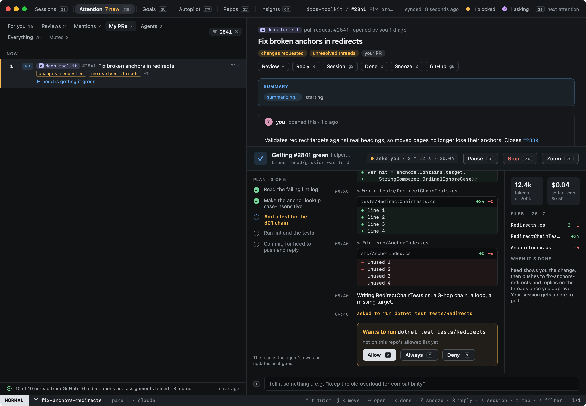
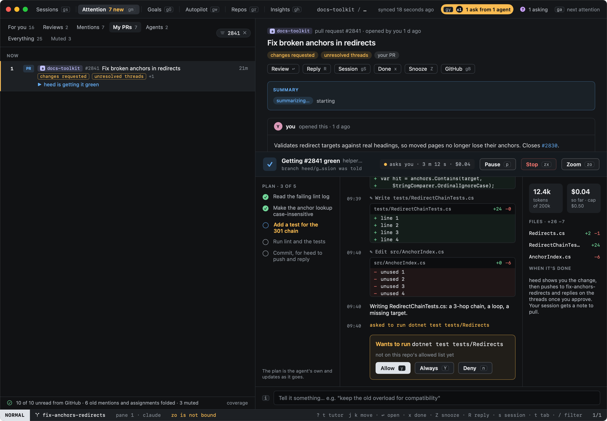
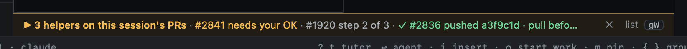
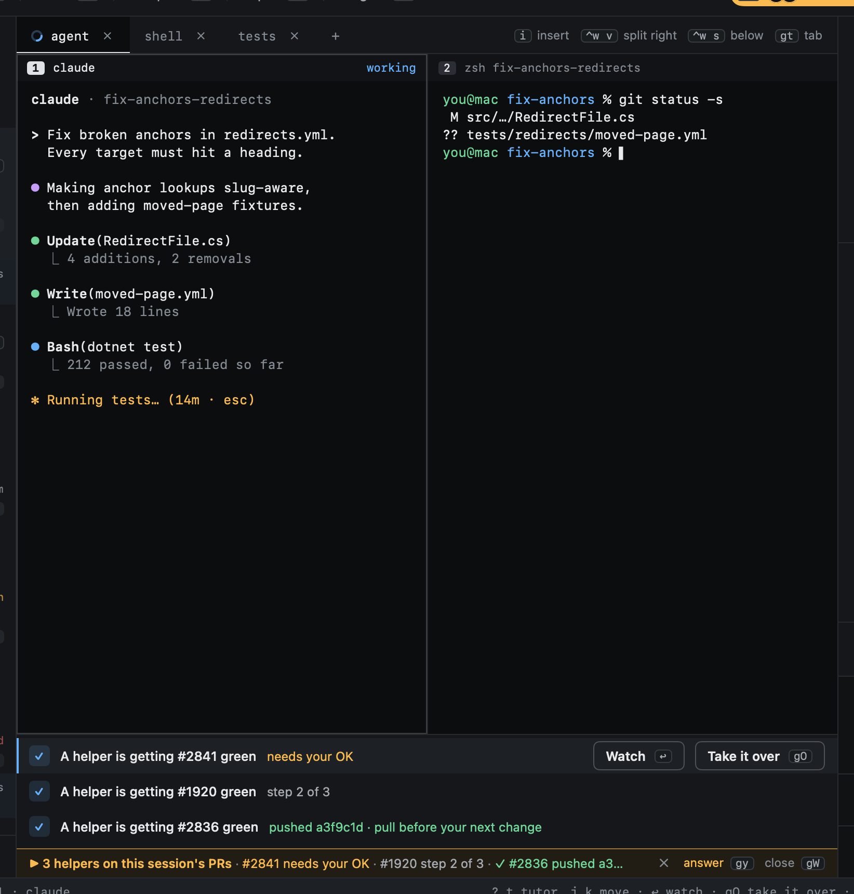
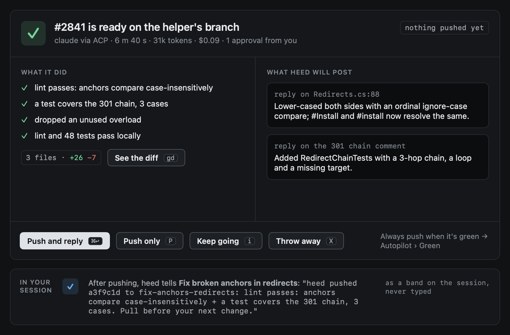

# Helpers

A **helper** is an agent heed starts on your behalf for one PR. It gets the PR green, resolves its conflict with the
base, or reviews someone else's PR for you. The helper works beside your sessions, never in them. It has a worktree of its own,
nothing is typed into your terminal, and it has no tab of its own. heed draws the helper as it works (its plan, its story with the
diffs it makes, what it asks). You steer the helper with a line of text. When the helper is done, heed shows you what it did and
what heed will post. heed pushes or posts nothing until you say so, or until the repo's **Always** says so.

Your sessions stay real terminals. Helpers are what heed runs itself.

**Requirement.** Helpers, and the [Fix, Implement, Chat and Review runs in Browse](../github/browse.md#fix-implement-chat-review),
reach their agent over ACP. Claude's own command line does not speak ACP, so heed needs the ACP project's adapter,
`npm install -g @agentclientprotocol/claude-agent-acp`, on your login shell's `PATH`. [Which agent](#which-agent) lists
the adapter for each agent. Sessions you start yourself never need it.

## How heed talks to them

Helpers speak the [Agent Client Protocol](https://agentclientprotocol.com) (ACP), version 1: JSON-RPC over the agent's
standard input and output. heed is the client. heed starts the agent in the helper's worktree and opens a session there
(`session/new`). heed then prompts the agent (`session/prompt`) and draws the `session/update` notifications that stream back. They carry the
agent's messages, its tool calls and their diffs, its plan, and its token use and cost when it reports them. When the
agent asks before running something (`session/request_permission`), heed shows the question in the helper with the
answers the agent offers. heed also shows it in [approvals](approvals.md#a-helpers-asks) (`gy`) with every other agent's questions.

heed offers the agent neither its file system nor terminals. The agent reads, edits and runs commands in its own
worktree itself, and asks heed's permission the way it is set up to. Claude's adapter starts its session in Claude
Code's auto mode unless `permissions.defaultMode` in your Claude settings names another mode. A claude helper therefore asks only
what auto mode leaves to you. heed names files relative to the helper's worktree (`src/a.cs`), though the agent reports
them in full.

## Which agent

`[helpers] agent` picks the helper's agent. Unset, it is your default agent when heed knows an ACP way to that agent, else claude.

| Agent | What runs | Install |
|---|---|---|
| claude | `claude-agent-acp`, the ACP project's adapter for Claude Code | `npm install -g @agentclientprotocol/claude-agent-acp` |
| codex | `codex-acp`, the ACP project's adapter for Codex | `npm install -g @agentclientprotocol/codex-acp` |
| opencode | `opencode acp` | opencode itself |
| gemini | `gemini --acp` | Gemini CLI itself |

heed never installs an adapter. When the adapter heed needs is not on your login shell's `PATH`, the proposal and Autopilot
say so, with the command to install it. `[helpers] command` replaces the command line, for a path of your own or
`npx -y @agentclientprotocol/claude-agent-acp`. The adapter signs in as the agent does. If the agent has never signed in, run it once in a
terminal first.

```toml
[helpers]
agent = "claude"
# command = "npx -y @agentclientprotocol/claude-agent-acp"
spend_cap = 0.5      # dollars a helper may spend; 0: no cap
```

## What a helper does

- **Where:** a worktree of its own (`<worktree_root>/heed/<repo>/get-it-green-<branch>`) on a branch of its own
  (`heed/get-it-green/<branch>`, `heed/get-it-merged/…` for a conflict, `heed/review/…` for a review), made from the
  PR's branch (a review: the PR's head as GitHub has it, `refs/pull/<n>/head`, so a fork's PR has its own code). It is never
  your worktree. heed copies your `.worktreeinclude` files in and first runs the repo's approved
  [setup](../worktrees/setup.md) there, except on a PR from someone outside the repo.
- **What it is told:** the PR's feedback, as get it green sends it (each failing check with the failed step's log, each
  review comment), or for a review the PR's description and how to read its change. It is also told to work only in its
  worktree, to commit but not push, to post nothing, and to end with a few `heed-` lines saying what it did and the
  replies it drafted. heed adds `green_instructions` and `review_instructions` as for other runs.
- **Someone outside the repo:** on a PR heed does not trust (anything but yours, or a PR from a branch of the repo by
  someone who can write to it or by one of `trusted_authors`: the rule
  [heed merges by](green-and-merged.md#which-prs-heed-merges);
  `gh pr view --json author,authorAssociation,isCrossRepository`), a helper gets none of your
  `.worktreeinclude` files and runs no setup. It starts with no GitHub, ssh or cloud login: its environment keeps only
  what a [sandboxed run](../goals/reviewers.md#how-a-reviewer-runs) gets back (the basics, heed's own and the agent's
  own login), and `gh` is logged out. A review helper is told to read the code and run none of it, because a helper has
  no sandbox and so does not run a stranger's tests. Get it green starts no run on such a PR on its own. You send the run.
- **How long:** until its turn ends, you stop it, it reaches `[helpers] spend_cap` (from the cost the agent reports;
  heed holds an agent that reports none to `run_timeout` only), or it runs past `[pilot] run_timeout`.

Get it green runs as helpers by default (`[pilot] run_in = "helper"`). See [Runs](green-and-merged.md#runs) for the
other two ways, a background tab or the session's own agent. Both stay for agents without an ACP adapter.

## Where you see it

- **Attention:** once you approve heed's next step for a PR, the helper opens in a split under the reader. The PR's row
  says `▶ heed is on it`, right on its reasons line.
- **Autopilot › Now:** a live tile per helper above the PRs. The tile shows what the helper does now, its plan as pips, the files it touched,
  its last tool calls, and what it asks. `h` `l` move between tiles, `↩` opens one in a split.
- **Sessions:** a session tracking the PR gets one line at the foot of its panes, just above the status bar (below).
  A row under the session in the sidebar says the same.



The split shows the agent's plan on the left (when the agent sends one; otherwise the split says so). The middle holds the agent's story with the
small diffs its edits made and any permission it waits on. The right shows the agent's tokens and cost against the cap, the
files it changed and what happens once the helper is done. The steer box is at the foot.

| Key | |
|---|---|
| `i` | Tell it something. Typing goes into the box; `↩` sends, `⎋` closes. A turn under way is cancelled and your words start the next |
| `p` | Pause it (its turn is cancelled and it waits), or let it carry on |
| `zx` | Stop it. Its close-out keeps what it did |
| `zo` | Zoom: the split takes the whole column |
| `y`, `Y`, `n` | Allow what it asks once, allow it from now on (when the agent offers that), deny it |

What the helper asks is also in the approvals (`gy`), with every other agent's asks. You answer a request once, there or here.
| `⎋` | Close the split; the helper keeps working |

`zo` zooms the split over the whole column:



### The session's helper line

However many helpers work on a session's PRs, the session gets one line for them at the foot of its panes. With
one helper, the line is that helper: *▶ A helper is getting #2841 green · step 3 of 5*. With more, the line counts the helpers and says
where each stands: what needs you first, then what works, then what waits:

```
▶ 3 helpers on this session's PRs · #2841 needs your OK · #1920 step 2 of 3 · ✓ #2836 pushed a3f9c1d · pull b…
```



The line is quiet by default and turns amber only when a helper needs you: it asks permission, or it is done and waits
for your close-out. While a helper asks permission, the line says **answer** `gy`. The approvals hold its request with
every other agent's, and `gW` still watches the helper. The line lights up briefly when a helper moves to its next step or finishes. A finished helper stays on
the line (*✓ #2841 pushed a3f9c1d · pull before your next change*) until you have seen it. You have seen it when you looked at the session
after the helper finished (it goes once you leave the session), or when you took it off with the ✕ on the line.

| Key | |
|---|---|
| `gW` | With one helper, watch it: the helper in a split under the panes (again hides it). With more, the list of helpers over the line |
| `gO` | Take it over: the helper the line leads with, or the list's row under the cursor |

In the list, one row per helper: `j` `k` move, `↩` (**Watch**) opens the row's helper in the split, `gO` (**Take it
over**) takes it over, `x` takes a finished one off the line, and `⎋` or `gW` closes the list. A click on a row
watches that helper.



## Close-out

When the helper's turn ends, the split shows what the helper did, from its last message and git. It shows the lines it wrote, the files and lines
it changed, and the replies heed will post on the review threads it addressed (for a review, the comments and its
verdict).



| Key | |
|---|---|
| `⌘↩` | **Push and reply:** heed commits what the helper left uncommitted, pushes its branch to the PR's (`git push origin HEAD:<branch>`), then posts each reply on its thread. heed posts a review as one review |
| `P` | **Push only**, without the replies |
| `i` | **Keep going:** tell the helper what else to do, and it takes another turn |
| `X` | **Throw away**, twice: heed removes the helper's worktree and branch, and pushes or posts nothing |
| `gd` | The whole diff |

Once the helper has pushed, heed tells your session in words: *heed pushed a3f9c1d to fix-anchors-redirects: lint fix + a
301-chain test. Pull before your next change.* The note is always on the session's helper line. It reaches the
session's agent through its own [channel](../agents/messages.md) when the agent has one (Claude's inbox, codex's queue). heed never types the note. An
agent without a channel gets the line only, and the helper's row in the list (`gW`) says which case applied. Either way the
session's events record the note. With get it green on **Auto** for the repo (Autopilot's **Always**), heed pushes and
replies as soon as a helper is done and has changed something.

**Take it over** (`gO` on the session) stops the helper and leaves its worktree and branch where they are. The
session's helper line says where the branch is (`#2841 taken over · heed/get-it-green/… is yours`), and heed tells the
session's agent how to merge the branch in.

## What helpers never do

- type into your session, or touch your worktree;
- push, reply or post a review before you approve (or the repo's Always);
- run past their spend cap or `run_timeout`;
- show progress the agent did not report: an adapter that sends no plan, no usage or no diffs shows none.
