# Autopilot

Autopilot gets PRs green, merges them by your rules, answers permission asks with one key and tidies up afterwards.

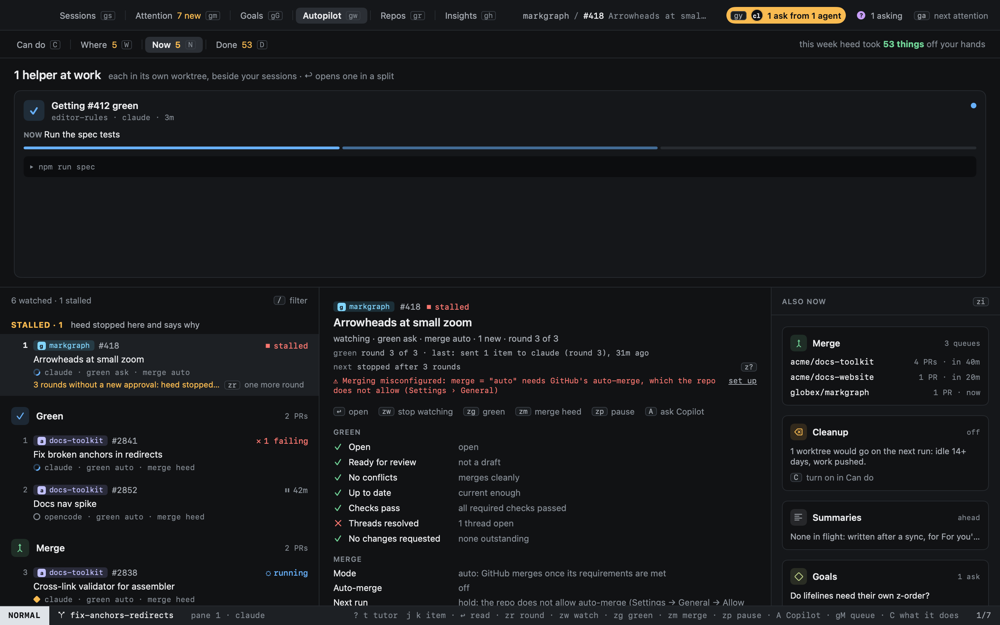

`gw` opens **Autopilot**. It is the one place that shows what heed can do on your behalf, where each capability is on and
where not, what heed is doing about it right now, and what heed has done. Autopilot has four views, each with its key, the same in all
four:

| View | Key | Count on its tab |
|---|---|---|
| **Can do** | `C` | (where `gw` lands) |
| **Where** | `W` | capabilities off somewhere |
| **Now** | `N` | PRs heed is working on or stopped on |
| **Done** | `D` | what heed did this week |

The strip's right side says how much heed took off your hands this week. It is the same number as Done's tab.

`view.watch` and `:watch`, from when Autopilot was the Watch view, open Autopilot too.

## In this section

- [Get it green and merged](green-and-merged.md): the rules, the merge queue, runs, and stalled and paused PRs.
- [Setting up a repo](repo-setup.md): heed reads a repo's history and proposes its merge and green settings.
- [Approvals](approvals.md) (`gy`): one place to answer what every agent asks permission for.
- [Helpers](helpers.md): agents heed starts for one PR, in a split beside your session.

## Can do

A card for each thing heed does on its own once the capability is on. Each card has its icon, its key when it has one, one
sentence, a bar for how much of the capability is on (an ask-first repo counts half), and how often heed acted this week.

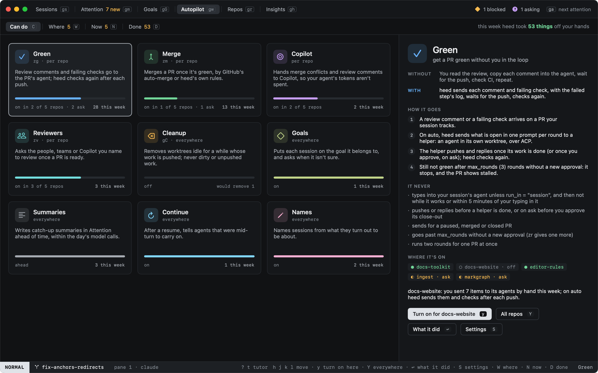

| Card | What it does | Set where |
|---|---|---|
| **Green** | review comments and failing checks go to the PR's agent; heed checks again after each push | per repo: `green` (`off`, `ask`, `auto`), see [Get it green](green-and-merged.md#green) |
| **Merge** | merges green PRs, by GitHub's auto-merge or heed's own rules | per repo: `merge` (`off`, `auto`, `heed`), see [Get it merged](green-and-merged.md#get-it-merged) |
| **Copilot** | hands conflicts and review comments to GitHub's Copilot coding agent | per repo: `copilot_conflicts`, `copilot_comments` |
| **Reviewers** | asks the reviewers you name once a PR is ready | per repo: `reviewers` |
| **Cleanup** | removes worktrees idle for `idle_days` whose work is pushed | everywhere: `[cleanup] enabled`, see [Cleanup](../worktrees/cleanup.md) |
| **Goals** | puts new work on its goal, and asks when unsure | everywhere: `[goals] attach` |
| **Summaries** | writes Attention's catch-up summaries ahead of time | everywhere: `[attention] summaries` (`ahead`, `open`, `off`) |
| **Continue** | types `continue_prompt` into agents resumed mid-turn | everywhere: `[sessions] continue_prompt` (empty: off) |
| **Names** | names sessions from what they turn out to be about | everywhere: `[sessions] name_sessions` |

`h` `j` `k` `l` move between cards. The picked card's detail says what changes with the capability (**without** and **with**) and how
it works step by step. It also says what heed **never** does (the real limits: three rounds at most, never typing while you type, never
removing unpushed work) and which repos have the capability on. When heed has a number for it, the detail says where the capability would help: *docs-website:
you sent 7 items to its agents by hand this week*.

- `y` turns the capability on where it would help most: the repo that the nudge names, else the first repo where it is off. A global capability
  is simply turned on.
- `Y` turns the capability on everywhere. It sets the `[pilot]` default and removes every org and repo override that says otherwise.
- `x` turns a global capability off. `↩` shows what the capability did (Done, narrowed to it). `S` opens its Settings page.

The keys write config.toml as Settings does (`[repos."acme/docs-website"] green = "auto"`). A capability with no
ask-first (Merge, Copilot, Reviewers, Goals) says so instead of writing anything.

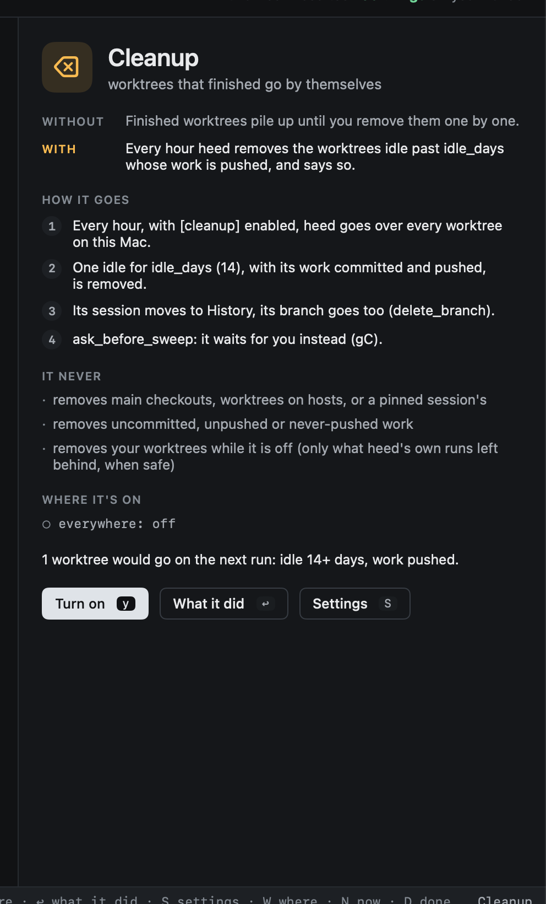

## Where

Every repo against each capability: on (●), asks you first (◐) or off (○). Under each mark, the cell says what the capability did in that repo this week, or why it cannot work there. An example is *auto-merge off on GitHub* for a repo set to `merge = "auto"` that does not allow auto-merge. The
last column is the strongest thing heed saw that would help that repo.

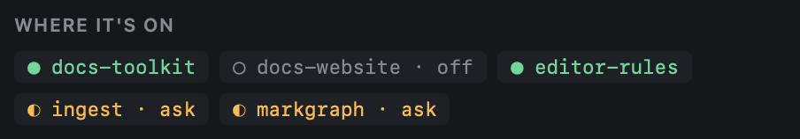

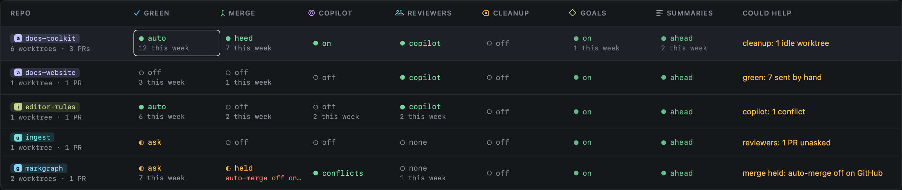

`h` `j` `k` `l` move over the cells, and the footer explains the cell under the cursor. `y` turns the capability on, `a` makes it ask
first, `x` turns it off, and `C` shows its card. `↩` opens the repo in [Repos](../worktrees/repos.md), and `M` sets up merging
in that repo. Cleanup, Goals and Summaries are set once for every repo, so their cells show the same value on every row.

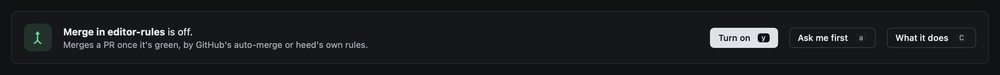

## Now

On top, the **helpers at work**: a live tile per [helper](helpers.md), each in its own worktree beside your
sessions. A tile says what the helper is doing (*Getting #2841 green*) and shows its repo, agent and age. It also shows what the helper does now, its plan as pips,
the files it touched, its last tool calls, and what it asks you (`y` allows the request once the helper is open). `h` `l` move
between the tiles. `↩` opens the tile under the cursor in a split in the PRs' place, and `⎋` closes the split. `j` `k` go back
to the PRs.

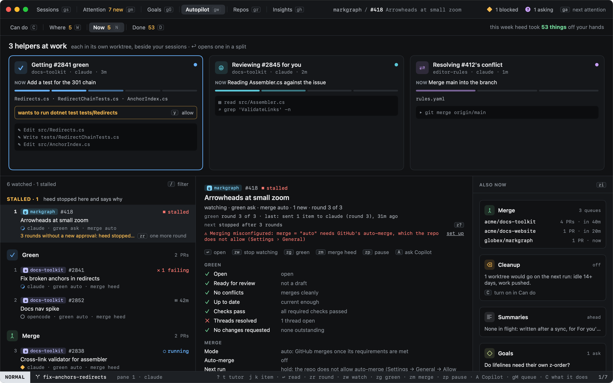

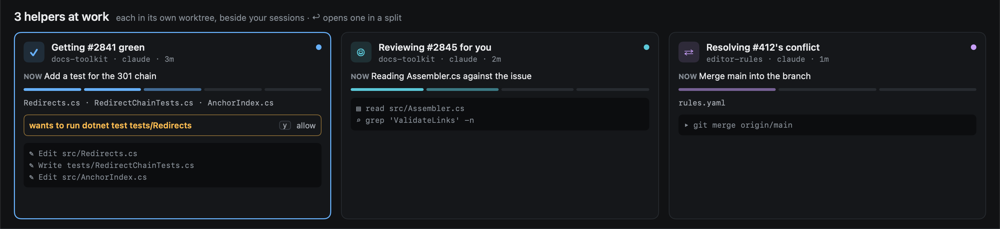

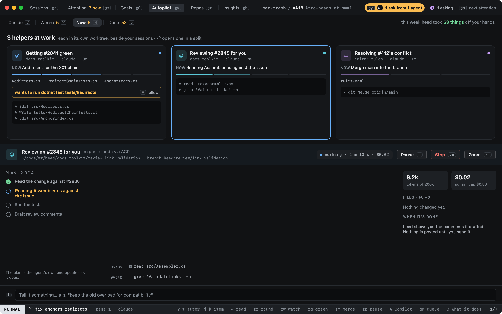

Under the tiles, Now shows what the pilot is doing, by card. **Stalled** comes first (heed stopped and says why, with the key out: `zr` one more round),
then **Green** (PRs being fixed, with the rounds used so far), **Merge** (PRs with merging on, with what the next run of
their queue does), **Copilot** (PRs Copilot was asked about) and **Not watched**. Merged and closed PRs move to Done.

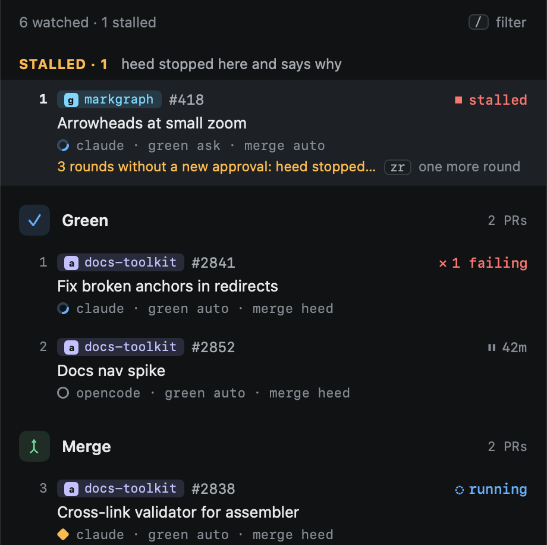

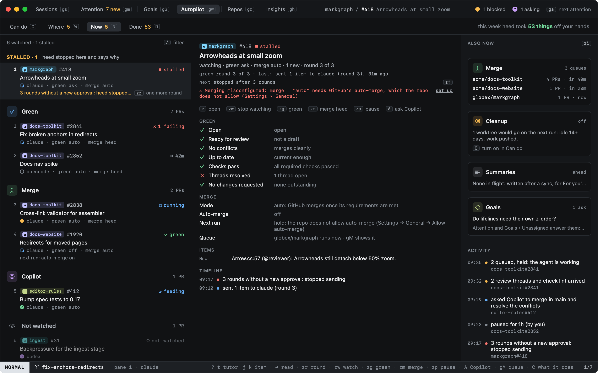

The middle shows the PR under the cursor: its green checklist, merge rules, items and timeline, described in
[Get it green and merged](green-and-merged.md). The right side (`zi` hides it) shows the merge queues with their next run, what cleanup
would remove next, summaries in flight, heed's goal asks, and the pilot's activity across PRs.

The [pilot keys](green-and-merged.md#keys) work on the PR under the cursor. `↩` reads the PR, `A` asks Copilot about it, `R` runs its
merge queue and `gM` shows the queue.

## Done

Done lists what heed did on its own, by day, newest first. Each day says how many things heed did, how many PRs it merged and how many items
an agent's push fixed. Each line is an outcome with its capability's icon, and its repo and PR on the right.

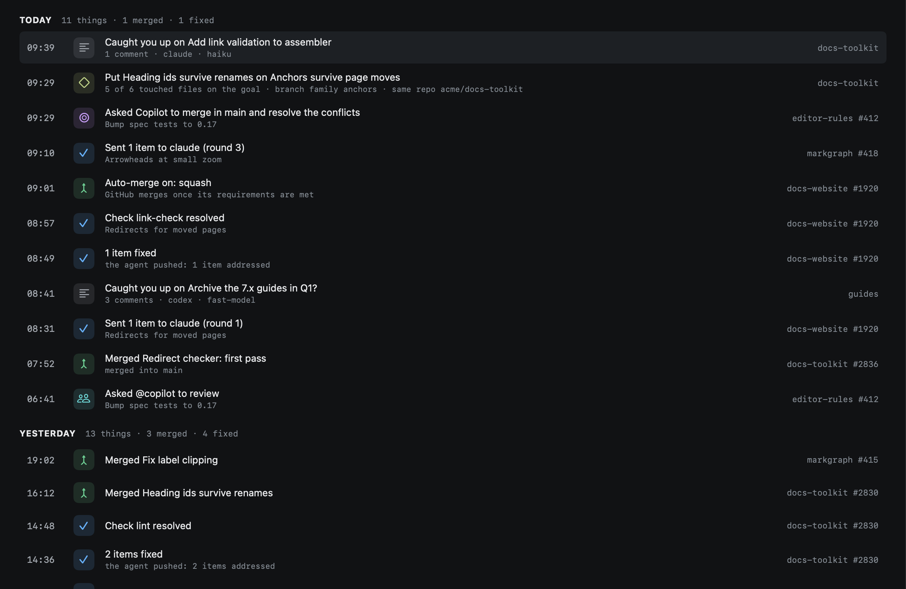

`t` narrows Done to one capability and `r` to one repo (the rail on the left counts each). `{` `}` move between days. `↩`
opens the line's PR, or its session.

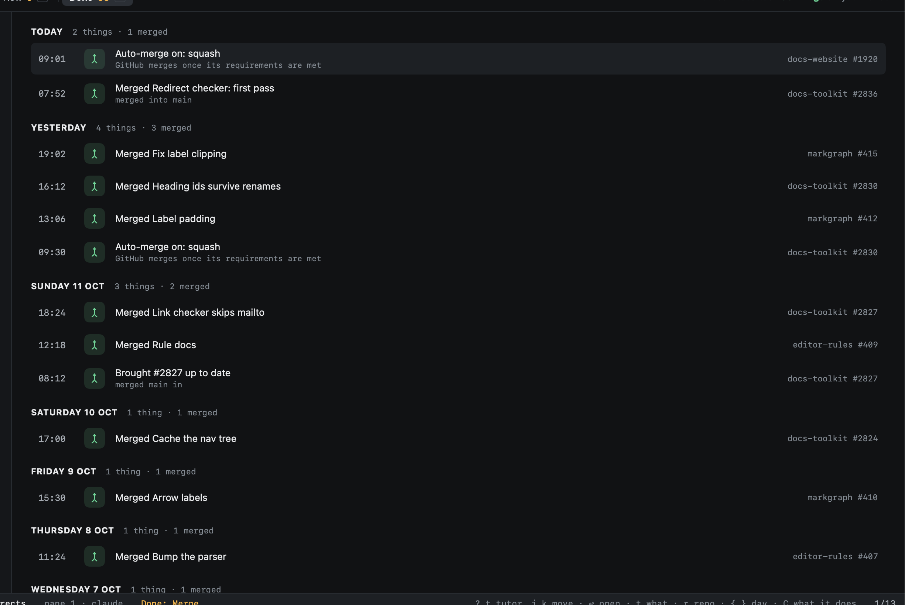

## Where the numbers come from

Autopilot counts only what heed records:

- **Green, Merge, Copilot, Reviewers**: the pilot's log, the same as Now's activity. What you did yourself (a send with
  `s` in the PR overlay, a Copilot ask with `C`, `zv`) is marked *by you* there and is not counted as heed's. The Green nudge counts the sends you
  made by hand.
- **Goals**: heed's attach decisions that put something on a goal (Goals › Unassigned keeps them).
- **Summaries**: the catch-up summaries Attention keeps, by when each was written (ahead of time and on open alike).
- **Continue**: the line heed adds to a session's timeline when it types `continue_prompt`.
- **Names**: the renames on sessions heed still names (not those you titled yourself).
- **Cleanup**: heed keeps no record of a sweep apart from removing by hand, so the card shows what the next run would
  remove instead of a count.

A week is the last seven days. The pilot's log keeps at least the last 14 days.

**Next:** [Goals](../goals/index.md).
