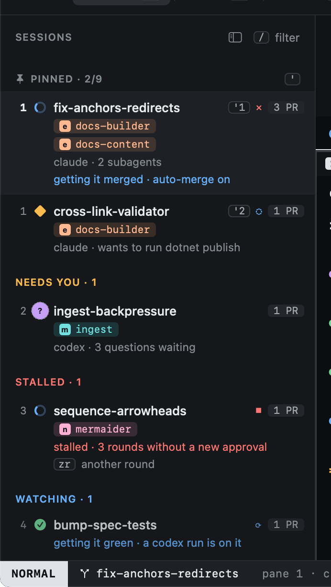

# Agent states

Every session shows its agent's state, and the sidebar sorts by it: whatever needs you comes first.

| State | Means |
|---|---|
| **working** | The agent is busy. |
| **blocked** | It wants permission to run something and cannot go on without you. |
| **asking** | It has questions for you, a plan to approve, or ended its turn on a question. |
| **done** | It finished its turn. |
| **idle** | Waiting for a prompt. |
| **limited** | It hit a rate or usage limit. |
| **exited** | The agent's process ended. |

## Reported or guessed

Most agents report their state through [hooks](../agents/hooks.md): Heed passes them a small command to call as they
work. For states an agent cannot report, Heed reads its terminal and guesses from what is on screen
([Reading the screen](../agents/screen-reading.md)). A guessed state is drawn with a dotted ring, and a reported state
always wins over a guess.

One guess comes from the hooks themselves: when a turn ends on a question to you ("Should I push this?"), the session
is **asking** with the reason "asked a question", drawn dotted because it is read from what the agent wrote
([Questions at the end of a turn](../agents/hooks.md#questions-at-the-end-of-a-turn)).

## Subagents

A session's state is its main thread's. Subagents (claude, codex) only add to it: a permission prompt inside one blocks
the session, and while any still run after the main thread's turn ended the session stays **working** ("2 subagents
running"). A subagent finishing never marks the session done or asking. See
[Subagents](../agents/hooks.md#subagents).

## Where states show

- The sidebar's groups and glyphs, and the inspector's event list.
- The title bar's counts of blocked and asking sessions.
- The [Dock badge](../outside-the-window/dock.md) and the [menu bar item](../outside-the-window/menu-bar.md).
- A [notification](../outside-the-window/notifications.md) when a session starts needing you.
- `ga` jumps to the next session that needs you.
