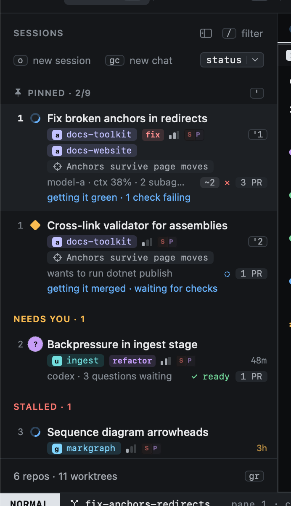

# Concepts

Four ideas explain how heed works. Read them once, and the rest of the docs makes sense.

- [Sessions](sessions.md): an agent, its terminals and its worktree, with a state.
- [Agent states](agent-states.md): what each agent is doing, and whether it needs you.
- [Worktrees](worktrees.md): one per task, so agents never step on each other.
- [Modes](modes.md): who gets your keys, heed or the terminal.

The [glossary](../reference/glossary.md) defines every other term the docs use.

**Next:** [Start work](../start-work/index.md).
