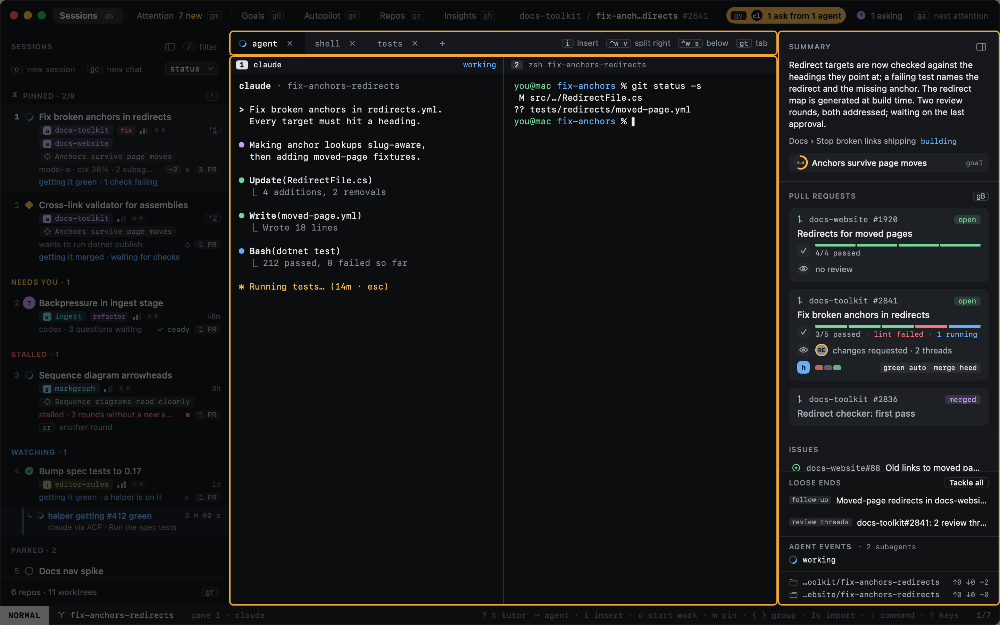
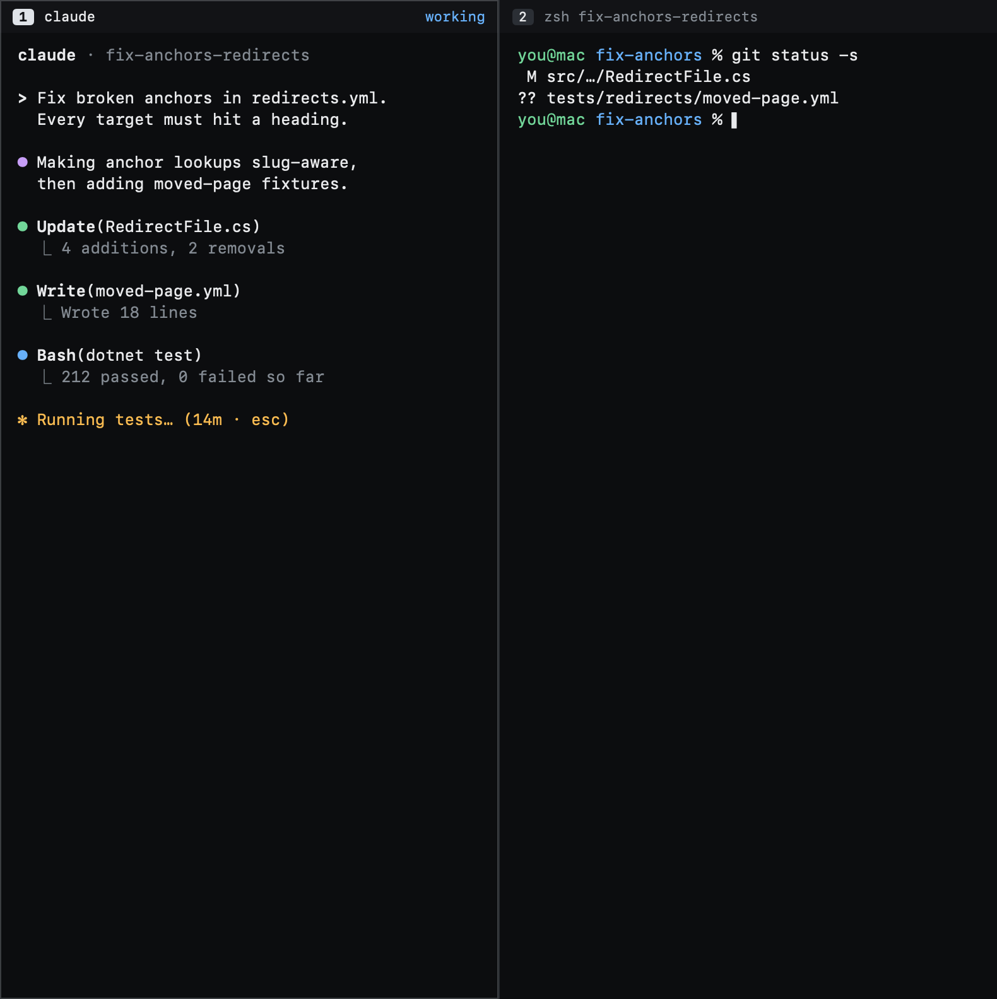
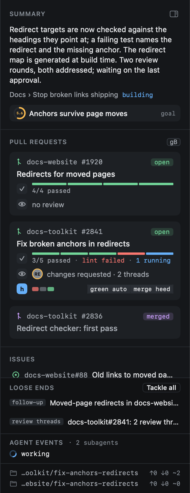

# Sessions

A session is one task: an agent working in a git worktree, the terminals around it, and the PRs it opens.

A session has:

- **A prompt and a title.** The prompt is what you asked for. heed keeps it for [History](../insights/history.md) and for starting again. The title starts as the prompt's first words, and heed renames it as the work changes. See [The sidebar](../sessions/sidebar.md).
- **An agent.** claude, codex, cursor, pi, opencode, gemini, or your own. The session keeps the agent's own session id, so the agent can resume.
- **One worktree per repo.** Most sessions touch one repo. A cross-repo session gets a worktree in each, on the same branch.
- **Panes and tabs.** The agent's terminal, and any shells or tasks you open beside it.
- **Tracked PRs.** heed picks up the PRs the agent opens, and you can add one by URL. See [Tracking PRs](../github/tracking-prs.md).
- **A state.** The state is working, blocked, asking, done and so on. See [Agent states](agent-states.md).

The [inspector](../sessions/inspector.md) shows the rest of the session: its worktrees, its PRs and its agent events.

## Sessions without a repo

A [chat](../sessions/chats.md) is a session with no repo. Its agent works in a folder instead of a worktree, and the
chat has no PRs.

## What heed keeps

heed keeps a record of each session: its prompt, its timeline, its outcome and the agent's last message. The agent
keeps its own transcript. After the worktree is gone, the [ledger](../insights/ledger.md) keeps a short summary of the
work.

## How a session ends

| Key | What happens |
|---|---|
| `zz` | Park: the session leaves your way and the agent keeps running |
| `x` | Close: the agent and panes stop, and the worktree stays |
| `dd` | Delete: heed removes the worktree after saving any work not pushed |

Closing and deleting both move the session to [History](../insights/index.md), where `R` reopens it. See
[Pin, park, close, delete](../sessions/pin-park-close-delete.md).
