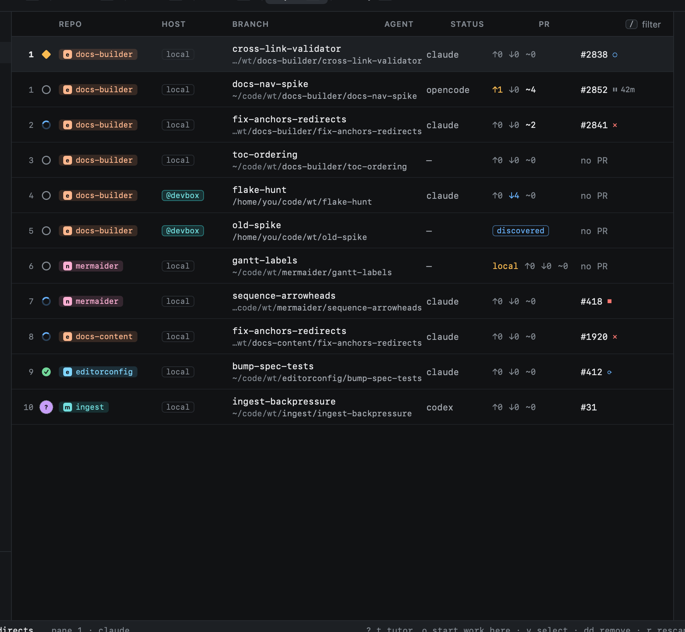

# Worktrees

Every session works in its own [git worktree](https://git-scm.com/docs/git-worktree): a separate checkout of the repo on
its own branch. Agents never share a working tree, so two of them can change the same repo at once, and your main
checkout stays yours.

- Worktrees go under `~/code/wt/<repo>/<name>` (set `root` under `[worktrees]`).
- The branch name comes from the prompt: see [Branch names](../start-work/branch-names.md).
- A cross-repo session gets a worktree in each repo, on the same branch name.
- Worktrees made outside Heed can be [imported](../worktrees/importing.md) as sessions.

Removing a worktree saves its unpushed commits and uncommitted changes as `refs/heed/archive/<branch>` first, and
cleanup never removes one that has any. See [Removing](../worktrees/removing.md) and [Cleanup](../worktrees/cleanup.md).
