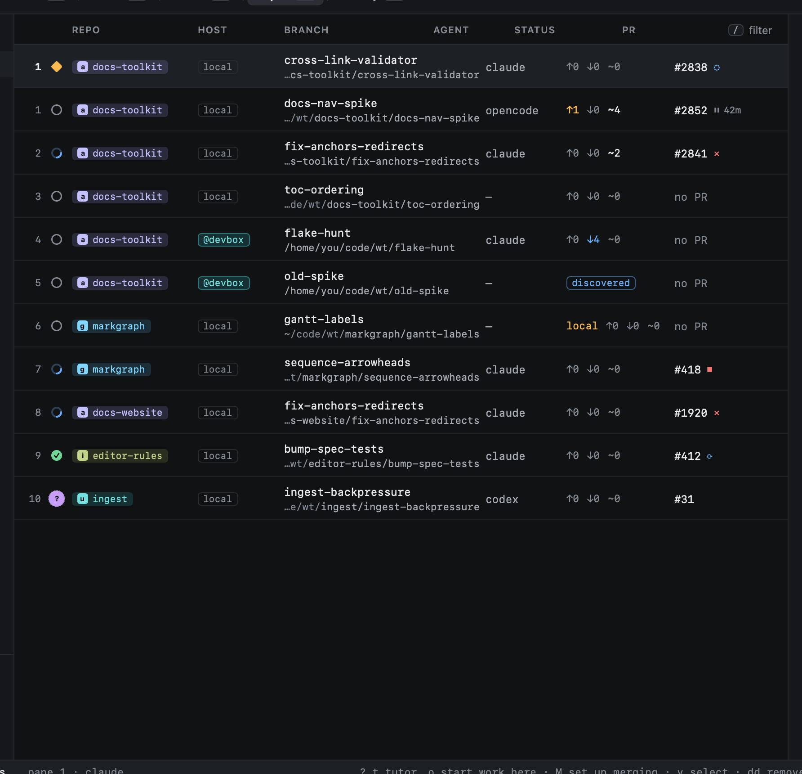
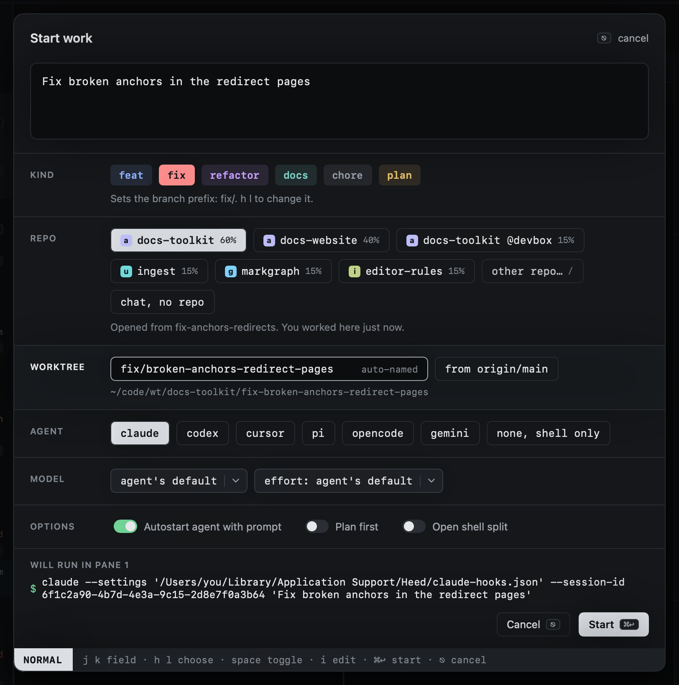
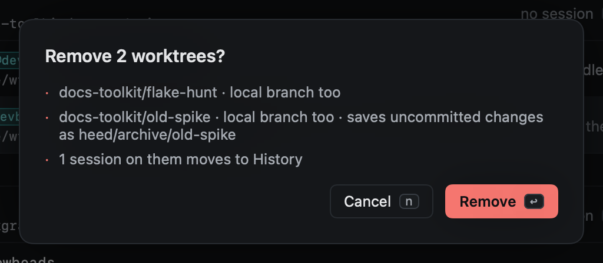

# Worktrees

Every session works in its own [git worktree](https://git-scm.com/docs/git-worktree): a separate checkout of the repo
on its own branch. Agents never share a working tree, so two agents can change the same repo at once. Your main
checkout stays yours.

## How heed makes one

When you start work, heed makes the worktree before the agent starts:

1. heed fetches the repo's base branch from `origin`. A failed fetch does not stop the start.
2. heed runs `git worktree add -b <branch>` from `origin/<base>`, or from the local base branch when the repo has no `origin`.
3. heed runs the repo's approved [setup commands](../worktrees/setup.md) in the new pane.
4. The agent starts when every setup command passed.

## Where worktrees live

- Worktrees go under `~/code/wt/<repo>/<name>`. Set `root` under `[worktrees]` to move them. A host has its own `worktree_root`.
- The folder name is the branch name with `/` replaced by `-`.
- The branch name comes from the prompt. See [Branch names](../start-work/branch-names.md).
- A cross-repo session gets a worktree in each repo, on the same branch name.
- You can [import](../worktrees/importing.md) worktrees made outside heed as sessions.

## What heed never shares

A worktree belongs to one session. Closing the session keeps the worktree and its branch. Deleting the session removes
the worktree and its local branch.

## Removing

Removing a worktree saves its unpushed commits and uncommitted changes first, as `refs/heed/archive/<branch>` in the
repo. Cleanup never removes a worktree that has any. A pinned session's worktree is never removed.

See [Removing](../worktrees/removing.md) and [Cleanup](../worktrees/cleanup.md). [Repos](../worktrees/index.md) lists
every worktree.
