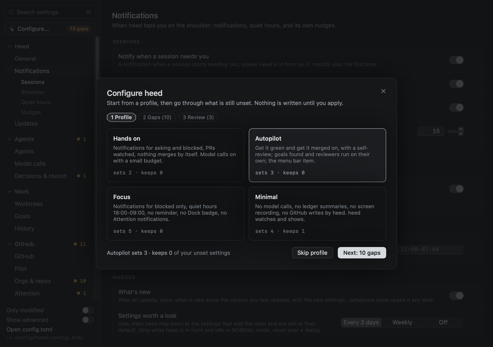
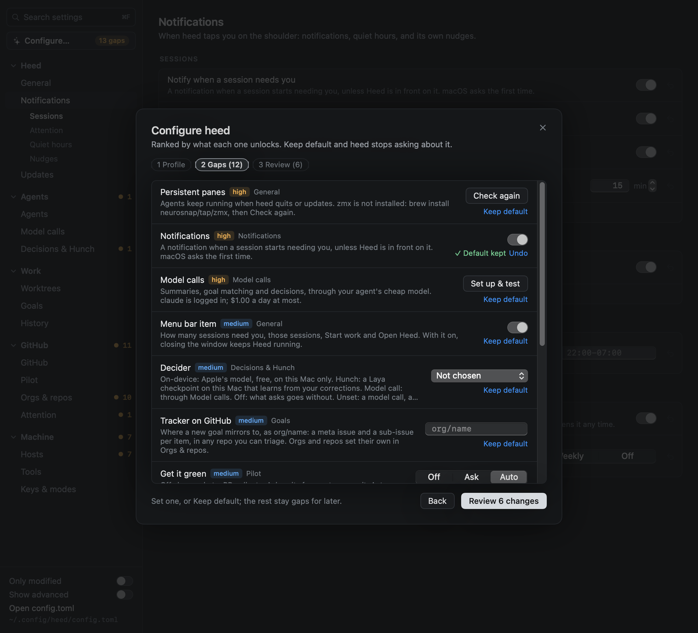
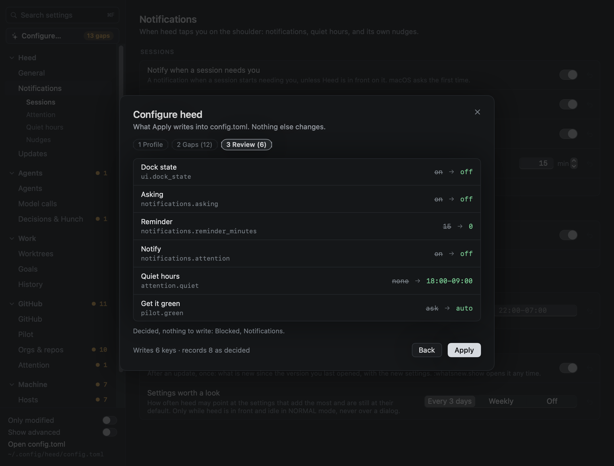

# Configure…

**Configure…** is the button at the top of the Settings tree. It goes through the settings that change most what heed
does for you, and that you have not decided on yet. The badge on the button counts those settings as `N gaps`. With
none left, the badge goes away. You can also open it from the app menu (**Heed › Configure…**, under Settings…) and
with `:settings.configure`.

Configure… has three steps. Nothing is written to `config.toml` until you click **Apply** on the last one. Close it
(✕ or esc) and nothing changes.

## 1 Profile

A profile is a starting point. Pick one, or click **Skip profile** to go straight to the gaps. Each card shows what the
profile would do to your config, as `sets N · keeps M`:

- **sets** counts the settings it would write. They are at heed's default and you have not decided on them.
- **keeps** counts the settings it leaves alone because you already set them, or decided on them in Configure….

A profile never changes a value you set. A setting the profile names that is already at the profile's value counts
as decided, and nothing is written for it.

| Profile | Sets |
|---|---|
| **Hands on** | `notifications.enabled`, `asking` and `blocked` on; `pilot.watch` on; `pilot.green = "ask"`; `pilot.merge = "off"`; `llm.enabled` on, `llm.agent = "auto"`, `llm.daily_dollars = 0.5` |
| **Autopilot** | `pilot.green = "auto"`; `pilot.merge = "heed"`; `pilot.self_review = "claude -p"` (only when claude is your default agent); `goals.attach` and `goals.auto_review` on; `ui.menu_bar` on |
| **Focus** | `notifications.asking` off, `blocked` on; `attention.quiet = "18:00-09:00"`; `notifications.reminder_minutes = 0`; `ui.dock_state` off; `notifications.attention` off |
| **Minimal** | `llm.enabled` off; `decisions.decider = "off"`; `summary.when = []`; `local.record_screens` off; `pilot.green` and `pilot.merge` `"off"`; `goals.mirror` off |

Attention notifications are on or off (`notifications.attention`); for notifications about the important items only,
keep them on and write [rules](../github/attention-rules.md) that `notify`.

## 2 Gaps

A gap is a setting that matters, is at heed's default and that you have not decided on. The ones the profile you picked
decides are left out. Gaps are ranked high, then medium, then low:

| Impact | Settings |
|---|---|
| high | [Persistent panes](../sessions/zmx.md), notifications, [model calls](inference.md) |
| medium | The menu bar item, the decider, the goal tracker on GitHub, get it green, the global Start work shortcut |
| low | Quiet hours, how updates install, removing idle worktrees, standup reports, get it merged |

Each row has the control from its Settings page. The value you pick goes into Configure…'s draft, not into
`config.toml`. **Keep default** decides the setting at heed's default, and heed stops asking about it. **Undo** makes it
a gap again.

Two gaps need something done first, so they show a button instead of a control:

- **Persistent panes** without a working zmx: the line to install it, and **Check again**. heed never installs
  anything itself.
- **Model calls**: **Set up & test** drafts the agent and the decider that Settings › Model calls' one-click setup
  would pick. They are tested once you apply.

## 3 Review

The review lists every key Apply writes, with its value now and the one it gets. Settings decided without a write
(Keep default, or already at the profile's value) are listed under it. **Apply** writes the keys into `config.toml`,
comments kept, as Settings does, and records every decided setting. **Back** goes back to the gaps.

## Decided is not modified

Configure… keeps the settings you decided on with heed's own state, not in `config.toml`. A decided setting is no
longer a gap, whatever its value, but it is not *modified*: modified means a value differs from heed's default, and
that is what the `● N` counts and [Only modified](settings.md#show-advanced-and-only-modified) show. Keep default
decides a setting without modifying it.
