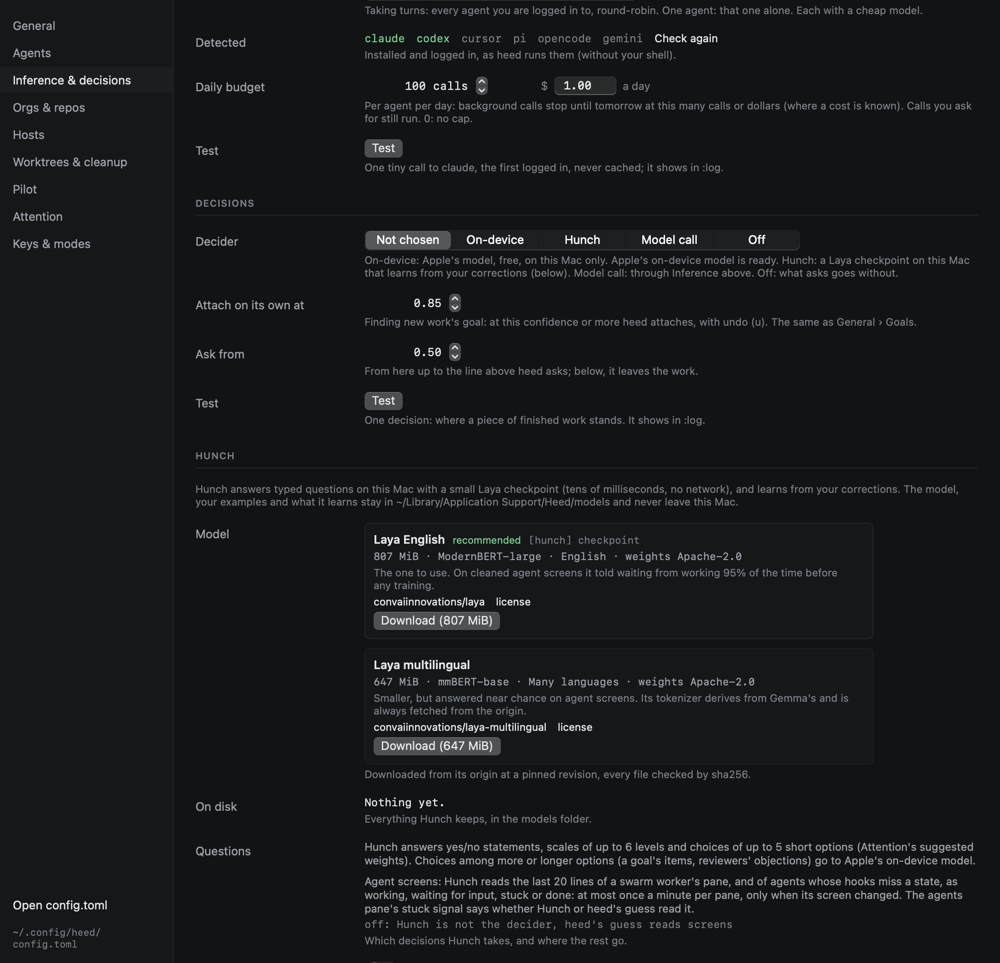
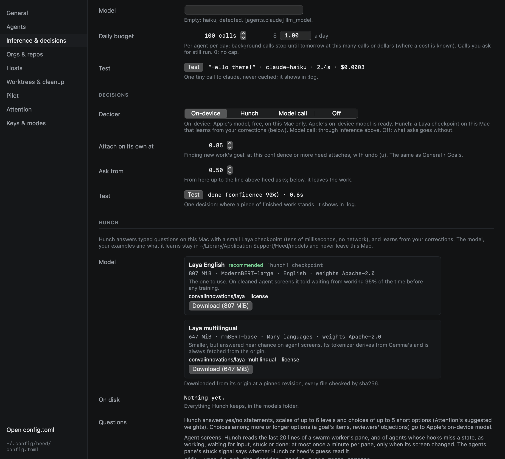
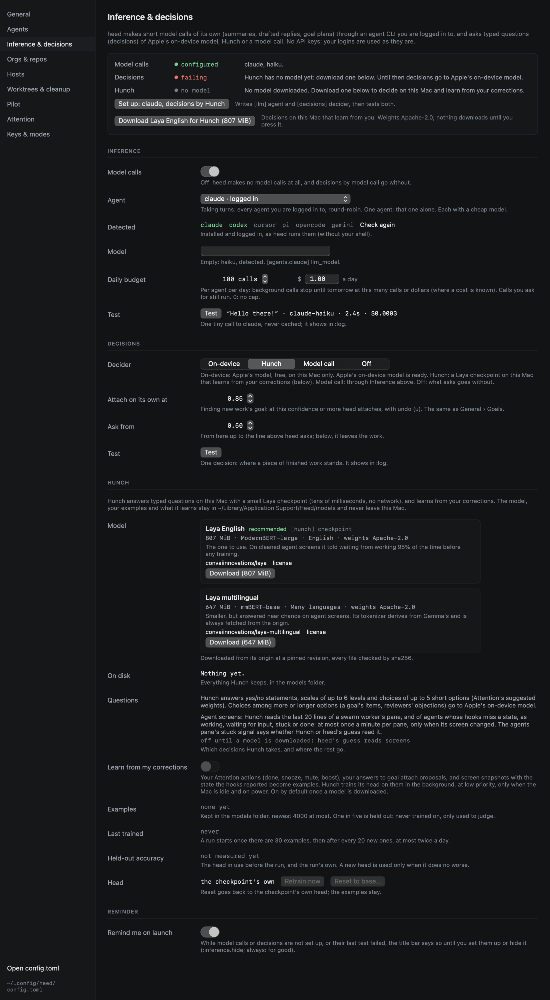
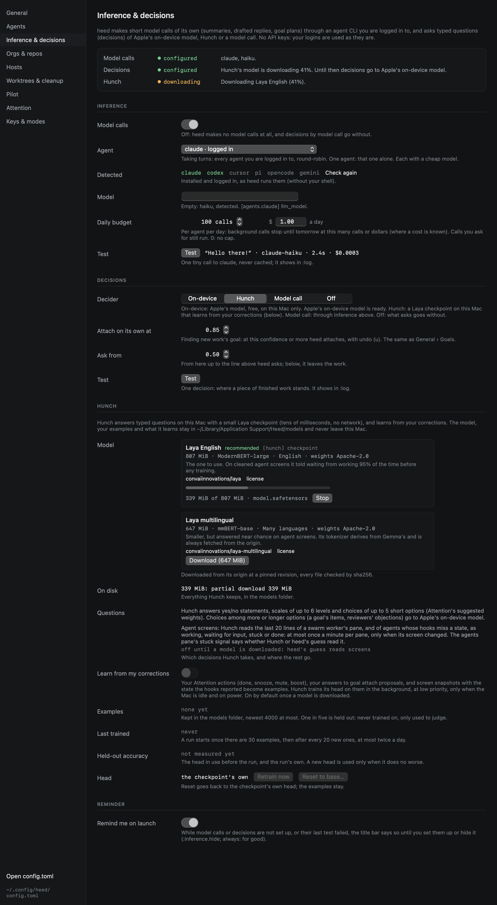
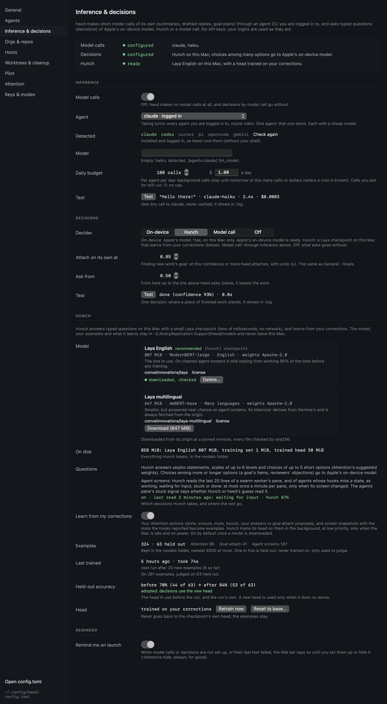
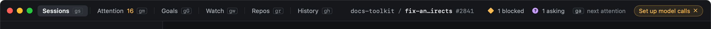
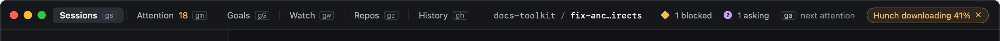

# Inference & decisions

Heed makes short [model calls](../agents/model-calls.md) of its own (summaries, drafted replies, goal plans) through
an agent CLI you are logged in to, and asks typed questions, *decisions*, of Apple's on-device model, of
[Hunch](#hunch) (a small model on this Mac that learns from your corrections) or of a model call.
**Settings › Inference & decisions** sets up both, and tests them. `:inference.setup` opens it, as does
`:settings.open inference` and **Help › Set up model calls & decisions**.



## Where it stands

The top of the pane says, for model calls and for decisions, one of:

| State | Means |
|---|---|
| **configured** | Chosen, and nothing says it does not work. |
| **not configured** | Not chosen yet. Model calls still take turns over every agent you are logged in to, and decisions go to a model call, as before. |
| **failing** | Chosen, and it cannot work: the agent is not installed or not logged in, the on-device model is not available on this Mac, Hunch has no model (or its download stopped), decisions by model call while model calls are off or failing, or the last test of it failed. |
| **off** | Turned off on purpose. |

Below the two states, the pane lists what goes without while they do not work: History's ledger summaries,
Attention's thread summaries and drafted replies, goal plans, edits, personas and walk-throughs, and finding new work's
goal when the signals are unsure need model calls; Attention's suggested weights, telling a new goal item from one the
board has, goal quality profiles and matching reviewers' objections need decisions.

## One click

While either one is not set up, **Set up** writes the suggestion for both and tests them:

- **Model calls**: the first agent that is installed and logged in, in the order claude, codex, cursor, pi, opencode,
  gemini (Heed checks with each one's free login check), else one installed without a login check (gemini).
- **Decisions**: Hunch once its model is downloaded; else Apple's on-device model when this Mac has it (macOS 26 with
  Apple Intelligence on and its model downloaded): free, and nothing leaves the Mac. Otherwise a model call when there
  is an agent for it, else off.

Set up never downloads anything. When Hunch has no model, the card offers **Download Laya English for Hunch
(807 MiB)** as a button of its own, with its size and license, for you to press.



## Inference

- **Agent**: *Taking turns* (`auto`) uses every agent you are logged in to, round-robin, as Heed always has; one agent
  takes every call alone. Each uses a cheap model; **Model** sets another for the chosen agent (`llm_model`).
- **Detected**: which agents are installed and logged in, as Heed runs them (without your shell). **Check again**
  looks again.
- **Daily budget**: per agent per day, background calls stop until tomorrow at this many calls or dollars. Calls you
  ask for still run.
- **Test**: one tiny call to the chosen agent (for taking turns, the first one logged in), never cached, with its
  answer, the model, how long it took and what it cost. It shows in `:log`.

## Decisions

- **Decider**: *On-device* (Apple's model), *Hunch* (below), *Model call* (through Inference above) or *Off* (what
  asks goes without). The on-device model picks an option and says how sure it is (low, medium, high); Heed turns that into
  probabilities, and every decision writes a `decide` row in `:log` as a model call's does.
- **Attach on its own at** and **Ask from**: the thresholds [finding new work's goal](../goals/attach.md) acts on, the
  same as in General › Goals.
- **Test**: one decision, where a piece of finished work stands, with the pick, the confidence and how long it took.

The last test of each is kept between launches: a failed one says so in the pane, and in the reminder.

## Hunch

[Hunch](https://github.com/heed-build/hunch) answers typed questions on this Mac with a small
[Laya](https://github.com/NandhaKishorM/laya) checkpoint: one pass of an encoder, tens of milliseconds, no network. It
needs a Mac with Apple silicon. Choosing it (`decider = "hunch"`) does not make it answer everything:

| Question | Who answers |
|---|---|
| A statement that is true or not, a scale of up to 6 levels, a choice of up to 5 short options (Attention's suggested weights) | Hunch |
| A choice among more or longer options (a goal's items, reviewers' objections) | Apple's on-device model when this Mac has it, else a model call, else nothing |

A Laya checkpoint shares a small budget (192 tokens on the English one) between a question and its options, so with
many options each is cut to a few words, and its confidence for 11 or more options cannot be trusted. Picking one of
many names is a generative model's job. Until Hunch's model is downloaded, its questions go where the rest go. Each
part writes its own `decide` row in `:log`; Hunch's say `hunch` and the checkpoint (and head) they used.

Hunch also reads agents' screens, where heed otherwise guesses from patterns: the last 20 lines of a swarm worker's pane
(its [stuck signal](../goals/swarms/watching.md#when-a-worker-is-stuck)), and of a session whose agent has no hook for
some states (a waiting or done it reads becomes a guessed state, marked *Hunch*). Each read is one choice: *working*,
*waiting for input*, *stuck: looping or erroring* or *done*. A pane is read at most once a minute, only when its screen
changed, off the main thread; its `decide` row says `screen.read`. **Questions** in the pane says whether it is on and
shows the newest reading. `:hunch.screen` reads the pane under the cursor now. Without Hunch as the decider, or before
its model is downloaded, heed's own guess is all there is.

### The model

The pane lists the checkpoints Hunch supports, each pinned to a revision with every file's size and sha256:

| Checkpoint | Size | Encoder | Weights | Source |
|---|---|---|---|---|
| Laya English (recommended) | 807 MiB | ModernBERT-large | Apache-2.0 | [`convaiinnovations/laya`](https://huggingface.co/convaiinnovations/laya) |
| Laya multilingual | 647 MiB | mmBERT-base | Apache-2.0 | [`convaiinnovations/laya-multilingual`](https://huggingface.co/convaiinnovations/laya-multilingual) |

Nothing downloads until you press **Download** (or run `:hunch.download`). It downloads from the origin into
`~/Library/Application Support/Heed/models/`, with progress; **Stop** (`:hunch.cancel`) keeps what arrived, and
**Resume** picks it up where it stopped, also after a quit. Each file is checked against its sha256 once complete; a
file that does not match is fetched once more, then the download stops. Only when every file matched does the folder
become the model. **Delete** (`:hunch.delete`) removes it and the head trained on it, after you confirm. **On disk**
says what the models folder holds.





Hunch learns from your corrections: see [Local learning](local-learning.md).



## The reminder on launch

While model calls or decisions are not set up, or the last test of what is chosen failed, the title bar says so:



With Hunch chosen it says where Hunch is instead: *Hunch has no model*, *Hunch downloading 42%*, *Hunch's download
stopped*. Once the model is ready (or learning) it has nothing to say.



Click it to open the pane. × (or `:inference.hide`) hides it until the next launch; right-click it for **Don't remind
me**, or run `:inference.hide always`, to turn it off for good (`setup_reminder = false`, also **Remind me on launch**
in the pane). It never opens a dialog, and it goes away by itself once both are set up. Fixtures and screenshots never
show it unless they ask for it.

## In config.toml

```toml
[llm]
agent = "claude"        # or "auto": every agent you are logged in to, taking turns
setup_reminder = true   # false: no reminder on launch
daily_calls = 100
daily_dollars = 1.0

[decisions]
decider = "hunch"       # "local" (Apple's on-device model), "hunch", "model" or "off"

[hunch]
checkpoint = "english"  # or "multilingual"
learn = true            # unset: on once a model is downloaded
```

The menu bar's **Help** menu has the Hunch commands too: download, stop the download, retrain, reset, delete.
