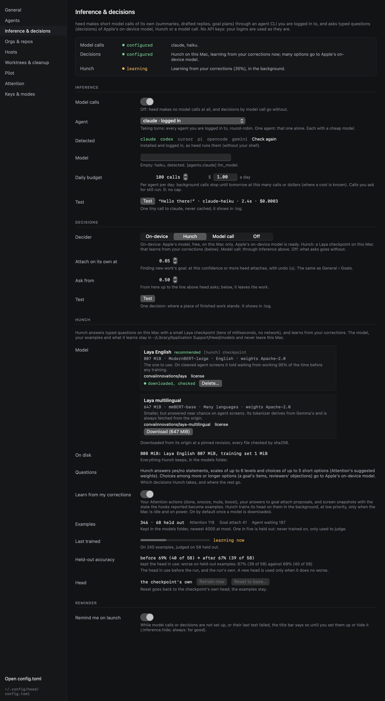

# Local learning

[Hunch](inference.md#hunch) starts from a checkpoint trained by others, which is a base to specialise rather than a
judge of your work. It gets better by learning from what you do anyway: every time you correct Heed, or act on
something it was asked about, that becomes an example. You label nothing yourself.

**Nothing leaves your Mac.** The examples, the training and the head it produces stay in
`~/Library/Application Support/Heed/models/`. No model call is made to train, and nothing trained here is shared.



## Turning it on

**Learn from my corrections** in Settings › Inference & decisions › Hunch, or in `config.toml`:

```toml
[hunch]
learn = true   # unset: on once a model is downloaded
```

It is on by default once a model is downloaded, and does nothing before. Turning it off stops a run in progress and
gathers no more examples; the ones kept stay until you delete the model folder.

## What it learns from

| Your action | The example | Answer |
|---|---|---|
| **Attention**: done, snooze, mute or boost an item | The item as Attention's suggested weight sees it, with its *How much does this want your attention* question | mute: ignore, snooze: lower, done: normal, boost: boost 1 (done and snooze count half: they say less) |
| **Goal attach**: yes, no, a move (`m`) or an undo (`u`) | The session or chat as finding its goal saw it, with *This work belongs to the goal …* | yes: true; no and undo: false; a move: false for the goal proposed, true for the one you picked |
| **[Screen snapshots](../agents/screen-snapshots.md)**, if you record them | The last 20 lines of the agent's screen, with *The last lines ask the user to answer a question or approve something* | true when the hooks said asking or blocked, false when working |

Only the newest example of a thing is kept (a snooze then a done is one example, a done). Ignores, items no one acted
on, and states read from the screen rather than reported by hooks teach nothing and are left out. Examples are
gathered an hour apart from the call log, the goals store and `heed.sqlite`, so they outlast the call log's 30 days.

At most 4,000 examples are kept, newest first and at most 2,000 of one kind, in `learning/examples.jsonl` (a few MB).
The pane shows how many there are, per kind.

## When it trains

A run trains Hunch's *head* (the decision layers on top of its encoder; the encoder itself is never changed) on your
examples, starting each time from the checkpoint's own head. A hundred examples take seconds on Apple silicon, thousands a few minutes. It runs:

- once there are **30 examples**, with at least 10 of them held out (below), and then after every **20 new ones**, at
  most once every 12 hours;
- only when the Mac has been **idle for 5 minutes**, is **on power**, is not hot, and Low Power Mode is off;
- in the background at low priority. It **stops within seconds of you using the Mac** again, and tries again later.
  A decision asked while a run is going waits for it to stop.

**Retrain now** (`:hunch.retrain`) runs one at once, without waiting for new examples or for the Mac to be idle (still
never on battery, in Low Power Mode or on a hot Mac), and does not stop when you type.

## How a new head is judged

One example in five is **held out**, chosen by the example's own id so it stays held out as the set grows: runs never
train on it, they are only judged on it. After a run, the new head and the head in use answer the held-out examples:

- The new head is **adopted only if it is not worse**: at least as many right, and when exactly as many, at least as
  sure of the right answers. A tie in both keeps the head in use.
- Otherwise the head in use stays, and the pane says why (*worse on held-out examples: 67% against 69%*).

**Held-out accuracy** in the pane shows both numbers from the last run, **before** (the head in use) and **after**
(the run's), and whether it was adopted. Decisions log the head they used in `:log` (`laya-english+english-…`).

**Reset to base** (`:hunch.reset`) goes back to the checkpoint's own head and deletes the trained one. Your examples
stay, so the next run starts again from them.

## What is kept

| File | What |
|---|---|
| `models/learning/examples.jsonl` | The examples, one per line |
| `models/learning/record.json` | The last run: when, on how many, before and after, adopted or not, and why |
| `models/learning/heads/<checkpoint>-<time>.safetensors` | The trained head in use (about 52 MB for Laya English); older ones are deleted |

Examples hold text from your work: thread summaries, session titles and prompts, and screen lines if you record
screens. They stay on this Mac with the rest of Heed's data; keep that in mind before you copy the folder anywhere.
Deleting a model (`:hunch.delete`) deletes the head trained on it too, not the examples. To start over, quit Heed and
delete `~/Library/Application Support/Heed/models/learning`.
