# Settings

`⌘,` opens Settings. It edits `config.toml` in place, keeping its comments; anything you change in the file shows up
here, and the other way round. Key bindings live only in the file.

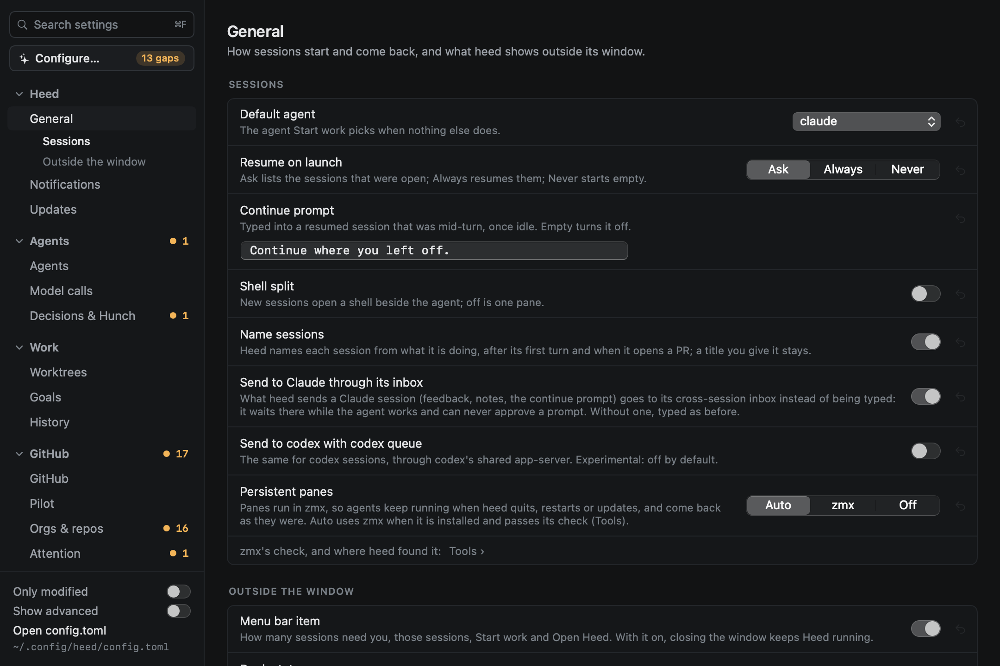

## The tree

The sidebar is a tree: five groups, their pages, and under the page shown its sections. Click a page to show it, a
section to scroll to it; the section at the top of the page is the one marked. Click a group to fold it. With the
tree focused, ↑ and ↓ move, ← folds (or goes up a level) and → unfolds (or goes down one). What is folded stays
folded when you quit and reopen heed.

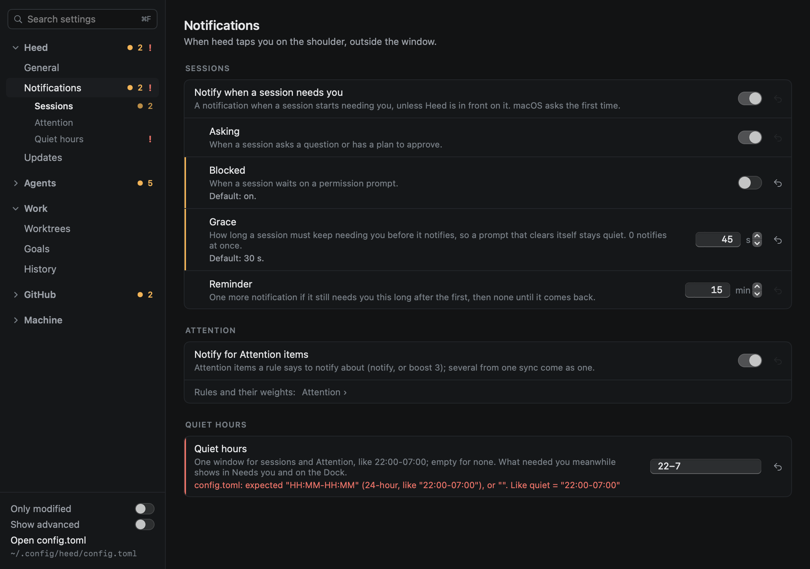

`● 3` beside a page says three of its settings differ from heed's defaults; groups add their pages up, folded or not.
A red `!` says `config.toml` has a value there heed refused.

| Group | Page | Holds |
|---|---|---|
| **Heed** | **General** | The default agent, resume on launch, the continue prompt, shell split, [persistent panes](../sessions/zmx.md), the menu bar item and the Dock state |
| | **Notifications** | [Notifications](../outside-the-window/notifications.md) when a session needs you (asking, blocked, the grace, the reminder), Attention notifications, and quiet hours, once for both |
| | **Updates** | Whether heed checks for [updates](updates.md), and whether it asks before installing |
| **Agents** | **Agents** | Each agent's own settings, in two tabs (see below) |
| | **Model calls** | Where heed's [model calls and decisions](inference.md) stand and one click to set them up, the switch for every model call, which agent takes them, a **Test**, the limits (timeout, at once, back off, daily calls and dollars), whether the inspector shows a cost and your prices, and the reminder on launch |
| | **Decisions & Hunch** | The decider and its **Test**, [finding new work's goal](../goals/attach.md) with its two thresholds and `attach.rules`, [Hunch](local-learning.md) (its model, what it keeps, learning from your corrections, how often the Mindmap placed work right) and [screen snapshots](../agents/screen-snapshots.md) |
| **Work** | **Worktrees** | Where worktrees go, the repo roots, offering to trust repos for agents, branch prefixes, Start work's [smart guesses](../start-work/repos.md#smart-guesses), the cleanup rules, and how long [saved work](../worktrees/removing.md#saved-first) is kept |
| | **Goals** | Telling agents their goal, [reviewers](../goals/reviewers.md) running on their own, items spawned, and the [GitHub mirror](../goals/github.md) |
| | **History** | When the [ledger](../history/ledger.md) writes a summary and what it includes, While you were away, the [Mindmap](../history/mindmap.md), session memory, [standups](../history/standup.md), and how long the [call log](../reference/call-log.md) keeps each kind of call |
| **GitHub** | **GitHub** | The poll interval and the issues default |
| | **Pilot** | The defaults every PR starts from, on four tabs: Get it green (with watching), Get it merged, Reviews, Instructions |
| | **Orgs & repos** | Per org and per repo, over five tabs (see below) |
| | **Attention** | The [rules](../github/attention-rules.md) in plain words, an editor that builds one, what an edit would change before you save it, and the weights |
| **Machine** | **Hosts** | Every [host](../hosts/index.md) in `[hosts.<name>]` as `config.toml` has it |
| | **Tools** | Where heed found git, gh and the rest, zmx's and Tailscale's checks, and where to look instead |
| | **Keys & modes** | The INSERT escape chord, the two [global shortcuts](../outside-the-window/global-shortcuts.md) (typed or recorded, checked before they are written), and every binding as it stands |

Each setting is on one page only. `:settings.open <page>` opens one (`general`, `notifications`, `updates`, `agents`,
`model-calls`, `decisions`, `worktrees`, `goals`, `history`, `github`, `pilot`, `orgs`, `attention`, `hosts`, `tools`,
`keys`); the names of the sections Settings had before still work (`colors`, `repos`, `cleanup`, `inference`, `llm`,
`modes`, `rules`, `ssh`) and open the page their settings are on now.

Some of what the table lists is [advanced](#show-advanced-and-only-modified) (the notification grace, model calls'
timeout, at once and back off, the attach thresholds, the call log's retention, tool paths, an agent's command line
flags, several of Get it merged's): it is on its page, but hidden until Show advanced is on or you set it.
[Search](#search) finds it either way.

## Rows

Each section is a card of rows: what the setting is and does on the left, its control on the right. Settings that only
mean something while another is on sit indented under it, and hide while it is off (unless you set one: nothing set is
ever out of sight).

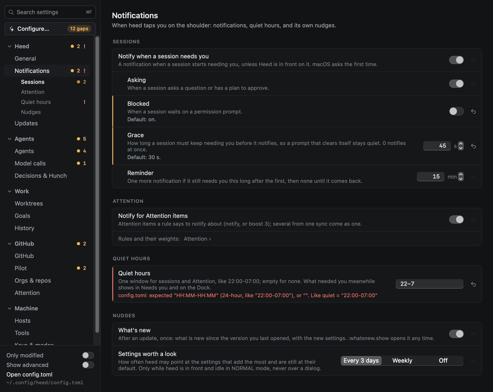

A setting changed from heed's default has an amber bar, says what the default is, and ↺ puts it back (removes the key
from `config.toml`); ↺ is dim on a setting at its default. A value `config.toml` has that heed refused has a red bar,
the reason and a line it would take; heed uses its default meanwhile, and ↺ removes the value. Problems that belong to
no setting (a syntax error, a key heed no longer reads) show at the top of Settings, as well as in the status bar.

## Show advanced and Only modified

Two switches sit at the foot of the tree, and stay as they are when you quit and reopen heed.

**Show advanced** is off at first: tuning most people never touch (timeouts, limits, retention, tool paths, command
lines) is hidden, and a card that hides some says how many at its foot, `2 advanced hidden · Show`; **Show** turns the
switch on, for every page. An advanced setting you changed, or one `config.toml` has a value heed refused for, always
shows: nothing set or broken is out of sight. The tree's counts include hidden settings.

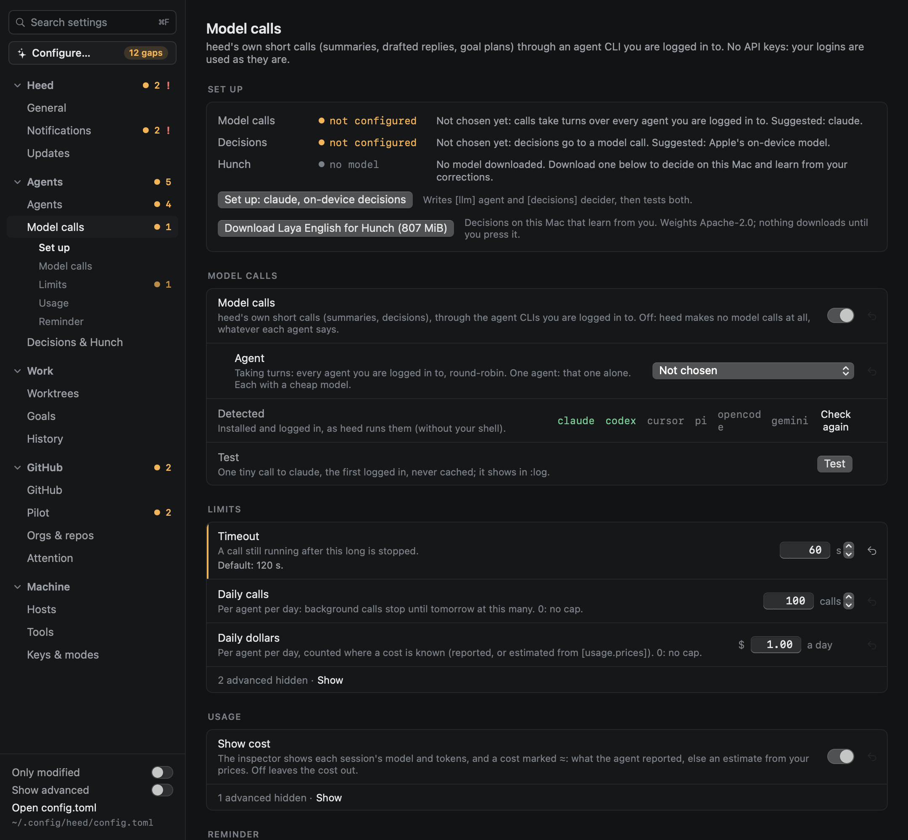

**Only modified** keeps what differs from heed's defaults, and what heed refused. The tree keeps the groups, pages and
sections with a change; each page only its changed rows, with the default to compare and ↺; Agents and Orgs & repos
only the agents, orgs and repos with one; and each tab strip (Agents, Pilot, Orgs & repos) only the tabs that hold one.
The page's line says how many, and **Reset all** puts all of them back: it asks first, lists the keys, then removes
them from `config.toml`, as each row's ↺ would. With nothing changed anywhere, the page says so. Show advanced has no
say while Only modified is on: every change shows, advanced or not.

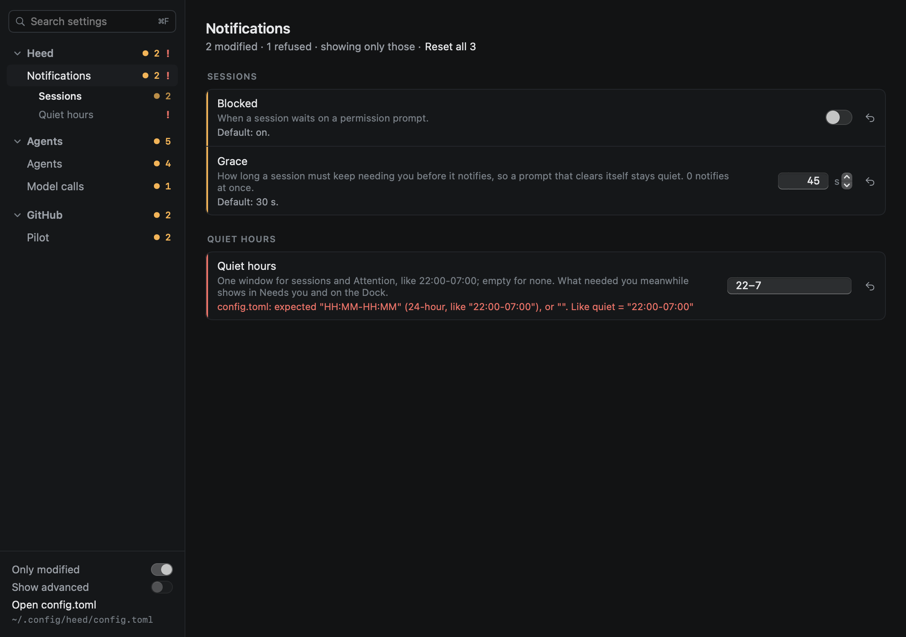

`:settings.advanced` and `:settings.modified` flip the switches from anywhere (and open Settings to show it).

## Search

The field at the top of the tree searches every setting at once: ⌘F puts the keyboard there while Settings is in
front, and `:settings.find <words>` opens Settings with the words typed. Every word has to match somewhere in a
setting: its name, its description, its page, group, section or tab, or its key as `config.toml` writes it
(`grace_seconds`, `notifications.grace_seconds`, `llm.timeout_seconds`, `[orgs.<org>] watch`). Case does not matter.

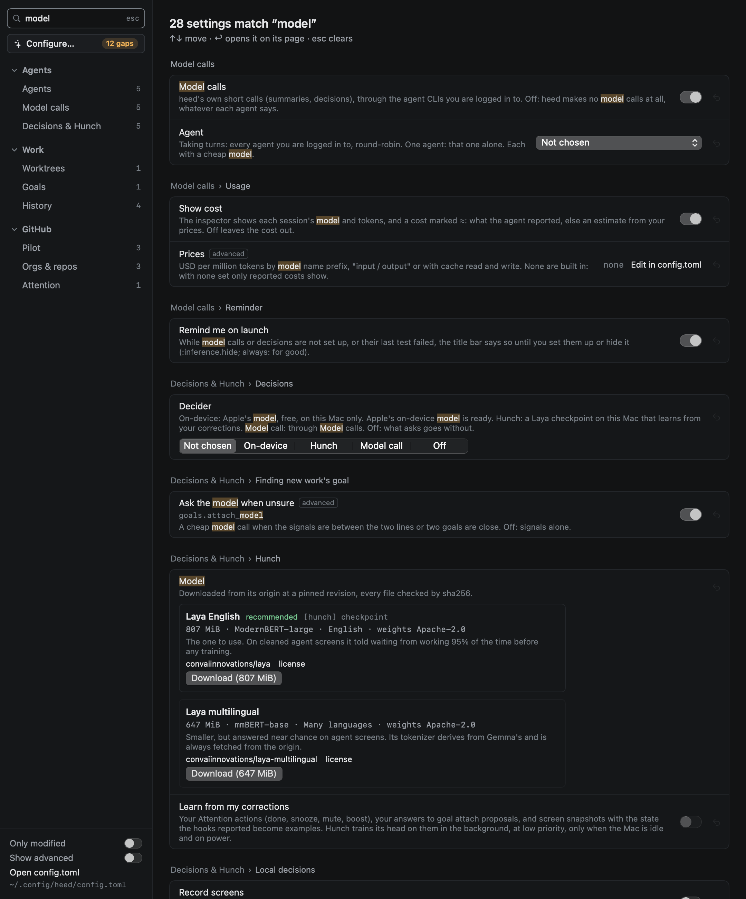

While the field has words, the tree keeps the pages with matches, each with how many; their groups are open (the
folds come back as they were when the field is empty). The pane says how many settings match and lists them as their
own pages draw them, so you can change one there: the same controls, the amber bar of a changed one, its default and
↺. Each card is headed by where it is, `Model calls › Limits`, or for an agent, org or repo `Agents › claude ›
Sessions › Starting`. The page whose name matched comes first. A match on its key shows the key; an advanced setting is
found whether Show advanced is on or not, and is tagged `advanced`.

An agent's setting is listed for each agent that changes it, else for the default agent; an org or repo setting for
each org or repo that overrides it, else for the first org Orgs & repos lists. A host setting with no host yet is
listed with nowhere to set it.

↑ and ↓ move through the matches, ↩ opens the one you are on (the first, before you move) on its page: the search
clears, the page opens on its tab and its agent, org or repo, and the row is scrolled to and flashes. Clicking a card's
heading does the same for its first row. An advanced row opened this way turns Show advanced on, so it is there. ⎋
clears the field. With **Only modified** on, search finds only what differs from heed's defaults (or that heed
refused); when that leaves nothing, the pane says so and offers to turn Only modified off.

## Agents

The list has **Every agent**, what the agents share (the default agent on General, model calls and their limits on
Model calls), then each agent with what it is and how many of its settings are changed:

| Mark | Means |
|---|---|
| `✓` | Ready: installed, logged in, its hooks passed per run |
| `○` | Not installed (dimmed) |
| `!` | Broken, and why: logged out, its own command not found, its last test failed |

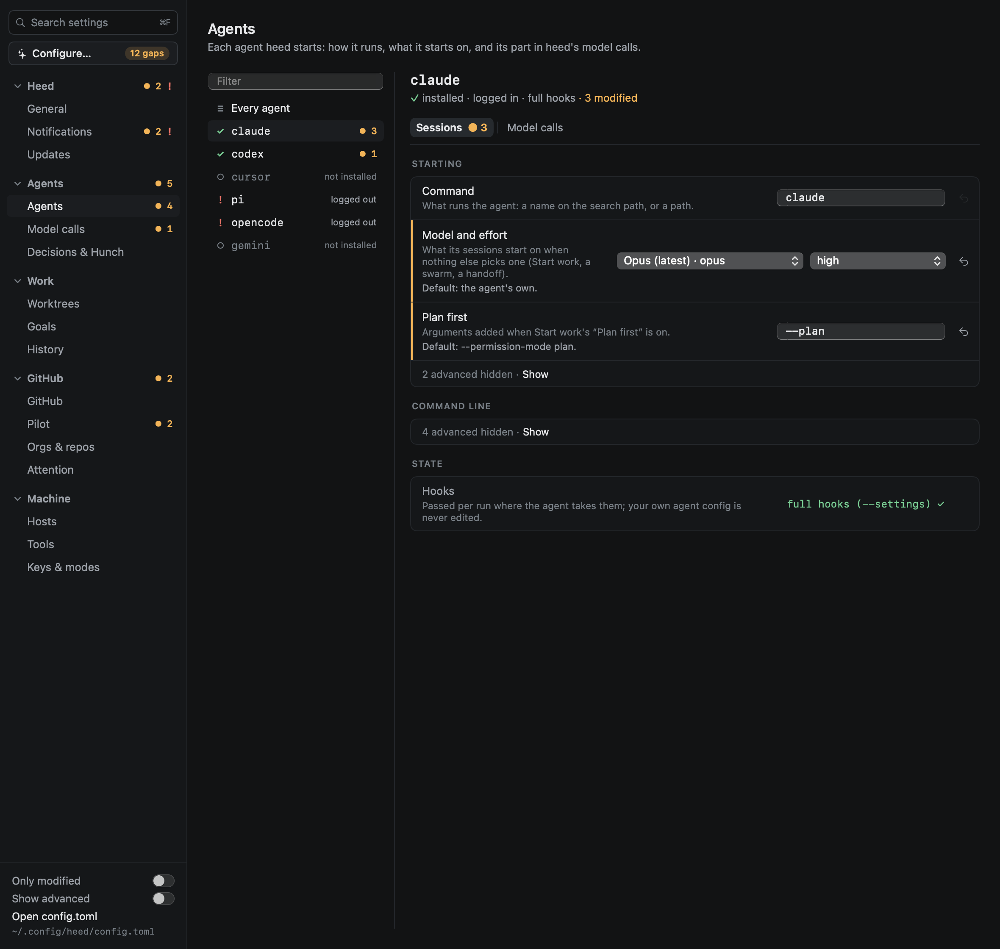

For the selected agent, its status line (`installed · logged in · full hooks · 3 modified`) and two tabs, each with its
count. **Sessions**: its command, prompt delivery, the [model and effort](../agents/models.md) its sessions start on,
plan and resume arguments, its command line flags, profiles and screen patterns, and its hooks. **Model calls**: its
part in heed's [model calls](../agents/model-calls.md): whether it takes part, its login, its model, and a **Test**.
⌘1 and ⌘2 turn to a tab, and the tab stays as it is for every agent. `:settings.open agents codex model-calls` opens
codex on its Model calls tab.

## Pilot

The defaults every PR starts from, on the same tabs Orgs & repos has: **Get it green** (watching, whether and how get
it green runs, the agents and models of its runs and of merge-conflict runs), **Get it merged** (whether and how PRs
merge, what heed waits for, merging by hand), **Reviews** and **Instructions**. `:settings.open pilot merged` opens it
on a tab; the link at its foot leads to the same tab of Orgs & repos.

## Orgs & repos

The same two panes as Agents: every org and repo heed knows, from the repo list and from `config.toml` (ones you have
not cloned here say so). A marked one, `● 3`, overrides three settings.

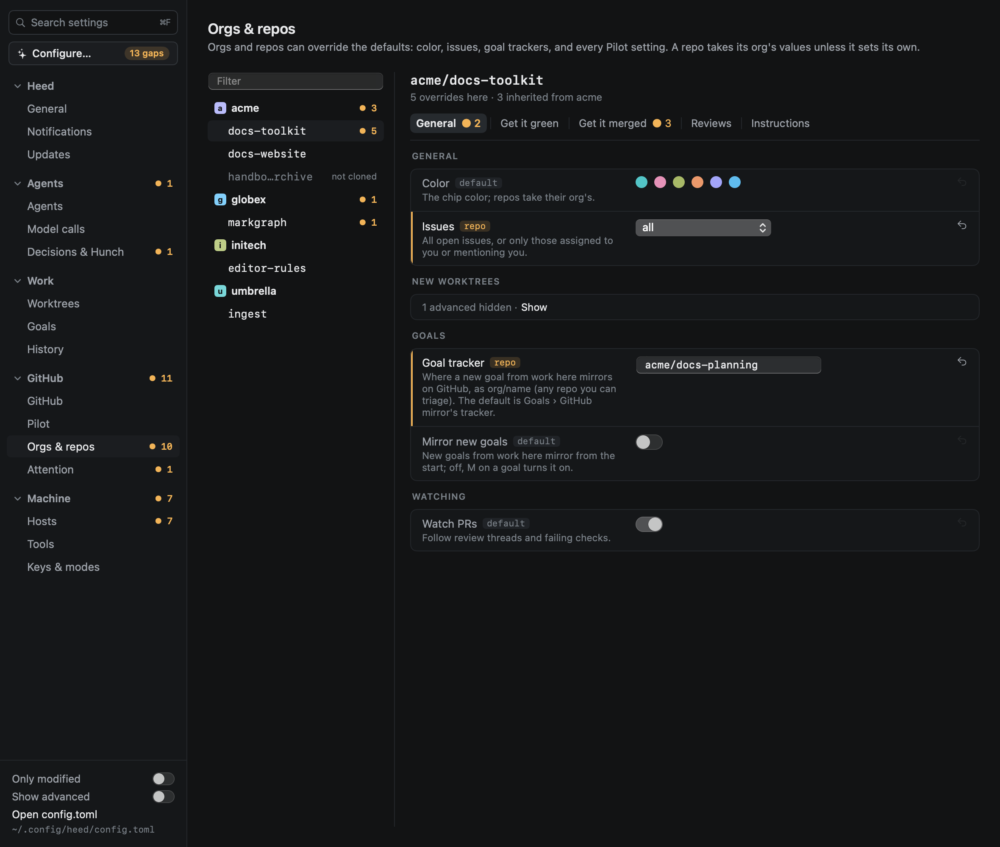

For the selected org or repo, each setting shows the value that applies and where it comes from: `default` (heed's,
or `[pilot]`), `org` or `repo`. Overridden rows are marked. Changing a value writes the override
(`[orgs.acme] reviewers = ["copilot"]`, `[repos."acme/docs-toolkit"] quiet_minutes = 15`); ↺ removes it, and
the value falls back to the org's, then the default.

### Tabs

The settings are split over five tabs, and each tab says how many overrides it holds at the selected org or repo
(`General ● 2`), so you can see where they are without opening each one. Click a tab, or press ⌘1 to ⌘5. The tab stays
as it is when you pick another org or repo, and when you quit and reopen heed.

| Tab | What it holds |
|---|---|
| **General** | Color, issues, the setup new worktrees run, the goal tracker and mirroring, watching PRs, and a repo's tasks (shown here, edited in the file) |
| **Get it green** | Whether get it green runs, when it stops, where its runs go, and the agents, models and efforts for its runs and for merge conflicts |
| **Get it merged** | Whether and how PRs merge, what heed waits for before it merges (quiet time, gate checks, hold labels), and merging by hand (merge now, force merge) |
| **Reviews** | Reviewers asked on each PR, AI reviewers whose review counts as an approval, self-review, and what Copilot is asked to fix |
| **Instructions** | Extra instructions for get it green, self-review, Start work and summaries, and signing off with a summary |

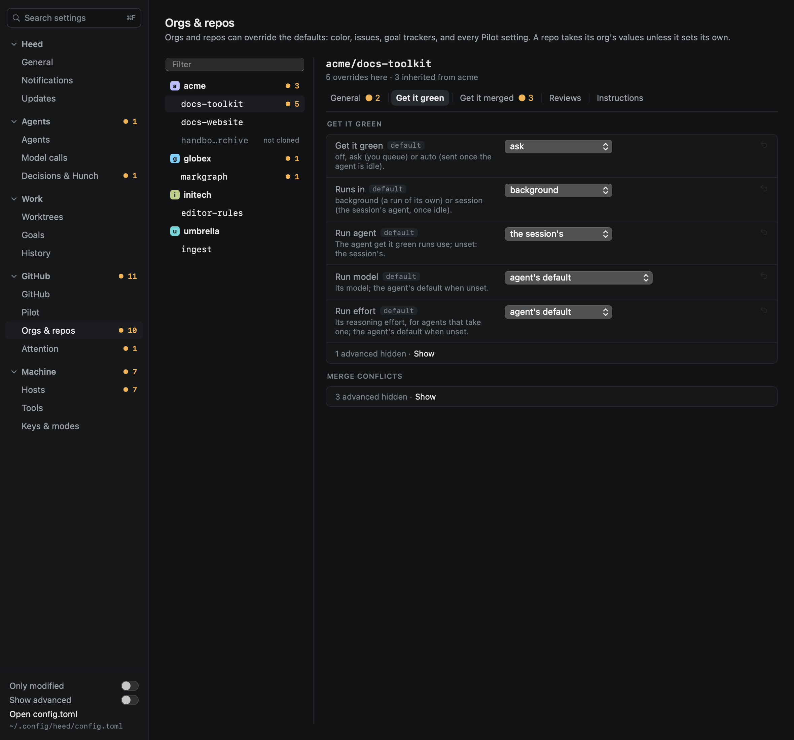

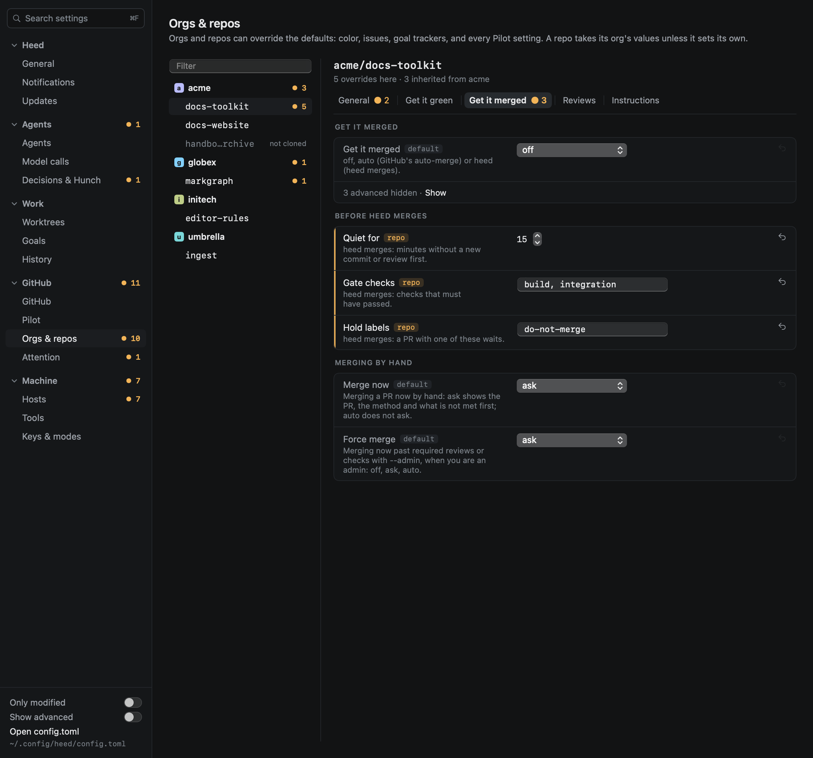

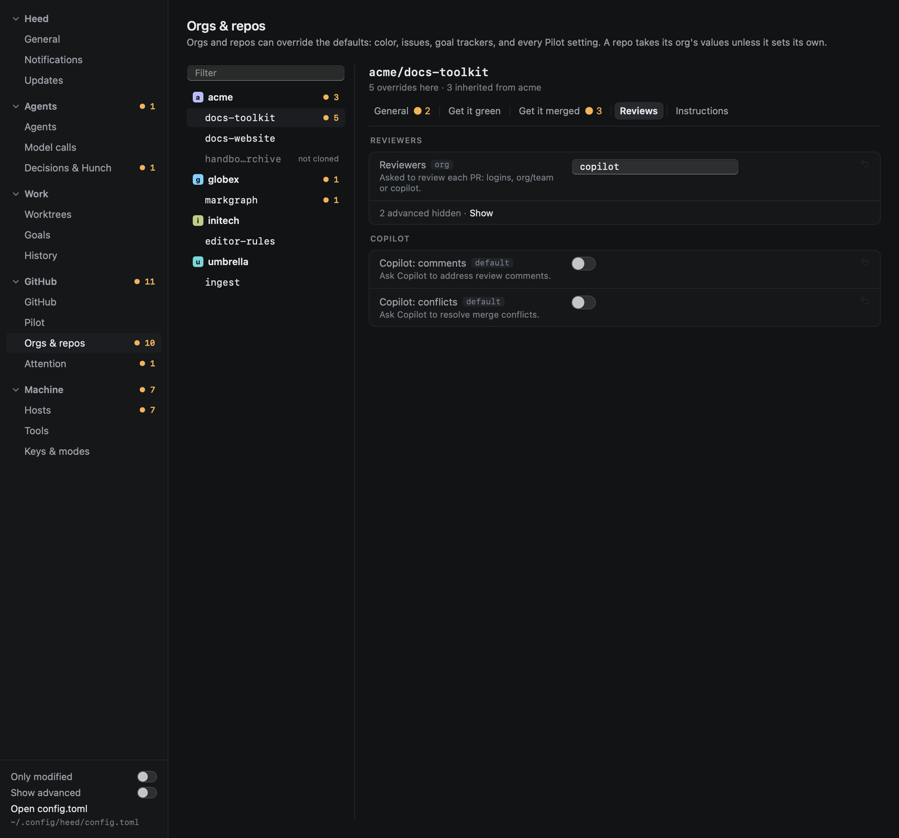

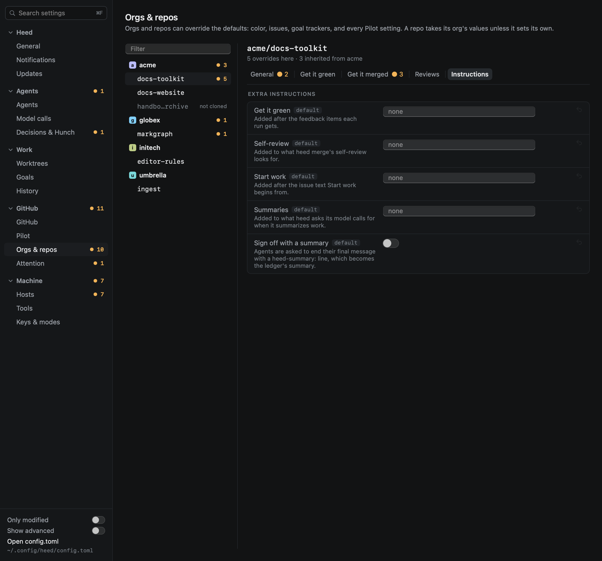

`:settings.open colors <tab>` opens the page on a tab (`general`, `green`, `merged`, `reviews`, `instructions`), and
the links that lead here land on the right one: `:setup.edit` and the link under Goals › GitHub mirror on General, the
link at the foot of Pilot on the tab it was on.

**Goals**, on General, holds the [goal tracker](../goals/github.md#the-tracker) a new goal from work in this org or
repo mirrors to (`goals_tracker`), and whether it mirrors from the start (`goals_mirror`); their defaults are
Goals › GitHub mirror's tracker and **Mirror new goals**. Emptying the tracker field removes the override.

### Only modified

With [Only modified](#show-advanced-and-only-modified) on, the list keeps the orgs and repos that override something
(or have a value heed refused), the tabs only those holding an override at the selected one, and each tab only its
overridden rows:

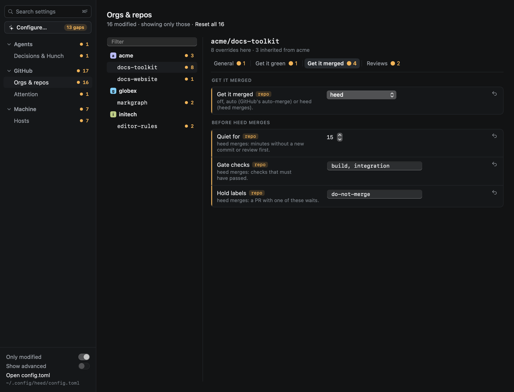

An override a repo inherits from its org is not one of its own: it shows on the org.

### Narrow windows

In a narrow window the list cuts long repo names in the middle (hover for the whole name), the tabs use short names
(Green, Merged, Prompts) and take two lines, and each setting puts its control under its label rather than beside
it:

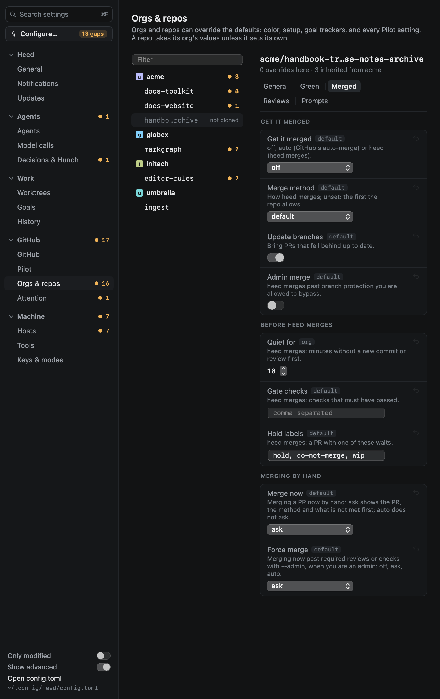

## Hosts

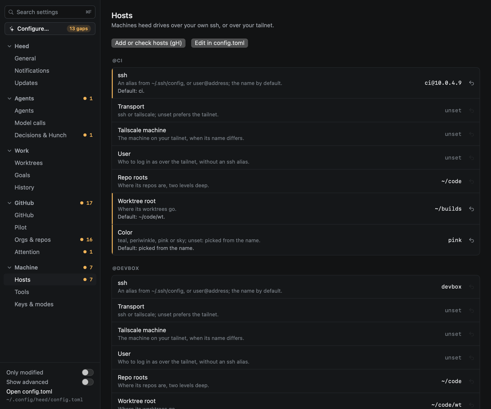

Hosts are added and checked in `gH`, which reads `~/.ssh/config` and your tailnet; this page lists what
`config.toml` says about each, and which values are the defaults. Change one in the file (**Edit in config.toml**).

Each key set there is marked like any other setting, and ↺ removes it.
