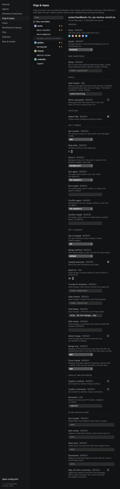
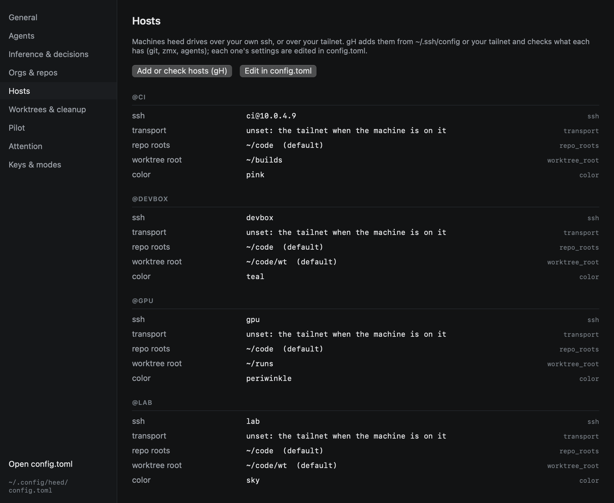

# Settings

`⌘,` opens Settings. It edits `config.toml` in place, keeping its comments; anything you change in the file shows up
here, and the other way round. Key bindings live only in the file.

| Section | Holds |
|---|---|
| **General** | Default agent, resume on launch, the continue prompt, shell split, persistent panes, when the History [ledger](../history/ledger.md) writes a summary and what it includes, [Goals](../goals/index.md) (telling agents their goal, [finding new work's goal](../goals/attach.md) with its two thresholds, the model and `attach.rules`, [reviewers](../goals/reviewers.md) running on their own and their runs a day, and the [GitHub mirror](../goals/github.md)'s tracker, per org too, whether new goals mirror and the label), menu bar item, Dock state, [notifications](../outside-the-window/notifications.md) (which states, the grace, the reminder, quiet hours), GitHub poll interval, issues default, how long the [call log](../reference/call-log.md) keeps each kind of call, [updates](updates.md) (whether Heed checks, and whether it asks before installing), and where `git`, `gh` and `zmx` are |
| **Agents** | Each agent's command, prompt delivery, plan and resume arguments, and its part in Heed's [model calls](../agents/model-calls.md): whether it takes part, whether it is installed and logged in, its model, and a **Test**; then model calls for every agent (`[llm]`): the switch that turns them all off or back on, the timeout, how many run at once, the back-off, and the daily caps in calls and dollars; **Usage**: whether the inspector shows a cost, and how many prices `[usage.prices]` sets; below them, **Local decisions**: whether [screen snapshots](../agents/screen-snapshots.md) are recorded, how long they are kept, what is kept so far, how many [Start work outcomes](../agents/screen-snapshots.md#start-work-outcomes) are kept, and **Delete all** |
| **Inference & decisions** | Where Heed's [model calls and decisions](inference.md) stand, what goes without, one click to set both up from what this Mac has, the agent, its model, the daily budget, the decider, the goal attach thresholds, a **Test** of each, and the reminder on launch |
| **Orgs & repos** | Per org and per repo: colour, issues, the [goal tracker](../goals/github.md#the-tracker) and whether new goals mirror, and every Pilot setting, with which ones override the defaults (see below) |
| **Hosts** | Every [host](../hosts/index.md) in `[hosts.<name>]` with its ssh destination, transport, tailnet machine, user, repo roots, worktree root and colour, read-only; **Add or check hosts** opens `gH`, and each host is edited in `config.toml` |
| **Worktrees & cleanup** | Where worktrees go, the repo roots, offering to trust repos for agents, Start work's [smart guesses](../start-work/repos.md#smart-guesses), the cleanup rules, and how long [saved work](../worktrees/removing.md#saved-first) is kept |
| **Pilot** | The defaults every PR starts from: watching, get it green, get it merged and their rules, [merge now and force merge](../github/watch.md#ready-to-merge-and-merge-now), extra instructions for heed's prompts (summaries too), and whether agents sign off with a summary |
| **Attention** | The [rules](../github/attention-rules.md) in plain words, an editor that builds a rule from choices, what an edit would change over the last 30 days before you save it, the weights, Attention notifications and quiet hours |
| **Keys & modes** | The INSERT escape chord, the two [global shortcuts](../outside-the-window/global-shortcuts.md) (typed or recorded, checked before they are written), and every binding as it stands, read-only: bindings are edited in `config.toml` |

## Orgs & repos

Every org and repo heed knows, from the repo list and from `config.toml` (ones you have not cloned here say so). A
marked one, `● 3`, overrides three settings; **Only overridden** hides the rest.

For the selected org or repo, each setting shows the value that applies and where it comes from: `default` (heed's,
or `[pilot]`), `org` or `repo`. Overridden rows are marked. Changing a value writes the override
(`[orgs.acme] reviewers = ["copilot"]`, `[repos."acme/docs-toolkit"] quiet_minutes = 15`); ↺ removes it, and
the value falls back to the org's, then the default. A repo's tasks show here and are edited in the file.

**Goals** holds the [goal tracker](../goals/github.md#the-tracker) a new goal from work in this org or repo mirrors
to (`goals_tracker`), and whether it mirrors from the start (`goals_mirror`); their defaults are General › Goals'
tracker and **Mirror new goals**. Emptying the tracker field removes the override.

In a narrow window the list cuts long repo names in the middle (hover for the whole name), and each setting puts its
control under its label rather than beside it:

## Hosts

Hosts are added and checked in `gH`, which reads `~/.ssh/config` and your tailnet; this page lists what
`config.toml` says about each, and which values are the defaults. Change one in the file (**Edit in config.toml**).

Problems in the file show at the top of Settings as well as in the status bar.
