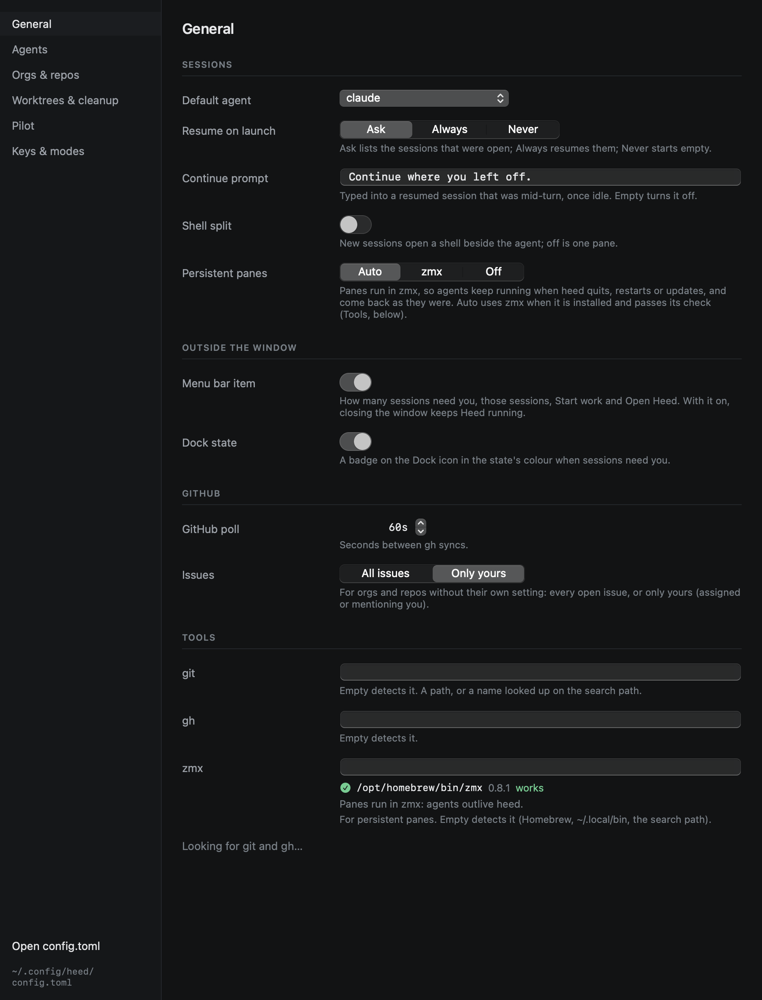
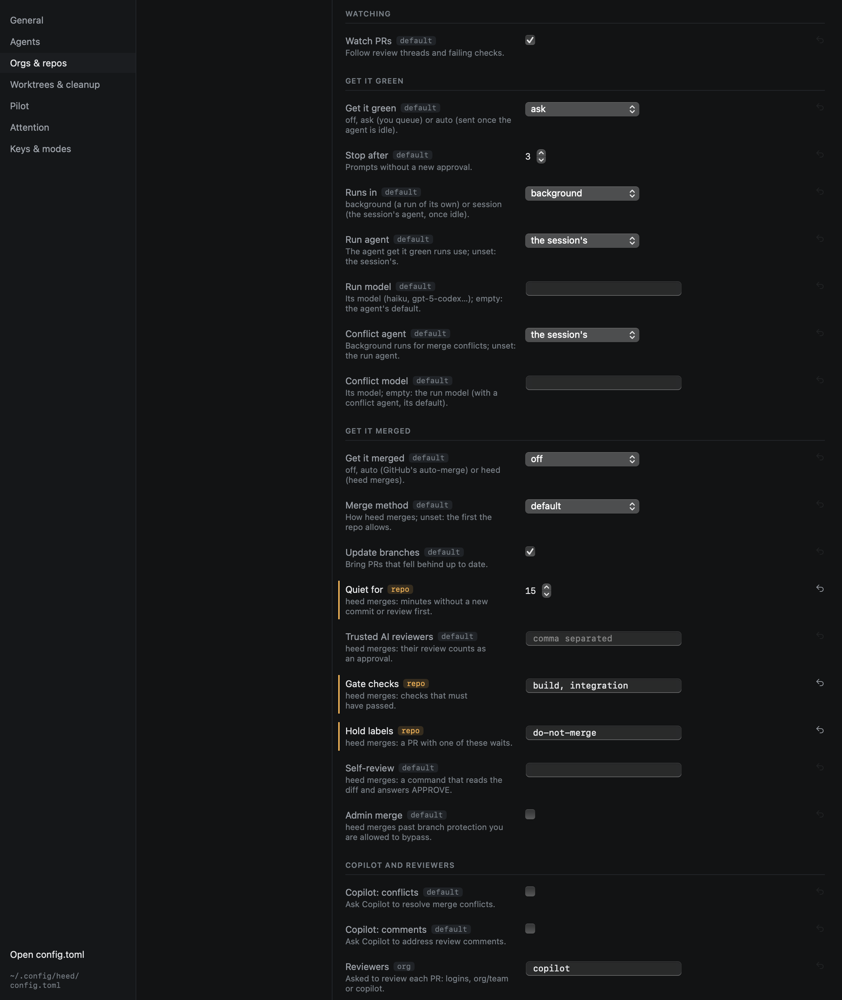

# Settings

`⌘,` opens Settings. It edits `config.toml` in place, keeping its comments; anything you change in the file shows up
here, and the other way round. Key bindings live only in the file.

| Section | Holds |
|---|---|
| **General** | Default agent, resume on launch, the continue prompt, shell split, persistent panes, when the History [ledger](../history/ledger.md) writes a summary and what it includes, menu bar item, Dock state, [notifications](../outside-the-window/notifications.md) (which states, the grace, the reminder, quiet hours), GitHub poll interval, issues default, how long the [call log](../reference/call-log.md) keeps each kind of call, and where `git`, `gh` and `zmx` are |
| **Agents** | Each agent's command, prompt delivery, plan and resume arguments, and its part in Heed's [model calls](../agents/model-calls.md): whether it takes part, whether it is installed and logged in, its model, and a **Test** |
| **Orgs & repos** | Per org and per repo: colour, issues, and every Pilot setting, with which ones override the defaults (see below) |
| **Worktrees & cleanup** | Where worktrees go, the repo roots, offering to trust repos for agents, the cleanup rules, and how long [saved work](../worktrees/removing.md#saved-first) is kept |
| **Pilot** | The defaults every PR starts from: watching, get it green, get it merged and their rules, extra instructions for heed's prompts (summaries too), and whether agents sign off with a summary |
| **Attention** | The [rules](../github/attention-rules.md) as a list and as text, what an edit would change over the last 30 days before you save it, the weights, Attention notifications and quiet hours |
| **Keys & modes** | The INSERT escape chord and every binding as it stands, read-only: bindings are edited in `config.toml` |

## Orgs & repos

Every org and repo heed knows, from the repo list and from `config.toml` (ones you have not cloned here say so). A
marked one, `● 3`, overrides three settings; **Only overridden** hides the rest.

For the selected org or repo, each setting shows the value that applies and where it comes from: `default` (heed's,
or `[pilot]`), `org` or `repo`. Overridden rows are marked. Changing a value writes the override
(`[orgs.acme] reviewers = ["copilot"]`, `[repos."acme/docs-toolkit"] quiet_minutes = 15`); ↺ removes it, and
the value falls back to the org's, then the default. A repo's tasks show here and are edited in the file.

Problems in the file show at the top of Settings as well as in the status bar.
