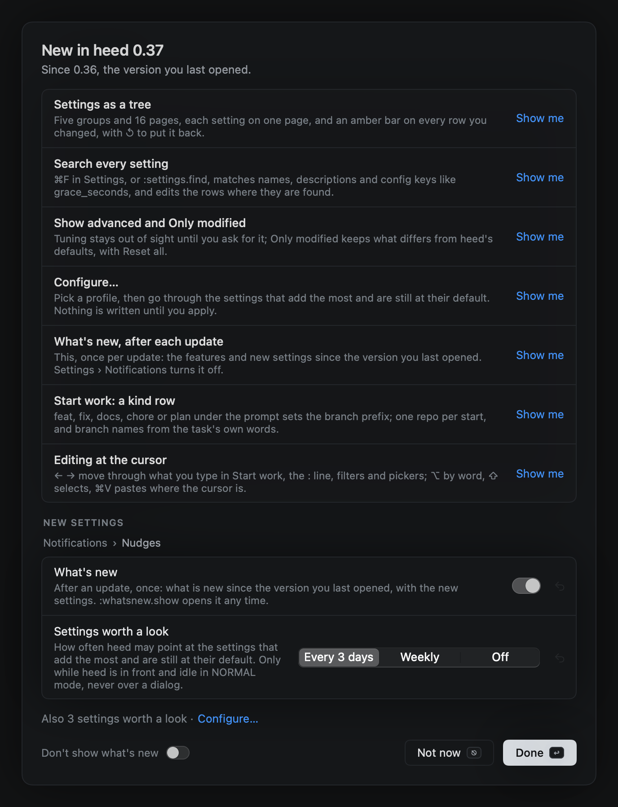
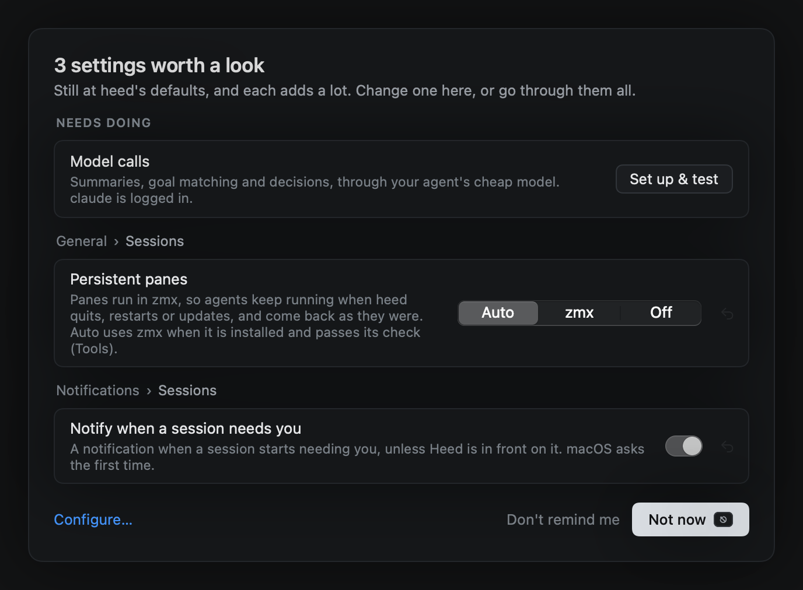
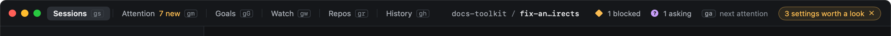

# What's new and nudges

heed has two nudges of its own. After an update, **New in heed X** lists what changed since the version you last
opened. Every few days, **Settings worth a look** lists the high-impact settings that are still at heed's defaults.
Neither shows while you are busy, and neither brings heed to the front.

## New in heed X



The first time you open heed after an update, it lists:

- the **features** added since the version you last opened, each in one line. **Show me** opens the view, the
  command or the Settings page it is about.
- the **new settings** from those versions, with their real controls. Changing one here is the same as changing it
  in Settings: it is written to `config.toml` and gets the same amber mark and ↺. Advanced settings, and settings set
  per agent, org or repo, are counted rather than shown. You find them on their pages in Settings.
- **Also N settings worth a look · Configure…**, when there are high-impact settings you have not decided on yet.

**Done** (↩) closes it, and it does not show again for that version. **Not now** (⎋) closes it for now, and it comes
back the next time you launch heed. **Don't show what's new** turns it off (`whats_new = false`).

When you update across several versions, it covers all of them. It skips your very first launch, because the welcome
screen comes first. That launch also starts the clock for the settings nudge, so the first one comes a full cadence
later. A local build that is not a release (`0.1.0-dev`) never shows it on its own.

**Help › What's New in Heed**, or `:whatsnew.show`, opens it at any time. It covers the same versions the last one did.

## Settings worth a look



These are the settings Configure… ranks as high impact that are still at heed's defaults and that you have not
decided on: persistent panes, model calls, and notifications. Some need something done before there is a choice.
Persistent panes needs zmx installed, so heed shows the install commands and **Check again**. heed never installs
zmx. Model calls needs an agent you are logged in to, so heed shows **Set up & test**. That writes the agent and the
decider that Settings › Model calls suggests, then tests both. Any other setting appears as its row.

**Configure…** goes through every setting worth deciding, with a profile first (see [Configure…](configure.md)).
Deciding on a setting there, even with Keep default, stops heed from asking about it again. **Not now** (⎋) closes the
nudge until the next one. **Don't remind me** turns this nudge off (`gaps = "off"`).

### The title bar pill



Between nudges, the title bar shows **N settings worth a look** while any are left. Click it to open Configure…, or
click × to hide it until the next launch. Right-click it for **Don't remind me**, which turns the nudge and the pill
off for good. `:nudges.hide` does the same as ×, and `:nudges.hide always` the same as Don't remind me.

## When a nudge may show

heed shows a nudge only at a safe moment:

- **on launch**, when no other dialog is up (when the resume dialog or While you were away is open, it waits for the
  next safe moment), or
- **while heed is in front and idle**, with its main window focused, nothing typed, clicked or moved for 60 seconds,
  in NORMAL mode.

It never shows:

- while you are typing in a terminal (INSERT), on the `:` line (COMMAND), selecting (VISUAL) or picking a hint;
- over another dialog, overlay or form: resume, While you were away, the welcome screen, Start work, a picker, a
  reader, the help;
- in front of another app. heed never activates itself or raises its window for a nudge. One that comes up while heed
  is behind waits in the window until you look.

Only one nudge shows at a time. What's new comes first, and it also restarts the clock for the settings nudge.

## How often

```toml
[nudges]
whats_new = true                   # after an update, once
gaps = "3d"                        # 3d | weekly | off
```

- `gaps = "3d"` (the default) shows the settings nudge at most once every three days, and `"weekly"` at most once a
  week. It shows only when something is left to look at. `"off"` turns off both the nudge and the title bar pill.
- `whats_new = false` turns off New in heed X. `:whatsnew.show` still opens it.

Settings › Notifications › Nudges sets both. heed keeps the version you last opened and the time of the last nudge in
its own preferences, not in `config.toml`.
