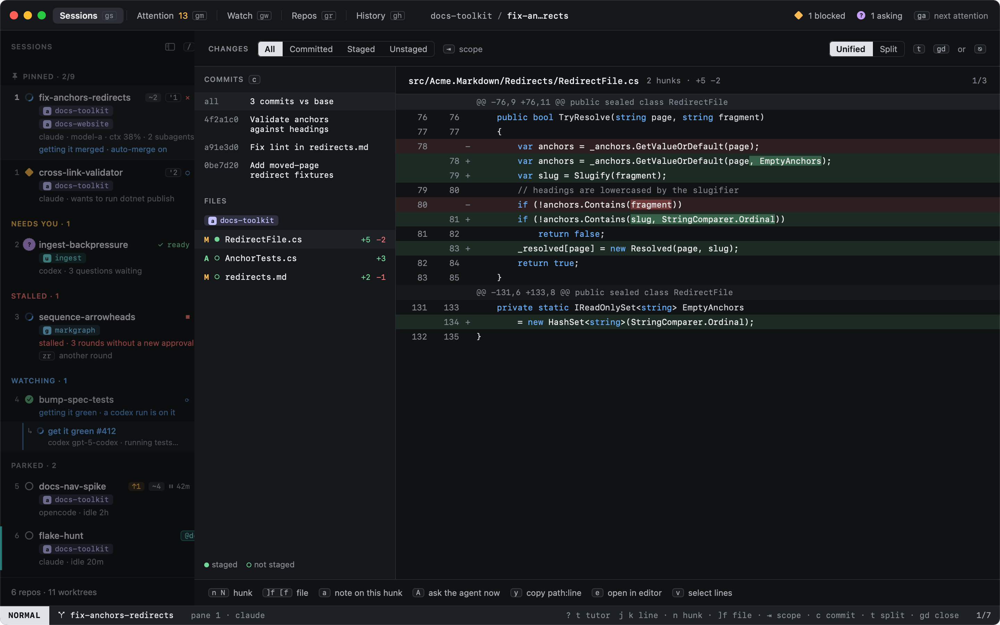
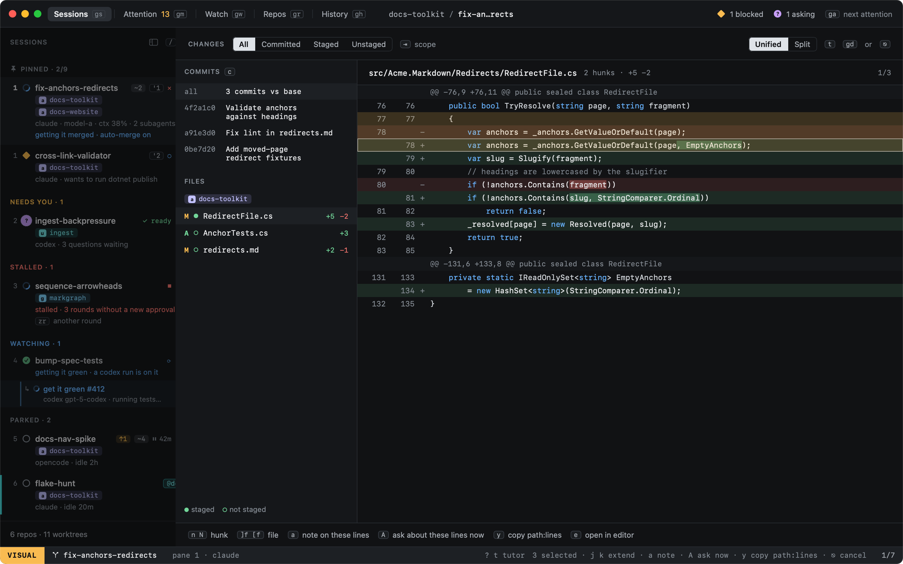

# Diff

`gd` opens the diff overlay for the session's worktree: what changed, file by file, hunk by hunk, with word-level
highlights.

| Key | |
|---|---|
| `⇥` / `⇧⇥` | Scope: **all**, **committed**, **staged**, **unstaged** |
| `c` | One commit at a time (cycles through the branch's commits) |
| `]f` / `[f` | Next / previous file |
| `n` / `N` | Next / previous hunk |
| `j` / `k` | Move by line |
| `v` | Select lines (below) |
| `gd` or `⎋` | Close |

See [Reviewing changes](reviewing.md) for the split view and acting on a hunk.

## With the mouse

Everything above is a click too. A file in the list shows that file; a commit shows that commit alone, and **all**
the whole branch again. A click on a line moves the cursor there, and a double-click writes a note on it, as `↩` does.
The key hints along the top and bottom are buttons: `⇥ scope`, **Unified** and **Split** (`t`), `c` for the next
commit, `⎋` to close, and the actions below the diff (`a`, `A`, `y`, `e`).

## Selecting lines

`v` starts a selection on the line under the cursor, and `j` and `k` extend it. With the mouse, drag over the lines,
or shift-click where the selection should end; a click on a hunk's header selects the whole hunk.

While lines are selected, `a` writes a note on them (on the first of them), `A` asks the agent about them
(`About path lines 77-78 …`), and `y` copies `path:first-last`. A right-click on a selected line offers the same, for
all of them; a right-click anywhere else moves the cursor there first. `⎋` drops the selection, and a second `⎋`
closes the overlay.

Selecting works in the unified view; the split view is for reading.
