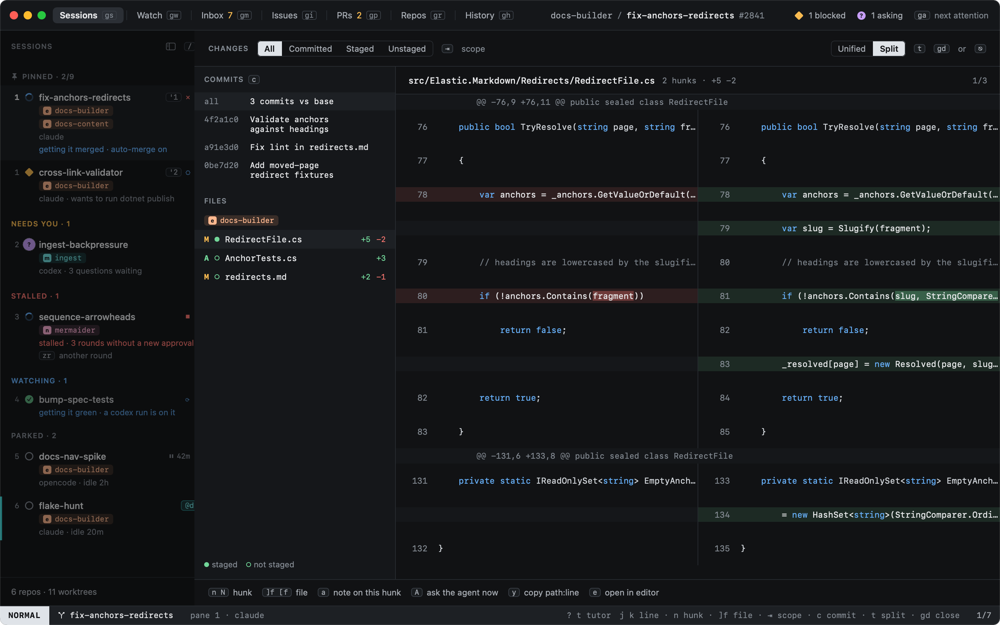
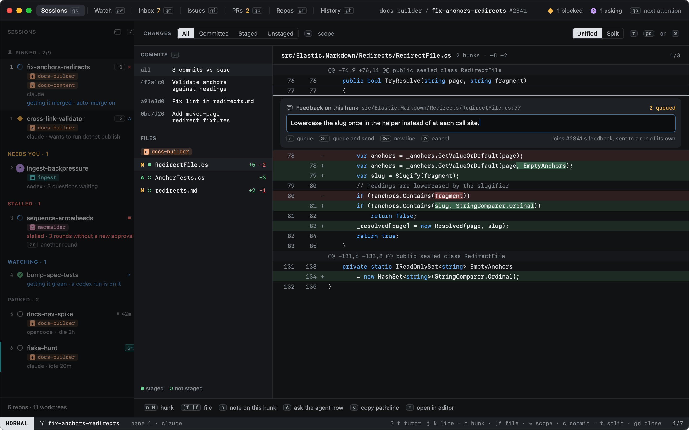
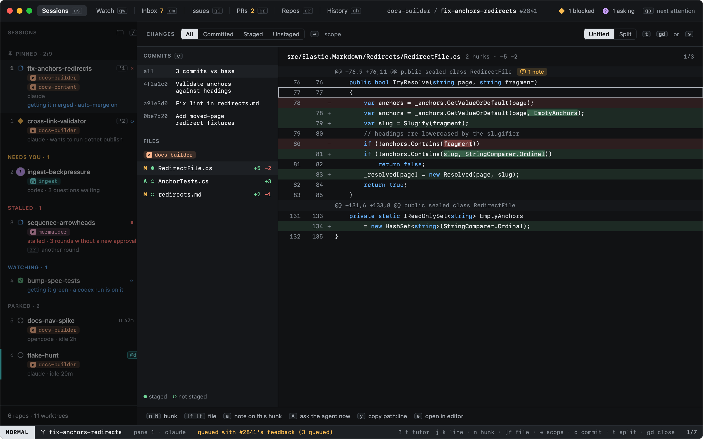

# Reviewing changes

`t` switches between the unified and the split view.

From the line under the cursor:

| Key | |
|---|---|
| `a` | Write a note on this hunk, queued for the agent (below) |
| `A` | Ask the agent about this hunk now: its location goes to the agent's pane, and you finish the question there |
| `e` | Open the file at that line in your editor |
| `y` | Copy `path:line` |

Changed words within a line are highlighted, so a one-character fix stands out in a long line.

## Notes on a hunk

`a` opens a comment box under the line. Everything you type goes into it until you queue or cancel:

| Key | |
|---|---|
| `↩` | Queue the note |
| `⌘↩` | Queue it and send what is queued now |
| `⇧↩` | New line |
| `⎋` | Cancel |

A note keeps the file, the line (on the new side), your words, and up to 20 lines of the hunk around the line. The
prompt carries it as `path:line (you): your note`, with those lines in a fenced block after it.

Where it goes, as the box says on its right:

- **The session has a pull request** in that repo: the note joins the PR's [review feedback](../github/review-feedback.md)
  as a queued item, next to the review threads and failing checks, and goes out with them (`s` in the PR overlay,
  or on its own with **Auto when idle**).
- **No pull request yet**: it waits on the session. `go` opens the PR overlay on a **your notes** tab, where `space`,
  `s` and `x` work the same, and the inspector lists them. `s` types them into the session's own agent once it is
  idle. When the session tracks a PR in that repo later, its notes move into that PR's feedback.

A hunk with notes not yet sent says so on its header:

