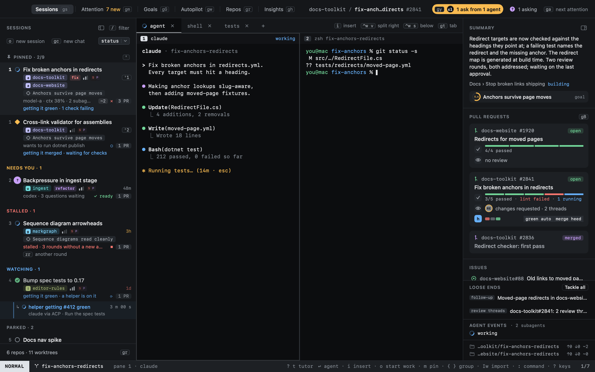

# Getting started

In four steps you install heed, see what it finds on your Mac, learn its keys, and merge a first PR.

1. [Install heed](installation.md): with Homebrew, the install script or the disk image, or from source.
2. [The first run](first-run.md): what heed looks for, and what it will and will not change.
3. [The tutor](tutor.md): the keys, learnt by doing: a nine-step tour and a lesson per view, on a pretend world.
4. [Your first session](first-session.md): from a sentence to a merged PR.

When a piece of work takes more than one session, give it a [goal](../goals/index.md): `gG` opens Goals and `n` makes
one. From then on heed puts new sessions and chats on the goal when it is sure, asks when it is not, and their agents
read its `GOAL.md` first.

**Next:** [Install heed](installation.md).
