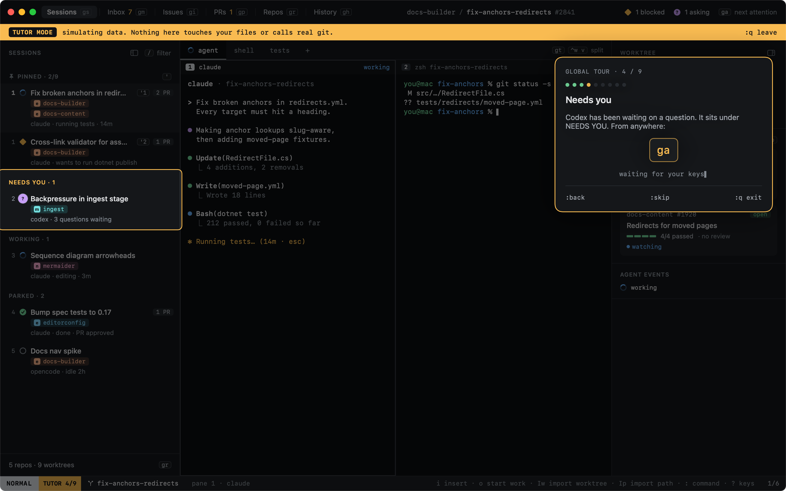
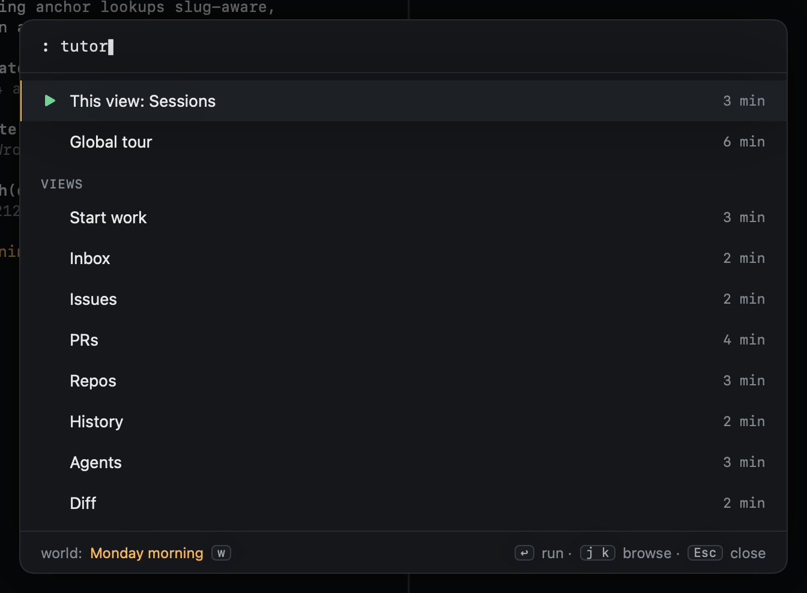
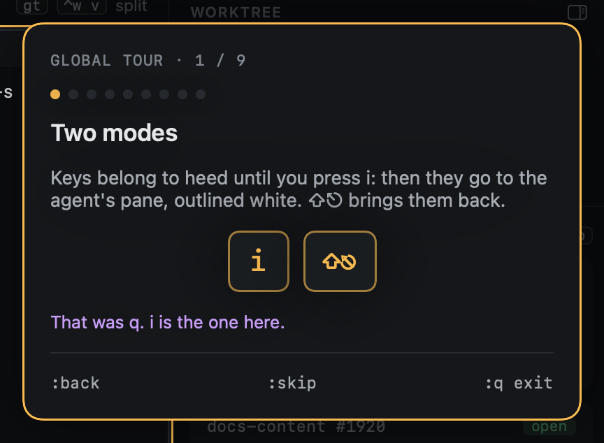
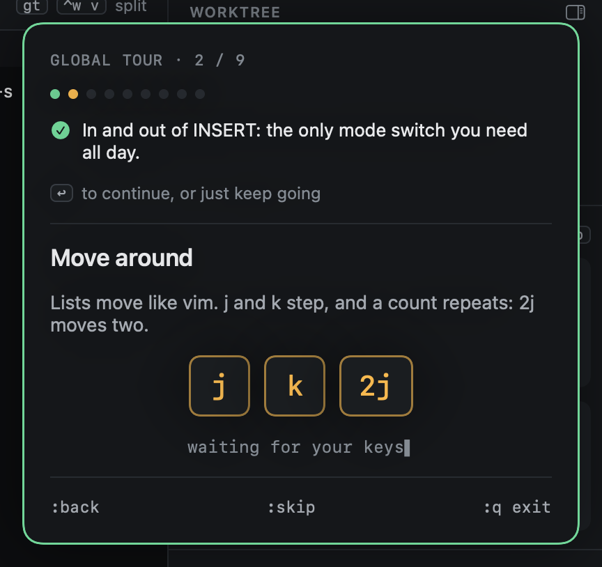
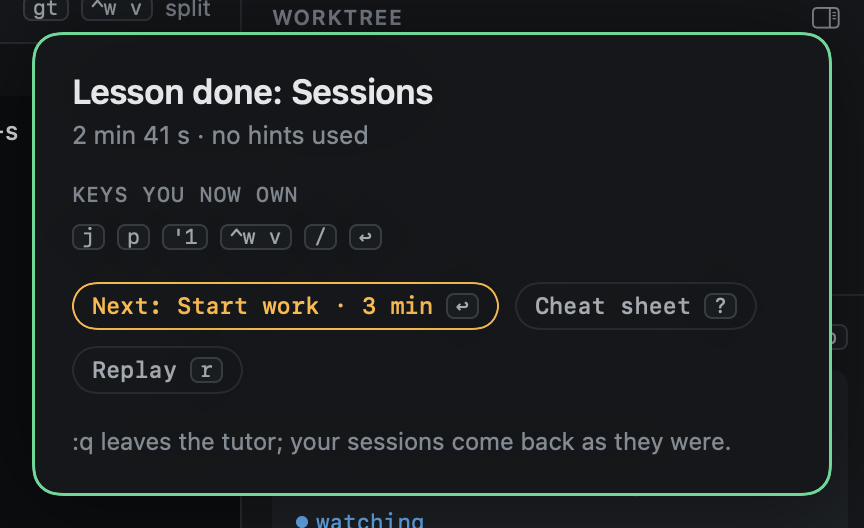

# The tutor

The tutor is a vimtutor for Heed: the real app, in the same window, running a pretend world. Every step is a real key in
a real view. Nothing you do there touches your files, calls git or reaches an agent, and your own sessions keep running
underneath (the Dock and the menu bar stay live). They come back exactly as they were when you leave.

## Two layers

- **The global tour**: nine steps, about six minutes. Two modes, moving around, pins, the session that needs you,
  Start work, panes, views, the command line, and the keys sheet. The first-run screen offers it (`t`, show me around).
- **View lessons**: one per view, two to four minutes each: Sessions, Start work, Inbox, Issues, PRs, Repos, History,
  Agents and Diff. Each opens in its view.

## Starting it

| From | |
|---|---|
| `:tutor` | The picker: the lesson for the view you are on first, then the tour and every other lesson |
| `:tutor prs` | Straight into a lesson: `tour`, `sessions`, `start-work`, `inbox`, `issues`, `prs`, `repos`, `history`, `agents`, `diff` |
| `?` then `t` | The keys sheet ends with "t tutor for this view" |
| `⌘⇧T` | The picker, from anywhere in the window, even a terminal pane (never typed into the shell) |
| Help ▸ Heed Tutor | The picker, for the mouse |

Until you have done a view's lesson, the status bar shows a quiet `? t tutor` on it.

In the picker, `j` `k` move, `↩` starts, `⎋` closes. Done lessons are ticked, a lesson left halfway shows where you
were, and the last row replays the last lesson. `w` changes the world the lesson runs in.

## How a step works

The card says one sentence, the spotlight dims everything but what the step is about, and the keys to press are shown
as you have them bound. You press them; the tutor watches what changes in the app and ticks the step off. The status
bar shows `TUTOR n/9` beside the mode.

You are free to wander: press anything, open anything. The tutor only cares whether the step got done.

| Mood | When |
|---|---|
| Waiting | The keys are shown, nothing else is blocked |
| Hint | After a while without them, the keys pulse |
| Nudge | A key that changed nothing gets one line, never a scolding |
| Done | The card turns green with what changed; the next step is already there (`↩` or just keep going) |

| Command | |
|---|---|
| `:back` | Puts the world back as it was when the step began; on a step you have not touched, the step before |
| `:skip` | Skips the step |
| `:q` or `⌘.` | Leaves the tutor at once; your sessions come back untouched |

## Finishing a lesson

The finish card says how long it took and how many hints you needed, lists the keys the lesson taught, and offers the
next lesson you have not done (`↩`), the cheat sheet (`?`) and a replay (`r`).

## The pretend worlds

| World | What is in it | Lessons |
|---|---|---|
| Monday morning | Five agents, two PRs, one blocked on a permission, one asking questions | The tour, Sessions, Issues, Repos, History, Agents, Diff |
| PR storm | Review comments and a failing check on a PR whose agent is busy | Inbox, PRs |
| Fresh repos | Your repos and worktrees, no sessions yet | Start work |

Agents in them are scripted: their panes show a transcript rather than a shell, so every lesson plays the same. Starting
work, reopening from History and sending feedback happen as they would, without git or an agent.

Only your progress is kept between launches: which lessons are done, and the step you were on, so quitting mid-lesson
resumes there. The world is never saved.
