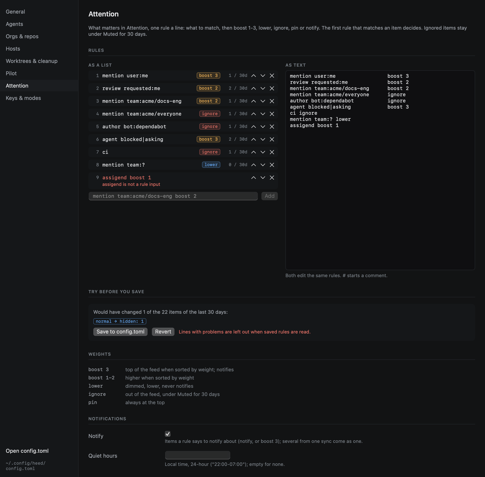

# Attention rules

Rules decide what counts more, what counts less and what does not count at all. They live in `config.toml`, one rule
a line, and the **first rule that matches** an item decides what happens to it:

```toml
[attention]
rules = [
  "mention user:me                boost 3",
  "review requested:me            boost 2",
  "mention team:acme/docs-eng     boost 2",
  "mention team:acme/docs-all     lower",
  "mention team:acme/everyone     ignore",
  "author bot:dependabot          ignore",
  "label \"blocker\"                pin",
  "repo acme/*-archive            ignore",
  "agent blocked|asking           boost 3",
  "ci branch:main                 lower",
]
```

Settings › Attention (`:settings.open attention`) edits them as a list (reorder, add, remove) and as text, side by
side. Before you save, it shows what the edited rules would have changed over the items of the last 30 days, and how
many items each rule matched.



A line is what to match, then what to do. A line that does not parse is reported with its number (in the status bar,
and next to the line in the editor) and left out; the other rules still apply.

## Actions

| Action | |
|---|---|
| `boost 1`, `boost 2`, `boost 3` | Higher when sorted by weight; `boost 3` also notifies |
| `lower` | Dimmed, lower when sorted by weight, never notifies |
| `ignore` | Out of the feed: listed under Muted, and kept there for 30 days |
| `pin` | At the top of the feed |
| `notify` | A notification when it arrives; combines with the others (`boost 2 notify`) |

`notify` and `boost 3` post a macOS [notification](../outside-the-window/notifications.md) when the item arrives.
For an item no rule matched, heed's [Decider](../agents/model-calls.md) may suggest a weight, shown next to the item
and never acted on. What you do with items (done, snooze, mute) is kept beside those suggestions in the call log, for
a better ranking later.

Quiet hours are a setting, not a rule: `[attention] quiet = "22:00-08:00"`.

## What a rule can match

Every condition on a line must hold. Values take globs (`*`, `?`) and alternatives (`blocked|asking`), and match
case-insensitively.

| Input | Matches |
|---|---|
| `mention` | You or one of your teams was @-mentioned |
| `user:me` | You yourself were mentioned (`mention user:me`) |
| `team:acme/docs-eng` | It came through that team: the team mentioned, or asked to review. `team:?` matches a team mention whose team heed could not work out |
| `review` | A review was requested; `requested:me` of you yourself, `requested:team` of one of your teams |
| `assigned`, `ci`, `mine`, `changes`, `threads`, `mergeable`, `comment`, `subscribed`, `watching` | The reason it is there: assigned to you, CI failed, your PR, changes requested, unresolved threads, ready to merge (with merging off), ... |
| `agent blocked\|asking\|limited` | An agent in one of those states; `agent` alone, any agent |
| `proposals` | A goal with changes to its `GOAL.md` waiting for you ([Goals](../goals/items.md#in-attention)) |
| `author maria`, `author me` | Who opened it |
| `author bot`, `author bot:dependabot`, `author human` | Opened by a bot (that one), or by a person |
| `label "blocker"` | A label |
| `repo acme/*-archive` | The repo |
| `branch:main` | The branch a CI failure is on |
| `kind pr\|issue\|ci\|release\|discussion\|agent\|goal` | What it is |
| `draft`, `ready` | A draft PR, or one ready for review |
| `size >500`, `size <50` | Lines changed |
| `age >7d`, `age <2h` | Time since its last update (`m`, `h`, `d`) |
| `turn mine`, `turn theirs` | Whose turn: someone else spoke last, or you did |
| `reason teamMention` | Any of heed's reasons by name |
| `any` | Everything (a last line that catches the rest) |

## Team mentions

GitHub says a notification is a team mention but not which team. Heed works it out for each new team mention with a
search in that repo per team you are on, and falls back to reading the thread; a review request asks the PR which
teams were requested. Each thread is worked out once (until its reason changes), so this costs about one call per new
team mention.

It needs gh's `read:org` scope to list your teams. Without it there is no team attribution and every team mention
matches `team:?`; `gh auth refresh -s read:org` adds the scope.
