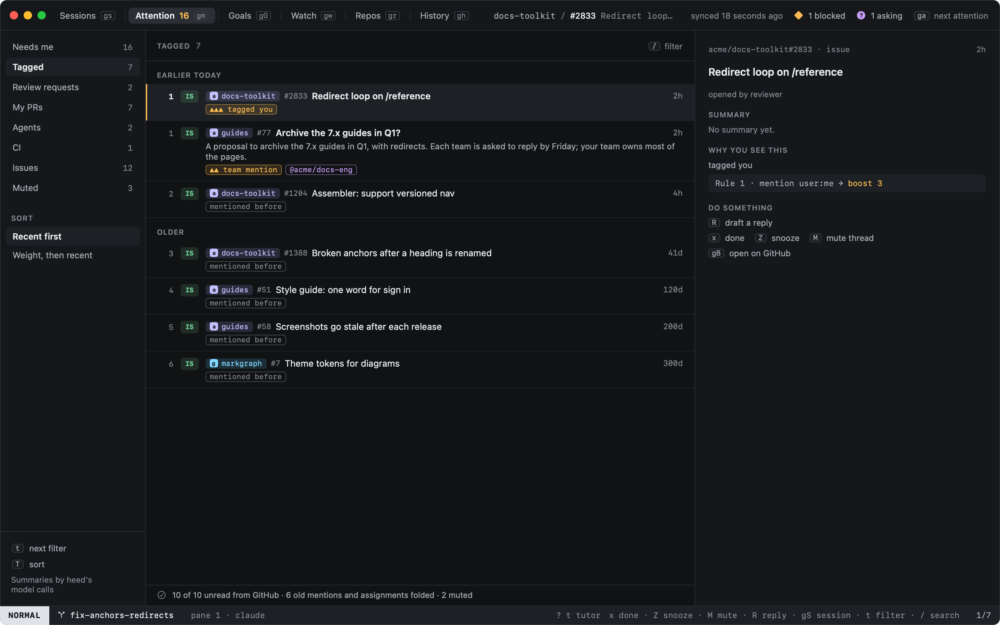

# Attention

`gm` opens Attention: everything that wants you, newest first. GitHub notifications, issues assigned to you or
mentioning you, your open pull requests, and agents that are asking, blocked or rate limited, in one list. A thread
is one item however many reasons it has: a pull request that asks for your review, mentions you and failed CI is one
row with three reasons.


Each row says why it is there (`tagged you`, `review requested`, `team mention`, `agent blocked`, ...), the team it
came through, and its weight when a [rule](attention-rules.md) boosted it (`▲▲`). With heed's [model
calls](../agents/model-calls.md) on, a short summary sits under the title.

Needs you in the sessions sidebar stays as it is, and `ga` still goes to the next session needing you: the agents
here are the same ones.

## What counts as needing you

Needs me lists an item when something about it asks for you:

- an unread notification, whatever its reason;
- a notification you have read (here, on github.com, on your phone) that still asks something of you: a mention, a
  team mention, a review request, an assignment. It stays until you mark it done. A read notification of any other
  kind (comments, CI, a release) leaves when you read it;
- an issue mentioning you or assigned to you, opened within the last 14 days;
- your PR with failed checks, changes requested, unresolved threads, or ready to merge with merging off;
- an agent asking, blocked or rate limited, and goals waiting on you.

Heed reads every unread notification (every page, up to 500), and on each sync the threads that changed since the
last one, read or not, so a thread you read elsewhere stays with what it was instead of vanishing. Read threads are
kept for 30 days. The issue searches (`mentions:@me`, `assignee:@me`) read up to 200 issues each, newest update
first.

### Mentioned before

An open issue the search finds mentioning you, opened more than 14 days ago, with no notification about the mention,
is *mentioned before*: an old ask, not a new one. It is folded out of Needs me, listed under Tagged and Issues, and
counted at the foot of the list. Assignments the same way are *assigned before*. Something new in such a thread (an
unread comment) brings it into Needs me for that, not for the old mention; a notification that says you were
mentioned makes it a fresh mention again. Heed cannot see when a mention without a notification was written, so it
goes by when the issue was opened.



### Done

`x` marks the thread read on GitHub and keeps it out of Attention until someone else does something in it:

- a comment or review by someone other than you brings it back;
- your own comments and pushes do not;
- a bot's comment does not, unless the item is there for a failed check or a review (a review requested, changes
  requested);
- an unread notification does, as GitHub never notifies you of what you did yourself, unless the thread's last
  comments show only a bot spoke since.

Heed tells who spoke from the thread's last comments, which it fetches when the thread changes. Until they are in, a
thread with no unread notification stays done. Agents, goals, CI runs and releases come back on any update.

## Is anything missing?

The line at the foot of the list says how much of what GitHub has heed has:

```
36 of 36 unread from GitHub · 54 old mentions folded · 3 muted
```

It turns amber when something is missing: the notifications stopped at their cap of 500 (`500 of 500+`), an issue
search stopped at 200 (`mentions 200 of 254`), or GitHub withheld items (SAML). Clicking it, or
`:attention.coverage`, shows each source on a line: notifications, mentions, assigned, your PRs, agents and goals, with
how many came against GitHub's own count, how many are in Needs me, folded, done, snoozed, hidden by a rule or muted,
and when it was fetched. Sync now there syncs.


## Filters

`t` goes to the next filter, `T` switches the sort between recent first and weight then recent. `/` filters by text
on top.

| Filter | Shows |
|---|---|
| Needs me | Everything that wants you (the default) |
| Tagged | You or one of your teams was mentioned, mentions from before included |
| Review requests | Reviews asked of you or your teams |
| My PRs | Your open pull requests, whether or not something about them wants you (`gp`) |
| Agents | Agents asking, blocked or rate limited |
| CI | Failed checks. A PR heed is [getting green](watch.md) shows under Watch instead, until it stalls |
| Issues | Issues: assigned, mentioning you, and every issue in repos you watch (`gi`) |
| Muted | What a rule ignores and what you muted, kept 30 days |


## The item under the cursor

The right side shows the summary, the thread in three lines (its last comments), why you see it, and the
[rule](attention-rules.md) that matched.


| Key | |
|---|---|
| `x` | Done: marks the thread read on GitHub. It comes back when someone else does something in it ([Done](#done)) |
| `Z` | Snooze for three hours; `:attention.snooze 30m`, `2d` or `tomorrow` for other times. Only heed knows |
| `M` | Mute the thread on GitHub: no more notifications about it, anywhere. It moves to Muted |
| `R` | Draft a reply with the model. You read it before anything is posted, and post it or copy it |
| `gS` | Go to the item's session: the agent's, or the session tracking the PR |
| `↩` | [Read](reading.md) it in heed; for an agent, go to its session |
| `gB` | Open it on GitHub |
| `space`, `s`, `a` | Pick items, [start a session](../start-work/from-github.md) from them, or add them to the current one |


Done, mute and a posted reply are GitHub writes, and show in the [call log](../reference/call-log.md) as such.
Snoozing is local.

The [Inbox](inbox.md), [Issues](issues.md) and [Pull requests](pull-requests.md) views are still there as
`:inbox`, `:issues` and `:prs`.
