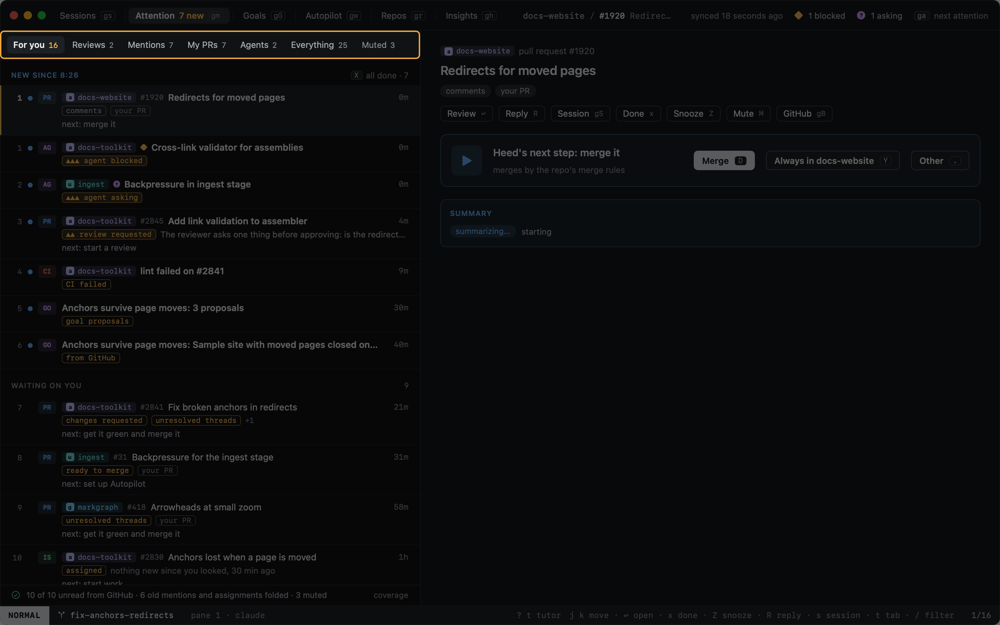
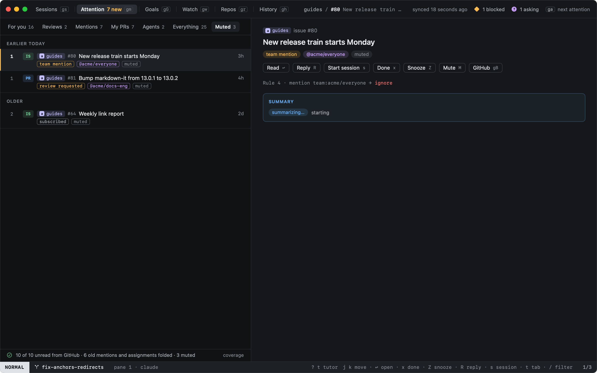
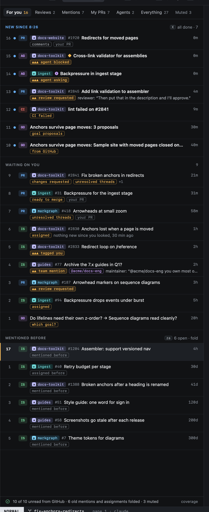
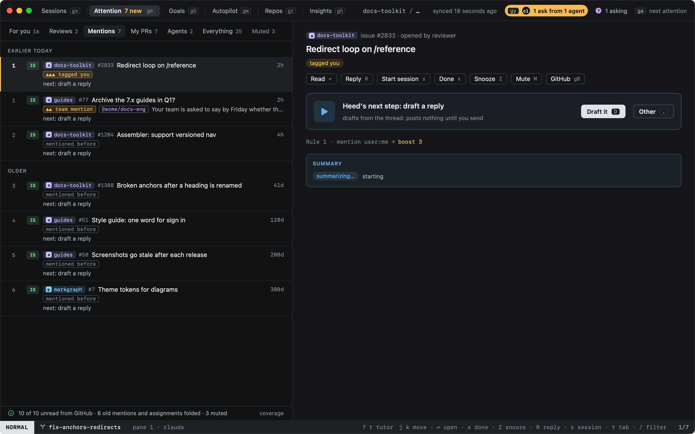
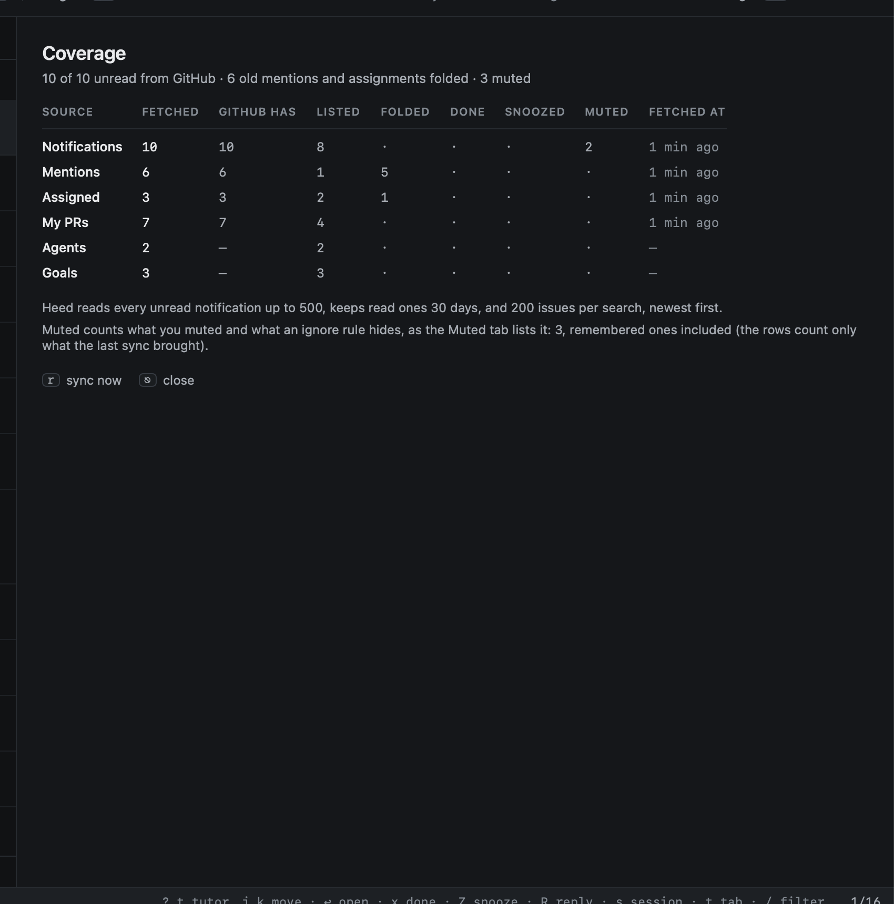
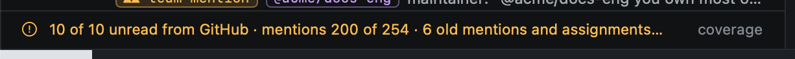
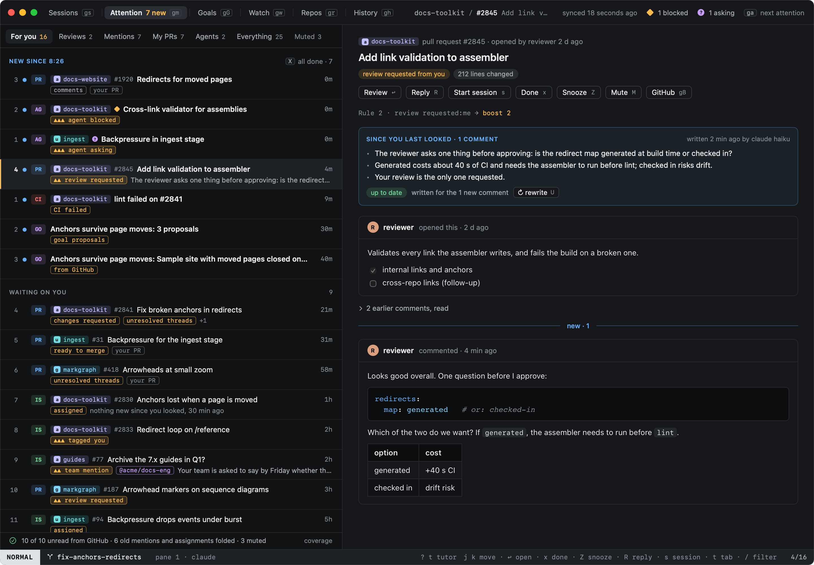
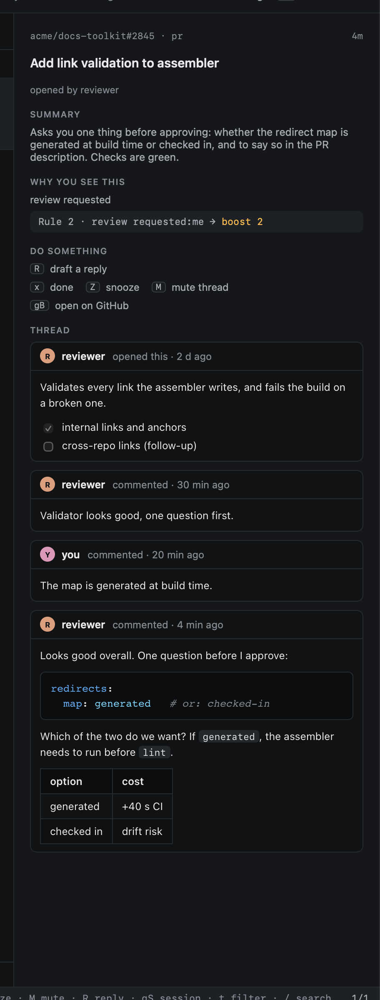
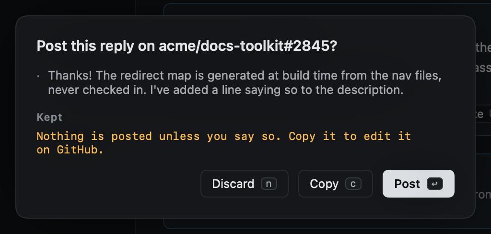

# Attention

`gm` opens Attention: what wants you, the list on the left and the item under the cursor on the right. GitHub
notifications, issues assigned to you or mentioning you, your open pull requests, and agents that are asking, blocked
or rate limited. A thread is one item however many reasons it has: a pull request that asks for your review, mentions
you and failed CI is one row with three reasons.



## Tabs

The tabs over the list each carry a count. `t` goes to the next one, and after Everything to Muted; a click opens
one. `T` switches the sort between recent first and weight then recent, `/` filters by text on top.

| Tab | Shows |
|---|---|
| For you | What wants you, in three sections (the default; its count leaves out what is folded) |
| Reviews | Reviews asked of you or your teams |
| Mentions | You or one of your teams was mentioned, mentions from before included |
| My PRs | Your open pull requests, whether or not something about them wants you (`gp`) |
| Agents | Agents asking, blocked or rate limited |
| Everything | All of it: every notification and every item the other tabs list. `:inbox` opens it |
| Muted | What a rule ignores and what you muted, kept 30 days (quieter, after Everything) |

`gi` (`:view.attention issues`) and `:view.attention ci` still narrow the list to issues, and to failed checks; the
tab shows while you are on it. The names from before the tabs still work: `needs` is For you, `tagged` Mentions,
`inbox` Everything.



## For you

For you sorts what wants you by what it asks of you:

- **New since 9:45**: someone other than you did something since you last looked: a comment or a review, a new
  notification, an agent that started asking. The time is when you last left Attention. Each row has a blue dot.
  `X` (or the *all done* on the header) is done with the whole section.
- **Waiting on you**: an open ask with nothing new since you looked: a review requested, changes requested on your PR,
  an assignment, a mention, failing checks, an agent waiting. These stay until you act on them. What is only news (a
  comment on a thread you follow, a state change) leaves For you once you have looked at it; Everything keeps it.
- **Mentioned before**: old mentions and assignments no notification is about ([below](#mentioned-before)), folded
  with their count. `za` lists them, `za` again folds them.

A row in New stays in New while you are in Attention, so the list does not shift under you as you read; its dot goes
as soon as you have looked. Leaving Attention moves what you read to Waiting on you, or out.



Each row says what it is (`PR`, `IS`, `AG`, ...), its repo and number, its title and age; under that why it is there
(`review requested`, `tagged you`, `agent blocked`, ...), its weight when a [rule](attention-rules.md) boosted it
(`▲▲`), and a preview: the newest comment when it is new to you, else the summary when the model wrote one, else
*nothing new since you looked*.

Needs you in the sessions sidebar stays as it is, and `ga` still goes to the next session needing you: the agents
here are the same ones.

## When you looked

Heed keeps, for each thread, when you last looked at it, and when you last left Attention (in `attention.sqlite`,
beside the other Attention data, for 30 days). A thread counts as looked at when you open it (a click on its row, or
`↩`) or when it stays in the reader for two seconds; moving past it with `j` and `k` does not. The time kept is when it
showed, so a comment that came in while you read is still new next time.

The reader uses the same time: the comments before it fold into one line (*6 earlier comments, read*, a click shows
them), and *new · 3* marks where the new ones start.

## What counts as wanting you

For you lists an item when something about it asks for you:

- an unread notification, whatever its reason;
- a notification you have read (here, on github.com, on your phone) that still asks something of you: a mention, a
  team mention, a review request, an assignment. It stays until you mark it done. A read notification of any other
  kind (comments, CI, a release) leaves when you read it;
- an issue mentioning you or assigned to you, opened within the last 14 days;
- your PR with failed checks, changes requested, unresolved threads, or ready to merge with merging off;
- an agent asking, blocked or rate limited, and goals waiting on you.

Heed reads every unread notification (every page, up to 500), and on each sync the threads that changed since the
last one, read or not, so a thread you read elsewhere stays with what it was instead of vanishing. Read threads are
kept for 30 days. The issue searches (`mentions:@me`, `assignee:@me`) read up to 200 issues each, newest update
first.

### Mentioned before

An open issue the search finds mentioning you, opened more than 14 days ago, with no notification about the mention,
is *mentioned before*: an old ask, not a new one. It is folded at the end of For you, listed under Mentions and
Issues, and counted at the foot of the list. Assignments the same way are *assigned before*. Something new in such a
thread (an unread comment) brings it into For you for that, not for the old mention; a notification that says you were
mentioned makes it a fresh mention again. Heed cannot see when a mention without a notification was written, so it
goes by when the issue was opened.



### Done

`x` marks the thread read on GitHub and keeps it out of Attention until someone else does something in it:

- a comment or review by someone other than you brings it back;
- your own comments and pushes do not;
- a bot's comment does not, unless the item is there for a failed check or a review (a review requested, changes
  requested);
- an unread notification does, as GitHub never notifies you of what you did yourself, unless the thread's last
  comments show only a bot spoke since.

Heed tells who spoke from the thread's last comments, which it fetches when the thread changes. Until they are in, a
thread with no unread notification stays done. Agents, goals, CI runs and releases come back on any update.

## Is anything missing?

The line at the foot of the list says how much of what GitHub has heed has:

```
36 of 36 unread from GitHub · 54 old mentions folded · 3 muted
```

It turns amber when something is missing: the notifications stopped at their cap of 500 (`500 of 500+`), an issue
search stopped at 200 (`mentions 200 of 254`), or GitHub withheld items (SAML). *Muted* counts what the Muted tab
lists, remembered threads included, so the two agree.

Clicking the line, or `:attention.coverage`, opens Coverage in the reader's place: each source (notifications,
mentions, assigned, your PRs, agents and goals) with how many came against GitHub's own count, how many are listed,
folded, done, snoozed or muted (by you or a rule), and when it was fetched. `r` syncs, `⎋` or another click closes
it.





## The reader

The right side follows the cursor. An issue or a PR shows in full: where it is and who opened it, its title, chips
for why it is there and its state, its actions as buttons with their keys, the summary when the model wrote one, the
[rule](attention-rules.md) that matched, then the thread as GitHub renders it, the same cards as the
[reader](reading.md), with the comments you read folded. Until the thread has loaded its last three comments stand in.
An agent or one of heed's goal items shows its card with what you can do, as before.

`j` and `k` stay in the list; `⌃e` and `⌃y` scroll the reader by half its height. `↩` opens the full
[reader](reading.md) (a PR's review threads, checks and feedback), or for an agent its session. Drag the line between
list and reader to change the split; heed keeps it.





| Key | |
|---|---|
| `x` | Done: marks the thread read on GitHub. It comes back when someone else does something in it ([Done](#done)) |
| `Z` | Snooze for three hours; `:attention.snooze 30m`, `2d` or `tomorrow` for other times. Only heed knows |
| `M` | Mute the thread on GitHub: no more notifications about it, anywhere. It moves to Muted |
| `R` | Draft a reply with the model. You read it before anything is posted, and post it or copy it |
| `gS` | Go to the item's session: the agent's, or the session tracking the PR |
| `↩`, a double-click | The full [reader](reading.md); for an agent, go to its session. A click on a row opens it in the reader |
| `X` | Done with everything in New since |
| `za` | List Mentioned before, or fold it again |
| `⌃e`, `⌃y` | Scroll the reader down, up |
| `gB` | Open it on GitHub |
| `space`, `s`, `a` | Pick items, [start a session](../start-work/from-github.md) from them, or add them to the current one |



Done, mute and a posted reply are GitHub writes, and show in the [call log](../reference/call-log.md) as such.
Snoozing is local.

The [Issues](issues.md) and [Pull requests](pull-requests.md) views are still there as `:issues` and `:prs`.
`:inbox` opens [Everything](inbox.md).
