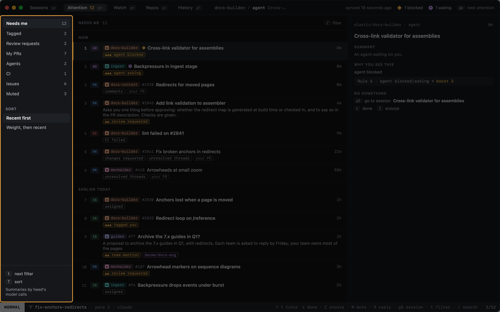
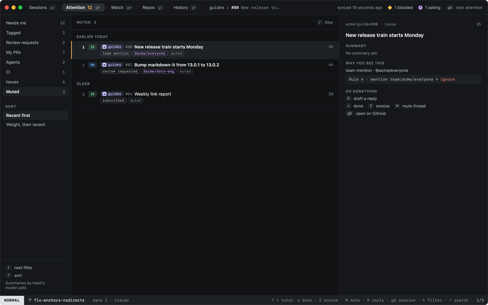
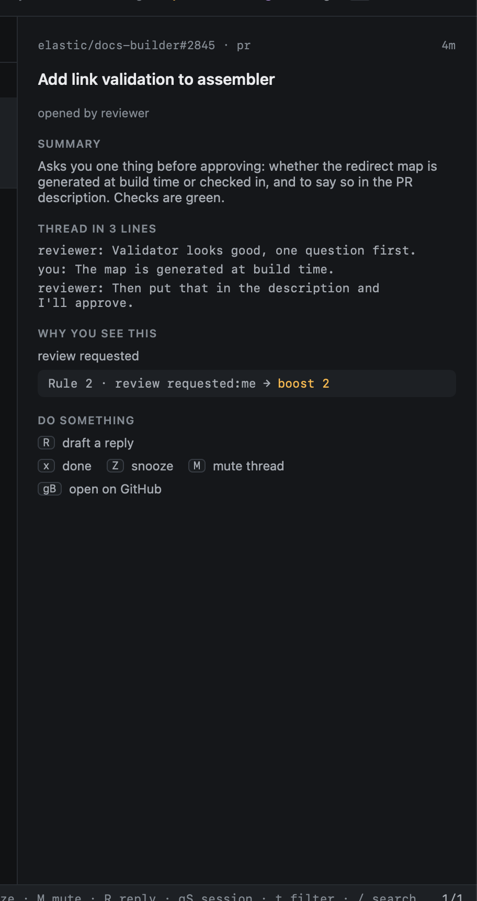
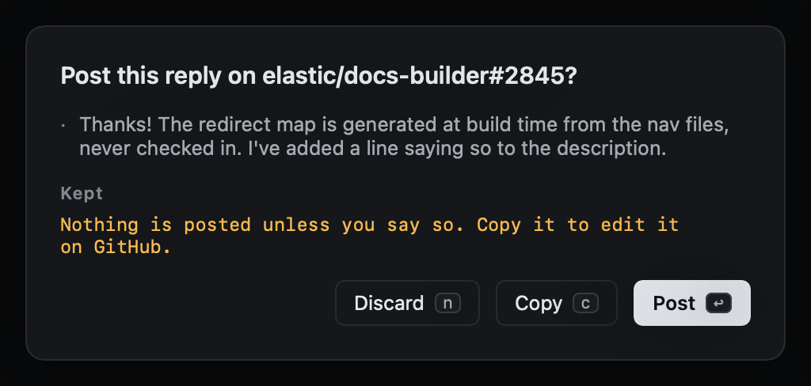

# Attention

`gm` opens Attention: everything that wants you, newest first. GitHub notifications, issues assigned to you or
mentioning you, your open pull requests, and agents that are asking, blocked or rate limited, in one list. A thread
is one item however many reasons it has: a pull request that asks for your review, mentions you and failed CI is one
row with three reasons.

Each row says why it is there (`tagged you`, `review requested`, `team mention`, `agent blocked`, ...), the team it
came through, and its weight when a [rule](attention-rules.md) boosted it (`▲▲`). With heed's [model
calls](../agents/model-calls.md) on, a short summary sits under the title.

Needs you in the sessions sidebar stays as it is, and `ga` still goes to the next session needing you: the agents
here are the same ones.

## Filters

`t` goes to the next filter, `T` switches the sort between recent first and weight then recent. `/` filters by text
on top.

| Filter | Shows |
|---|---|
| Needs me | Everything that wants you (the default) |
| Tagged | You or one of your teams was mentioned |
| Review requests | Reviews asked of you or your teams |
| My PRs | Your open pull requests, whether or not something about them wants you (`gp`) |
| Agents | Agents asking, blocked or rate limited |
| CI | Failed checks. A PR heed is [getting green](watch.md) shows under Watch instead, until it stalls |
| Issues | Issues: assigned, mentioning you, and every issue in repos you watch (`gi`) |
| Muted | What a rule ignores and what you muted, kept 30 days |

## The item under the cursor

The right side shows the summary, the thread in three lines (its last comments), why you see it, and the
[rule](attention-rules.md) that matched.

| Key | |
|---|---|
| `x` | Done: marks the thread read on GitHub. It comes back when something new happens in it |
| `Z` | Snooze for three hours; `:attention.snooze 30m`, `2d` or `tomorrow` for other times. Only heed knows |
| `M` | Mute the thread on GitHub: no more notifications about it, anywhere. It moves to Muted |
| `R` | Draft a reply with the model. You read it before anything is posted, and post it or copy it |
| `gS` | Go to the item's session: the agent's, or the session tracking the PR |
| `↩` | [Read](reading.md) it in heed; for an agent, go to its session |
| `gB` | Open it on GitHub |
| `space`, `s`, `a` | Pick items, [start a session](../start-work/from-github.md) from them, or add them to the current one |

Done, mute and a posted reply are GitHub writes, and show in the [call log](../reference/call-log.md) as such.
Snoozing is local.

The [Inbox](inbox.md), [Issues](issues.md) and [Pull requests](pull-requests.md) views are still there as
`:inbox`, `:issues` and `:prs`.
