# Browse

[Attention](attention.md) brings the work that involves you. Browse is where you go to find the rest: `gb` opens the
issues and pull requests of an org or a repo, searched on GitHub, with the thread beside the list and four
agents a key away. Read this page top to bottom and you know what Browse can do.

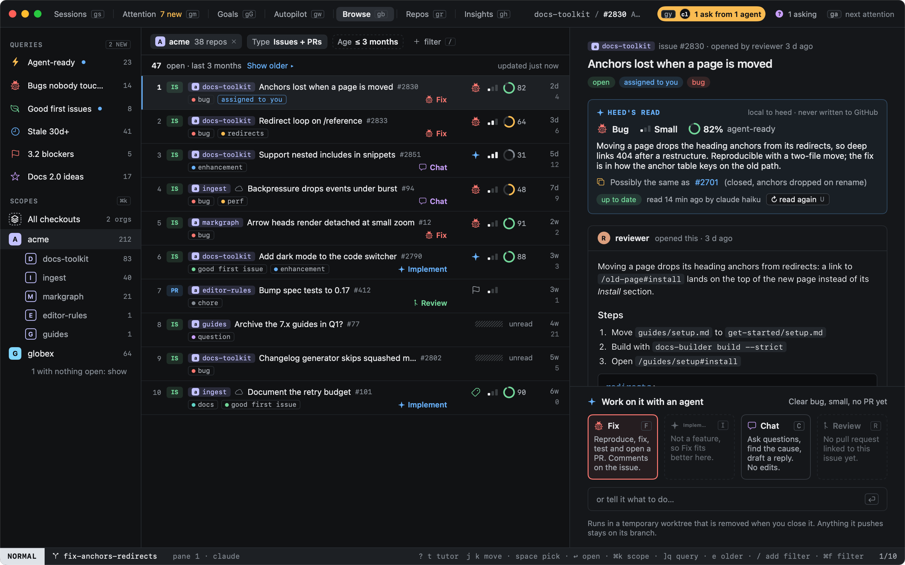

Browse asks GitHub when you ask: when you enter it, change the scope or the query, press `e` for older items or `r`
to refresh. It never asks on the sync's poll. What it fetched last time draws first, and the fresh answer replaces
it.

## Browse works inside what you have checked out

Browse searches the **orgs and accounts you have checked out a repo of**, on this Mac or on a host, and nothing else.
heed reads that list from your repos each time (it keeps no copy), so cloning a repo adds its org at once and removing the
last one takes the org away.

- **No scope means all your checkouts.** A query with no scope of its own (the starter queries, a fresh install) runs
  inside every org you have a checkout in. The chip over the list says *All checkouts* and how many orgs that is. GitHub
  limits a search to 256 characters, so many orgs are searched in groups of at most 240 characters, up to six, and the
  counts are added up; past six groups the line over the list says so, and `⌘K` narrows to one org.
- **A scope or a place you type wins.** A saved query with its own `org:` or `repo:` is neither widened nor
  narrowed by the scope you are in. Picking a scope replaces the default, and the query you are on goes with you.
- **An org with no checkout is refused, not searched.** Pick it, or type `org:`, `repo:` or `user:` for it, and the list
  says *`<name>` isn't checked out*, with a button that opens Add or clone on that name. Nothing is sent to GitHub. A repo
  of an org you have checked out something of is allowed, since Browse searches an org as a whole.
- **With nothing checked out,** the list says *Check out a repo first* with the same button, and the rail's counts are
  dashes.
- **Browse never searches all of GitHub.** The check is in the fetch itself, so no key, saved query or typed filter can
  get around it.
- **The cache follows.** Shortly after launch, and again when your checkouts change, heed quietly drops the issues and
  pull requests of orgs you have no checkout in from Browse's own cache (`browse.sqlite`), along with heed's reads of them.
  Saved queries and pinned scopes stay. [Attention](attention.md) keeps its own cache and is not touched.

## Layout and the rail

Three panes, left to right:

- **The rail.** Queries on top, scopes under them.
- **The list.** One row per issue or pull request, newest update first.
- **The reader.** The thread under the cursor, as GitHub renders it, with heed's read and the agent buttons.

**Queries** are searches you keep. heed starts you with five: *Agent-ready* (open items heed read as ready for an
agent), *Assigned to me*, *Bugs nobody touched*, *Good first issues* and *Stale 30d+*. Each has a glyph and a tint:
heed picks the glyph from the query's main filter (a bug for bug labels, a sprout for good first issues, a clock for
stale, a flag for a milestone, a person for an assignee, a bolt for agent-ready, a pull for pull requests), and you
can change it when you save. The number beside a query is what GitHub counts for it inside the scope you are in (a dash when Browse would not search it), refreshed slowly in the
background while you are in Browse. A blue dot marks a query with news; `]q` and `[q` step through the queries.

**Scopes** say where the search runs. *All checkouts* (a dashed square) comes first and is the default; the orgs you
have checked out follow, and an org you pinned but have no checkout in is dimmed with a dash for its count. Under an org the rail leaves out the repos with nothing open and says how many
(*1 with nothing open: show*); the repo you are in, and a repo not searched yet, stay. The shape says what a scope is:

| Mark | Scope |
|---|---|
| Filled square with the initial | An org or your own account |
| Outlined small square with a tick, first under its org | *Only my N repos*: the org's repos you have checked out ([below](#only-my-repos)) |
| Outlined small square, indented under its org | One repo |
| Filled square with a filter glyph | An org view: an org narrowed by language or archived state ([below](#orgs-with-very-many-repos)) |

**Clicking an org** picks it as the scope and opens it, which shows what is under it: *Only my N repos*, then the
repos you have checked out, as outlined small squares. Clicking the org that is already the scope closes it again,
and clicking another org opens that one without closing the first. The chevron beside an org opens or closes it and
leaves the scope alone. An org opens by itself the first time you go there; once you close it, it stays closed.
Which orgs are open is kept on this Mac. `za` opens or closes the org you are in, and `]o` and `[o` step through the
scopes. A scope joins the rail when you go there, and the rail keeps it. The half-width icon rail keeps its one square
per scope, and the sheet at a third width shows the same tree as the rail.

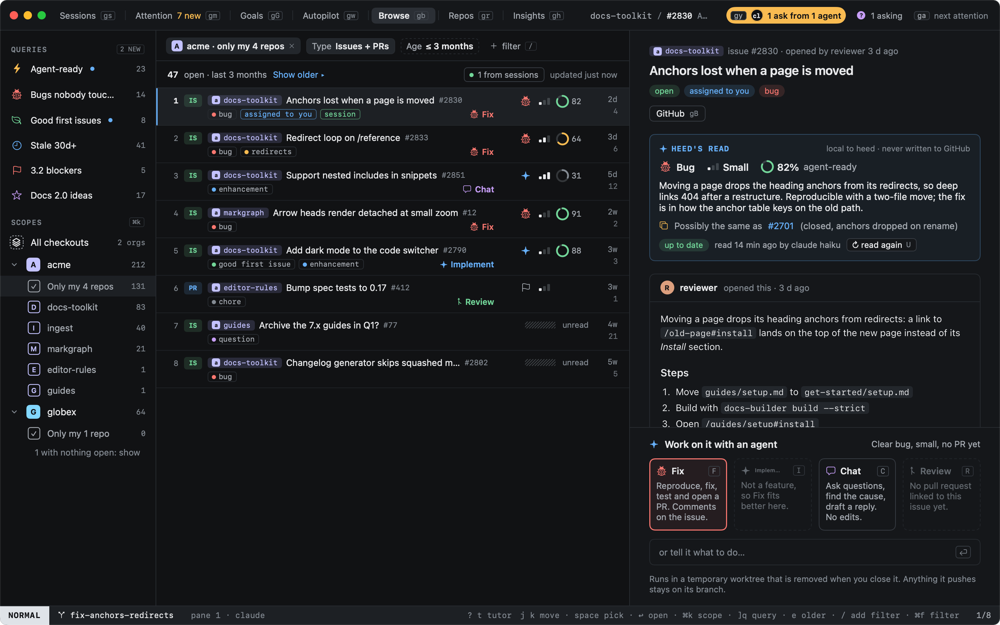

### Only my repos

An org can be too big to browse whole while you work in three of its repos. *Only my N repos* under an org (and
a row of that name in the quick jump) searches just the repos of that org you have checked out. The scope chip
says so (*acme · only my 3 repos*). heed keeps only the org's name and the fact that it is this scope: the repos are
read from your checkouts each time, so a clone or a removal changes the next search and nothing is a snapshot. A long
list of repos is split into several searches that each fit GitHub's limit, their counts are added up and their items
merged; each search backs off on a failure the way the whole-org search does. It is the same rule as the rest of
Browse: every repo it names is checked out, so nothing outside what you have checked out is searched.

### Quick jump

`⌘K` (or `gj`, as in "go jump") opens the jump, the one dialog for "get me to X" and "find Y". Type to find a saved query, an org or account, or a
repo of one. Saved queries lead, the ones you ran last first, each with its count; `↩` runs one. Orgs list their repo
count, and an org with repos checked out has an *acme · only my 3 repos* row right after it. Matching repos follow
(six at most) with *cloned ✓* or *not cloned* and how many items are open. `↩` goes there.
A repo that is not cloned still browses: only starting an agent on it asks to clone first.

When what you typed matches none of them, the last row is **Search GitHub for “…”**, and `⌘↩` picks it at any time.
The words go to the add-filter card, so the model reads them into filters first (*Understood as*), or, with `[llm]`
off, they search as text. `⌘F` and `/` work as before.

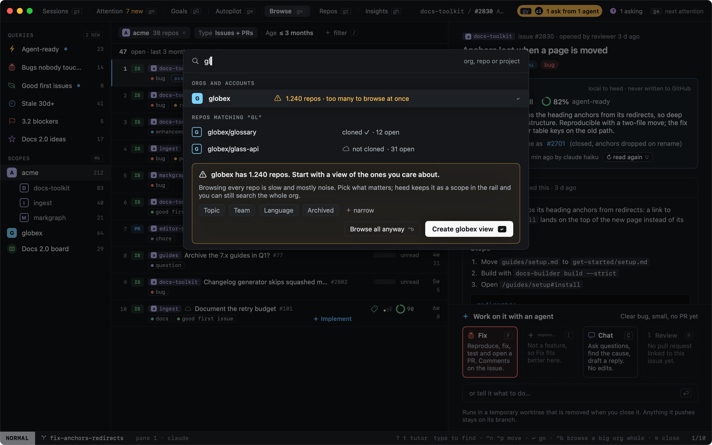

### Orgs with very many repos

Browsing every repo of a big org is slow and mostly noise. An org with more repos than `many_repos` (200 by default)
gets a card in the jump instead of a plain go: **Create `<org>` view**, or **Browse all anyway** (`⌃B`). An org view is
the org narrowed by a language and by archived or not. heed stores nothing but those two filters, and GitHub applies
them on every search, so the view never goes stale. The builder counts the matching repos live as you choose. `:browse.view.new`
makes a view of the org you are in.

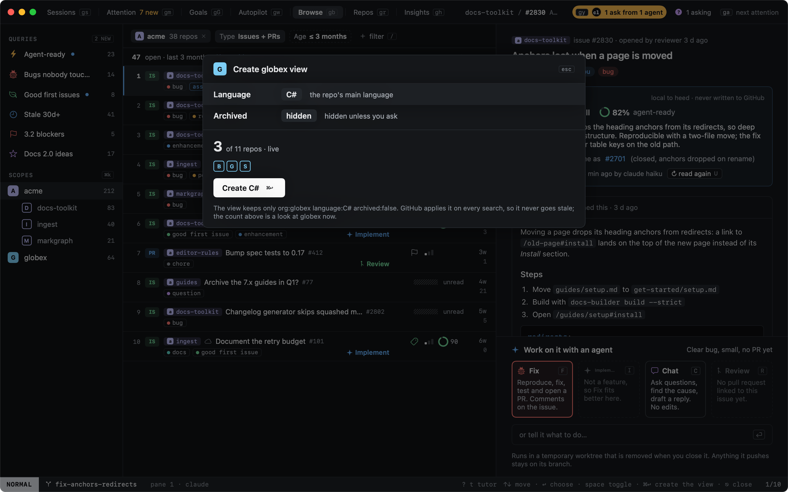

## The list


Each row holds the item type (`IS` issue, `PR` pull request), its repo, its title and number, its labels, and a few
tags: *assigned to you*, *open PR* when an issue has a linked pull request, *draft*. A cloud means the repo is not
cloned on this Mac. On the right:

- **heed's read:** the class (a glyph: bug, feature and so on), the size (one to three pips) and a ring with the
  agent-ready percentage. A hatched *unread* means heed has not read the item yet.
- **The verb heed suggests:** Fix (red), Implement (blue), Chat (purple) or Review (green), when heed has one.
- **The age and the comment count.**

Above the list a line says how many items are open and the cap: *47 open · last 3 months*, with **Show older** beside
it. Browse searches items updated in the last 3 months (`max_age_days`). `e` lifts the cap for the view you are in, and
`e` again puts it back. A query with its own *Activity* filter ignores the cap. A search brings in at most 300
items.

`T` cycles the sort: updated, created, comments, oldest. `⌘F` narrows the rows by words over titles, repos and labels.

### Open it on GitHub, copy its link

`gB` opens the item under the cursor on GitHub, whatever the reader shows (a run included). With items picked it opens
every picked item, and above five it asks first (`↩` opens them, `⎋` cancels). The reader has the same thing as a
**GitHub** button with its key beside the title, and a click on the repo or the number above the title opens the item
too. On a narrow window the button is in the reader's `···` menu as well.

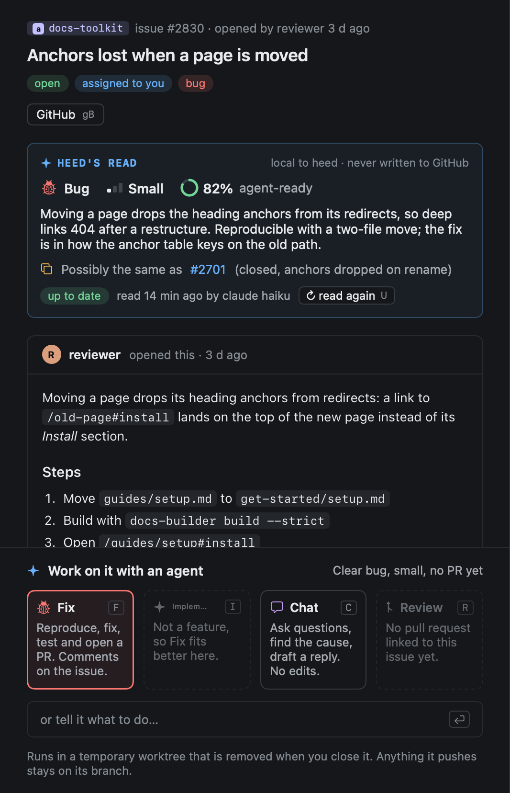

`y` copies the item's link and `Y` copies `org/repo#number`, one per line for every picked item; `y` in VISUAL copies
the links of the range. `gR` opens the item's repo.

### Right-click

A right-click on a row opens a menu of what the keys do, with each key beside it: open on GitHub, copy the link and the
reference, the agent choices, a session or a goal from it, read it, pick it, and the writes to GitHub (label, assign to
you, comment, close). The agent choices lead with the one heed suggests, with its reason under it; those that do not fit
are greyed with the reason (*Not a feature, so Fix fits better here.*). On an open pull request they are Get it green,
Get it merged, Review and Chat.

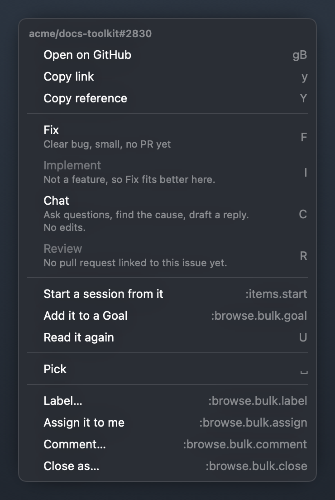

A right-click on a row that is not picked acts on that row alone, whatever is picked. A right-click on a picked row acts
on all the picks, and the menu then leaves the agents out, which take one item. A GitHub write from a menu on one item
shows its confirm step in the reader, as for picks.

In the rail, a right-click on a saved query offers Rename, Delete, Move up, Move down and Refresh count; on an org it
offers Open org on GitHub, Expand or Collapse, and Only my N repos.

## Staying current

Browse asks GitHub again for the view you are on when you come back to it, so the list is not as old as your last
look. Three things count as coming back: switching to Browse, the app coming to the front while Browse is the view,
and the window regaining focus. Each asks only when the last answer for that same scope and query is older than
`refresh_after` seconds (a minute), never while an earlier ask is still running, and it waits longer after each
failure. Heed never raises a window or takes focus for it.

The ask is quiet: no spinner, only *updated 2m ago* at the end of the line over the list. What came back lands in two
parts:

- **Rows you can see change in place, at once.** A new comment count, label, title, state, check or review changes on
  its row and nowhere else, even while an item is open. A row that was touched keeps its place until you refresh.
- **New, gone and reordered rows wait while you hold an item.** When the item under the cursor is in the reader, items
  are picked, the reader is pushed, a run is working, or a sheet or form is open, a slim banner appears over the list,
  such as *3 new · 1 gone · 5 reordered*. `r` (or a click on **Refresh**) applies it without asking GitHub again. The
  cursor stays on its item, picks stay picked, and the new rows get a blue dot until the next answer. When the item
  under the cursor is gone, the cursor moves to the nearest row and heed says so. Picked items that are gone are
  dropped and counted. With nothing held, the list takes the answer at once.

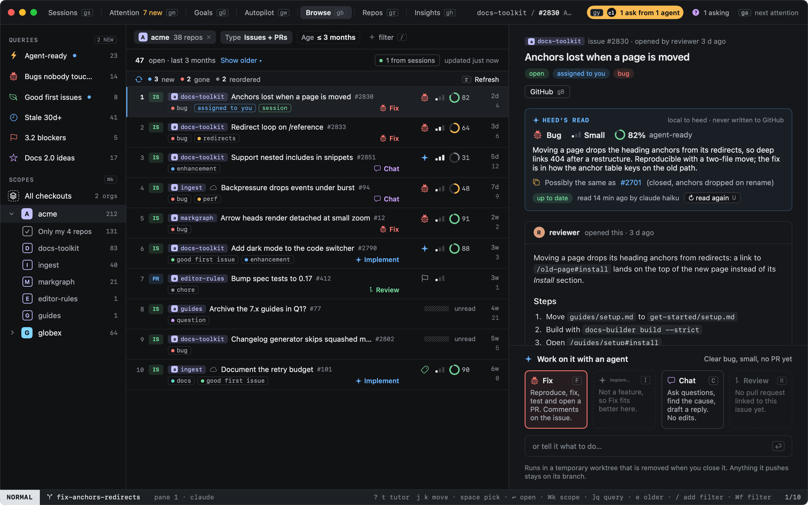

When an ask fails, a banner says *Could not refresh* and why, and `r` tries again; the list you had stays as it was.
Offline, the cached list stays untouched.

Two settings: `auto_refresh` turns this off (entering Browse then still asks, as it did), and `refresh_after` is the
seconds an answer stays fresh.

## Filtering

`/` opens the filter builder over the list. A query is a scope and a row of filters (the chips above the list), each
of which becomes a GitHub search qualifier.

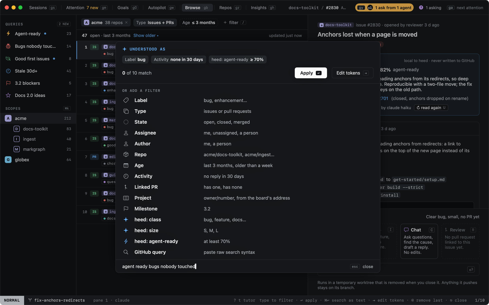

**The fields:** Label, Type, State, Assignee, Author, Repo, Age, Activity, Linked PR and Milestone, the
three heed fields (class, size, agent-ready), and GitHub query. Type to narrow the list of fields, or press `1` to `9`
for one.

**There is no Project field.** heed cannot read the Projects an item is on (that needs a GitHub token scope its
default token does not have), so a filter on them could only ever show nothing. A raw `project:owner/N` in a GitHub
query works only for classic Projects, and GitHub does the matching; a saved query that already has one keeps running,
with the chip as it was.

**Value pickers show counts.** Pick a field and a list of its values appears, each with how many of the items you
have would match. Label takes several values and reads them as *any of*, *all of* or *none of* (`⇥` switches).
Under the list, *would match 7 of 10* updates as you tick, with bars by age, and the GitHub query it makes. `↩`
applies, `⌘C` copies the query, `⌘S` saves it.

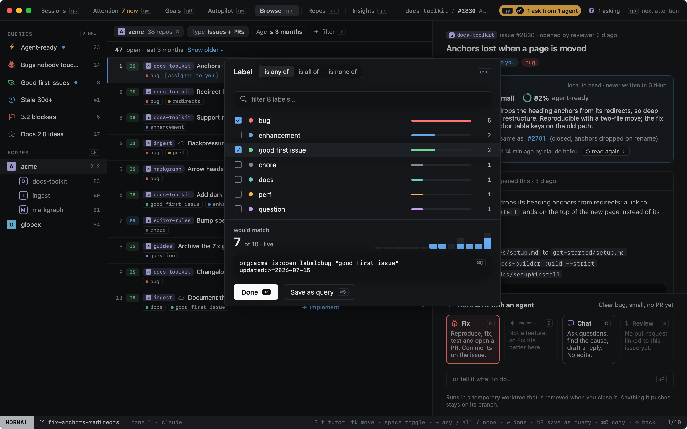

**Say it in words.** Type a sentence that is not a field name, for example *agent ready bugs nobody touched*, and
`↩` sends it to heed's cheap model tier. The card *Understood as* shows the filters it made. Nothing hides behind the
sentence: a field heed does not know, or a value out of range, is dropped and listed with its reason, and you can
edit the tokens (`⇥`) before you apply. `⌘↩` searches the words as text instead. With model calls off
(`[llm] enabled = false`), words are searched as text.

**The raw GitHub query** is always one step away: pick GitHub query to see, edit and paste the search syntax.
What heed does not model (`sort:`, `no:assignee` and the like) stays as written.

**Heed fields filter locally.** Class, size and agent-ready narrow what GitHub answered, on this Mac, using heed's
read. They never go to GitHub, and an item heed has not read matches none of them.

**Save as query** (`S`, or `⌘S` in the builder) takes a name, a glyph (`⇥`) and a tint (`⌃T`) and puts the query in
the rail. `N` renames the query you are on, `D` removes it, `]Q` and `[Q` move it. `x` takes the last filter off.

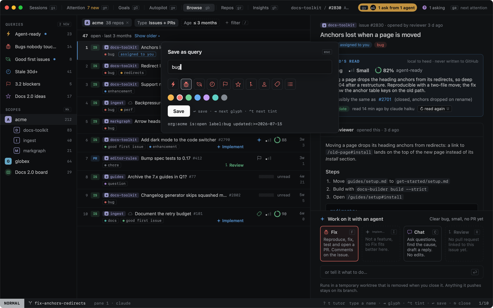

## heed's read

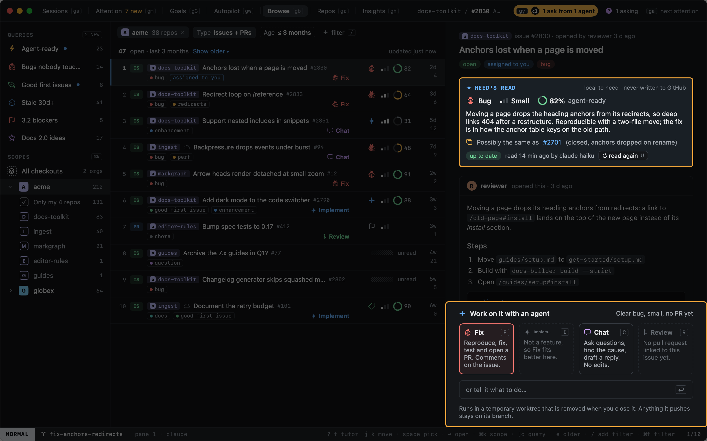

For each item heed writes a read: its **class** (bug, feature, docs, question or chore), its **size** (S, M or L), how
**agent-ready** it is (0 to 100: a clear repro or acceptance, bounded, no design decision pending), a **TL;DR**, and
**possible duplicates** among the other items of the repo. Duplicates come from the titles, not from the model.

The read is local. heed keeps it in `browse.sqlite` on this Mac for 90 days and never writes it to GitHub. A read
belongs to the item as it was: when the item changes, the card says *stale* and keeps the old read, dimmed, until
heed writes a new one. The card always says its state: up to date, stale, reading, queued, failed and why, or off.

**When heed reads:**

- **Ahead:** the top 20 rows of the view, once the view settles (`read_ahead`), and the item under the cursor.
- **On open:** the item under the cursor once it rests.
- **On demand:** `U` reads the item under the cursor, or every picked item, one at a time, and reads again if it is stale.

`reads` in `[browse]` chooses *ahead*, *open* or *off* (only `U`). Reads are model calls: they follow `[llm]`, so
they stop when model calls are off and ahead and on-open reads stop at the daily cap. `U` goes past the daily cap.

## Fix, Implement, Chat, Review

Four buttons sit under every item, always all four, with one filled when heed has a suggestion and a line saying why.
A button that does not fit is dashed and says why.

| Key | Does |
|---|---|
| `F` Fix | Reproduces the bug, fixes it, tests it and opens a PR. Comments on the issue. On a PR it is Get it green (below) |
| `I` Implement | Builds what the issue asks, with tests, and opens a PR that closes it |
| `C` Chat | Asks questions, finds the cause, drafts a reply. Edits nothing |
| `R` Review | Reads the diff, runs the tests and drafts a review for you |
| `t` | Tell an agent in your own words what to do |
| `w` | Only the items with an agent on them, and back |
| `W` | Only the items a session was started from, and back |
| `O` | Only the items that are in a goal, and back |

**What heed suggests:**

| The item | Suggested |
|---|---|
| Closed or merged | Chat; the others are off |
| An issue heed has not read | Nothing; Fix and Implement wait for the read |
| A question, an issue under 50% agent-ready, or one with a PR already linked | Chat |
| A bug at 50% or more, no linked PR | Fix |
| A feature, docs or chore item at 50% or more, no linked PR | Implement |
| A PR whose review is requested of you | Review (not on a draft) |
| Your PR with failing checks or changes requested | Fix, addressing the feedback |

Implement never fits a PR, and Review is off on your own PR. An agent action works on one item: with several picked,
`F` `I` `C` `R` say so.

**On a pull request** the buttons are the PR tracking's own: **Get it green** (`zg`, and `F`), **Get it merged** (`zm`),
Review and Chat. Get it green and Get it merged are not runs in the reader. They turn on the modes
[get it green and get it merged](../autopilot/green-and-merged.md) already has (each press cycles off, ask, auto; the card shows the mode that is on), so the PR
also shows in Attention and Autopilot, and heed asks before it pushes. heed suggests Get it green on your PR with
failing checks or requested changes, and Get it merged on your PR once checks are green and nobody asks for changes.
Get it merged is on offer on someone else's PR and waits for green first; it is off on a draft. A PR that is closed
or merged gets Chat only.

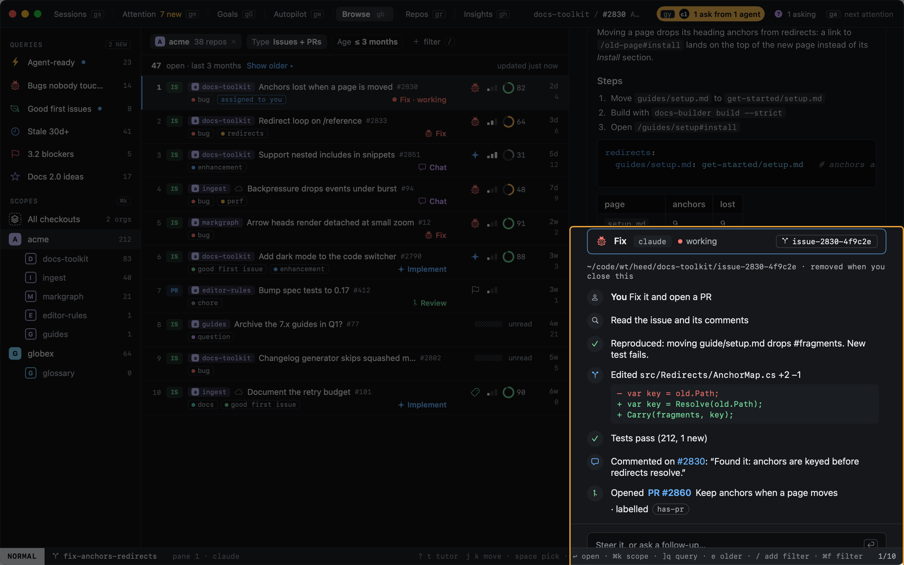

**Where it runs.** The agent runs in a temporary worktree, named `issue-<number>-<hex>` for an issue and
`pr-<number>-<hex>` for a PR, on a branch `heed/browse/<name>`, under the same root as helper worktrees. The reader
is split in two: the issue or PR stays on top, so you can keep reading what the agent is working on, and the run's
feed sits below it: what it read, edited (with the diff), ran, tested, commented, pushed and opened. Closing the run
(`⎋`) removes the worktree and its local branch; a branch it pushed stays on GitHub. A worktree that holds work
nothing else has, commits no remote has or changes not committed, is not removed: the run closes, and the reader shows
a card (below) until you deal with it.

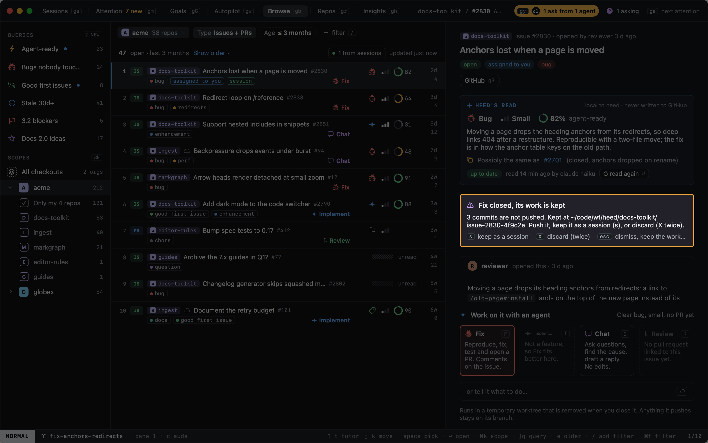

The card says how many commits are not pushed and where the worktree is kept. Push it from there, keep it as a session
(`s`), discard it (`X` twice, within a few seconds), or dismiss the card with `⎋`, which leaves the worktree where it is.

**What it needs.** A run talks to its agent over [ACP](../autopilot/helpers.md#how-heed-talks-to-them), which the agent's
own command line does not speak, so for claude heed needs the ACP adapter on your login shell's `PATH`:

```sh
npm install -g @agentclientprotocol/claude-agent-acp
```

Without it a run stops at once and says `claude-agent-acp is not installed`, with that command. opencode and gemini
speak ACP themselves and need nothing extra; codex needs `codex-acp`. heed never installs an adapter. Sessions you
start with Start work run the agent directly and do not need it. The adapter table, and `[helpers] command` for running it
through `npx -y` instead, are in [Helpers](../autopilot/helpers.md#which-agent); `[browse] agent` picks the agent a run uses.

**Which items have an agent.** A row with a run on it is tinted in the run's colour (stronger under the cursor) and
says what it is doing (*Fix · working*). While there is any, a *● N with an agent* toggle appears at the right of the
count (`w`) and narrows the list to those items. It goes away with the last run.

**Work started from an item.** An item remembers what became of it. A session started from it (it closes the issue,
tracks the PR, or was started with the issue linked) and a goal that holds it as an item show as *session* and *goal*
tags on its row, and as links under heed's read in the reader (*Started from here*), which open the session or the goal.
heed derives this from what sessions and goals already keep, so it covers work started before this and needs no
storage. Beside the agent toggle, *N from sessions* (`W`) and *N in goals* (`O`) appear at the right of the count,
each only while some item qualifies, and narrow the list the same way. A session that was closed is not listed.

**Clone first.** When the repo is not on this Mac, the run opens with a card: `↩` clones and starts, `c` only clones,
`d` picks the folder, `⎋` is not now.

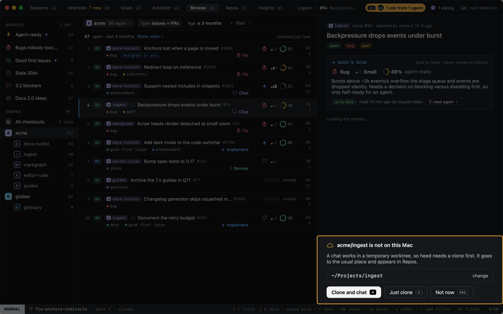

**What the agent may and may not do.** Fix and Implement edit files and run commands inside the worktree, commit, push
a branch of this repo, open and update PRs, and comment and label, all without asking. Chat reads only and changes
nothing. Review also builds and tests, but edits, commits, pushes and writes nothing to GitHub. For every verb, heed
refuses a path outside the worktree, secrets and credential files, another repo, force-pushes, any push to the default
branch, changes to the repo's settings, download-and-run, and fetches from anywhere but GitHub. The feed shows each
refusal. This is a guard on what an agent asks to run, not a sandbox: a test suite the agent runs executes whatever the
repo's code does.

**Review drafts need your Post.** A review is public speech on someone else's PR, so the agent's review is a draft with
a verdict (approve, comment or request changes): **Post** (`P`), **Edit** (`E`, the agent changes it) or **Discard**
(`X`). Nothing is posted any other way.

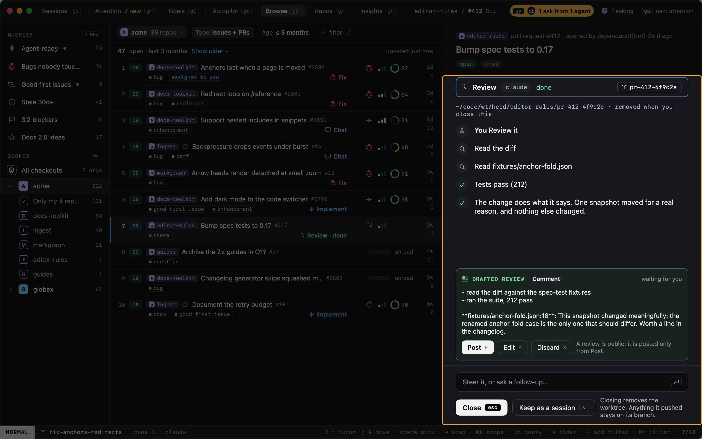

**Untrusted authors run as Chat.** heed applies the same rule as everywhere else: work is trusted when it is yours,
when someone who can write to the repo wrote it, or when `trusted_authors` names them. A PR from a fork is never
trusted unless it is yours. For anyone else the run is a Chat, whatever you pressed: it reads, edits nothing, runs none
of the repo's code and has no GitHub login, and the header says why.

**When a run cannot start,** the reader says so where the buttons were, with the reason and what to do about it
(*gh is not signed in*, *the agent is not installed*, *the repo is not cloned*), and keeps saying it until you press
the verb's key again or `⎋`. `t` shows what you type in its line under the buttons, and `↩` starts the run.

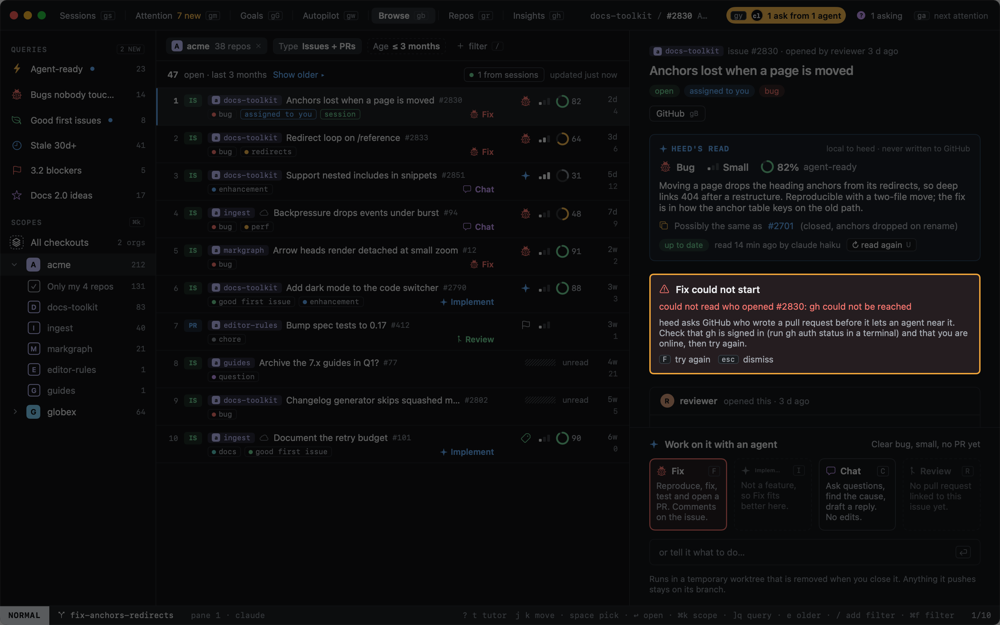

**Keep it as a session.** `s` turns a run into a full session: its worktree moves to heed's usual naming (`fix/...`),
its branch is renamed, and a session opens in it. Nothing is removed. `i` (or `↩`) steers a run or asks a follow-up.

**How many at once.** One run per item, and `max_runs` (3 by default) working at the same time. A run that is waiting
for you does not count. Past the limit, heed says so and starts nothing: it does not queue. Runs use `[browse] agent`,
else `[helpers] agent`, and count against `[helpers] spend_cap`.

## Selecting several items

`space` picks the item under the cursor, `v` picks a range, `a` picks every item in the view (again: none) and `⎋`
clears. With two items picked, the reader becomes a bulk panel.

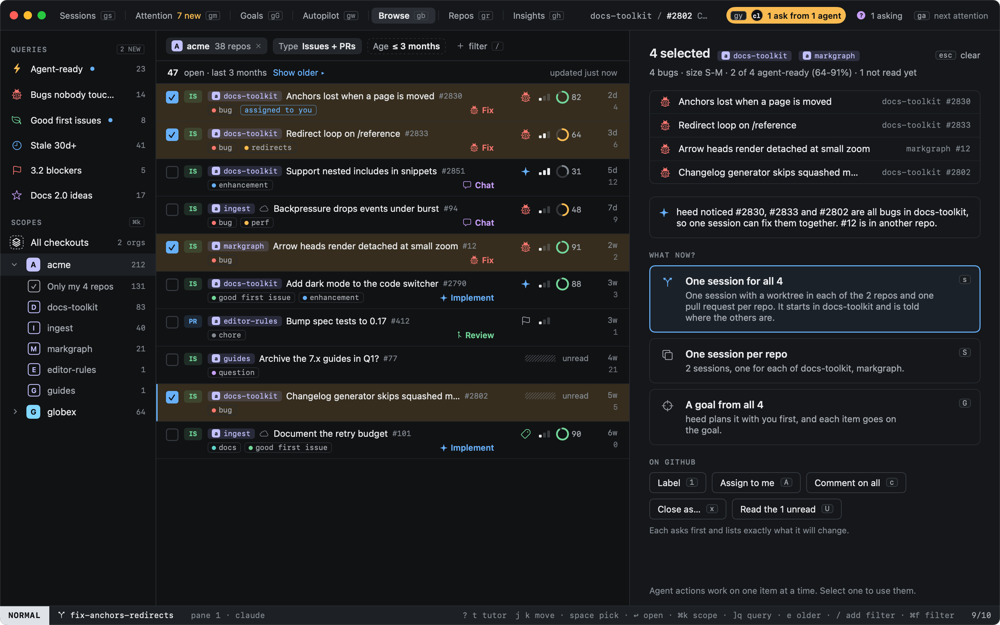

heed's note names what it noticed: issues of one repo and one class that share a label or a title word. It does this
from titles and labels, without asking a model, and never groups pull requests. The note is a suggestion: it words the
prompt and never changes the choices below.

With two items picked or more, the panel always offers the same two sessions, whatever the repos and whatever heed
noticed:

- **One session for all N** (`s`, the default and the outlined card): one session with every pick in its prompt. Each
  line names its repo, and each issue gets a `Closes` line. When the picks are in one repo, that is one worktree, one
  branch and one PR. When heed found no group, the prompt says the items may be unrelated and asks for one PR per issue.
- **One session per repo** (`S`): one Start work form for each repo, one after the other, each with the prompt for that
  repo's picks. Above five repos, heed asks first. When all the picks are in one repo this card is dimmed and says
  *All N are in org/repo*: there is nothing to split.

### A session over several repos

When the picks are in more than one repo, `s` opens Start work with all of those repos chosen, the one with the most
picks first (the first picked on a tie). A repo that is not on this Mac yet is cloned when the work starts, as a repo
typed into Start work is. The session gets:

- one worktree in each repo, all on the same branch name, made together;
- the agent in the first repo's worktree, with a shell tab for each of the others;
- a line at the end of its prompt naming the other worktrees and their paths, and, for Claude Code and Codex, their
  paths as extra directories (`--add-dir`), so reading and editing them is not outside the agent's reach;
- a prompt that lists each item with its repo, asks for one PR per repo (a PR cannot span repos), and has the
  `Closes org/repo#n` lines grouped by repo.

heed also notices a session that works in a second repo and offers to grow it into a goal (see
[Goals](../goals/index.md#from-a-session)).

- **A goal from all** (`G`): heed plans it with you first, and each item goes on the goal.
- **On GitHub:** **Label** (`1`), **Assign to me** (`A`), **Comment on all** (`c`) and **Close as...** (`x`: completed
  or not planned). Each opens a confirm step that lists exactly what changes on each item, and what it leaves alone
  and why. Nothing is written before you confirm. A write that fails does not stop the rest, and a report says what
  each item got. A closed PR is closed without merging.
- **Read the unread** (`U`): heed reads the picked items it has not read.

## Smaller windows

Browse draws itself from the width of its own area, so a window in a split behaves as a narrow window does.

| Width | Layout |
|---|---|
| 1100 and up | Rail, list and reader side by side |
| 640 to 1100 | An icon rail and the list; `↩` pushes the reader over them, `⎋` goes back, `j` and `k` move to the next item |
| Under 640 | No rail: the scope chip and the filter count sit over two-line rows, the scope chip opens the jump as a sheet, filters and bulk actions are sheets too |

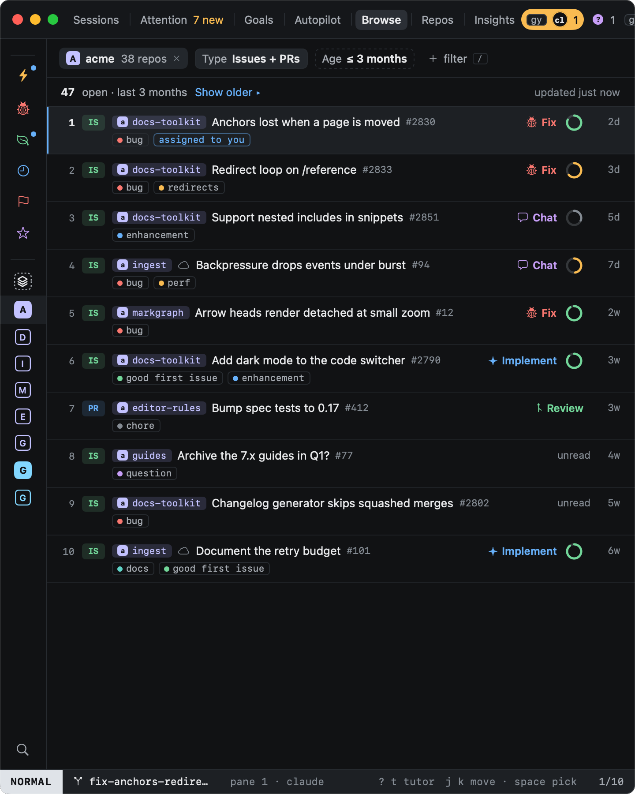

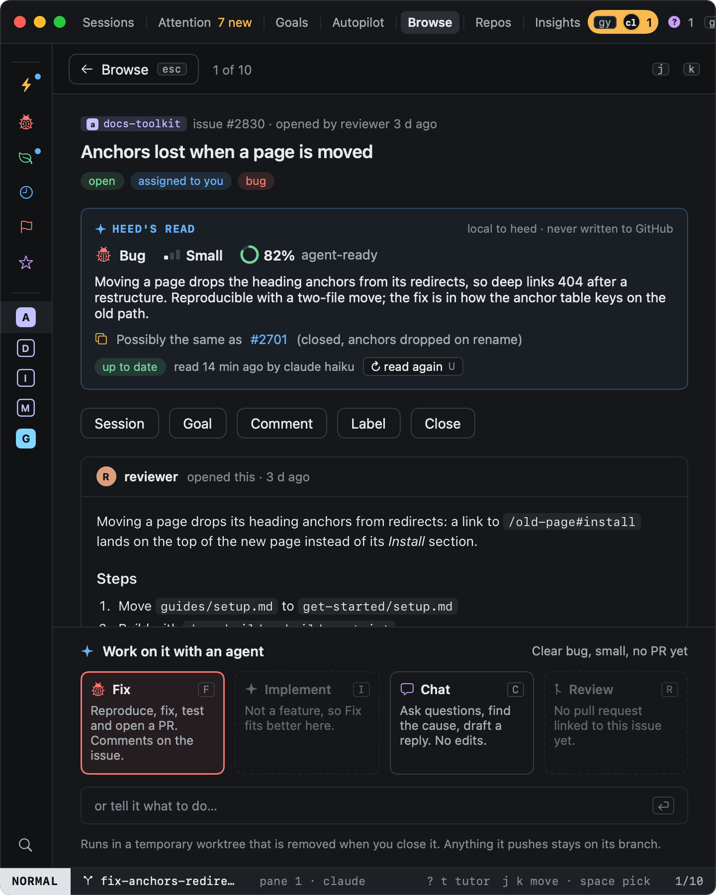

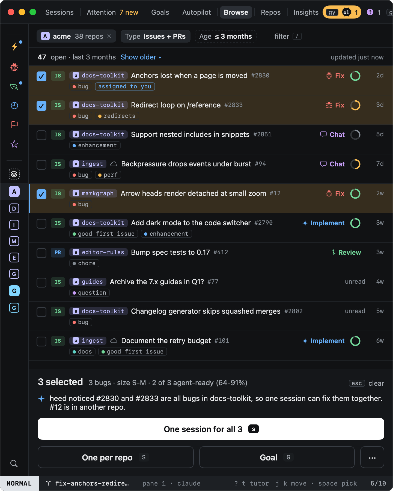

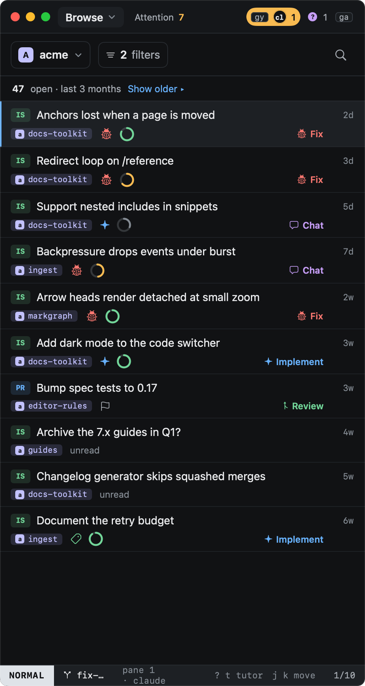

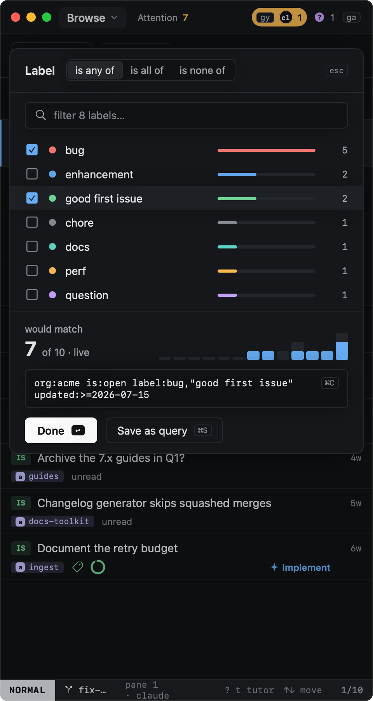

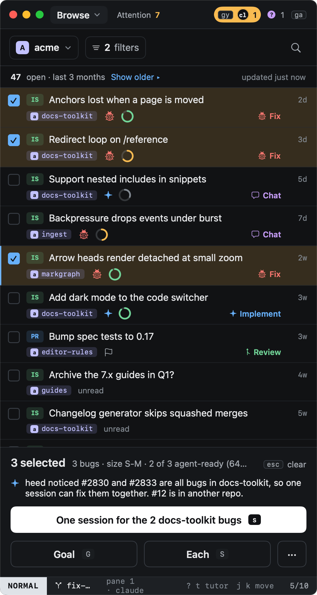

Where you are, what you picked and the query survive a resize.

## Keys

`gb` (or `:browse`, or `:view browse`) opens Browse. These keys work inside it, and you can rebind each (`:keys`, [Customizing](../keyboard/customizing.md)).

| Key | Command | Does |
|---|---|---|
| `j` `k` | | Move through the list |
| `↩` | `browse.open` | Load the item now; on a narrow window, push the reader |
| `⌘K`, `gj` | `browse.scope` | Jump to an org or a repo |
| `]o` `[o` | `browse.scope.next` `browse.scope.prev` | Next and previous scope |
| `za` | `browse.scope.toggle` | Open or close the repos under the org you are in (the rail's chevron) |
| `]q` `[q` | `browse.query.next` `browse.query.prev` | Next and previous saved query |
| `/` | `browse.filter.add` | Add a filter |
| `x` | `browse.filter.remove` | Take the last filter off |
| `S` | `browse.query.save` | Keep the query in the rail |
| `N` `D` | `browse.query.rename` `browse.query.delete` | Rename (and change glyph and tint), or remove, the saved query you are on |
| `]Q` `[Q` | `browse.query.down` `browse.query.up` | Move the saved query down or up the rail |
| `e` | `browse.older` | Show older items, or go back to the cap |
| `r` | `browse.refresh` | Apply the banner's new rows, or ask GitHub again |
| `T` | `browse.sort` | Next sort |
| `⌘F` | `session.filter` | Narrow the rows by words |
| `space` `v` `a` | | Pick one, pick a range, pick all |
| `gB` | `open.browser` | Open the item, or every picked item, on GitHub (asks above five) |
| `gR` | `open.repo` | Open the item's repo on GitHub |
| `y` `Y` | `browse.copy.link` `browse.copy.ref` | Copy the link, or `org/repo#number`, of the item or the picked items |
| `U` | `browse.read` | heed reads the item or the picked items |
| `F` `I` `C` `R` | `browse.fix` `browse.implement` `browse.chat` `browse.review` | Fix, Implement, Chat, Review |
| `t` | `browse.tell` | Tell an agent what to do, in your words |
| `w` | `browse.agents` | Only the items with an agent on them, and back |
| `W` | `browse.from.sessions` | Only the items a session was started from, and back |
| `O` | `browse.from.goals` | Only the items that are in a goal, and back |
| `s` | `browse.run.keep` | Keep the run as a session |
| `i` | `browse.run.steer` | Steer the run |
| `⎋` | `browse.run.close` | Close the run and remove its worktree (kept, with a card, when it holds unpushed work); in this order, the first that applies: close help or a reader that is open, cancel a bulk step, go back from a pushed reader, clear the picks, close the scope sheet, then close the item's run |
| `P` `E` `X` | `browse.run.review.post` `.edit` `.discard` | Post, edit or discard the drafted review; twice, discard a kept worktree |
| `c` `d` | `browse.clone.only` `browse.clone.folder` | On the clone card: only clone, choose the folder |

With items picked:

| Key | Command | Does |
|---|---|---|
| `s` | `browse.bulk.session` | One session for all the picks, in every repo they are in |
| `S` | `browse.bulk.each` | One session per repo |
| `G` | `browse.bulk.goal` | A goal from all |
| `1` | `browse.bulk.label` | Label them on GitHub |
| `A` | `browse.bulk.assign` | Assign them to you on GitHub |
| `c` | `browse.bulk.comment` | Comment on all on GitHub |
| `x` | `browse.bulk.close` | Close them on GitHub |

In VISUAL (`v`) the range becomes picks. `o` opens the picks on GitHub, and `y` copies their links. `d` (remove) and `m` (pin) are for worktrees and do nothing in Browse; they, and `o` and `y` as paths, work in [Repos](../worktrees/index.md) only.

[Keyboard reference](../keyboard/reference.md) lists every command and its key.

## Settings

`[browse]` in `config.toml`, and Settings › GitHub:

| Key | Default | Means |
|---|---|---|
| `max_age_days` | `90` | Browse leaves out items not updated within this many days. `0` shows everything. Show older lifts it for one view |
| `many_repos` | `200` | An org with more repos than this is offered a view of its own first. `0` never asks |
| `reads` | `"ahead"` | `"ahead"` reads the top rows and the item under the cursor, `"open"` only that item, `"off"` only when you press `U` |
| `read_ahead` | `20` | How many rows from the top of the view are read ahead. `0` reads none |
| `max_runs` | `3` | How many agent runs may work at once (0 to 20). `0` sets no limit |
| `auto_refresh` | `true` | Coming back to Browse asks GitHub again. `false` leaves it to `r` (entering Browse still asks) |
| `refresh_after` | `60` | Seconds an answer stays fresh before coming back asks again (5 to 3600) |
| `agent` | unset | The agent Browse's runs use: `claude`, `codex`, `opencode` or `gemini`. Unset, it is `[helpers] agent` |

Reads follow `[llm]`: its switch, its daily limits and its back-off. See [Model calls](../agents/model-calls.md) and
the [configuration reference](../configuration/reference.md).

## What Browse does not do

- **It fetches when you come back or ask, not on a timer.** A list you leave open and watch does not change by
  itself: coming back to it (see Staying current) or `r` asks again, and the line over the list says how old it is.
- **It brings in at most 300 items per search.** A longer result is filtered, not read: narrow the query.
- **An answer that is not an answer never empties the list.** When GitHub replies with errors and no search result, or only some of an "All checkouts" view's owners were searched, Browse says what went wrong (or keeps every row) instead of treating the missing rows as gone; the cache keeps them.
- **A cache that cannot be opened does not stop Browse.** If `browse.sqlite` is locked, unwritable or from a newer heed, Browse works from memory (everything fetched this run, nothing kept for the next) and a line over the list says why.

  
- **GitHub can time out on a very large search.** When it answers HTTP 502 or 504, Browse asks the same page again in
  smaller pages (100, then 50, 25 and 10, then ten without the checks and requested reviewers, which then show as
  unknown), waiting a moment between tries, and keeps the smaller size for that scope and query. If every size fails it
  says so and keeps the list on screen: narrow the search to a repo, a label or a shorter age. A secondary rate limit is
  waited out once, up to 30 seconds. Browse does not retry what a retry cannot fix: a sign-in or SAML problem, or a
  query GitHub refuses.
- **An org view is a filter GitHub applies,** language and archived. It has no topic or team filter, because GitHub's
  issue search has none, and it keeps no list of repos.
- **Projects are not a filter or a scope.** heed cannot read an item's Projects, so it offers no Project field, no
  Project rows in the rail and no Project value in the words box. `project:owner/N` typed as a raw GitHub query works
  for classic Projects only (Projects v2 need a token scope heed does not ask for).
- **Heed's fields are local.** The counts for queries that use them come from what this Mac has fetched and read, not
  from GitHub.
- **Words need the model.** With model calls off, a sentence is searched as text.
- **Agent actions take one item,** and an agent never starts on an item whose Fix, Implement or Review does not fit
  it: the button says why.
- **A run is not a sandbox,** and it is not free: it spends against `[helpers] spend_cap`.
- **Quitting stops the runs.** With a run live, ⌘Q asks first (also when sessions persist through zmx, which keeps sessions but not Browse's agents), names the runs, and closes their agents on the way out. A worktree stays where it is; the next launch's sweep removes only the ones holding nothing.
- **A crash can leave a run's worktree behind.** heed removes it when you close the run, not on its own at startup (the next launch's sweep removes the ones with nothing unpushed or uncommitted in them).

**Next:** [Reading](reading.md), or [start a session from an item](../start-work/from-github.md).
