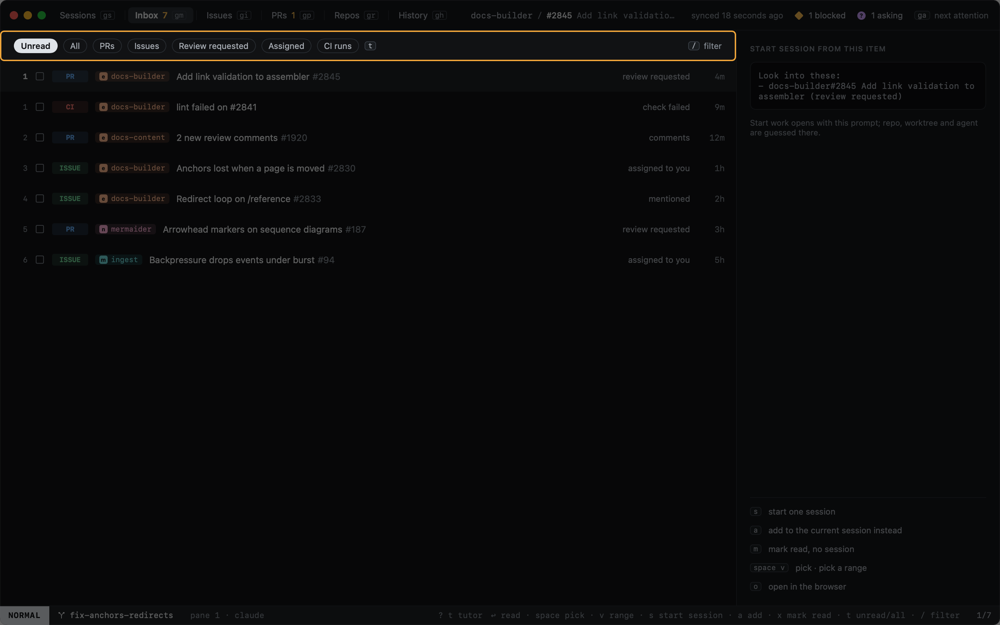
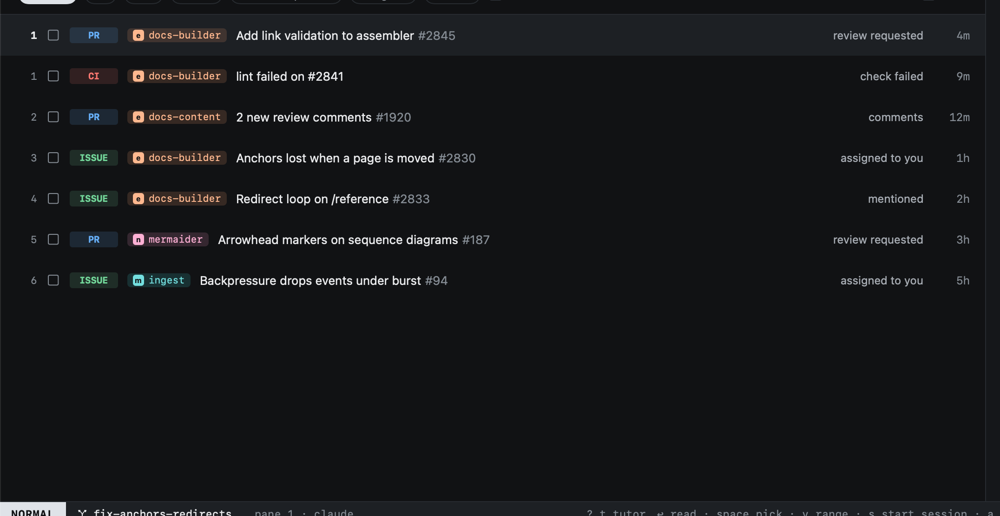

# Inbox

`gm` opens your notifications: pull requests, issues, CI runs, releases and discussions, newest first.

## Filters

`t` cycles the chips; `/` [filters](../sessions/filtering.md) by text on top of them.

| Chip | Shows |
|---|---|
| Unread | What you have not read yet (the default) |
| All | Everything |
| PRs | Pull requests |
| Issues | Issues |
| Review requested | Pull requests waiting on your review |
| Assigned | Things assigned to you |
| CI runs | GitHub Actions telling you a workflow run finished (failed, mostly) on your branch |

## Acting on items

| Key | |
|---|---|
| `space` | Pick an item; `v` picks a range |
| `s` | [Start a session](../start-work/from-github.md) from the picked items |
| `a` | Add them to the current session |
| `go`, `↩` | [Read](reading.md) the item in the app |
| `x` | Mark read: done with it, as `x` is everywhere |
| `gB` | Open in the browser |

