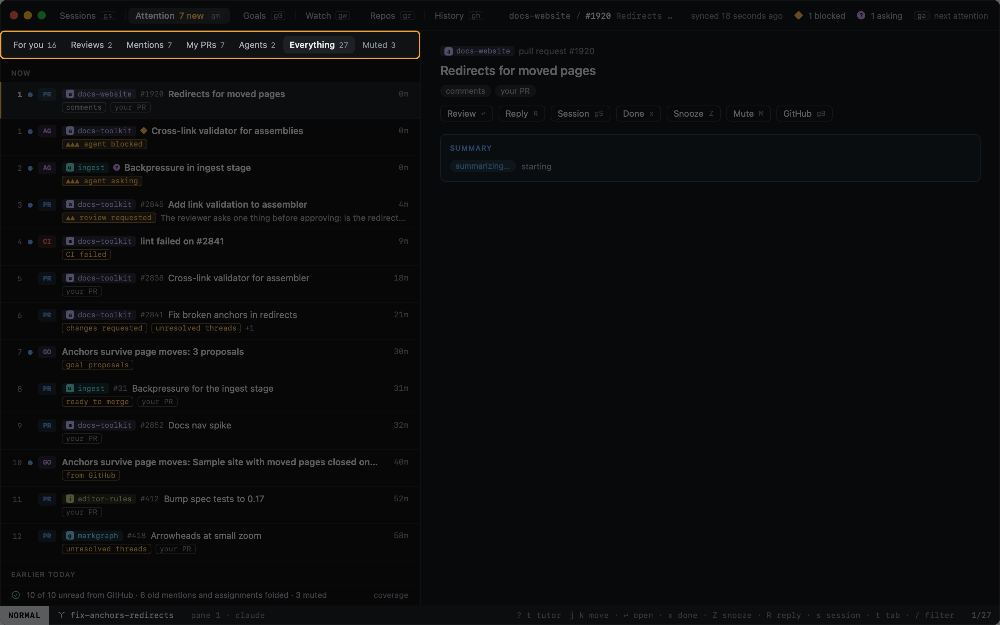
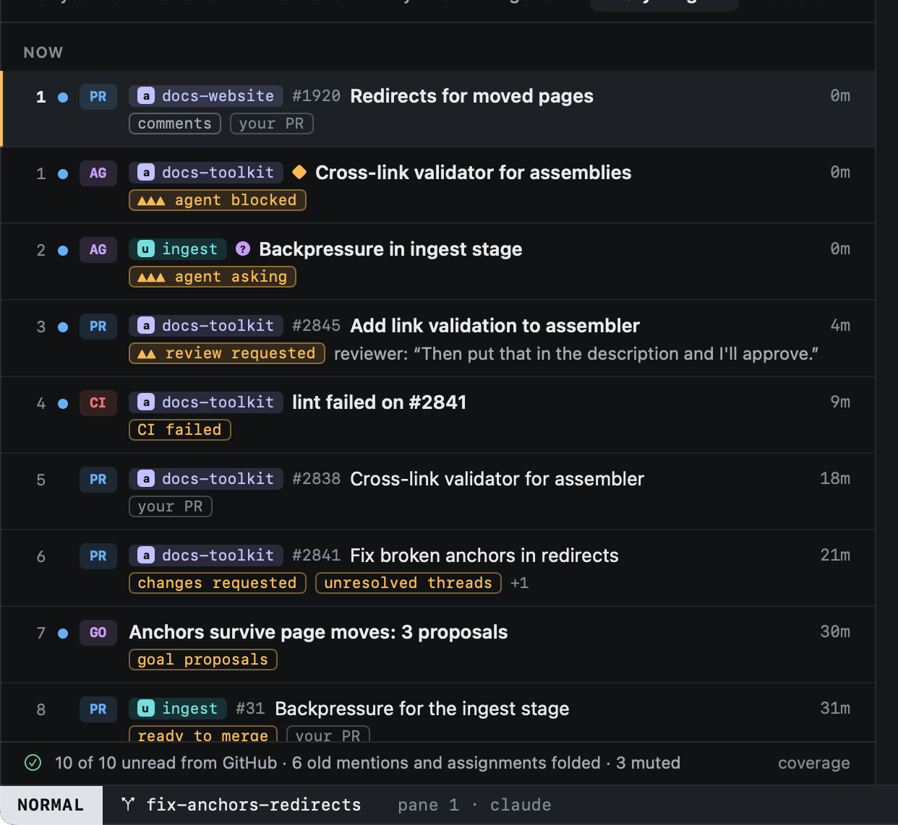

# Inbox

The Inbox is [Attention](attention.md)'s **Everything** tab now: every notification (pull requests, issues, CI runs,
releases, discussions) and every item the other tabs list, newest first, with the thread under the cursor beside it.
`:inbox` and `:view.inbox` open it, as `:view.attention all` does.

What was the Inbox's is Attention's:

| Inbox | In Attention |
|---|---|
| Unread, All | Everything lists every item; [For you](attention.md#for-you) what is new or waits on you |
| PRs, Issues, Review requested, Assigned, CI runs | The tabs and the narrow lists: My PRs, Reviews, `gi`, `:view.attention ci` |
| `x` mark read | `x` done: marked read on GitHub, back when someone else acts ([Done](attention.md#done)) |
| `space`, `v`, `s`, `a` | The same: pick, [start a session](../start-work/from-github.md), add to the current one |
| `go`, `↩` | `↩` the full [reader](reading.md); the thread under the cursor already shows on the right |
| `gB` | The same: open in the browser |

