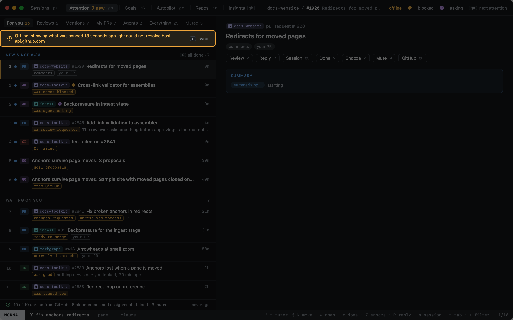

# GitHub

Heed talks to GitHub only through the [GitHub CLI](https://cli.github.com): it never asks for a token. Sign in once
with `gh auth login` and Heed keeps it in sync: what the view on screen shows every minute (`poll_seconds` under
`[github]`), the rest every five, and `r` syncs everything now. A tracked PR's details are fetched when you open it and
when its checks or review threads change.

| View | Key | Shows |
|---|---|---|
| [Attention](attention.md) | `gm` | Everything that wants you, one feed: notifications, issues assigned to you or mentioning you, your PRs and agents waiting on you. `gi` opens it on issues, `gp` on My PRs |
| [Pull requests](pull-requests.md) | `:prs` | Your open pull requests and the ones your sessions track |
| [Autopilot](autopilot.md) | `gw` | What heed can do on its own, where it is on, what it is doing now and what it did |
| [Get it green and merged](watch.md) | `gw` `N` | How green and merge work: the rules, the merge queue, runs, stalled and paused PRs |

Heed is not a GitHub browser: it brings you what involves you, so you can pick it up without going looking. There is
no list of every issue in a repo; `:inbox` and `:issues`, the views that were, open Attention's Everything tab and its
issues.

[Setting up a repo](repo-setup.md) proposes get it merged and get it green for a repo from its own merged PRs and CI.

From any of them you can [read](reading.md) an item in the app, [start a session](../start-work/from-github.md) from
it, and feed [review feedback](review-feedback.md) back to the agent working on it.

## When GitHub can't be reached

Heed keeps the last sync and keeps working. A banner says when the data was synced and why it is stale.

Items in orgs your `gh` token is not authorized for (SAML single sign-on) are counted in the title bar ("· 49 hidden")
rather than shown. `gh auth refresh`, or authorizing the GitHub CLI for that org, brings them in.

Saying which of your teams a team mention came through needs gh's `read:org` scope: `gh auth refresh -s read:org`
(see [Team mentions](attention-rules.md#team-mentions)).
