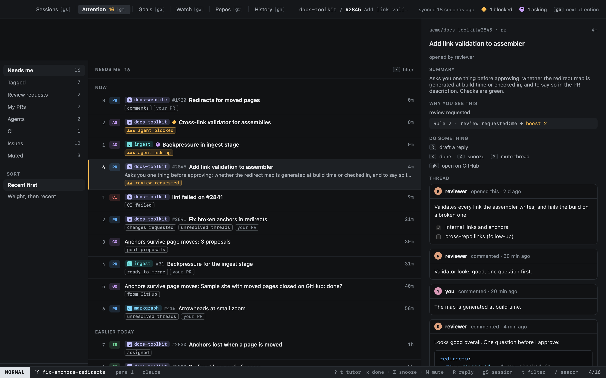
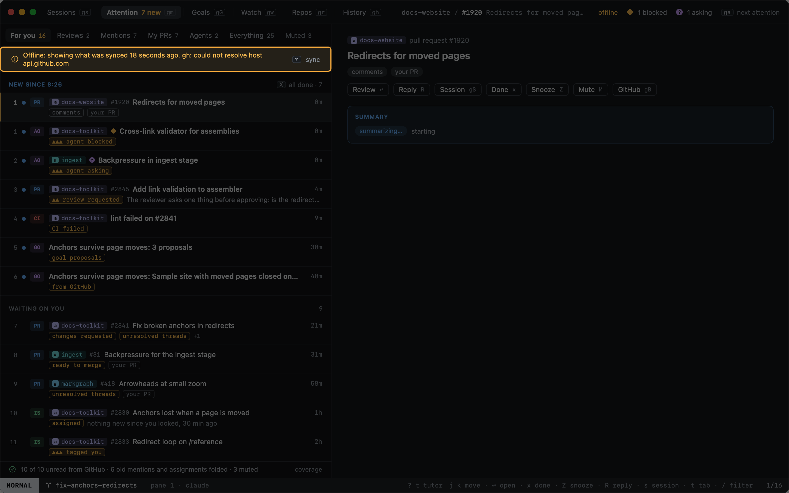

# GitHub

Everything on GitHub that wants you arrives in one feed, and the review feedback on your PRs goes back to the agent
that wrote the code.

heed talks to GitHub only through the [GitHub CLI](https://cli.github.com): it never asks for a token. Sign in once
with `gh auth login` and heed keeps the data in sync. The view on screen refreshes every minute (`poll_seconds` under
`[github]`), the rest every five, and `r` syncs everything now. heed fetches a tracked PR's details when you open it and
when its checks or review threads change.

[Attention](attention.md) brings you what involves you, so you can pick it up without going looking. [Browse](browse.md)
is where you go and get the rest: the issues and PRs of an org or a repo, searched on GitHub. Attention
still lists only what involves you, not every issue in a repo. `:inbox` and `:issues`, the views that were, open
Attention's Everything tab and its issues.

## In this section

- [Attention](attention.md) (`gm`): everything that wants you, in one feed: notifications, issues assigned to you or
  mentioning you, your PRs and agents waiting on you. `gi` opens it on issues, `gp` on My PRs.
- [Attention rules](attention-rules.md): tell heed what matters, team mentions included.
- [Browse](browse.md) (`gb`): search the issues and PRs of an org or a repo, read each with heed, and put an agent on one or a group.
- [Pull requests](pull-requests.md) (`:prs`): your open PRs and the ones your sessions track.
- [Reading](reading.md): read a PR or an issue without leaving heed, and start a session from it.
- [Review feedback](review-feedback.md): review comments and failing checks, fed back to the agent that opened the PR.
- [Tracking PRs](tracking-prs.md): which PRs a session follows, and how to add one.

[Autopilot](../autopilot/index.md) (`gw`) takes the next step on those PRs: it gets them green, merges them by your
rules and sets a repo up. From any PR you can [start a session](../start-work/from-github.md) too.

## When GitHub can't be reached

heed keeps the last sync and keeps working. A banner says when the data was synced and why it is stale.

heed counts items in orgs your `gh` token is not authorized for (SAML single sign-on) in the title bar ("· 49 hidden")
and does not show them. `gh auth refresh`, or authorizing the GitHub CLI for that org, brings them in.

To say which of your teams a team mention came through, heed needs gh's `read:org` scope: `gh auth refresh -s read:org`
(see [Team mentions](attention-rules.md#team-mentions)).

**Next:** [Autopilot](../autopilot/index.md).
