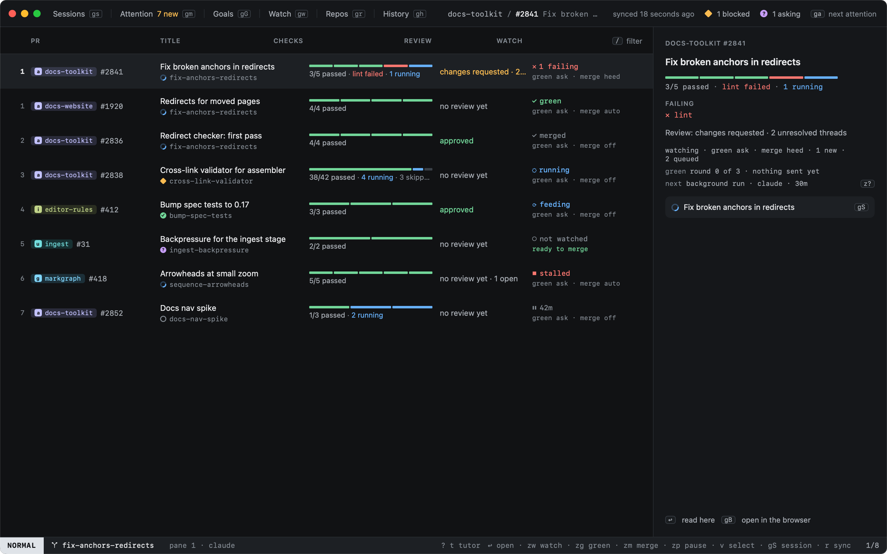
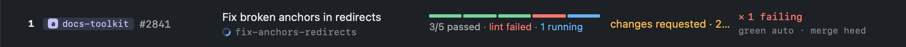

# Pull requests

`:prs` opens the list of your open PRs, and the PRs your sessions track. heed syncs the list from GitHub with `gh`.
`gp` opens [Attention](attention.md) on My PRs instead, which sorts the same PRs by what wants you.

Each row has five columns. The row's number counts how far the cursor is from it, as in the sidebar.

- **PR.** The repo chip and the PR number.
- **Title.** The PR's title, with its branch below. The branch line starts with the state of the session working on it, and says `draft` for a draft PR.
- **Checks.** The check bar and a count: `3/5 passed · lint failed · 1 running`.
- **Review.** `approved`, `changes requested` or `no review yet`, with the number of unresolved review threads.
- **Watch.** What heed does for the PR: whether it watches the PR, and the modes of get it green and get it merged.

## Checks

The check bar draws one segment per check when a PR has 12 or fewer: green passed, red failed, blue running and grey
skipped. Past 12 checks, the bar draws one segment per state, as wide as its share of the checks. The text under the bar
names each failing check.

## What heed does for the PR

The Watch column shows the PR's autopilot state and the modes in force, `green auto · merge heed`. `ready to merge`
appears when the PR meets every merge requirement while get it merged is off. A stalled PR shows `stalled`.
[Autopilot](../autopilot/index.md) explains the states.

| Key | |
|---|---|
| `zw` | Watch the PR, or stop watching it |
| `zg` | Cycle get it green: off, ask, auto |
| `zm` | Turn get it merged on or off |
| `zp` | Pause the PR, or resume it |

## The detail pane

When the window is at least 1100 points wide, a pane at the right shows the PR under the cursor. The pane holds the
check bar, the failing checks by name, the review state, what heed does for the PR, and the session that tracks it. A
PR with no session says so, and says that sessions pick PRs up by branch or with `heed pr add`.

| Key | |
|---|---|
| `go`, `↩` | [Read](reading.md) the PR in the app |
| `gS` | Jump to the session working on it |
| `gB` | Open it in the browser |
| `/` | [Filter](../sessions/filtering.md) by title, repo, number or branch |
| `v`, `space` | Select several PRs, then act on all of them: `zw`, `zg`, `zm`, `zp` |
| `r` | Sync now |

## The badge

The PRs tab counts the PRs that need you. A PR counts when it has a failing check, a review that asks for changes, or an
unresolved review thread.
