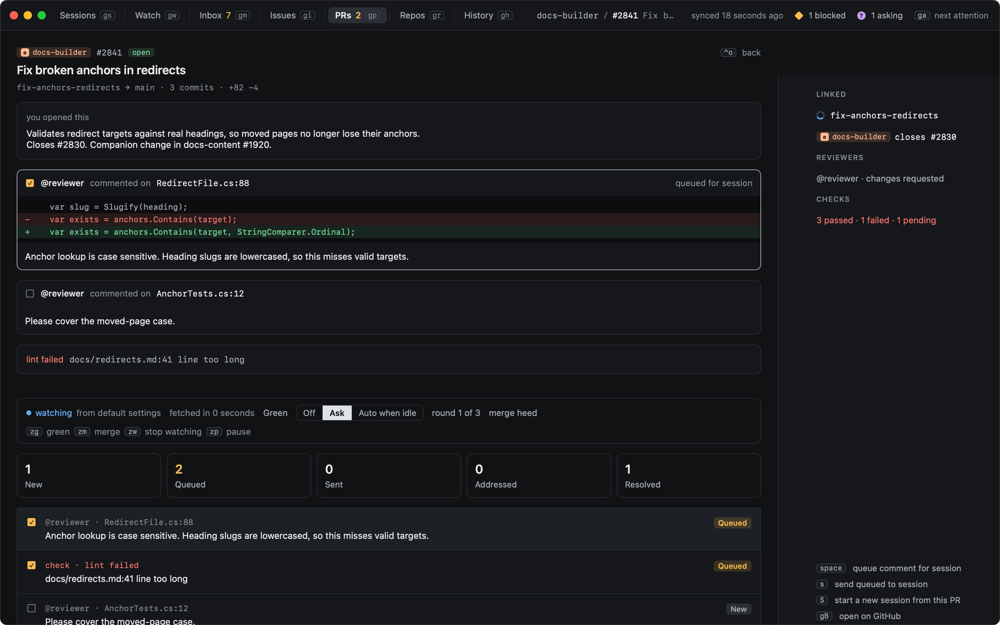
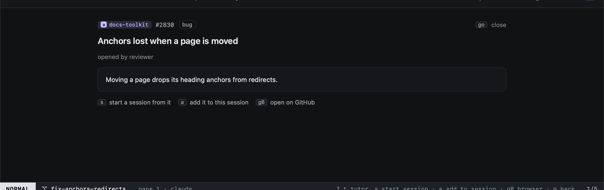

# Reading PRs and issues

`go` (or `↩`) on a pull request or an issue opens it in the app. `go` again, or `⌃o`, goes back.

## Pull requests

The reader shows the description, the unresolved review threads with the code they are on, the failing checks, and the
[review feedback](review-feedback.md) pipeline for it.

## Issues

The issue reader shows the title, labels, author and body. From it:

| Key | |
|---|---|
| `s` | [Start a session](../start-work/from-github.md) from it |
| `a` | Add it to the current session |
| `gB` | Open it on GitHub |

Only the issues in the [Issues](issues.md) view are synced in full. Any other issue shows what was synced of it: in
the Inbox its title, in [Attention](attention.md) also its labels, author and the body fetched for its detail.
