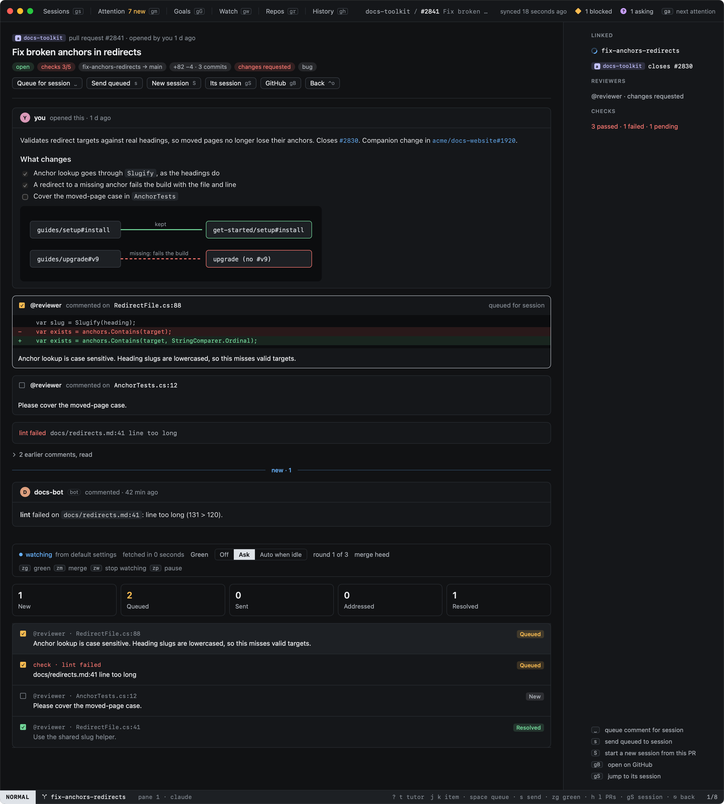
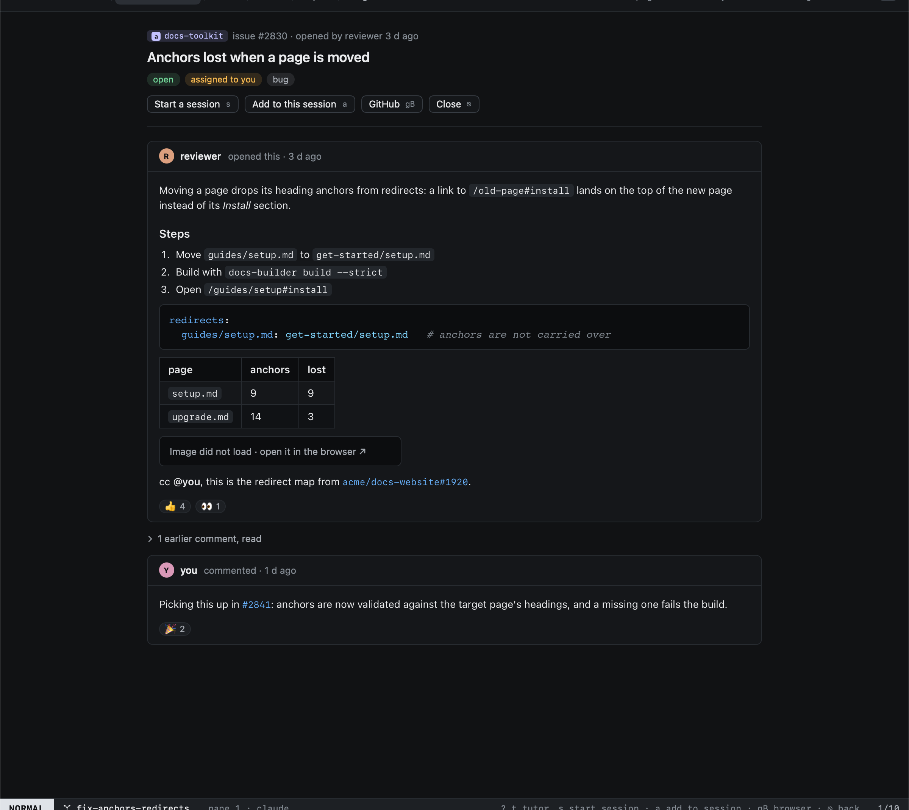

# Reading PRs and issues

`go` (or `↩`) on a pull request or an issue opens it in the app. `go` again, or `⌃o`, goes back.

A reader starts with the thread's header: the repo, the number, who opened it and when, the title, chips for its
state, and buttons for what you can do, each with its key. Under it is the conversation: the description, then every
comment as a card with its author, when it was written and its reactions. On a PR, reviews that approve, ask for
changes or say something are cards too.

## What renders

Bodies and comments are GitHub's own rendering of the markdown, drawn in heed's colours: headings, lists, task lists,
quotes, code blocks with GitHub's highlighting, inline code, tables, images, footnotes, `
`, and GitHub's links
to people (`@reviewer`), issues and commits. A comment hidden on GitHub shows why it was hidden instead of its body.

Links open in your default browser; the reader itself never navigates anywhere. The page runs no scripts: JavaScript
is off, and the page's security policy allows none, nor frames, fonts, forms or connections. The only thing it
fetches is images, through heed.

A reader loads the newest 300 comments of a thread. When a thread has more, it says how many older ones are only on
GitHub.

### Images in private repos

heed fetches a thread's images itself, with no cookies and without your GitHub token: the token never goes into the
page or along with an image request. Images in public repos load. An image in a private repo needs you signed in to
GitHub, unless the link GitHub gave is a short-lived signed one, so it may not load in heed. An image that does
not load shows as a box saying so, and clicking it opens the image in your browser, where you are signed in.

## Pull requests

Between the description and the comments, the PR reader shows the unresolved review threads with the code they are
on and the failing checks; under the conversation is the [review feedback](review-feedback.md) pipeline for it.

| Key | |
|---|---|
| `space` | Queue the review thread or check for the session |
| `s` | Send what is queued to the session |
| `S` | Start a new session from the PR |
| `gS` | Go to the session tracking it |
| `gB` | Open it on GitHub |

## Issues

| Key | |
|---|---|
| `s` | [Start a session](../start-work/from-github.md) from it |
| `a` | Add it to the current session |
| `gB` | Open it on GitHub |

Until a thread has loaded, an issue shows what was synced of it: the body for the issues in the [Issues](issues.md)
view, the title for others. If it cannot load (gh signed out, no access) the reader says why.
