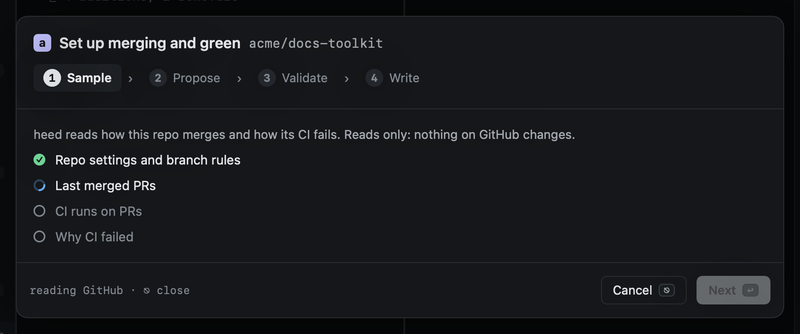
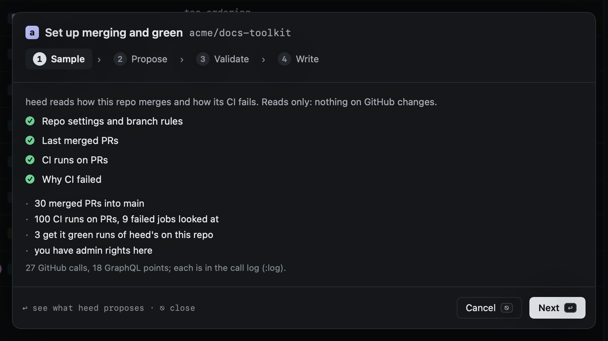
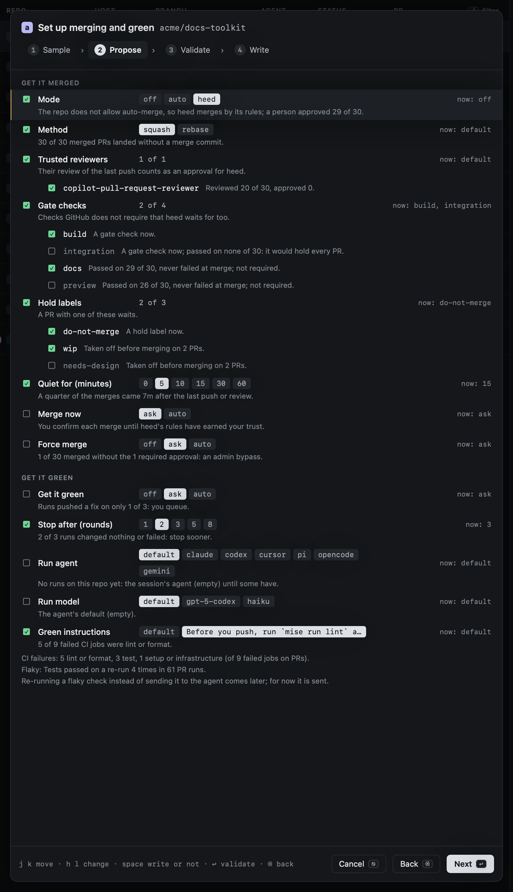
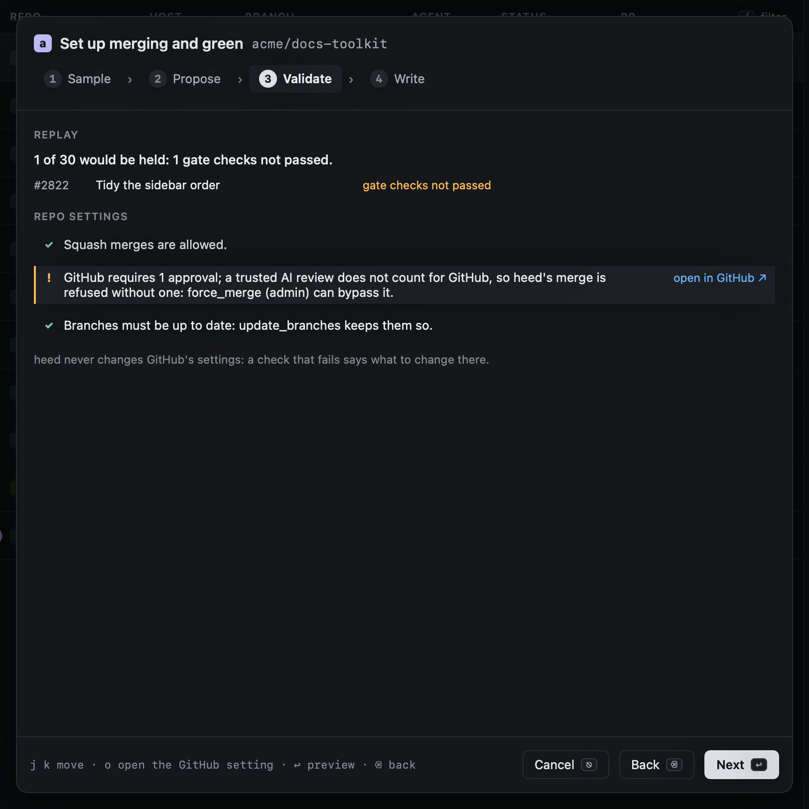
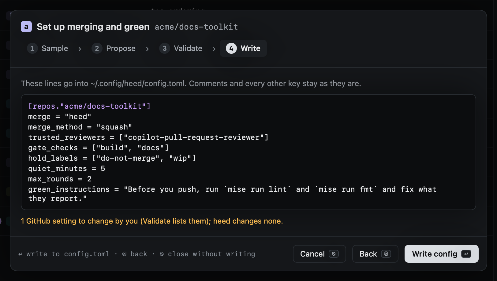

# Setting up a repo

Get it merged and get it green have a dozen settings per repo. The setup wizard reads the repo's own history and
proposes them, each with the reason, so you start from what the repo already does rather than from defaults.

Every repo in the [Repos view](../worktrees/repos.md) (`gr`) says where it stands, and has a **Set up…** button:

- **merging: not set up** (nothing in config decides it), **off**, **heed · squash** in green when it is set, or
  **⚠** and what is wrong, such as auto-merge turned on in heed while the repo does not allow it.
- **green: ask · 3 rounds**, with the run agent and model when set.

`M` in Repos (`:repo.setup`, or `:repo.setup org/name`) opens the wizard for the repo under the cursor; the button and a
right-click on a repo (or on one of its worktrees) open it for that repo. `⎋` closes it at any step without writing.

## 1. Sample

heed reads, with `gh`, and changes nothing:

- the repo's settings: the merge buttons it allows, auto-merge, a merge queue, branch protection and rulesets on the
  default branch (required checks and approvals, linear history, up-to-date branches), and your permission;
- its last 30 merged PRs into the default branch: who wrote, reviewed and merged each, the head commit's checks, labels
  taken off before the merge, whether auto-merge or a queue merged it, and the merge commit;
- its CI on PRs: the last 100 runs (a run that passed on a second attempt is flaky), and up to 20 failed runs, each
  failed job classified as lint or format, test, build, or setup and infrastructure (from the failed step's name, else
  its log);
- heed's own get it green runs on the repo, and the repo's tasks (mise, make, package.json).

A sample is two GraphQL queries (about 18 points of the 5,000 an hour) and up to 30 REST calls. Each is a row in the
[call log](../reference/call-log.md) (`:log`), under the caller `repo.setup`.

## 2. Propose

Each setting shows the proposed value with the others a click (or `h` `l`) away, what applies now, and why:

| Setting | Proposed from |
|---|---|
| `merge` | `auto` when the repo merges through a queue or auto-merge was used on a third of the PRs; `heed` otherwise; `off` with no merged PRs |
| `merge_method` | the only method the repo allows, else what the merged PRs used (merge commits, or one commit) |
| `trusted_reviewers` | bots that reviewed at least a fifth of the PRs, and Copilot when a ruleset asks it to review |
| `gate_checks` | with required checks: the others that passed on most PRs and never failed at merge (on when they ran on nine in ten) |
| `hold_labels` | labels named like a hold, and labels taken off before merging; a hold label merged PRs still carried is turned off |
| `quiet_minutes` | how soon after the last push or review a quarter of the PRs merged (5 to 30) |
| `merge_now` | `auto` with auto-merge (GitHub decides), else `ask` |
| `force_merge` | only for admins: `ask` when merged PRs went past the required approvals, else `off` |
| `green` | `auto` once heed's runs pushed a fix on at least half of three or more, else `ask` |
| `max_rounds` | 2 when most runs changed nothing or failed, else 3 |
| `agent`, `model` | the agent and model whose runs pushed most often |
| `green_instructions` | when CI failed on lint or format: run the repo's lint and format tasks before pushing |

Flaky workflows and what failed CI runs failed on are listed under get it green. Re-running a flaky check instead of
sending it to the agent comes later.

A setting is ticked when it changes something; space writes it or leaves it out, and on a list (reviewers, checks,
labels) turns one item on or off.

## 3. Validate

heed replays its merge rules (`merge = "heed"`, see [Watch](watch.md)) over the sampled PRs as they were just before
they merged, and says which would have been held and why. It checks the settings against the repo's: a method the repo
allows, auto-merge allowed for `auto`, linear history against merge commits, a merge queue, required approvals a
trusted AI review does not satisfy, up-to-date branches, and admin rights for `force_merge`.

heed never changes GitHub's settings. A check that fails says what to change there; `o` (or **open in GitHub**) opens
the settings page it is about.

## 4. Write

The exact lines are shown before anything is written. `↩` writes them under `[repos."org/name"]` in `config.toml`,
in place: comments, order and every other key stay as they are. The config reloads as after any edit, and Settings ›
Orgs & repos shows them.

