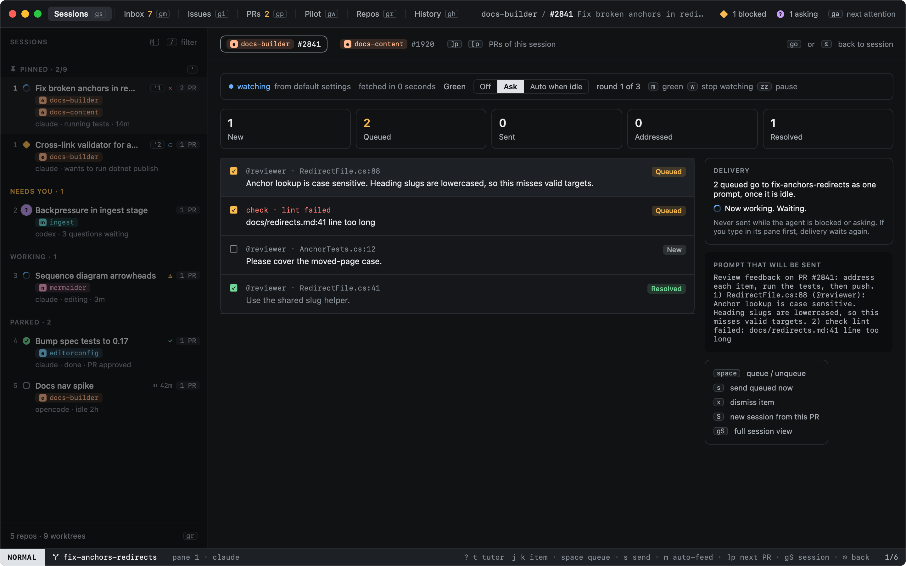
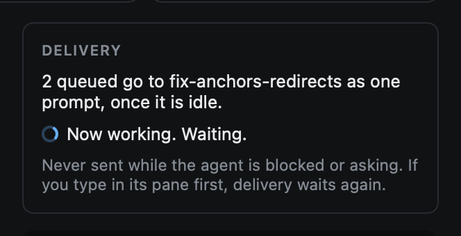
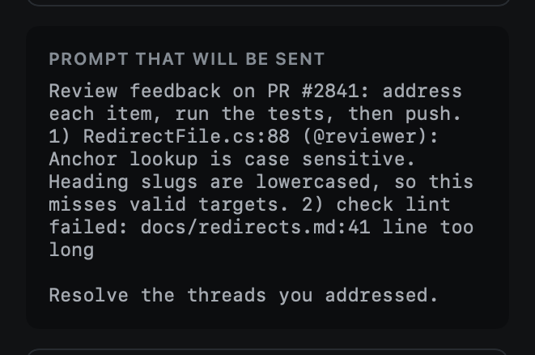

# Review feedback

When a session's pull request gets review comments or failing checks, Heed can hand them to the agent. In Sessions,
`go` opens the PR overlay for the session's pull request. The [Pilot view](pilot.md) (`gw`) shows every PR this
happens for, and what heed did.

## The pipeline

Every unresolved review thread and failing check becomes an item, and moves through:

**New** → **Queued** → **Sent** → **Addressed** → **Resolved**

| Key | |
|---|---|
| `space` | Queue or unqueue the item |
| `s` | Send the queued items now |
| `x` | Dismiss the item |
| `m` | Cycle green (auto-feed): **Off**, **Ask**, **Auto when idle** |
| `w` | Watch or stop watching this PR |
| `zz` | Pause or resume it (see [Pilot](pilot.md)) |
| `S` | Start a new session from this PR |
| `]p` / `[p` | The session's next / previous PR |

## Delivery

Queued items go to the agent as one prompt, and only when it is ready for it:

- Only when the agent is **idle** or **done**: never while it is working, blocked or asking.
- Not right after you typed in its pane: if you type, delivery waits again.
- With **Auto when idle**, new items queue and send by themselves. After three rounds on the same PR it stops and
  leaves the rest to you.

