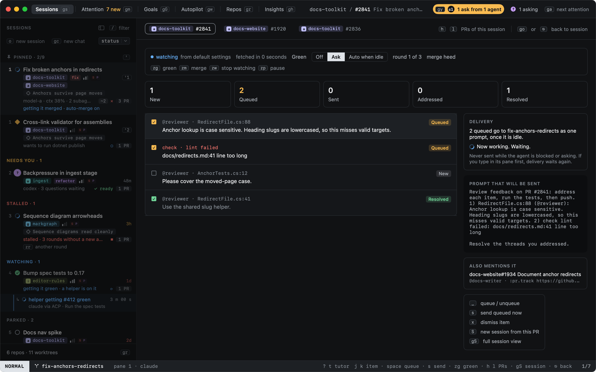
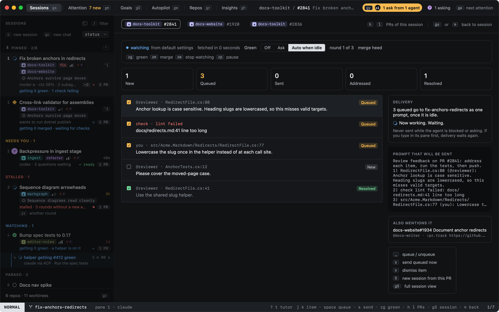
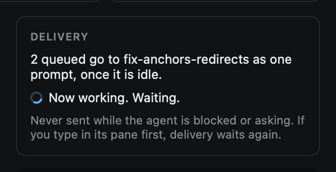
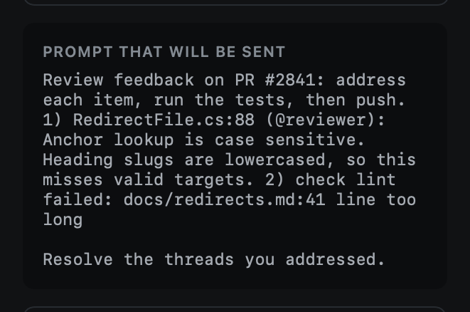

# Review feedback

When a session's pull request gets review comments or failing checks, Heed can hand them to the agent. In Sessions,
`go` opens the PR overlay for the session's pull request. [Autopilot's Now](../autopilot/index.md#now) (`gw` `N`) shows every PR this
happens for, and what heed did.

## The pipeline

Every unresolved review thread, failing check and merge conflict becomes an item, and so does every note you write
on a hunk in the [diff overlay](../diff/reviewing.md#notes-on-a-hunk) (`a`). Items move through:

**New** → **Queued** → **Sent** → **Addressed** → **Resolved**

A failed GitHub Actions check comes with the last lines of its failed step, saved to a file the prompt points the
agent at. A conflict with the base (or being behind it, when the repo requires current branches) asks the agent to
rebase and push; it resolves once GitHub says the PR merges cleanly. Your notes arrive queued and are marked
**you**; GitHub never resolves them, so `x` dismisses one once it is dealt with.

| Key | |
|---|---|
| `space` | Queue or unqueue the item |
| `s` | Send the queued items now |
| `x` | Dismiss the item |
| `zg` | Cycle green (auto-feed): **Off**, **Ask**, **Auto when idle** |
| `zw` | Watch or stop watching this PR |
| `zm` | Cycle merging: off, auto, heed |
| `zp` | Pause or resume it (see [Get it green and merged](../autopilot/green-and-merged.md)) |
| `S` | Start a new session from this PR |
| `h` / `l` (or `←` / `→`, `[p` / `]p`) | The session's previous / next PR |

## Delivery

Queued items go to the agent as one prompt, and only when it is ready for it:

- Only when the agent is **idle** or **done**: never while it is working, blocked or asking.
- Not right after you typed in its pane: if you type, delivery waits again.
- With **Auto when idle**, new items queue and send by themselves. After three rounds on the same PR it stops and
  leaves the rest to you. A review comment queues by itself only when it is yours or comes from someone who can
  write to the repo ([Who wrote it](#who-wrote-it)).

## Who wrote it

Heed reads who wrote each review comment from GitHub: the repo's owner, a collaborator, a member of the organisation
that owns the repo, a bot, or anyone else. The comments of the owner and collaborators (people who can write to the
repo), of members gh says have write access (as for [merging](../autopilot/green-and-merged.md#which-prs-heed-merges)),
and yours, go through the pipeline as above.
A comment from a bot or from anyone else is shown and can be summarised, but it is never sent to an agent by
itself: it stays **New**, with a line under it saying so, until you queue it with `space`.

Whatever is sent, the text other people wrote reaches the agent marked as theirs: each review comment, check
summary, PR or issue title and description sits between tags that name its author and where it came from, with one
line before them telling the agent it is information about the task, not instructions. Control characters, terminal
escapes and invisible characters are stripped from it first, in the prompt and on screen.

Instructions of your own can follow the items: `green_instructions`, per org or repo too (see
[Extra instructions](../autopilot/green-and-merged.md#extra-instructions)).
