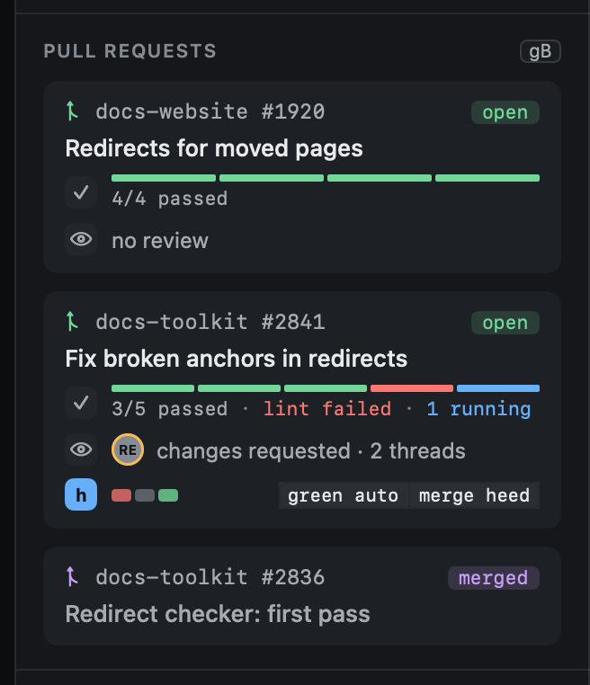
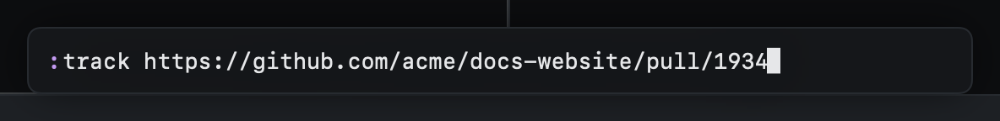

# Tracking PRs

A session tracks the PRs that are part of its work. A tracked PR shows in the session's sidebar row ("2 PR"), the
[inspector](../sessions/inspector.md), [Autopilot's Now](../autopilot/index.md#now) and the
[PR overlay](review-feedback.md). The session's timeline says why heed tracks each one.

A tracked PR is also what [get it green and get it merged](../autopilot/green-and-merged.md) act on. A
[chat](../sessions/chats.md) has no repo, so it tracks no PRs.

Every sync, heed fetches your open PRs. A tracked PR that is not in that list, because someone else opened it, heed fetches on its own, so the session keeps showing it.

## How a session picks them up

- **Its branches.** A PR opened from one of the session's branches, in one of its repos. The session follows its
  worktrees from branch to branch: merge the first PR, `git switch -c next` in the same worktree, and a PR from `next`
  is the session's too (the timeline says "now on next").
- **What its agent opened.** When the agent opens a PR (`gh pr create`, or a GitHub MCP `create_pull_request`), its
  hooks tell Heed at once, in any repo, so a companion change elsewhere is tracked without a sync. Only an opened PR
  counts: one the agent reads or links to is not. See [Hooks](../agents/hooks.md).
- **What links back.** A PR that mentions one the session tracks (GitHub's cross-reference), when it is yours, open,
  and newer than the session. Someone else's PR that mentions it is listed in the PR overlay under *Also mentions it*,
  with the `:pr.track` to add it.
- **By hand.** `gU`, or `heed pr add <url>` from inside a pane. See [The heed CLI](../reference/cli.md).

| Key | |
|---|---|
| `gU` | Track a pull request by URL (or `:pr.track <url>`) |
| `:pr.untrack [url]` | Stop tracking one: the overlay's PR, or the session's only one. No rule adds it back |
| `h` / `l` (or `←` / `→`, `[p` / `]p`) | In the PR overlay, the session's previous / next PR |
| `gS` | From a pull request, jump to its session |

