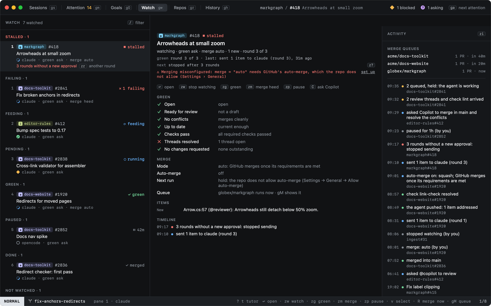
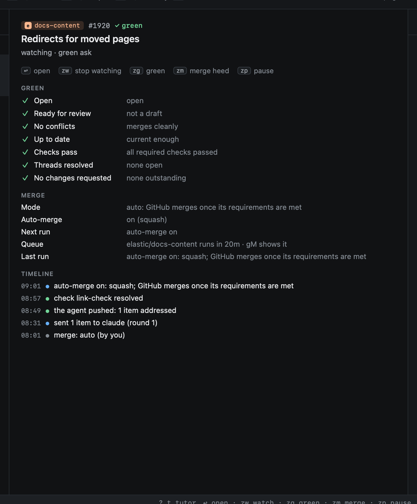
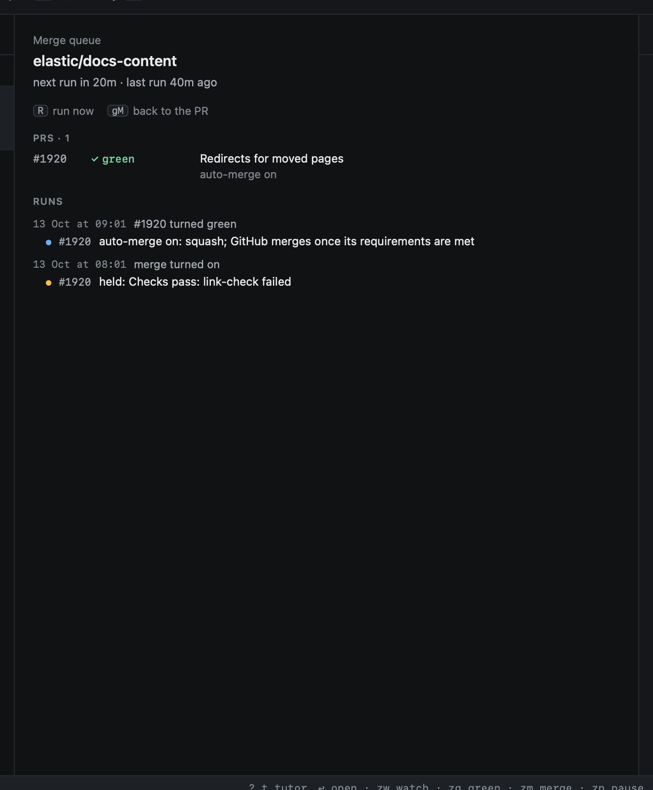
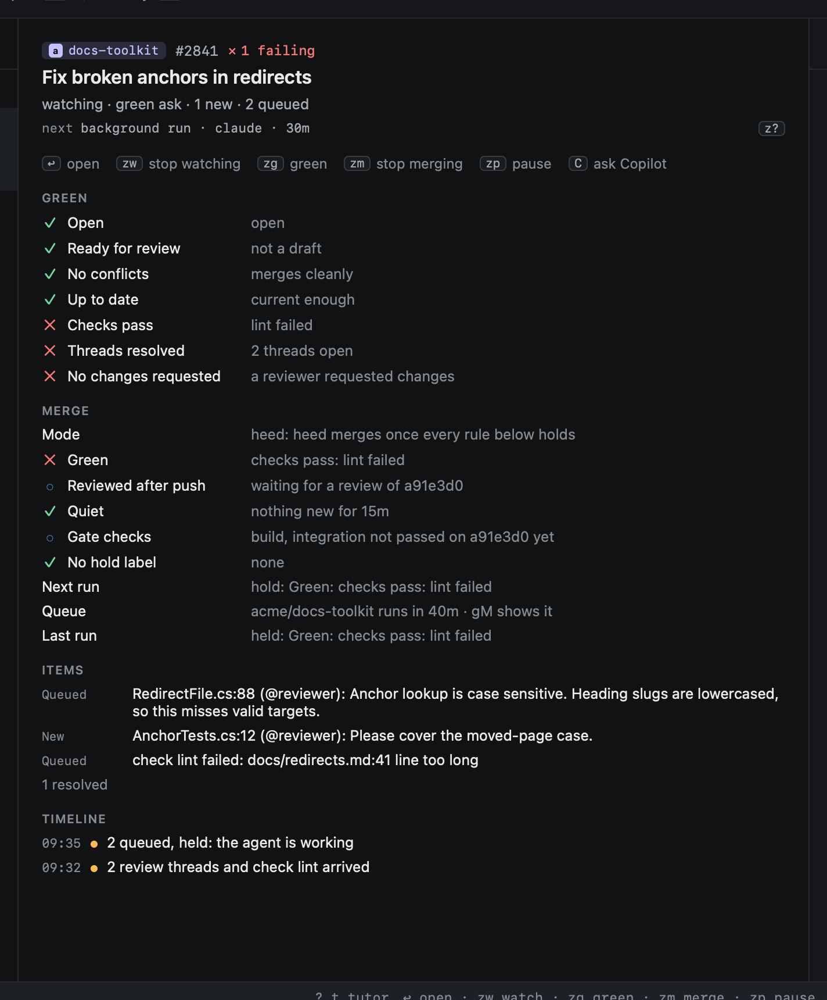
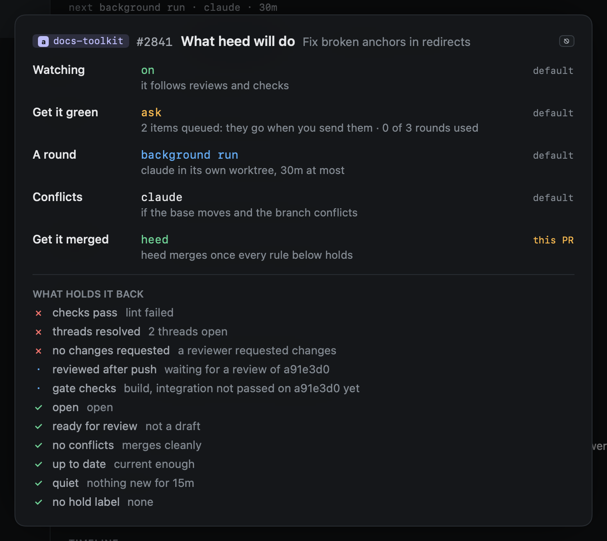
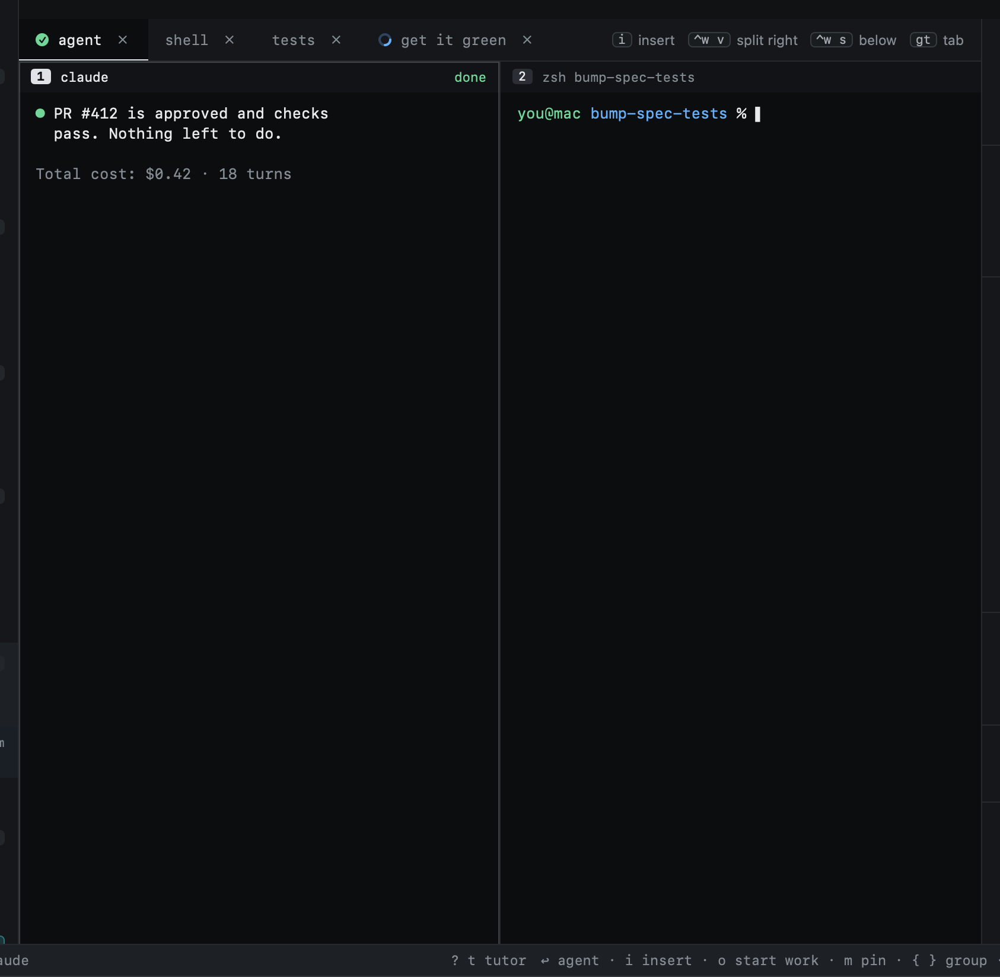
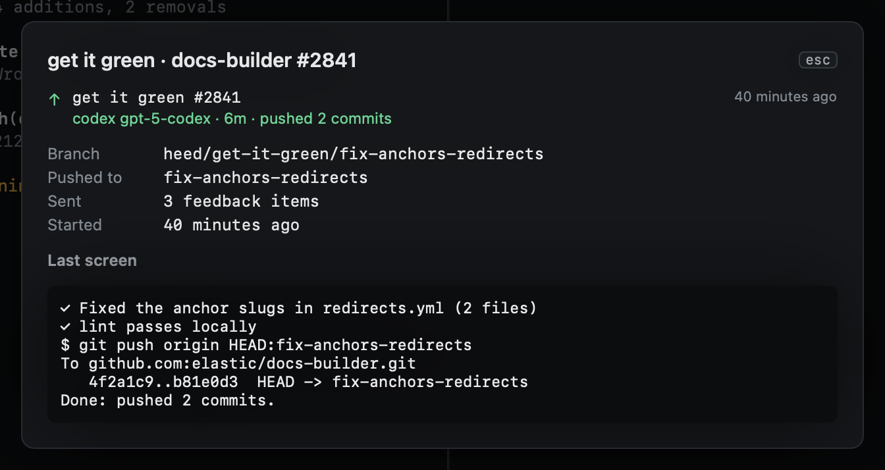
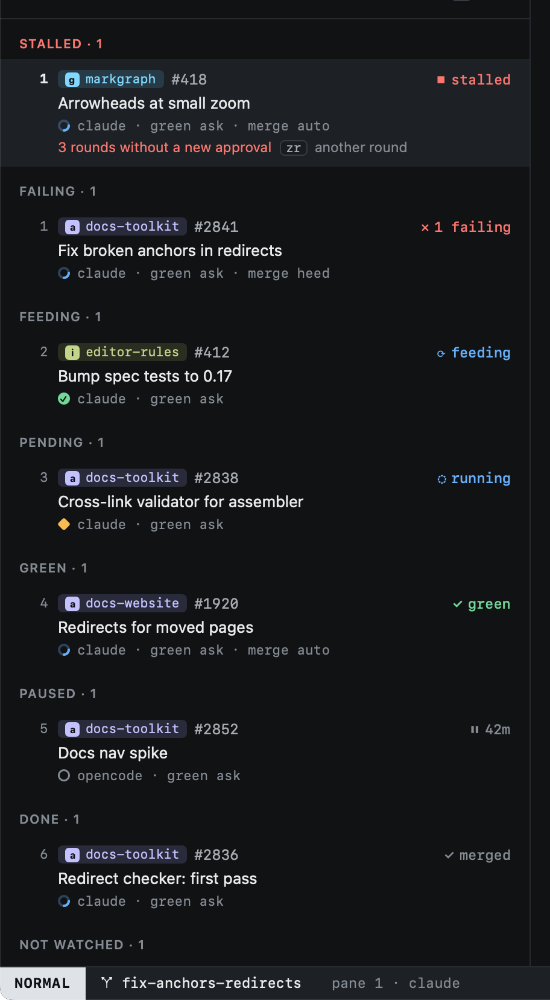
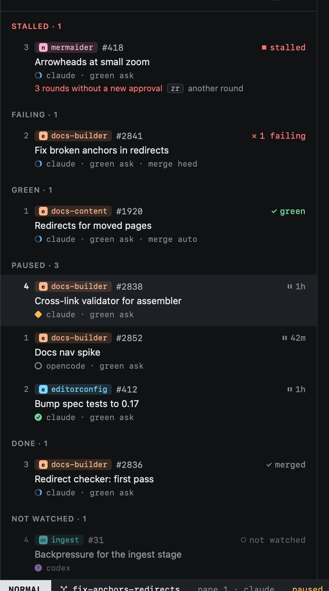
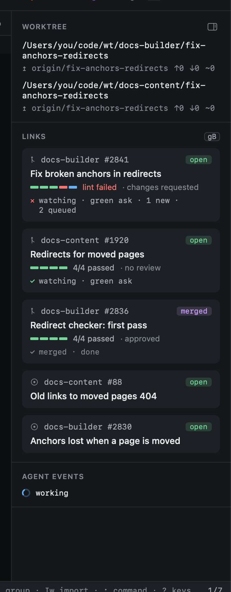

# Watch

`gw` opens the Watch view: every pull request your sessions track, grouped by what it needs, with what heed is doing
for each and a log of what it has done.



- **Left**, the PRs, most urgent first: *Needs you* (feedback and no session to send it to), *Stalled* (out of
  rounds: see below), *Failing* (a check failed, or a conflict), *Changes*,
  *Feeding* (sent to the agent, waiting for its push), *Pending* (checks running, or a draft), *Green*, *Passing* (not
  fetched in detail yet), *Paused*, *Done* (merged or closed) and *Not watched*. `{` `}` jump between groups.
- **Middle**, the PR under the cursor: one line on where it stands, its **green** checklist, its open items, and its
  **timeline**: everything heed noticed and did for it.
- **Right**, the **merge queues** with when each runs next, and the **activity** across all PRs, newest first (`zi`
  hides it).

## Green

A PR is **green** when GitHub has nothing left to object to in the code. The middle pane lists each rule with what it
found, and `z?` (`:pilot.why`) lists them for the PR you are on (see [What heed will do](#what-heed-will-do)):

| Rule | Holds when |
|---|---|
| Open | not merged or closed |
| Ready for review | not a draft |
| No conflicts | it merges cleanly into its base |
| Up to date | not behind the base, when the repo requires branches to be current |
| Checks pass | every required check passed (every check, when the repo requires none) |
| Threads resolved | no review thread is open |
| No changes requested | no reviewer is waiting on changes |



What holds a PR back goes to its agent as an item, the same way review comments do: a failing check, and a conflict
("rebase on main, resolve the conflicts, run the tests and push"). For a failed GitHub Actions check heed saves the
failed step's log and the prompt points the agent at the file, so it reads the error rather than just "lint failed".

### Copilot does the work

Merge conflicts and review comments can go to GitHub's Copilot coding agent instead of your session's agent, so the
work spends Copilot's budget rather than your agent's tokens. Two options, off by default, per org and per repo too:

- `copilot_conflicts`: a PR that conflicts with its base.
- `copilot_comments`: new review comments.

With get it green on (`ask` or `auto`), heed asks on the PR, once per conflict and per comment. When both have
something, one comment asks for both:

> @copilot Please merge in main and resolve the conflicts, then address these review comments:
>
> 1. `RedirectFile.cs:88` (@reviewer): Anchor lookup is case sensitive.
>
> Make sure the build and tests still pass.

Copilot works in its own environment and pushes to the PR's branch. What it was asked shows as sent, so your agent does
not get it as well. Pull in your session's worktree before its agent pushes again. `C` asks Copilot for the PR you are
on, both kinds, whatever the options say.

heed asks only where Copilot can work: it checks that the repo lists Copilot among those an issue can be assigned to,
which is the case when the Copilot coding agent is on for the repo (any paid Copilot plan; on Business and Enterprise an
admin enables it). Elsewhere the work goes to your agent as before. Failing checks stay with your agent, and a branch
that is merely behind is the [merge queue](#get-it-merged)'s.

### Reviewers

`reviewers` names who heed asks to review a PR once it is open and not a draft: logins, teams (`org/team`), and
`copilot` for Copilot code review. Each is asked once per PR, never the PR's author. `zv` (`:pilot.reviewers`) asks now.

## Three levels

Each PR has three levels, each needing the one before:

| Level | Off | On |
|---|---|---|
| **Watch** | only the PR's summary from the regular sync | heed follows it: fetches its review threads and checks as they change, and shows its state everywhere |
| **Green** | items are shown, nothing is sent | `ask`: you queue items to send; `auto`: they go to the agent once it is idle (see [review feedback](review-feedback.md)) |
| **Merge** | nothing is merged | `auto`: heed turns on GitHub's auto-merge, and GitHub merges once its requirements are met; `heed`: heed merges once [its rules](#heed-merges) hold (see [below](#get-it-merged)) |

Watching only reads from GitHub, so it is on by default.

## Get it merged

`zm` cycles merging for a PR: off, `auto`, `heed` (and turns watching on with it). Each repo with such PRs has a **merge queue**, and a run of the
queue goes through its PRs, oldest first:

| The PR | A run |
|---|---|
| is green | turns GitHub's auto-merge on, with the repo's merge method |
| waits on something GitHub itself requires (a required check, a required review) | turns auto-merge on: GitHub merges once that arrives |
| waits on something GitHub does not hold it for | waits: auto-merge there would merge at once, with checks still running |
| fell behind its base | brings it up to date (`update_branches`) |
| fails a green rule | holds it, and turns auto-merge off if it was on: GitHub might merge what the rule catches |
| is paused | holds it |

GitHub does the merging, so the repo has to allow auto-merge (Settings ▸ General ▸ Allow auto-merge); the queue says so
when it does not. Only PRs your sessions track are merged.

A queue runs every hour (`merge_schedule`), when merging is turned on, when one of its PRs turns green, and after one of
them merges, so the others get brought up to date. `R` in the Watch view runs the PR's queue now, `:merge.run all`
every queue. `gM` shows the PR's queue in the middle: its PRs with what the next run does to each, and every run with
what it did. `gM` again, or moving the cursor, goes back to the PR.



### heed merges

With `merge = "heed"` heed does not hand the PR to GitHub's auto-merge (it turns it off if it is on) and merges itself,
once every rule holds. A run checks them again on the PR as it is then, and merges only that head commit
(`--match-head-commit`), so a push in between holds it for the next run.

| Rule | Holds when |
|---|---|
| Green | every [green rule](#green) holds |
| Reviewed after push | a human approved the head commit, or a trusted AI reviewer reviewed it (below) |
| Quiet | no new commit or review for `quiet_minutes` (5) |
| Gate checks | every check named in `gate_checks` passed on the head commit, required by GitHub or not |
| No hold label | none of `hold_labels` (`hold`, `do-not-merge`, `wip`) is on the PR |
| Self-review | with `self_review` set: the command approved the diff of the head commit |

A **trusted AI reviewer** (`trusted_reviewers`, e.g. `copilot-pull-request-reviewer`) counts as a review of the head
commit when it approved it, when it left a comment review none of whose threads is still open, or when it left no review
at all but its review check, named in `gate_checks`, passed on that commit.

The **self-review** is a command you choose, such as `claude -p`. heed passes it a prompt with the PR's description and
diff (`gh pr diff`, nothing is checked out) on stdin, and merges when its first line is `APPROVE`; `REQUEST_CHANGES:
<why>` holds the PR with that reason. It runs last, once every other rule holds, and once per head commit.

After merging, heed comments on the PR with each rule and what it found. When GitHub refuses the merge (branch
protection), the PR is held with GitHub's reason; `admin_merge = true` under `[repos."org/name"]`, and only there, retries
with `--admin`.



## What heed will do

Settings come from three levels and a choice made on the PR, so it is not always plain what the next round will be.
Every PR card, in the inspector and in Watch's middle pane, says it in one line under the pilot's:

- `next  background run · codex · 30m · 1 instruction`: a [run](#runs) of its own, with the agent and model it
  starts, how long it may work, and how many lines of `green_instructions` it gets.
- `next  conflict run · …`: the PR conflicts with its base, so the round takes `merge_agent` and `merge_model`.
- `next  typed into the session's claude`: `run_in = "session"`.
- `next  Copilot is asked to resolve the conflicts`: `copilot_conflicts`.
- `next  nothing: get it green is off`, `paused until 14:00`, `stopped after 3 rounds`: why no round goes.

Hover the line for each setting behind it and where its value comes from: `default`, `org <name>`, `repo`, or
`this PR` for a choice made with `zw`, `zg` or `zm`.

`z?` (`:pilot.why`) opens the whole picture for the PR you are on: in Watch and the PRs view the PR under the cursor,
in the PR overlay its PR, in Sessions the session's first PR. One row each for **Watching**, **Get it green**, **A
round**, **Conflicts** and **Get it merged**: the value, what it means for this PR now, and on the right where it comes
from, amber when it is not the default. Below them, **what holds it back**: the green rules and, with
`merge = "heed"`, heed's merge rules, failures first (✕), then what is still pending (·), then what passes (✓).
`j` `k` scroll it, ⎋ closes it.



## Keys

| Key | |
|---|---|
| `↩` | Open the [PR overlay](review-feedback.md) |
| `zw` | Watch or stop watching |
| `zg` | Cycle green: off, ask, auto |
| `zm` | Cycle merging: off, auto, heed |
| `C` | Ask Copilot to resolve the PR's merge conflicts and address its review comments |
| `zr` | Another round for a stalled PR |
| `zp` | Pause or resume |
| `z?` | What heed will do for the PR, and what holds it back |
| `zv` | Ask the PR's reviewers now |
| `gb` | Go to the session's running run |
| `zx` | Stop the session's running run |
| `v` | Select several, then `zp` pauses or resumes them all |
| `r` | Sync now |
| `R` | Run the PR's merge queue now |
| `gM` | Show the PR's merge queue |

The pilot keys are the same everywhere: in Watch, the PRs view and the PR overlay they act on that PR, and in
Sessions on every PR the session tracks. A choice made with them sticks to that PR; PRs you
never set follow the settings.

## Runs

By default get it green never types into your session's agent. Each round (heed sending on its own with
`green = "auto"`, or `zg` with items queued) is a **run** in the background:

- **Where:** a worktree of its own (`<worktree_root>/heed/<repo>/get-it-green-<branch>`) on a branch of its own,
  `heed/get-it-green/<branch>`, tracking the pull request's. Conflicts with the base get `heed/get-it-merged/…`.
- **Which agent:** the one `[pilot] agent` names, on `[pilot] model` (both per org and repo too), or the session's
  agent when unset. You can spend the tokens of an agent you don't use for real work.
- **Conflicts:** a get it merged run (conflicts with the base) takes `merge_agent` and `merge_model` when set. Merging
  is usually simple work, so a cheaper agent or model often does it; unset, it uses the run agent and model.
- **What it's told:** to fix what is listed, commit, and push to the pull request with `git push origin
  HEAD:<branch>`.
- **The tab:** appended next to the session's own, named **get it green** (or **get it merged**). It never takes your
  focus; its glyph in the tab strip is the run's state, and `gb` (`:pilot.run`) goes to it. `zx` (`:pilot.run.stop`)
  stops it, as closing its tab does.

While it works, it shows in three places: a row under its session in the sidebar (the goal and PR, how long, its agent
and the last line of its screen), a box on the PR's card in the inspector (also with the round and the key to its tab),
and the PR's line in Watch (`a codex run is on it (4m)`). Clicking the row or the box goes to its tab.

When its agent finishes its turn (or exits, or runs past `run_timeout`), the run ends at once:

1. its last screen is kept;
2. what it did is recorded: pushed N commits, no changes, timed out, or stopped (you closed its tab, or `zx`);
3. its tab, worktree and `heed/…` branch are removed;
4. your session's worktree is brought up to what it pushed, when it has no changes of its own.

The next failing check or review starts a fresh run. There is one run per PR at a time, and rounds still count
toward `max_rounds`. A run asking something, or blocked on a permission, puts its session in Needs you.

The inspector lists the session's runs, newest first. Click one to read what it did and its last screen; a running
one takes you to its tab.





### In the session instead

`run_in = "session"` (per org and repo too, or **Runs in** on the Pilot page) sends each round to the session's own
agent instead, as one prompt typed into its pane. It waits until that agent is idle or done, never while it works,
is blocked or asks, and until you have not typed in it for five minutes (20 seconds after `zg`). No worktree, branch or
tab is made. Use it where a fresh worktree gets in the way, such as an agent that asks to trust every new folder.

Nothing is sent for a PR once it is merged or closed, in either mode.

### Leftovers

If heed quits mid-run, or a removal fails, a `heed/…` branch and its worktree can be left behind. Every cleanup sweep
(and launch) removes them when it's safe: no uncommitted changes, and nothing that isn't on the pull request's
branch. Otherwise it keeps them and says why. From a terminal, `heed cleanup runs` does the same in the repo you are
in, and also skips anything git touched in the last hour. Since every run branch starts with `heed/`, a script can
find them too:

```sh
git for-each-ref --format='%(refname:short)' 'refs/heads/heed/'
```

## Stalled

Get it green sends up to `max_rounds` prompts (3) without a new approval; then it stops, and the PR is **stalled**.
It shows in its own group in Watch and in the sidebar, in red, with how many rounds it used.



A new approval starts the count again. `zr` gives the PR one more round now: heed sends what is open (on `auto`), and
stops again if that round brings no approval either. Stalled does not count toward what needs you in the Dock and the
menu bar: it waits on a reviewer.

## Pausing

A paused PR stays watched and keeps its state up to date, but heed sends nothing for it and it does not count as
needing you, and its merge queue leaves it alone. `zp` pauses for an hour (`[pilot] pause`); `:pilot.pause 4h`, `:pilot.pause forever` and
`:pilot.pause off` choose. The countdown shows on the row, and the pause ends by itself.



## Elsewhere

The same state shows wherever a PR does: next to a session's PR count in the sidebar, on the inspector's PR card, in
the PRs view's **Watch** column, and by the PR number in Repos.



## Settings

The settings live in `[pilot]` (the pilot is what does the watching and the merging). `[pilot]` sets the
defaults; an org or a repo overrides any of them. Settings ▸ Pilot edits the defaults, and Settings ▸ Orgs & repos
the overrides.

```toml
[pilot]
watch = true         # read-only, so on
green = "ask"        # off, ask or auto
max_rounds = 3       # prompts without a new approval before it stops
agent = ""           # runs' agent (codex, claude, ...); empty: the session's
model = ""           # their model (haiku, gpt-5-codex, ...); empty: the agent's default
run_in = "background" # background (a run of its own) or session (the session's agent, once idle)
merge_agent = ""     # background runs for merge conflicts; empty: agent
merge_model = ""     # their model; empty: model (with a merge_agent of its own, that agent's default)
run_timeout = "30m"  # a run still working after this long is stopped
pause = "1h"         # what zp pauses for
merge = "off"        # off, auto or heed
merge_schedule = "1h" # how often a repo's queue runs, or manual
update_branches = true
copilot_conflicts = false  # Copilot resolves merge conflicts
copilot_comments = false   # Copilot addresses review comments
reviewers = []             # e.g. ["copilot", "alice", "elastic/docs-team"]
quiet_minutes = 5          # merge = "heed": the rules
trusted_reviewers = []     # e.g. ["copilot-pull-request-reviewer"]
gate_checks = []
hold_labels = ["hold", "do-not-merge", "wip"]
# self_review = "claude -p"
# merge_method = "squash"  # unset: the first of squash, merge, rebase the repo allows
# Extra instructions, added to what heed sends (see below)
# green_instructions = "Resolve the review threads your changes addressed, and any that no longer apply."
# review_instructions = ""
# start_instructions = ""
# summary_instructions = ""
# summary_sign_off = false  # ask agents to end with a heed-summary: line (see History › Ledger)

[orgs.employer]
watch = false        # not this org's PRs, by default

[repos."employer/main-service"]
admin_merge = true   # per repo only: retry a refused heed merge with --admin
watch = true         # but this repo's, yes
green = "auto"
merge = "auto"
```

### Extra instructions

heed's prompts can carry instructions of your own, set in `[pilot]` and per org or repo like any other setting
(Settings ▸ Pilot ▸ Extra instructions):

| Key | Added |
|---|---|
| `green_instructions` | after the feedback items each get it green run gets |
| `review_instructions` | to what the self-review looks for, before the PR's description and diff |
| `start_instructions` | after the issue text Start work begins from, before the `Closes` lines |
| `summary_instructions` | to what heed asks for when its [model calls](../agents/model-calls.md) summarize work |

`summary_sign_off`, beside them, asks the agent itself for a one-line summary at the end of its work: see
[The agent's own summary](../history/ledger.md#the-agents-own-summary).

They add to a prompt and never replace it: what heed relies on stays as it is, such as the push command a run is
given and the `APPROVE` line it reads from the self-review. They are not a stand-in for the repo's own `AGENTS.md` or
`CLAUDE.md` either, which the agent still reads; use them for what you want from heed's prompts in particular, such as
"resolve the threads that no longer apply". A repo's `""` clears what its org adds.
