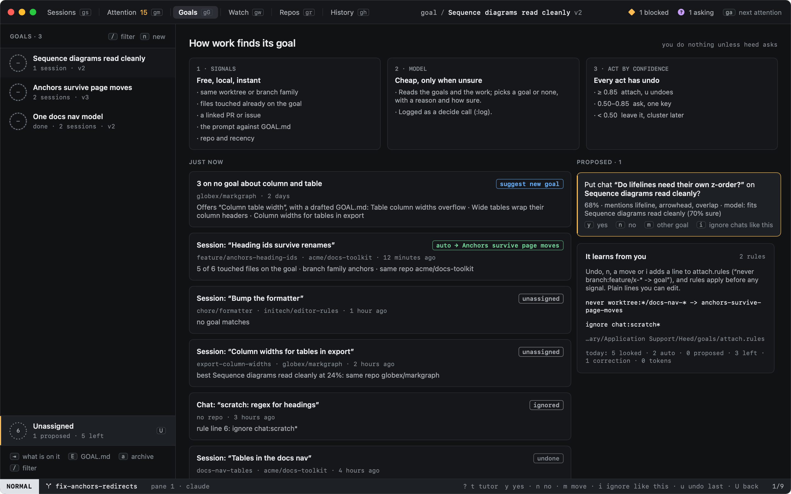
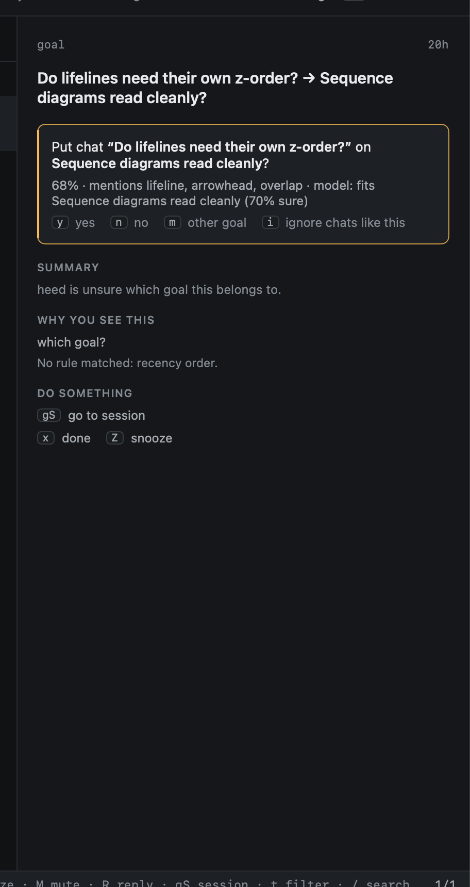
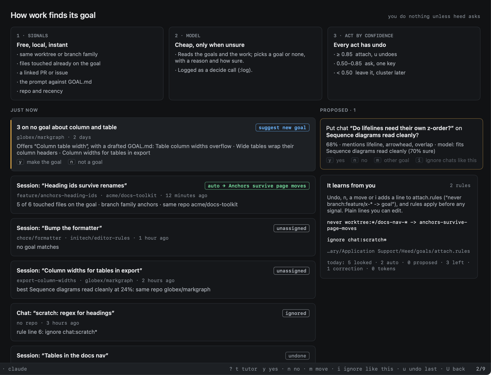

# How work finds its goal

You do not have to put work on a goal. When a session or chat starts, gets its first prompt, tracks a PR, or gets a
ledger entry, heed looks for its goal. When it is sure, it attaches the work and says so, with undo. When it is unsure,
it asks you once, one key. Otherwise it leaves the work alone, in **Unassigned**.

`U` in Goals (or `:goal.unassigned`) opens Unassigned: what heed decided lately and why, what it asks, goals it
suggests, and what it learnt from you.



## 1. Signals: free, local, instant

heed compares the new work with each active goal and what is already on it:

| Signal | Weight | |
|---|---|---|
| Same worktree | 0.9 | a worktree folder something on the goal works in |
| Same branch | 0.85 | not `main` or another default branch |
| Branch family | 0.65 | `feature/anchors-redirects` and `anchors-validator` share `anchors` |
| Linked PR | 0.9 | one of its PRs is on the goal already |
| Linked issue | 0.8 | |
| Files touched | 0.8 × share | the share of the files it touched (from its ledger entry) already on the goal |
| Prompt terms | 0.6 × share | the share of its title's and prompt's words, rarer words weighing more, that the goal's `GOAL.md` has (never its **Not the goal** list) |
| Same repo | 0.15 | |
| Goal active lately | up to 0.1 | in the last 48 hours; only adds to another signal |

Signals add up as independent evidence: confidence is `1 − (1 − w₁)(1 − w₂)…`, so two middling signals make a strong
one, and no pile of weak ones reaches certainty. Work in repos the goal has never seen counts for 60% of that.

## 2. The model, only when unsure

When the best goal is between `attach_ask` and `attach_auto`, or two goals are within 0.1 of each other, heed asks a
cheap model (Agents › Model calls): the goals with their statements and **Not the goal** lists, the work, and what the
signals saw. It answers with a goal or none, how likely each is, and how sure it is. The call is in the call log
(`:log`) as a `decide` with subject `goal-attach:session:<id>`.

The answer moves the number; it never replaces it. Each goal's confidence becomes `(1 − w)·signals + w·model`, where
`w` is 0.6 times the model's own confidence. A goal no signal found is never picked, and a model sure of "none" can
push the work back to Unassigned. With model calls off, or `attach_model = false`, the signals decide alone.

## 3. Acting by confidence

| Confidence | What heed does |
|---|---|
| `attach_auto` (0.85) or more | Attaches it, says so in the status bar; `u` in Goals (`:goal.attach.undo`) undoes |
| `attach_ask` (0.5) to `attach_auto` | Asks, once: an item in Attention (reason **which goal?**) and in Unassigned |
| below `attach_ask` | Leaves it in Unassigned |

Two goals within 0.1 of each other are always asked about, however sure.

### Answering an ask



In Attention and in Unassigned, one key answers:

| Key | |
|---|---|
| `y` | Yes, on that goal |
| `n` | No, not that goal; it stays unassigned |
| `m` | On another goal (`⇥` completes the goal) |
| `i` | Ignore things like this: no goal, no ask |

In Attention, `m` on anything that is not an ask still pins, as before. The rule keyword `attach` matches asks in
`[attention] rules`, so `attach notify` gets you a notification for each.

## It learns from you

An undo, an `n`, a move off the goal heed picked, and an `i` each add a line to
`~/Library/Application Support/Heed/goals/attach.rules`, under a comment saying why:

```
# 2026-10-26: you undid Tables in the docs nav on anchors-survive-page-moves
never worktree:*/docs-nav-* -> anchors-survive-page-moves
ignore chat:* repo:acme/docs-toolkit
```

The file is yours to edit. Each line is a verb, conditions (all must hold) and, for `always` and `never`, a goal:

| Verb | |
|---|---|
| `always … -> goal` | Things like this go on the goal, without asking |
| `never … -> goal` | Things like this never go on the goal |
| `ignore …` | Things like this stay on no goal, and are never asked about or suggested |

Conditions are `field:glob` (`*` any run, `?` one character, `a|b` either; case does not matter; quote a pattern with
spaces: `title:"fix the build*"`). Fields: `worktree` (its full path), `branch`, `repo` (`org/name`), `chat` and
`session` (by title, only that kind), `title` (either), `prompt`.

Rules apply before any signal, in file order: the first `ignore` or `always` that matches settles it, and every `never`
that matches takes its goal out. A line heed cannot read is skipped and shown with its number (in Unassigned and in
Settings › Goals); the others still apply. heed learns "like this" as the work's worktree family, else its branch
family, else, for a chat, chats (in its repo).

## Suggested goals



Work left on no goal that hangs together becomes a suggestion: three or more sessions or chats in one repo, each
sharing at least two words with another, within a week. `y` on it has the model draft a `GOAL.md` from their titles
and prompts (a plain draft when model calls are off), makes the goal, and puts the work on it. `n` drops the
suggestion.

## Today's numbers

The bottom of **It learns from you** counts today: things heed looked at, attached on its own, asked about, left on no
goal, your corrections, and the model tokens it spent.

## Settings

Settings › General › Goals turns finding goals on and off, sets the two thresholds and whether the model is asked, and
opens `attach.rules`. In config.toml:

```toml
[goals]
attach = true
attach_auto = 0.85
attach_ask = 0.5
attach_model = true
```
