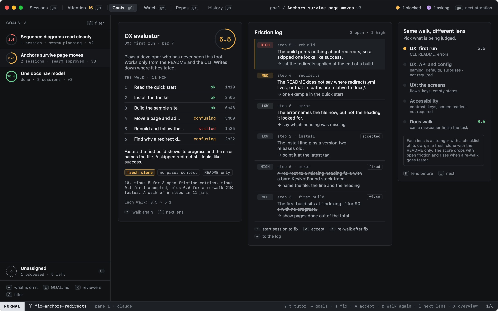
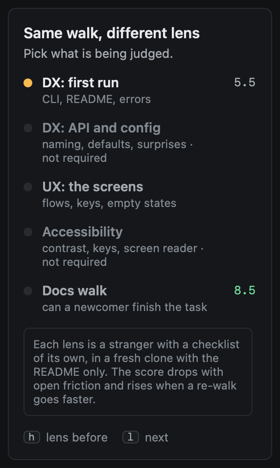
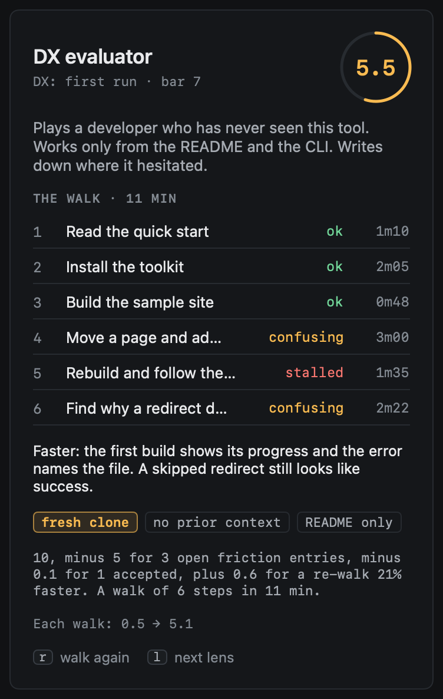
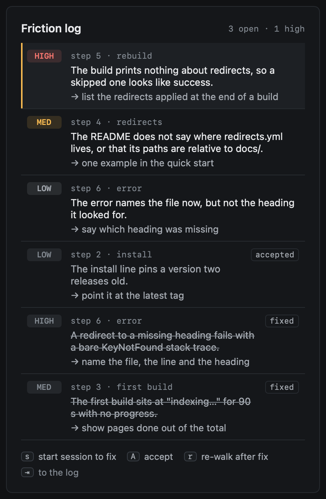

# Evaluations

An evaluation is a stranger walk: an agent plays someone who has never seen the project, clones it fresh, reads the
README, uses the CLI and does what the goal is about, timing each step and writing down where it hesitated, waited or
failed. Its score says how that went, so a re-walk after each fix shows whether the experience got better, not only
whether the code passes. `X` in Goals opens them; `X` again goes back to the overview.



## Lenses

The same walk can judge different things. Each lens is an evaluator of its own, with a stranger to play and a
checklist:

| Lens | Scores | What the stranger has and looks at |
|---|---|---|
| DX: first run | DX | The README and the CLI: install it, run it, do the task, make a mistake and recover |
| DX: API and config | DX | The README and the CLI's help: flags, config, defaults, what surprises |
| UX: the screens | UX | The product's own screens, started as the README says: flows, keys, empty states |
| Accessibility | UX | The keyboard only and a screen reader: what it cannot reach, read or tell apart |
| Docs walk | docs | The docs in the repository and nothing else: can a newcomer finish the task |

Only the lenses the goal's [profile](quality.md) needs walk: a first run whenever DX is required, API and config too
for a public API; the screens whenever UX is required (a user-facing goal, or a UX bar you pinned), and accessibility
too for a user-facing product; a docs walk when docs are required of a product or a public API. heed spawns their
evaluators with the profile, as it spawns [reviewers](reviewers.md). `h` and `l` (or a click) pick the lens the pane
shows; the lenses the goal does not need say so, and walk only when you ask.



A lens is only as good as its worst walk: the DX lens takes the lower of the first run and the API walk, and the docs
lens the lower of the docs reader and the docs walk. The goal is done when each required lens is at its bar, walks
included.

## The walk



The steps come from the goal: a cheap model reads `GOAL.md` and drafts the steps a newcomer would take for the lens,
once per `GOAL.md` version (with no model call, `[llm]` off or the goal's daily calls spent, each lens has default
steps). The evaluator is told the steps, never the `GOAL.md`: a stranger knows only the task.

A walk runs headless (claude `-p`, codex `exec`) in a fresh shallow clone of the repo, never in your clone or a
worktree of yours: the goal's open PR at its head, else the repo the goal's work is in at its default branch. The clone
lives in a temp folder of its own, its push URL points nowhere, the agent may not push or commit, and the folder is
removed when the walk ends. A walk still going after 45 minutes is stopped. An agent with no headless mode cannot walk;
set `[goals] reviewer_agent` to one that has.

The evaluator times each step and writes `.heed/evaluation.json` in the clone (and ends its reply with the same JSON):

```json
{
  "summary": "how it went",
  "steps": [{"title": "Run the first build", "outcome": "stalled", "seconds": 40, "note": "…"}],
  "friction": [{"severity": "high", "step": 3, "area": "first build", "finding": "…", "suggestion": "…"}]
}
```

Each step is **ok**, **confusing** (it hesitated or guessed), **stalled** (it waited or went round in circles) or
**failed**. A step that did not go well and has no friction entry gets one, as bad as it went: confusing low, stalled
med, failed high.

## The score

The score starts at 10 and loses each open friction entry's weight by severity (high 3, med 1.5, low 0.5), and a
quarter of that for each one you accepted. A re-walk of the same steps that went faster earns credit back: three times
the share of time it saved, at most 1.5. The basis under the walk says how the number came about.

## The friction log



Friction entries are the evaluator's objections: matched across walks as a reviewer's are, so an entry a re-walk no
longer meets is **fixed**, and each open **high** one becomes an item on the goal's [board](items.md) (source:
reviewer), which gets done evidence once fixed or accepted. Every walk is evidence on the goal: DX walks (the first run,
API and config, the docs walk) fill the matrix's **DX** column, UX walks are evidence of their own, with the score.

`⇥` moves from the goals to the friction log.

| Key | |
|---|---|
| `s` | Start a session to fix it: Start work, filled in with the entry, the step and the goal |
| `A` | Accept it: it costs a quarter of its weight; again, open it (as `A` accepts a risk in Reviewers) |
| `r` | Walk again now, in a fresh clone (after a fix, to see whether it helped) |
| `h` `l` | The lens before, the next lens |

Everything takes the mouse too: a click picks a lens or an entry, a right-click offers what the keys do, and the key
hints run their command.

## When they walk

Within the goal's daily budget, shared with its reviewers (`reviewer_runs_per_day`), an evaluator walks again:

- when the goal gets a new `GOAL.md` version (with new steps);
- when a PR on the goal merges, and when a PR that fixes one of its findings merges;
- when a file in its area changes in the goal's work: the README, docs and the CLI's entry points for DX, config files
  too for API and config, screens and styles for UX, Markdown and examples for the docs walk.

PRs opening or getting new commits and the nightly sweep do not make it walk: a walk is long, and waits for a merge.
Once at its bar it stays quiet until you ask. `r` walks it now, whatever the budget says (it still counts).
