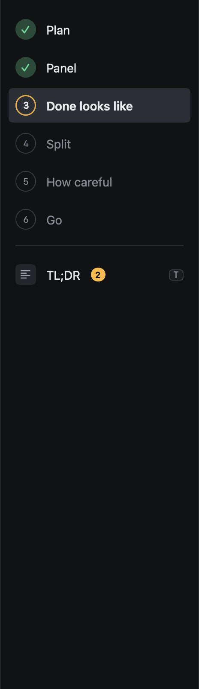
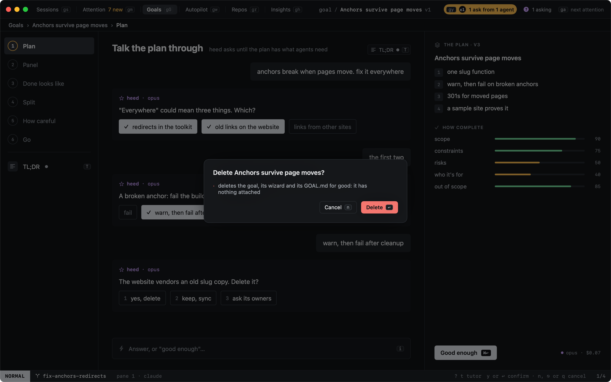
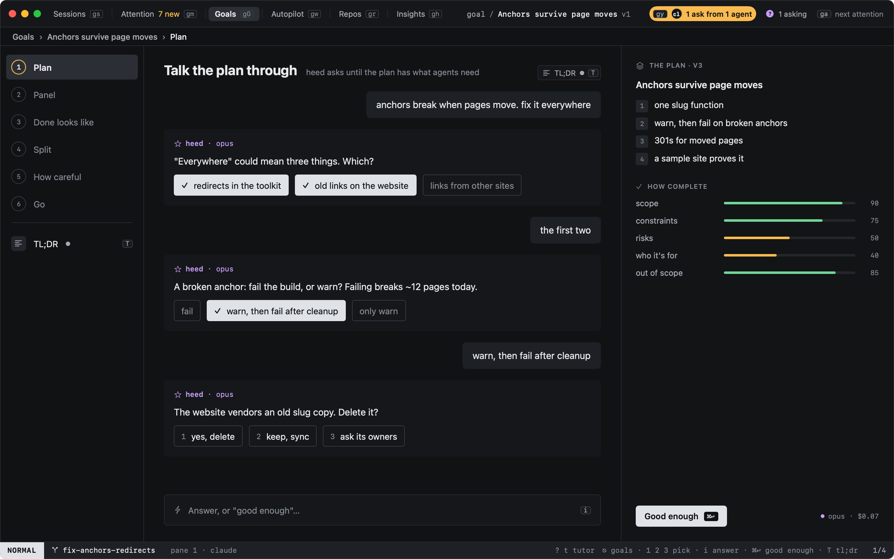
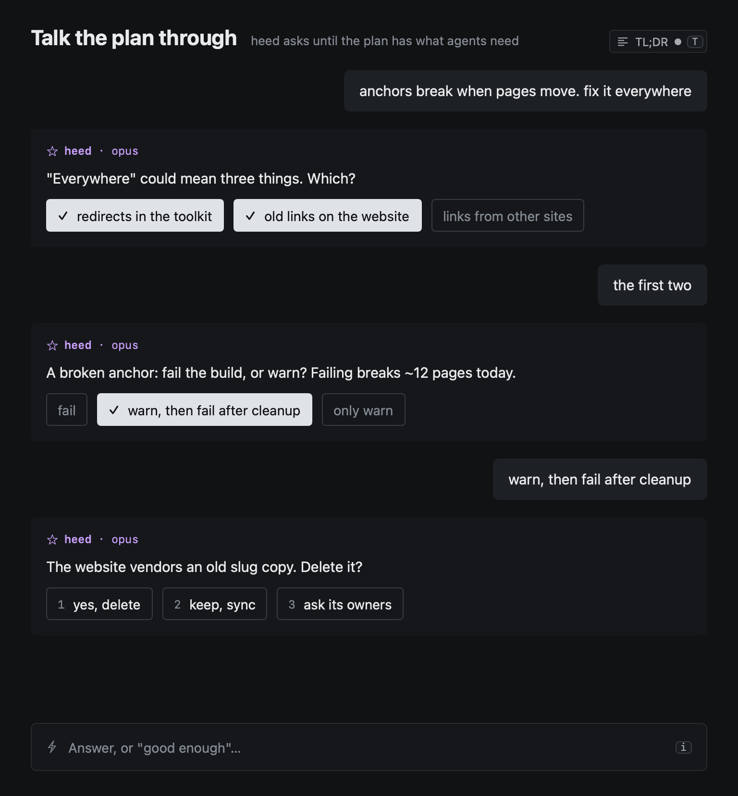
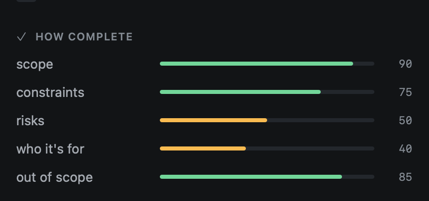
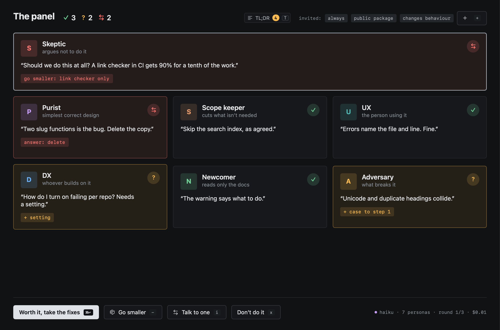
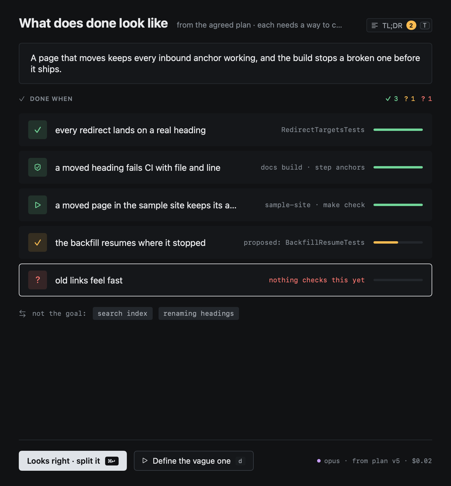
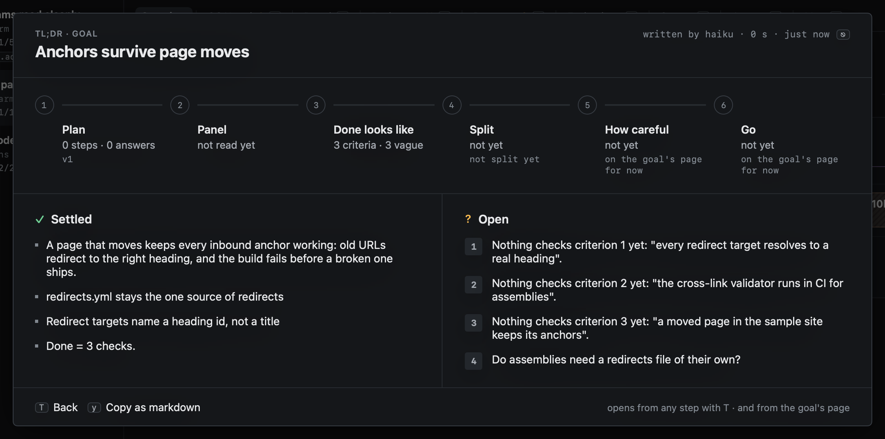
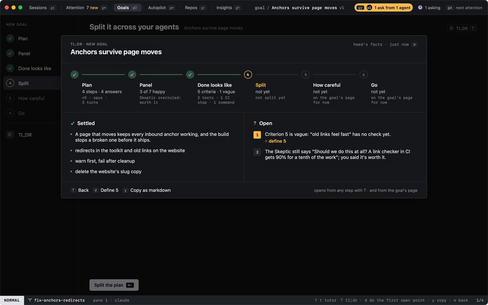

# Your first goal

`n` in Goals asks for a title and what you want, then walks the new goal through six steps before any work starts:
**Plan**, **Panel**, **Done looks like**, **Split**, **How careful** and **Go**. The rail on the left shows where you
are: a check on the steps done, a ring on the one you are on. `H` and `L` go back and forth between the steps you
reached, `⌘↩` moves on. The wizard is a part of the Goals overview, and the line over it says so: `Goals › your
goal › the step`.

## Leaving, and discarding the goal

`⎋` (or a click on **Goals** in that line) goes back to the Goals list, and the status bar always shows it as
`⎋ goals`. Leaving keeps the wizard's place: `↩` on the goal in the list, or `:goal.wizard`, comes back to where you
were. `:goal.wizard` also walks a goal you made another way. Inside a chat with a persona, the invite picker or the
TL;DR, `⎋` closes that first, and the status bar says so.

`D` discards the goal from any step, and asks first, saying what will happen:

- A goal with nothing attached (no sessions, chats or PRs, no swarm, no GitHub issue, and Go was never pressed) is
  **deleted for good**: the goal, its wizard and its `GOAL.md`.
- Any other goal is **archived**, and `a` brings it back in the Goals list.

The same is in the right-click menu on the wizard and in the Goal menu of the menu bar. `x` on the Panel step is the
other way out: it archives with a reason.

## 1. Plan: talk it through

heed asks until the plan has what agents need, one question at a time. Each question comes with options: `1`, `2` or
`3` picks one, `i` types your own answer (and "good enough" in it moves on). The questions come from your default
agent on its strongest model (opus for Claude), run headless and read-only in the goal's repos, so it can look at the
code before it asks: the worktrees of the sessions on the goal, and any repo you name in what you write. It may read
and search them; it cannot change a file, and nothing is kept in the agent's own history. A repo it could not read
means it plans from your words alone.

On the right, the plan builds up. Every version is saved as a new version of the goal's `GOAL.md` too: the summary
as the goal, the out-of-scope list as **Not the goal**, your decisions in **Decisions**, and the steps, constraints,
risks and who it is for in sections of their own. Under it, five meters say how complete the plan is: scope,
constraints, risks, who it's for and out of scope, each scored by a cheap model after every answer. heed says when it
thinks the plan is complete enough; **Good enough** (`⌘↩`) moves on whenever you like.

The line at the bottom right says what the step's calls cost so far, as the agents reported it; `≈` when part of it
is an estimate or unknown.

## 2. Panel: who reads it

A panel of personas reads the plan, each in its own voice, and says **happy**, **concern** or **not**, with one
quote and, unless happy, one fix. Four always sit: the **Skeptic**, who argues not to do it at all (or much smaller),
the **Purist**, the **Scope keeper** and **UX**. Others are invited by what the goal touches, read from the plan's
words, and the chips at the top say why:

| The goal touches | Who is invited |
|---|---|
| a public package, an SDK, a CLI | DX and Newcomer |
| behaviour or parsing (a format, a default, a migration) | Adversary |
| a service (a deploy, a queue, a database) | Operator |
| a UI | Accessibility |
| auth or the network | Security |
| a hot path (latency, throughput, a cache) | Performance |
| your team's style, once a library persona named "team style" exists | that persona |

`+` invites another: the built-in personas not on the panel, and the ones in your persona library. A cheap model
reads for the whole panel in one call.

Then, for up to three rounds:

| Key | |
|---|---|
| `⌘↩` | **Worth it, take the fixes**: the fixes go into the plan (a new version, in `GOAL.md` too) and the panel reads it again. With no fixes left, or after the third round, it moves on. |
| `-` | **Go smaller**: the plan is cut to what gets most of the value, the rest moves out of scope, and the panel reads again. |
| `i` | **Talk to one**: a chat with the persona under the cursor (`j` `k` move); `⎋` closes it. |
| `x` | **Don't do it**: type why (the Skeptic's words to start from); the reason goes into `GOAL.md`'s decisions and the goal is archived. |

## 3. Done looks like

From the agreed plan, heed drafts what done looks like: a statement and the criteria, each with how it is checked:
a **test**, a **CI step**, a **command**, or nothing yet. The meter on each row says how surely an agent can tell it
is met: a real check fills it, a proposed one (a test that does not exist yet) half, and a line nothing checks is
empty, or nearly, when its words cannot be checked ("fast", "nice", "robust" without a number).

A criterion nothing checks gets measurable replacements on the right: `1` `2` `3` highlight one, `↩` uses it ("drop
it" drops the criterion). `d` defines it with an agent: the same read-only agent as in Plan reads the repos and
proposes checks it could run, which join the list. **Looks right** (`⌘↩`) writes the criteria into `GOAL.md`'s
**Done when**, each with its check after it, as `(check: test RedirectTargetsTests)`.

## 4. Split

The plan's parts on your agents, by fit and what they have left, with the lead's moves on top: see
[Split it across your agents](split.md). `⌘↩` moves on.

## 5. How careful

Quick, Standard or Thorough: what has to pass before a part merges, on the goal's own reviewers, evaluations and
merge rules. heed suggests one and says why; `1` `2` `3` pick, `Q` shows the details. See
[How careful, and Go](go.md).

## 6. Go

Who works (helpers, sessions or a mix), how many at once, when you are asked, the budget and who merges, each with a
default, and what that comes to. `⌘↩` starts it as the goal's swarm, and the goal opens on
[its page](split.md#the-goals-page); `S` saves it to start later.

## TL;DR

Once there is something to summarise (the wizard's first plan, or a goal that says what it is), a **TL;DR** entry
sits under the rail's steps and a **TL;DR** chip beside each step's title and the goal's title on its page. When it
has news since you last opened it (a step finished, a new open point), the entry shows how many points are open, amber
when one of them needs you, or a dot when none is open. A click, or `T` on any step of the wizard and on a goal's
page, opens the goal's TL;DR: each
step with a summary, what is **settled**, and what is still **open**, numbered, each with what to do about it. `d`
does the first open point (define a vague criterion, back to the panel), `y` copies the whole TL;DR as markdown, and
`T` or `⎋` closes it. A cheap model writes it from heed's facts; it is written again only when something it was
written from changed, and until it is, heed's own words show.

## What it costs

Plan's questions run on your strongest model, one headless run per question, and say what each cost. Everything
else is heed's [model calls](../configuration/inference.md) on the cheap model: the meters after each answer, the
panel's read (one call per round), the fixes, the criteria, the replacements and the TL;DR. In the tutor and the
docs' pictures nothing is called: the answers are scripted.
