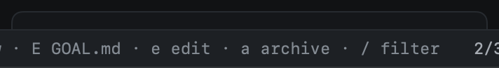

# GitHub mirror

A goal lives in heed, but the people around it do not all use heed. The mirror puts the goal on GitHub for them to
follow along: one issue for the goal, and a sub-issue for each of its items, in a repo of the team's choosing. heed
keeps them up to date on its own; what colleagues do there comes back to you as questions, never as changes.



## The tracker

Each goal mirrors to its own **tracker repo**, which does not have to be a repo the work happens in: a team's planning
repo, say, while the PRs land in three others. The new goal dialog fills it in from config, and you can change it
there or later. Settings sets the default in General › Goals (**Tracker on GitHub**), and one per org or repo in
[Orgs & repos](../configuration/settings.md#orgs-repos) (**Goal tracker**, on the General tab under Goals; a repo's wins over its org's):

```toml
[goals]
tracker = "acme/planning"          # any goal, when no org or repo below names one

[orgs.acme]
goals_tracker = "acme/planning"    # goals whose work is in acme's repos

[repos."acme/docs"]
goals_tracker = "acme/docs-planning"
```

`:goal.tracker org/name` sets a goal's tracker; `:goal.tracker none` takes it off. Before a tracker is taken, heed
checks it with a read: the repo exists, has issues turned on, is not archived, and you have triage access or more
there (sub-issues and closing need it). A tracker that fails the check is not set, and the overview says why.

Changing a goal's tracker starts the mirror over in the new repo. The issues in the old one stay as they are.

## Turning it on

Mirroring publishes, so it is off until you turn it on for a goal: `M` (`goal.mirror`) on the goal, in Goals. Turning
it on is the one confirmation: from then on heed writes to the tracker on its own, and `M` again stops it (the issues
stay as they are). **Mirror new goals** in General › Goals turns it on for new goals from the start, and Orgs & repos
(General tab) sets it per org or repo:

```toml
[goals]
mirror = false                     # new goals mirror from the start
mirror_label = ""                  # a label for heed's issues, e.g. "heed-goal"; never required

[orgs.acme]
goals_mirror = true
```

## What goes to GitHub

**The meta issue** has the goal's title, and a body rendered from `GOAL.md`: the goal, what it is not, the done-when
checklist with the evidence for each criterion met, the decisions and open questions, the quality bars with the
current scores, and the PRs on the goal in any repo. A footer says heed maintains it, and an invisible marker
(`<!-- heed:goal <id> -->`) lets heed find it again.

**A sub-issue per item**, made in the tracker and attached to the meta issue with GitHub's sub-issues, so GitHub shows
the goal's progress on the meta issue. Its body says where the item stands and its PRs, and carries its own marker
(`<!-- heed:item <id> -->`). A sub-issue closes when its item reaches Done, with a comment naming the evidence (the
merged PR, or that it was moved by hand), and reopens if the item moves back. The meta issue closes when the goal is
done or archived.

Items show their sub-issue number on the overview's matrix and on their card; the overview's **On GitHub** panel
shows the tracker, the meta issue (click it, or `:goal.mirror.open`, to open it), the last sync and anything that went
wrong.

## How it syncs

heed is the source of truth. On each of heed's GitHub syncs, it renders what the issues should say and compares that
with what it last wrote; only the differences are written: a new issue, an edited title or body, a close or reopen
with its comment, a sub-issue attached. With nothing new, a sync makes no GitHub call at all.

- **Never twice.** Before making an issue, heed searches the tracker for the goal's markers and takes back any issue
  it made before (on another Mac, or before its store was restored), so nothing is made twice.
- **Never deleted.** heed only makes, edits, closes and reopens issues. Turning the mirror off or changing the tracker
  leaves the issues where they are.
- **A little at a time.** A sync makes at most 20 writes, a second apart (GitHub limits bursts of new content); the
  rest go on the next sync, and the panel says how many are left.
- **In the log.** Every write is a GitHub write row in `:log` (caller `goals.mirror`), with the issue body left out.

`:goal.mirror.sync` syncs a goal now, and reads it back.

## What comes back

Every few minutes (five times heed's GitHub poll interval) heed reads back what changed in the tracker, cheaply: one
call for the issues updated since the last look, and one for the meta issue's comments when it changed. What it finds
becomes asks and proposals; the goal itself never changes because of something on GitHub.

- **A colleague closes a sub-issue** whose item heed has open: heed asks whether the item is done, in the panel and in
  Attention. Yes (`Y` on the goal, `y` in Attention) moves the item to Done; no (`K`, `n`) keeps it open, and heed
  reopens the sub-issue. Until you answer, heed leaves that sub-issue's state alone.
- **A colleague reopens a sub-issue** whose item is done: heed asks whether it is not done. Yes moves the item back to
  Working; no closes the sub-issue again.
- **A comment on the meta issue** is read by the GOAL.md proposer (a cheap model call, within the goal's daily
  budget), and what it suggests, an open question or a decision, waits in `GOAL.md` for you like any other proposal.
  Over the budget, the comments wait for the next day; with `[llm]` off, they are not read. heed's own comments are
  never read back.

## Commands

| Command | Key | What it does |
|---|---|---|
| `goal.mirror` | `M` | Mirror the goal (after checking the tracker); again: stop |
| `goal.tracker [org/name\|none]` | | Set or change the goal's tracker repo |
| `goal.mirror.sync` | | Sync the goal's issues now and read them back |
| `goal.mirror.open` | | Open the meta issue, or the sub-issue of the card under the cursor |
| `goal.mirror.yes` | `Y` (`y` in Attention) | Yes to a colleague's change: the item follows it |
| `goal.mirror.no` | `K` (`n` in Attention) | No: heed keeps its way and puts the sub-issue back |
