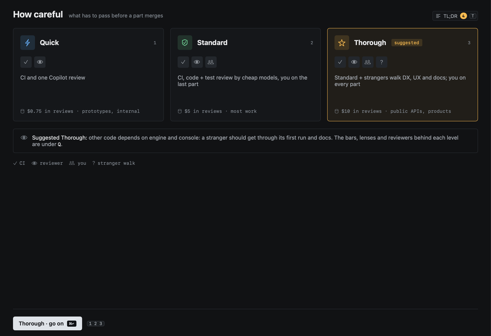
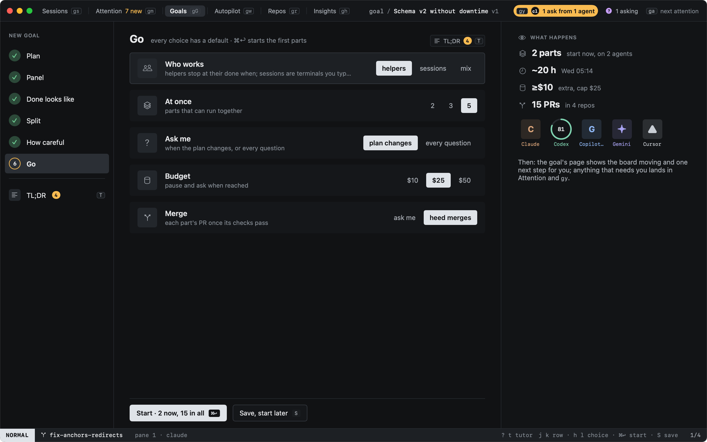
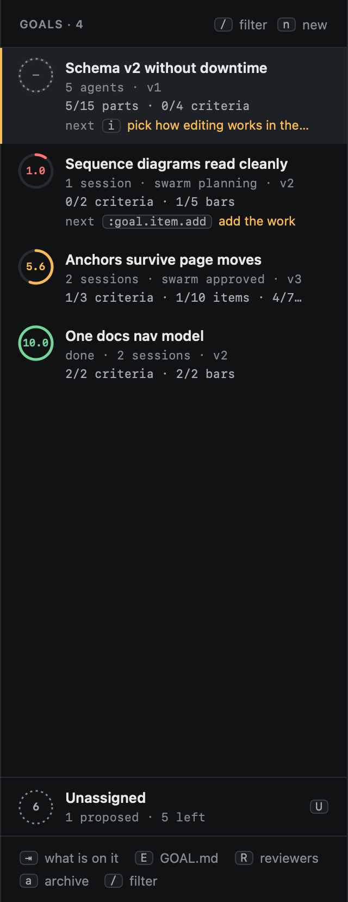

# How careful, and Go

The wizard's last two steps. How careful says what has to pass before a part merges; Go says who works, how much at
once, when you are asked, what it may spend and who merges, then starts it. After Go the goal opens on
[its page](split.md#the-goals-page).

## How careful

Three levels, as cards. Each card shows what checks a part as glyphs (✓ CI, 👁 a reviewer, 👥 you, ? a stranger's
walk), what its reviews cost for this goal's parts, and who it suits. heed suggests one, and says why, from what is
riding on the goal (its profile: a spike, internal work, a product, or something other code depends on, and whether
people use it).

A level is a setting of what the goal already has, not a check of its own:

| Level | What it sets |
|---|---|
| **Quick** | CI, and the pilot asks Copilot to review each PR and counts its review. No reviewers of heed's. |
| **Standard** | CI, the goal's code and test reviewers on the cheap model (security and performance too when the profile says so), and the part that ends last waits for you before it merges. |
| **Thorough** | Standard, plus the evaluations' stranger walks: the docs always, the screens when people use it, the first run when other code depends on it. Every part waits for you. A part whose PR is open shows as under review on the board. |

The level pins the goal's [bars](quality.md) (a lens it keeps at its bar, the others off), so its reviewers and
evaluators are the ones [Reviewers](reviewers.md) shows; change them there afterwards as for any goal.

| Key | |
|---|---|
| `1` `2` `3` | Quick, Standard, Thorough |
| `Q` | The details: the goal's Reviewers, where the bars and lenses are (the wizard keeps its place) |
| `⌘↩` | On, with the level picked (heed's suggestion if you picked none) |

## Go

Five rows, each with a default; the right side says what happens with them.

| Row | Choices | Default |
|---|---|---|
| **Who works** | **helpers**: agents heed starts over ACP in worktrees of their own, which stop at their done when; **sessions**: terminals in the lead's session, which you can type in; **mix**: sessions for the parts on the longest chain, helpers for the rest | helpers |
| **At once** | 2, 3, 5 parts at the same time | as many as the plan can use |
| **Ask me** | **plan changes**: the controller answers reversible choices, you the rest; **every question**: every question comes to you | plan changes |
| **Budget** | $10, $25, $50 beyond what you pay already: the swarm pauses and asks when it reaches it | $25 (more when the plan costs more) |
| **Merge** | **ask me**, or **heed merges** each part's PR once its checks pass | heed merges |

What happens: how many parts start now and on how many agents, how long it takes and when it ends, what it costs
beyond what you pay already against the budget (≥ when some agents cannot be priced), the PRs and their repos, and
your agents, with a ring where heed knows what is left of one's limit.

`⌘↩` starts it (the button says how many parts start now, and how many there are in all). The level goes on the goal, the split becomes the goal's swarm with its parts as the first plan
version, approved, and running: its lead starts and briefs, and the first parts start on their agents as helpers or
terminals per Who works. A part on GitHub's Copilot agent works on GitHub either way. `S` saves it for later: the
wizard waits at Go, and `↩` on the goal comes back to it.

| Key | |
|---|---|
| `j` `k` | The row below or above |
| `h` `l`, `1` `2` `3` | The row's choice |
| `⌘↩` | Start |
| `S` | Save, start later |

A goal with lanes is a swarm: Go fills in what [the swarm form](swarms/index.md) used to ask (repos from the parts,
the lead from the split, a worker seat per agent, limits from At once, the time and the budget, the merge mode) and
the [swarm machinery](swarms/index.md) runs it from there.

### Parts on helpers

A helper worker's permission asks join the [approvals](../agents/approvals.md), and its feed shows in Autopilot's
Now; `s` on its part on the goal's page opens it.

- **Its model.** The part's model goes to the helper's session as ACP's `model` session config option
  (`session/set_config_option`) before its first prompt. Claude's adapter (`claude-agent-acp`) takes it, aliases or
  model ids. An adapter without the option keeps its own default, and the helper's feed says so.
- **What it is told.** An answer its `heed goal ask` is waiting on, it reads itself. Anything else for it (an answer
  it stopped waiting for, a message from the lead or another part) goes over ACP: a prompt at once when it is between
  turns, else the next prompt once its turn ends (ACP cannot add to a turn under way). A message from you is urgent:
  its turn is cancelled and your words start the next, as the helper's steer box does. Each hand-over is in the
  swarm's steering log with how it went (through its ACP session, or queued there for the next prompt). A helper
  whose turn ends with mail waiting goes on with it instead of ending.

## In the list

Once it went, the goal's row in the list reads as its page does: its agents, its parts done and its criteria, and
the page's one next step with its key.

