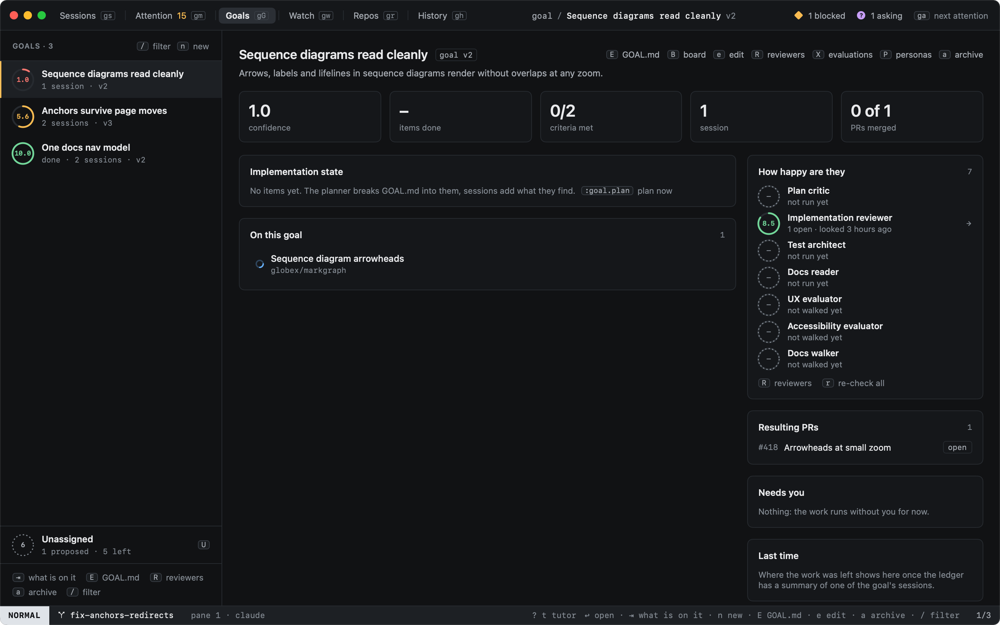
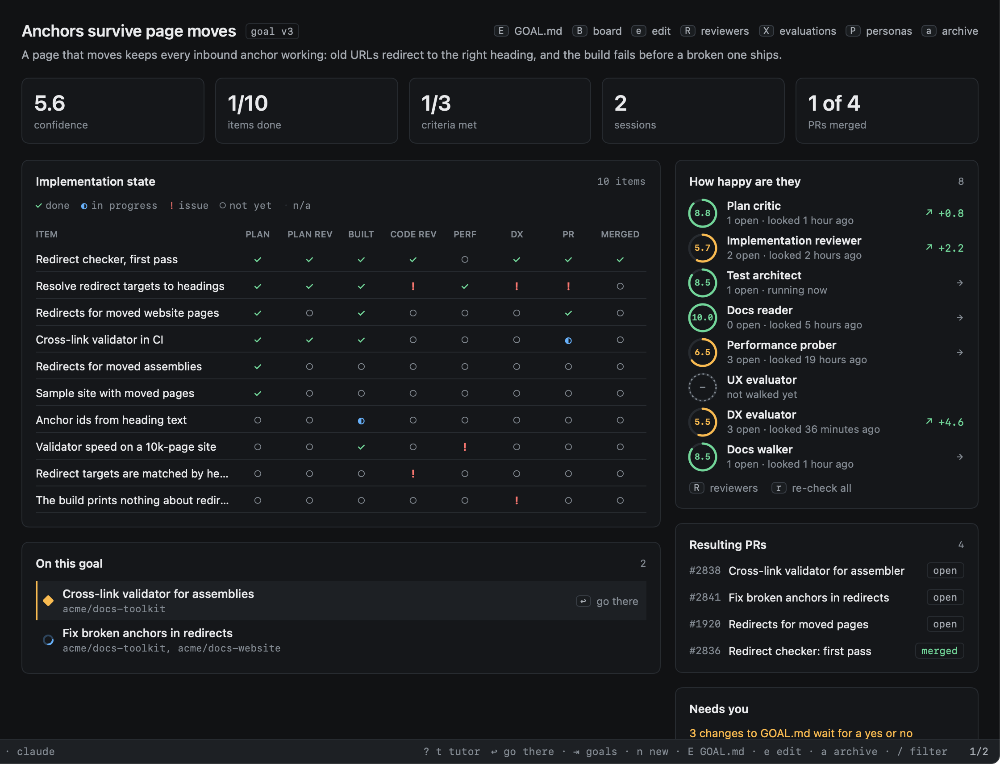
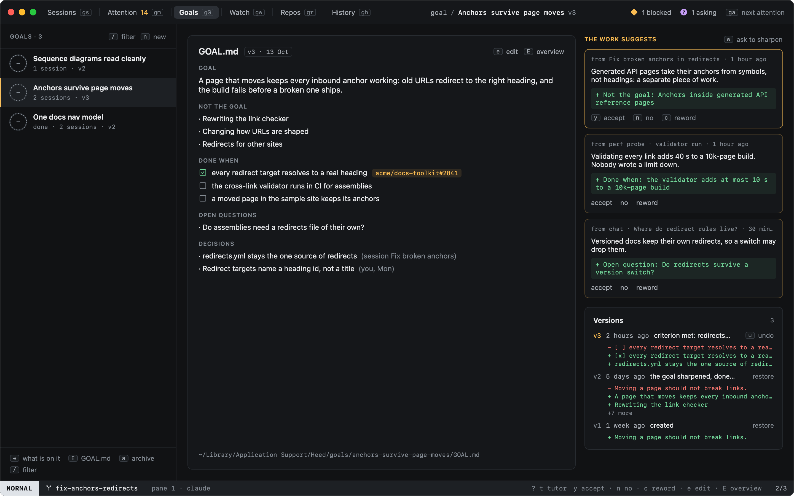
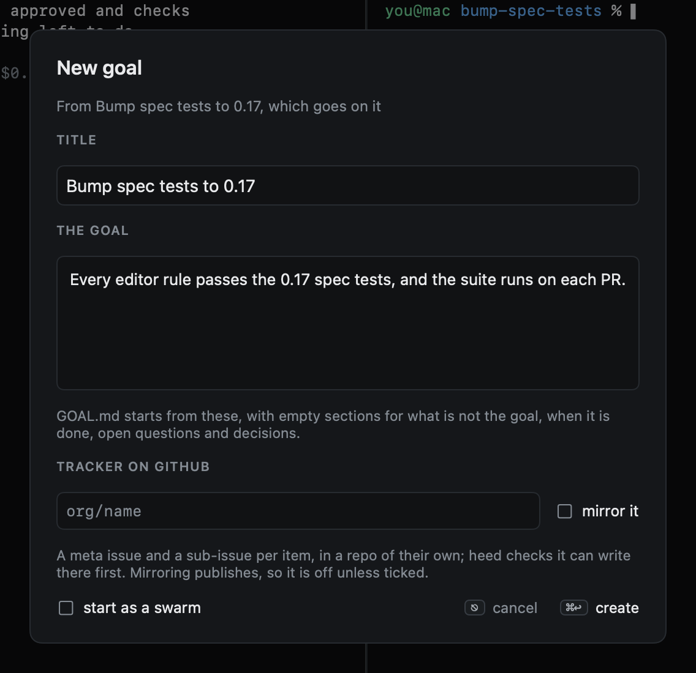
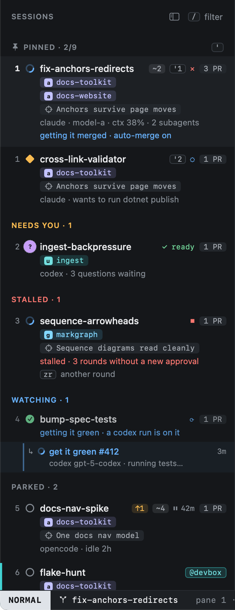
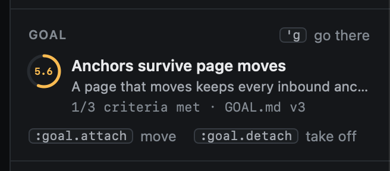

# Goals

A goal is work that outlives one session: a feature, a migration, a cleanup. Sessions, chats and their PRs belong to
it, and its `GOAL.md` says what the goal is, what it is not, when it is done, what is still open and what was decided.
`gG` (or `:goals`) opens Goals.



## The list

Each goal shows its score ring, how many sessions and chats are on it, and its `GOAL.md` version. The ring is the
goal's confidence: how many of its done-when criteria are met and how close its reviewers are to the goal's quality
bars ([Quality bars](quality.md)). It shows `–` until there is something to count. Active goals come first, then done ones, then archived ones; `/` filters them.

| Key | |
|---|---|
| `j` `k` | Move through the goals |
| `⇥` | Move to what is on the goal, and back |
| `↩` | What is on the goal; on a session or chat, go there |
| `n` | New goal: a title and what it is |
| `E` | The goal's `GOAL.md` and its versions; again, the overview |
| `e` | Edit `GOAL.md` in place |
| `a` | Archive the goal; on an archived one, bring it back |
| `x` | Take the session or chat under the cursor off the goal |
| `B` | The goal as a board; again, the overview ([Items and the board](items.md)) |
| `w` | Ask a model to sharpen the goal; what it suggests waits in `GOAL.md` |
| `R` | The goal's reviewers and quality bars ([Reviewers](reviewers.md)); again, the overview |
| `r` | Re-check: every reviewer the goal needs looks again |
| `P` | Who the goal needs ([Personas](personas.md)); again, the overview |
| `X` | Stranger walks of the goal, their friction logs and scores ([Evaluations](evaluations.md)); again, the overview |

Everything here also takes the mouse: a click picks a goal, a double-click opens it, and a right-click offers what
the keys do.

## The overview



The goal's title and statement, then its numbers: its confidence, items done, criteria met (from **Done when**), the sessions and
chats on it, and how many of their PRs merged. **Implementation state** is the goal's items by stage (see
[Items and the board](items.md)). **On this goal** lists its sessions and chats newest first, closed ones too;
**Resulting PRs** lists their PRs with where each stands; **Needs you** lists the changes to `GOAL.md` waiting for
you, the open questions and the goal's sessions that wait on you; **Last time** is the newest ledger summary of one of
its sessions, so you see where the work was left. **How happy are they** lists its reviewers with their scores and which
way each moved; a click opens it in [Reviewers](reviewers.md).

## GOAL.md



`GOAL.md` is a plain file in `~/Library/Application Support/Heed/goals/<goal>/`, next to `links.json` (what is on the
goal). Its sections are **Goal**, **Not the goal**, **Done when** (`- [x] criterion (evidence: …)`), **Open
questions** and **Decisions** (`- decision (source: …)`); sections of your own are kept as you wrote them.

`e` edits it in place; `⎋` or `⌘S` saves it. Every save is a new version, listed on the right with what changed and
the lines it took out and put in. A click on **restore** (or `:goal.restore 2`) makes an older version current again,
as a new version, so nothing is lost. The work writes into `GOAL.md` too; see
[What the work suggests](items.md#what-the-work-suggests).

## Putting work on a goal

- On a session or chat: right-click › **Put on a goal…**, or `:goal.attach` and the goal (`⇥` completes). A session
  is on one goal at a time; attaching it to another moves it.
- **New goal from this session…** (right-click, or `:goal.new` in Sessions) starts the dialog with the session's title
  and prompt, and puts the session on the new goal.
- `:goal.detach`, or **Take off** in the inspector, takes it off.
- Most of the time you do none of this: heed puts new work on its goal itself, and asks with one key when it is
  unsure. See [How work finds its goal](attach.md).



A session on a goal carries the goal's name on its row, and the inspector shows the goal between the worktree and the
links. `'g` jumps from a session to its goal.





## Agents read the goal

When a session or chat on a goal starts or resumes, its agent is told which goal the work belongs to, to read the
goal's `GOAL.md` first and to keep to its **Not the goal** list, and how to keep the goal itself with `heed goal`:
claude through heed's `heed-goal` skill (a plugin loaded for the session only), codex through its developer
instructions. See [Agents keep the goal](cli.md). Turn it off with `tell_agents = false` under `[goals]` in
config.toml, or in Settings › General › Goals.

```toml
[goals]
tell_agents = true
```
