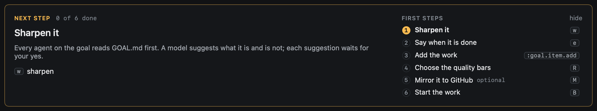
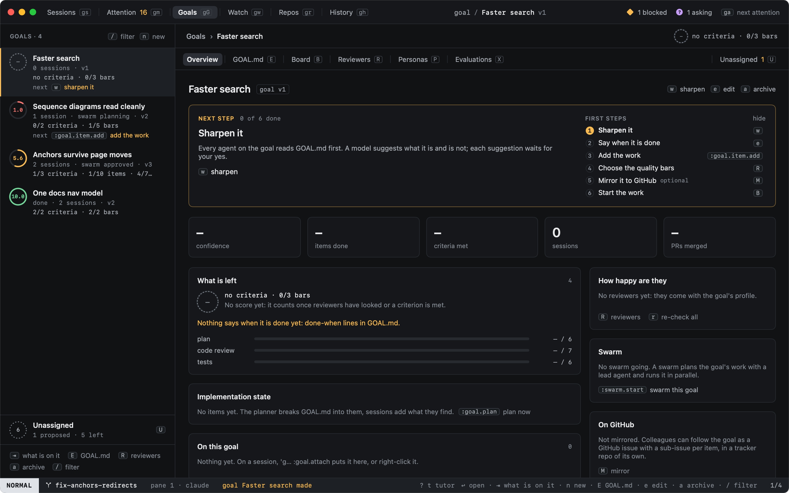
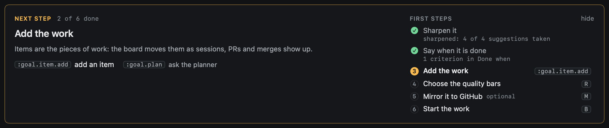
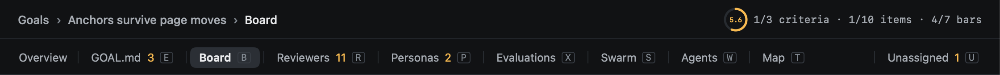
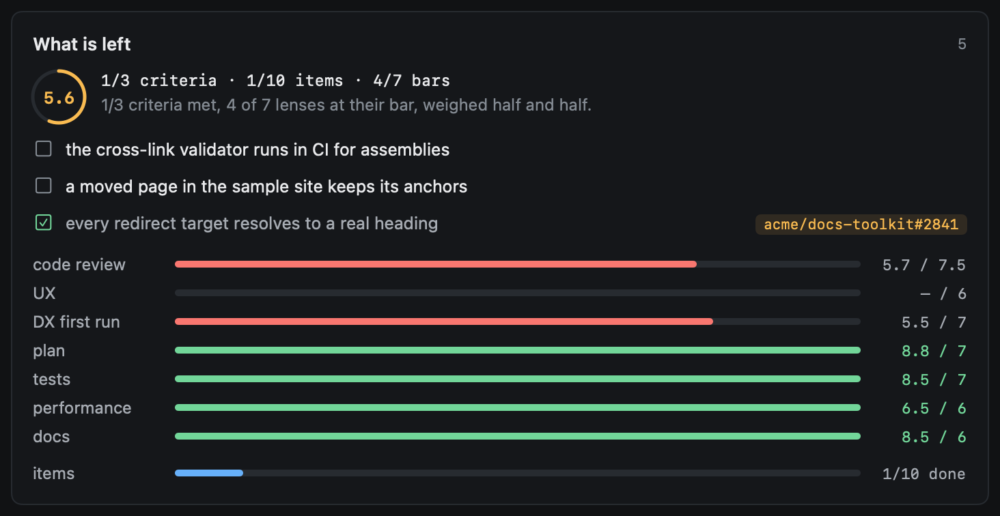
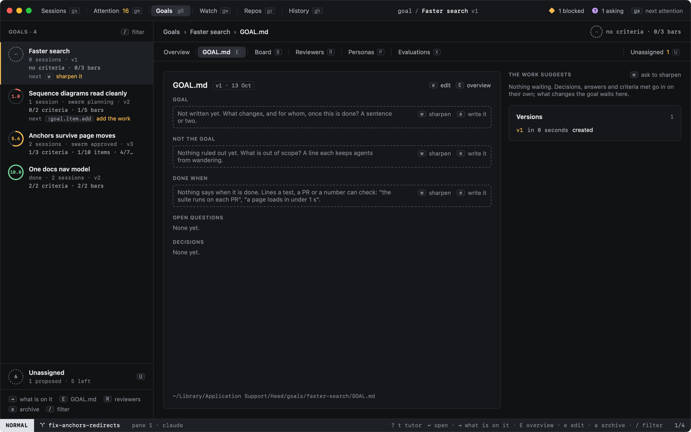

# Goals

A goal is work that outlives one session: a feature, a migration, a cleanup. Sessions, chats and their PRs belong to
it, and its `GOAL.md` says what the goal is, what it is not, when it is done, what is still open and what was decided.
`gG` (or `:goals`) opens Goals.


## A new goal, step by step

A new goal opens on its overview with a **Next step** card: what to do now, why it matters, and its key or button.
Beside it are all the first steps, each ticked off by what is true of the goal, never by a click:

1. **Sharpen it** (`w`). A model suggests what the goal is and what it is not; each suggestion waits in `GOAL.md` for
   your yes (`y`) or no (`n`). Done once you have answered them, or when `GOAL.md` already says what the goal is
   and is not.
2. **Say when it is done** (`e` edits `GOAL.md`). Done once **Done when** has a line. These lines are what evidence
   checks off and what the confidence ring counts.
3. **Add the work** (`:goal.item.add`, or `:goal.plan` to ask the planner). Done once the goal has an item.
4. **Choose the quality bars** (`R`). Done once heed has worked out the goal's profile and its bars, or you pinned one
   with `:goal.bar`.
5. **Mirror it to GitHub** (`M`), optional: it is listed but never the next step.
6. **Start the work** (`B`, then `s` on an item, or `:swarm.start`). Done once a session, chat or run is on the goal,
   or it has a swarm.



While the card shows, the goal's row in the list says its next step too. **hide** on the card (or `:goal.guide`)
hides it for that goal; it comes back on its own when a step it had ticked off stops being true (the done-when lines
were taken out, say), and `:goal.guide` shows it again.



After sharpening, the card has moved on:



## Where you are and how far it is

Above every pane of a goal, a line says where you are (`Goals › Anchors survive page moves › Board`; a click on the
goal's name goes back to its overview) and how far the goal is: its ring and `1/3 criteria · 2/11 items · 1/4 bars`.
Under it, a tab per pane with its key, and a count where something waits for you: changes in `GOAL.md`, open
objections in Reviewers, personas no one covers, the lead's questions in Swarm, what needs you in Agents, and asks in
Unassigned. Swarm shows once the goal has a swarm, Agents and Map once its plan is approved. A click on a tab opens it
as its key does.



## The list

Each goal shows its score ring, how many sessions and chats are on it, its `GOAL.md` version, how far it is (criteria
met, items done, bars reached) and, while its card shows, its next step. The ring is the
goal's confidence: how many of its done-when criteria are met and how close its reviewers are to the goal's quality
bars ([Quality bars](quality.md)). It shows `–` until there is something to count. Active goals come first, then done ones, then archived ones; `/` filters them.

| Key | |
|---|---|
| `j` `k` | Move through the goals |
| `⇥` | Move to what is on the goal, and back |
| `↩` | What is on the goal; on a session or chat, go there |
| `n` | New goal: a title and what it is |
| `E` | The goal's `GOAL.md` and its versions; again, the overview |
| `e` | Edit `GOAL.md` in place |
| `a` | Archive the goal; on an archived one, bring it back |
| `x` | Take the session or chat under the cursor off the goal |
| `B` | The goal as a board; again, the overview ([Items and the board](items.md)) |
| `w` | Ask a model to sharpen the goal; what it suggests waits in `GOAL.md` |
| `R` | The goal's reviewers and quality bars ([Reviewers](reviewers.md)); again, the overview |
| `r` | Re-check: every reviewer the goal needs looks again |
| `P` | Who the goal needs ([Personas](personas.md)); again, the overview |
| `X` | Stranger walks of the goal, their friction logs and scores ([Evaluations](evaluations.md)); again, the overview |
| `M` | Mirror the goal to GitHub for colleagues to follow; again, stop ([GitHub mirror](github.md)) |
| `S` | The goal's swarm: its plan, the lead's questions, versions and steering ([Swarms](swarms/index.md)); again, the overview |
| `W` `T` | The swarm's agents and its map, once its plan is approved; again, the overview |
| `U` | Unassigned: how heed put new work on goals, and its asks ([How work finds its goal](attach.md)) |

The capitals that open a goal's panes, `E` `B` `R` `P` `X` `U` `S` `W` `T`, work the same from every pane of Goals, and no
pane uses one for anything else. In a pane, a lowercase key acts on the thing under the cursor and means the same
wherever it applies: `s` starts a session on it, `c` a chat about it, `e` edits it, `x` drops it, `a` adds one (on the
board and in a swarm's plan), `r` does it again, and `y` and `n` answer a change waiting for you.

The lowercase keys in the table above act on the goal, so they work only here, in the overview and in `GOAL.md`. In
the board, Reviewers, Personas, Evaluations, Unassigned and the swarm's plan a key means that pane's own thing (`r` in
Reviewers re-checks its reviewers) or what it means outside Goals, and never archives, detaches or edits the goal.

Everything here also takes the mouse: a click picks a goal, a double-click opens it, and a right-click offers what
the keys do.

## The overview


The goal's title and statement, the next-steps card while it shows, then its numbers: its confidence (its basis on
hover), items done, criteria met (from **Done when**), the sessions and chats on it, and how many of their PRs merged.
**What is left** puts what still has to happen at one glance: the ring and what it is made of, the done-when criteria
not met first (met ones with their evidence), each quality bar against its score, under-bar ones first, and the items
done.


 **Implementation state** is the goal's items by stage (see
[Items and the board](items.md)). **On this goal** lists its sessions and chats newest first, closed ones too;
**Resulting PRs** lists their PRs with where each stands; **Needs you** lists the changes to `GOAL.md` waiting for
you, the open questions and the goal's sessions that wait on you; **Last time** is the newest ledger summary of one of
its sessions, so you see where the work was left. **How happy are they** lists its reviewers with their scores and which
way each moved; a click opens it in [Reviewers](reviewers.md). **On GitHub** shows where the goal mirrors to, its
meta issue and its last sync, and a colleague's change waiting for your answer ([GitHub mirror](github.md)).

## GOAL.md


`GOAL.md` is a plain file in `~/Library/Application Support/Heed/goals/<goal>/`, next to `links.json` (what is on the
goal). Its sections are **Goal**, **Not the goal**, **Done when** (`- [x] criterion (evidence: …)`), **Open
questions** and **Decisions** (`- decision (source: …)`); sections of your own are kept as you wrote them.

A section that is missing or thin does not show blank: it shows the question it should answer, in a dashed box with
`w` and `e` beside it, and a done-when line nothing could check ("it feels better") is marked vague. An unfinished goal
looks unfinished.



`e` edits it in place; `⎋` or `⌘S` saves it. Every save is a new version, listed on the right with what changed and
the lines it took out and put in. A click on **restore** (or `:goal.restore 2`) makes an older version current again,
as a new version, so nothing is lost. The work writes into `GOAL.md` too; see
[What the work suggests](items.md#what-the-work-suggests).

## Putting work on a goal

- On a session or chat: right-click › **Put on a goal…**, or `:goal.attach` and the goal (`⇥` completes). A session
  is on one goal at a time; attaching it to another moves it.
- **New goal from this session…** (right-click, or `:goal.new` in Sessions) starts the dialog with the session's title
  and prompt, and puts the session on the new goal.
- `:goal.detach`, or **Take off** in the inspector, takes it off.
- Most of the time you do none of this: heed puts new work on its goal itself, and asks with one key when it is
  unsure. See [How work finds its goal](attach.md).


A session on a goal carries the goal's name on its row, and the inspector shows the goal between the worktree and the
links. `'g` jumps from a session to its goal.


## Agents read the goal

When a session or chat on a goal starts or resumes, its agent is told which goal the work belongs to, to read the
goal's `GOAL.md` first and to keep to its **Not the goal** list, and how to keep the goal itself with `heed goal`:
claude through heed's `heed-goal` skill (a plugin loaded for the session only), codex through its developer
instructions. See [Agents keep the goal](cli.md). Turn it off with `tell_agents = false` under `[goals]` in
config.toml, or in Settings › General › Goals.

```toml
[goals]
tell_agents = true
```
